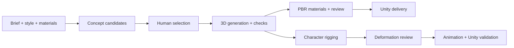

<div align="center">

# SlopForge

**Turn an asset brief into a reviewed 3D game asset.**


<sub>Each prop was generated from a written brief on an H100 and imported into Unity, with no manual repair.</sub>

[](https://github.com/gysahlgreene/SlopForge/actions/workflows/ci.yml)
[](docs/INSTALL.md)
[](LICENSE)
[](https://buymeacoffee.com/eoinmacd95f)

[Get started](docs/INSTALL.md) · [Documentation](docs/README.md) · [Examples](docs/EXAMPLES.md)

</div>

SlopForge connects ComfyUI generation, Blender processing, human review, and Unity delivery. Run inference locally or on a remote GPU, and keep your assets, approval decisions and provenance in your own project.

## What it makes

| Asset type | Status | Evidence |
| --- | --- | --- |
| [Props](#props) — pickups, furniture, containers, devices | **Provisional** on the H100 `final` tier: three briefs, two independent runs each, passed every check through Unity import. Not yet Qualified | Ten props as lit turntables, each with concept, Blender and Unity URP views |
| [Characters](#characters) — rigged humanoids | Generated in four art styles, rigged automatically and walking; experimental, well below shippable model quality | Four characters walking as lit turntables; one character with Unity Humanoid playback |
| [Structures and environments](#structures-and-environments) — buildings, ruins, modular kits | **Modular kits assemble in Unity** with a shared kit material and fit checks in the engine; standalone structures are generated end to end. Active milestone, not yet qualified | A 25-piece stone-kit courtyard assembled in Unity; six structures as lit turntables |
| Weapons and mechanical assets, creatures | Planned on the [roadmap](ROADMAP.md) | — |

Every 3D asset type shares the same [materials and textures](#materials-and-textures) stage. Generation is stochastic: candidates must pass checks and human review, or the pipeline reports failure. A successful export alone does not make an asset game-ready.

## Props

**Three briefs, two independent runs each** (2026-10-21):

| Supply crate | Glazed jug | Stone lantern |
| :---: | :---: | :---: |
|  |  |  |
|  |  |  |
| <sub>oak planks + wrought iron</sub> | <sub>cobalt glaze + cork + twine</sub> | <sub>granite + glowing paper + wood</sub> |

**Four more kinds of prop, one run each** (2026-10-22):

| Cast-iron pot | Sci-fi fuel canister | Mossy tree stump | Brass lantern |
| :---: | :---: | :---: | :---: |
|  |  |  |  |
| <sub>all cast iron</sub> | <sub>paint + steel + glow strip</sub> | <sub>bark + moss + mushrooms</sub> | <sub>brass + glass globe</sub> |

Each prop was generated on an H100 from a written brief through `generate` → `approve`, with no manual repair, then imported into a fresh Unity 6000.6.3f1 / URP 17.6.0 project. Every run is checked from the concept through to the engine:


*Brass lantern: the selected concept (left), Blender review views (top) and Unity URP renders (bottom). The globe is a second, transparent material.*

**What the evidence supports.** All six runs of the three protocol briefs passed every stage and every owner-accepted threshold:
- at most five parts, 30,000 triangles and one 4096² material;
- colour within the accepted limits of the concept's hue and saturation (grey concepts are not checked);
- the glowing parts found;
- no metal on non-metal briefs.

That makes static props on this tier **Provisional**. The owner reviewed the runs and rated them better than earlier rounds. Two runs per brief cannot measure a failure rate, so nothing is Qualified.

**Known limits:**
- **Unseen sides are invented.** The canister's front strip was copied onto its sides and back as darker panels ([#63](https://github.com/gysahlgreene/SlopForge/issues/63)).
- **Wording does not always hold proportions.** Every stump's trunk came out taller than wide whatever the wording. An opt-in shape guide fixed it in 12 of 12 concepts and one run through Unity ([evidence](docs/media/concept-proportion-2026-10/README.md), [#65](https://github.com/gysahlgreene/SlopForge/issues/65)).
- **Some surfaces differ from the concept:**
  - crate wood comes out paler than its concept;
  - one crate's open top was rebuilt closed;
  - one jug shows ribbing in Unity.
- **Glass:** glass parts work, but an object made entirely of glass does not reconstruct reliably.
- **Not covered by the checks:** the colour of small parts. Unity is checked in editor batch renders, not in Play mode.

[Protocol evidence →](docs/media/props-provisional-2026-10-v5/README.md) · [New prop kinds →](docs/media/props-coverage-2026-10/README.md) · [Earlier showcase (2026-10-18) →](docs/media/material-showcase-2026-10/README.md)

The brass lantern above was made from this brief:

```sh
slopforge --project ~/UnityProjects/MyGame generate prop brass_lantern "Brass hurricane lantern" --aspect portrait \
  --image-prompt "Front three-quarter view of one brass hurricane lantern, taller than it is wide. A rounded glass globe in the middle, drawn as a solid smooth pale surface with a faint sheen, nothing visible through it. Brass wire guards around the globe. A ring handle on top. A round brass base. Complete object, isolated on a plain light-grey background." \
  --material "frame=metal: aged brass" --material "globe=glass: clear glass"
slopforge --project ~/UnityProjects/MyGame candidates brass_lantern
slopforge --project ~/UnityProjects/MyGame approve brass_lantern 1
slopforge --project ~/UnityProjects/MyGame approve-texture brass_lantern 1
```

Inspect the concept, mesh views, materials, and validation report before each approval. [Writing briefs that reconstruct well →](docs/AGENT-INTEGRATION.md#mesh-aware-materials) · [More prop examples →](docs/EXAMPLES.md)

## Characters

| Realistic | Stylized hero | Anime | Hand-painted |
| :---: | :---: | :---: | :---: |
|  |  |  |  |

Each character is generated from a brief (a pose-conditioned concept, then TRELLIS.2 on an H100), rigged automatically with SkinTokens, and retargeted to a motion-capture walk with no manual repair. The rigging and walk are solid; the models are not yet game quality: forms are lumpy, faces soft and fingers fused, the limits of current open single-image 3D generation. Experimental and unapproved. [How they were made, evidence and limits →](docs/media/character-styles-2026-10/README.md)

Unity playback is shown separately: an earlier test character has a valid Unity Humanoid Avatar and plays a retargeted walk ([Unity evidence →](docs/media/character-qualification-2026-10/basalt-warden-unity-preview/README.md) · [diagnostic rig benchmark →](docs/media/character-qualification-2026-10/basalt-corrected-humanoid/README.md)).

Characters continue through [readiness and rigging](docs/CHARACTER-RIGGING.md), then [animation validation](docs/CHARACTER-ANIMATIONS.md).

## Structures and environments

**Modular kits, assembled in Unity.** The shipped `stone_ruin_kit` recipe makes a floor tile, wall, doorway, corner and column at real 3 m sizes. Then `environment-scene` builds a courtyard from them in Unity:


- **The pieces fit together:**
  - every module stands on its declared pivot, so walls stand on the floor's walkable top;
  - every module has a collider and static flags;
  - neighbouring modules meet with no seam gaps;
  - corners turn themselves to open inward.

  Unity checks all of this; it isn't judged by eye.
- **The pieces match:** the kit names one stone texture, and every module's colour is baked from it while keeping its own carved detail. Before this, columns came out sandy beside grey walls ([before and after](docs/media/kit-material-2026-10/README.md)).
- **Bad modules are caught:** a corner that reconstructs as a solid block is rejected, and the next seed is tried.

```sh
slopforge --project ~/UnityProjects/MyGame recipe run stone_ruin_kit --name ruin
slopforge --project ~/UnityProjects/MyGame approve ruin_stone 1
slopforge --project ~/UnityProjects/MyGame approve ruin_wall 1
slopforge --project ~/UnityProjects/MyGame environment-scene ruin courtyard
```

Approve the kit's stone texture first. Then approve each module and publish it with `approve-texture` before building the scene.

**Limits:**
- These are two live runs of one kit, selected for evaluation and not visually approved.
- Wall and corner thickness are not declared yet, so a corner steps out where walls continue it.
- One doorway was squeezed 45% to fit its size.
- Unseen wall backs keep some invented patchiness.

[Kit evidence →](docs/media/kit-material-2026-10/README.md) · [Unity assembly →](docs/media/kit-scene-2026-10/README.md) · [Environment kits guide →](docs/ENVIRONMENT-KITS.md) · [M2 epic →](https://github.com/gysahlgreene/SlopForge/issues/89)

**Standalone structures** use the `architecture` asset type, with the same brief-declared materials as props:

| Stone well | Market stall | Stone shrine |
| :---: | :---: | :---: |
|  |  |  |
| **Watchtower** | **Ruined arch** | **Sci-fi bunker** |
|  |  |  |

These are one run each (2026-10-18), not yet visually approved. They are still sized to 1 m and don't get the prop checks yet ([#92](https://github.com/gysahlgreene/SlopForge/issues/92)). [Structure evidence and limits →](docs/media/structure-showcase-2026-10/README.md)

## Materials and textures


Every 3D asset gets mesh-aware PBR materials generated with its geometry: base color, roughness, metallic, a baked tangent-space normal map and, for declared glowing parts, an emission map, at 4096² on the H100 final profile.

- **Material regions:** the brief declares `nonmetal`, `metal`, `emissive[#rrggbb]` or `glass[#rrggbb]` per region. Glass faces get a second, transparent URP material in Unity.
- **Reconstruction-ready concepts:** every 3D concept prompt asks for even lighting, matte non-metals, thick parts, and glowing or glass parts drawn as solid surfaces so they reconstruct whole.
- **Clean geometry:** raw shapes are remeshed on the GPU, and normals are baked against the full-detail mesh, so thin planks, handles and lattices survive. UV islands are padded by 4 texels and packed tightly.
- **Checks before review:** a candidate is rejected, and the next seed tried, when any of these fail:
  - it has more than five parts;
  - its silhouette does not fit the concept (this catches shattered meshes);
  - its colour drifts from the concept;
  - a declared glowing or glass part is not found.

  A metallic map that contradicts an all-non-metal brief also fails before review. Placeholder normal maps cannot be approved.

[How materials are made →](docs/MATERIALS.md)

## How it works



- **Generate:** props, collectibles, architecture, and humanoid character candidates using configurable ComfyUI workflows.
- **Prepare:** inspect geometry, preserve sources, process meshes and PBR maps, and render review views and turntables in Blender.
- **Review:** compare candidates, approve explicitly, and retain failed attempts and processing evidence.
- **Coordinate:** resume recipes, reuse style/reference libraries, and select quality tiers with bounded candidate budgets.
- **Deliver:** export models/materials, assemble kit layouts into Unity scenes, and prepare character animation tooling for Unity.

## Quick start

Requires **Python 3.10–3.14**, Blender, a compatible ComfyUI service, and an existing Unity project. Model weights and custom nodes are installed separately.

```sh
git clone https://github.com/gysahlgreene/SlopForge.git
cd SlopForge
python3 -m venv .venv
source .venv/bin/activate
pip install -e .
slopforge init ~/UnityProjects/MyGame
slopforge --project ~/UnityProjects/MyGame doctor
```

[Installation](docs/INSTALL.md) covers dependencies. [ComfyUI configuration](docs/COMFYUI.md) covers local/remote inference and model/workflow compatibility. Then follow the [props](#props) or [characters](#characters) example above.

## What is qualified today?

| Area | Current evidence |
| --- | --- |
| Generation, candidate tracking, recipes, provenance | Implemented; offline tests and selected live GPU runs. Visual quality depends on the model and brief. |
| Static props | **Provisional** for `h100`/`final`, commit `221c8d1`, Unity 6000.6.3f1 / URP 17.6.0 import. Three briefs × two independent runs passed every stage and owner-accepted threshold ([criterion v5](docs/media/props-provisional-2026-10-v5/QUALIFICATION-RECORD.md)). Four more prop kinds passed end to end in single exploratory runs; the stump passed only after a UV fix prompted by its failed first run. Not Qualified: six runs cannot measure a failure rate. |
| Material and texture generation | Declared non-metal, metal, emissive and glass regions, with baked normal maps at 4096². Candidates are checked for part count, concept fit, colour against the concept, glowing and glass parts, and metal. The colour of small parts is not checked. |
| Structures and modular kits | Two live runs of the stone ruin kit went from a fresh project to a 25-piece Unity courtyard. Modules came out at their declared 3 m sizes and pivots, with colliders and static flags, no seam gaps, and matching stone from a shared kit material. Six standalone structures were generated (2026-10-18). Not qualified: M2 criteria are not declared yet ([#94](https://github.com/gysahlgreene/SlopForge/issues/94)), and joints, stretch, budgets and visual approval are open. |
| Mesh/material preparation and Unity delivery | 30 protocol prop runs imported into Unity URP with materials assigned, rendered in editor batch mode. Publication through `approve-texture` is shown on one live asset. Play mode and in-scene checks are not run. |
| Humanoid rigging | Four generated characters in four art styles rig automatically with SkinTokens and walk on retargeted motion capture (natural stride, clean feet and shoulders); not approved, and model quality is well below target. Humanoid test 1 has a valid Unity Humanoid Avatar and visible walk playback. A separate diagnostic rig has approved body deformation. |
| Third-party motion retargeting | Humanoid test 1 demonstrates looping idle/walk playback and measured skinned-mesh movement. Broader movement, deformation approval, and production qualification remain open. |
| Safe Unity replacement/reimport | Implemented for props: republishing keeps GUIDs and texture references, and a prefab follows a republished mesh. If a GUID changes, approval stops and the previous files are restored. Checked by an opt-in live Unity test; a deleted `.meta` is only exercised on a fresh checkout. |

Full finger animation is not available on the diagnostic humanoid rig. Reference-input plumbing exists, but the bundled concept graph is text-only. SlopForge does not assemble game scenes or ship sprites; the pipeline remains a qualified asset workflow rather than a game engine.

## Find your way around

Contributors: read [AGENTS.md](AGENTS.md), the [product contract](docs/PRODUCT_CONTRACT.md), [pipeline contract](docs/PIPELINE_CONTRACT.md), and [current state](CURRENT_STATE.md). Run `make verify` before declaring implementation complete.

| Directory | Purpose |
| --- | --- |
| `slopforge/` | CLI, asset lifecycle, recipes, providers, and Unity integration |
| `blender/` · `processing/` | Background mesh, rigging, turntable and image helpers |
| `workflows/` · `templates/` | ComfyUI graphs, requirement declarations, and project defaults |
| `tests/` | Offline checks and opt-in Blender, Unity, and GPU integrations |
| `docs/` | User guides, contributor notes, and selected qualification examples |

[Contributing](CONTRIBUTING.md) · [Security and publishing](SECURITY.md) · [MIT license](LICENSE) · [Third-party notices](THIRD_PARTY_NOTICES.md)
