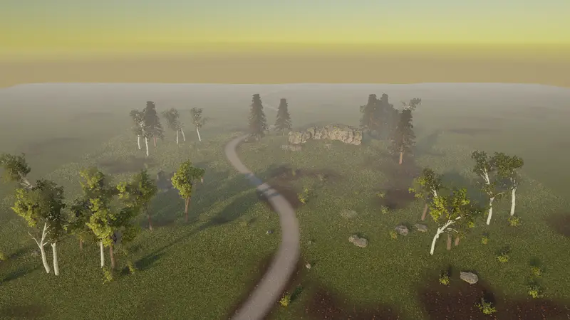
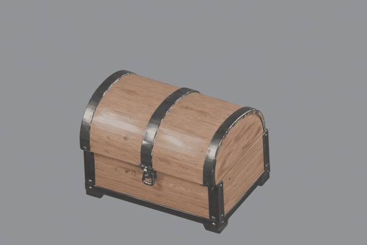
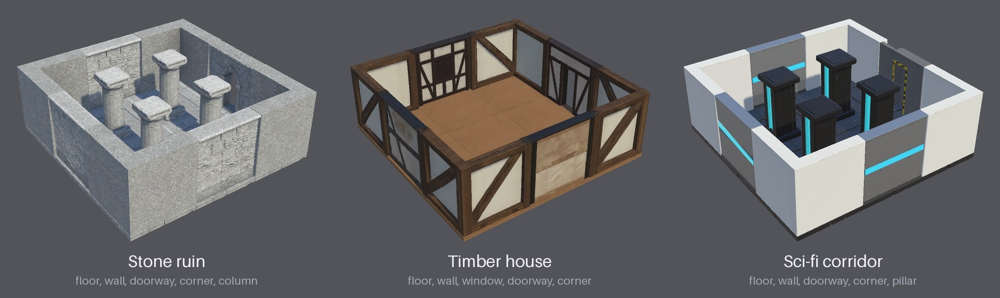
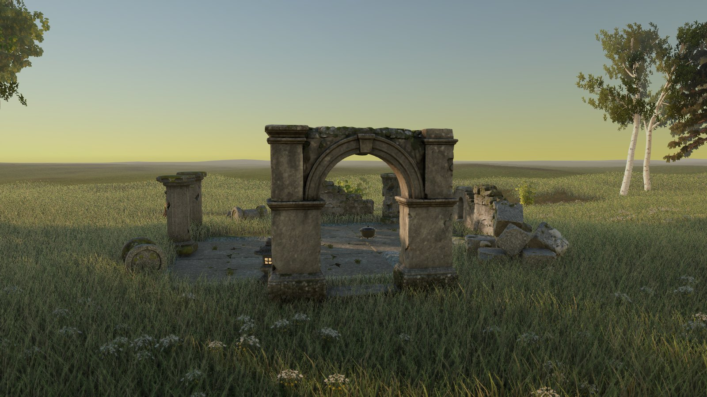
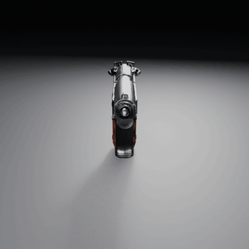
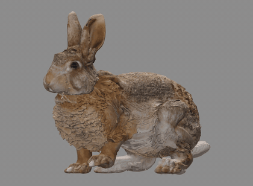
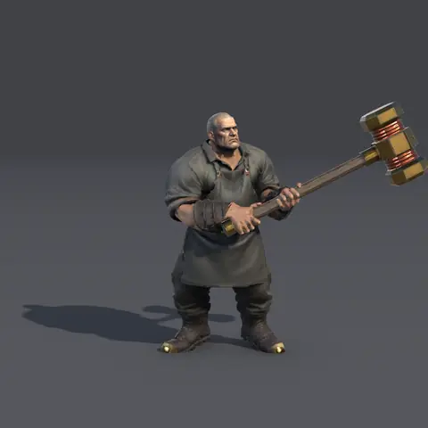
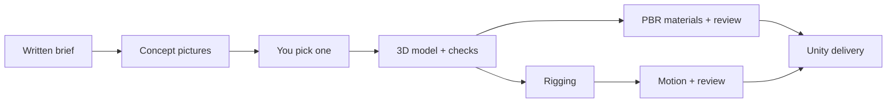

<div align="center">

# SlopForge

**Turn a written brief into a reviewed 3D game asset.**



<sub>Every rock, ruin, prop, tree, flower and ground surface in this Unity scene was generated from a written brief and assembled by one recipe, with no manual repair. [How it was made →](docs/SHOWCASE.md#scenes-and-natural-environments)</sub>

[](https://github.com/gysahlgreene/SlopForge/actions/workflows/ci.yml)
[](docs/INSTALL.md)
[](LICENSE)
[](https://buymeacoffee.com/eoinmacd95f)

[Get started](docs/INSTALL.md) · [Gallery](docs/SHOWCASE.md) · [Documentation](docs/README.md) · [Status](CURRENT_STATE.md#summary)

</div>

SlopForge connects ComfyUI generation, Blender processing, human review and Unity delivery. You write a brief, approve the results you like, and get assets in your Unity project. Inference runs locally or on a remote GPU, and your assets, approvals and provenance stay in your own project.

## What it makes

| | |
| :---: | :--- |
|  | **[Props](docs/SHOWCASE.md#props)** · Provisional<br>Pickups, furniture, containers and devices. Three briefs, two independent runs each, passed every check through Unity import. |
|  | **[Moving parts](docs/SHOWCASE.md#props)** · Experimental<br>A chest with a working lid and a pistol with a slide and trigger, published to Unity and checked in Play mode. |
|  | **[Modular kits and structures](docs/SHOWCASE.md#structures-and-environments)** · Provisional for kits<br>Three kits, two independent runs each, passed every check through an assembled Unity scene. The owner judged their look below the props'. |
|  | **[Scenes and natural environments](docs/SHOWCASE.md#scenes-and-natural-environments)** · Experimental<br>Terrain, rocks, trees, ground cover and showcase scenes. One moorland scene, rebuilt by a recipe from a blank project. A render, not a game level. |
|  | **[Weapons](docs/SHOWCASE.md#weapons)** · Experimental<br>A pistol, a longsword and a crossbow, one run each. The owner accepted the look for now. |
|  | **[Creatures](docs/SHOWCASE.md#creatures)** · Experimental<br>A wolf and a rabbit, rigged automatically and played in Unity. One brief each. |
|  | **[Characters](docs/SHOWCASE.md#characters)** · Experimental<br>Humanoids built from a separate head and body, with weapons held in both hands. Motion and close-ups are still rough, and none has been played in a game. |

Every 3D type shares the same [materials and textures](docs/SHOWCASE.md#materials-and-textures) stage. Generation is stochastic: candidates must pass checks and human review, or the pipeline reports failure. A successful export alone does not make an asset game-ready.

## How it works



Failed candidates are kept, and each stage records what made it, so a run can resume or be traced later. [More about the pipeline →](docs/ARCHITECTURE.md)

## Quick start

Requires **Python 3.10–3.14**, Blender, a compatible ComfyUI service, and an existing Unity project. Model weights and custom nodes are installed separately: see [installation](docs/INSTALL.md) and [ComfyUI configuration](docs/COMFYUI.md).

```sh
git clone https://github.com/gysahlgreene/SlopForge.git
cd SlopForge
python3 -m venv .venv
source .venv/bin/activate
pip install -e .
slopforge init ~/UnityProjects/MyGame
slopforge --project ~/UnityProjects/MyGame doctor
```

Then make a prop. Look at the concept, mesh views, materials and validation report before each approval:

```sh
slopforge --project ~/UnityProjects/MyGame generate prop brass_lantern "Brass hurricane lantern" --aspect portrait \
  --image-prompt "Front three-quarter view of one brass hurricane lantern, taller than it is wide. A rounded glass globe in the middle, drawn as a solid smooth pale surface with a faint sheen, nothing visible through it. Brass wire guards around the globe. A ring handle on top. A round brass base. Complete object, isolated on a plain light-grey background." \
  --material "frame=metal: aged brass" --material "globe=glass: clear glass"
slopforge --project ~/UnityProjects/MyGame candidates brass_lantern
slopforge --project ~/UnityProjects/MyGame approve brass_lantern 1
slopforge --project ~/UnityProjects/MyGame approve-texture brass_lantern 1
```

[More examples →](docs/EXAMPLES.md) · [Writing briefs that reconstruct well →](docs/AGENT-INTEGRATION.md#mesh-aware-materials)

## Status

- **Experimental:** being explored, with results and failures recorded and no claim of reliability.
- **Provisional:** repeated evidence supports a limited scope, but the full criteria aren't met.
- **Qualified:** meets all its declared criteria. Nothing is Qualified yet.

[Where each area stands →](CURRENT_STATE.md#summary) · [What the words require →](docs/QUALITY_CONTRACT.md)

## Built with

[Z-Image Turbo](https://huggingface.co/Tongyi-MAI/Z-Image-Turbo) for concepts, [TRELLIS.2](https://huggingface.co/microsoft/TRELLIS.2-4B) for shapes and materials, [ComfyUI](https://github.com/comfyanonymous/ComfyUI) for inference, [Blender](https://www.blender.org/) for mesh work and [Unity](https://unity.com/) for delivery, among others. No model weights are bundled. **Built with DINOv3**, which TRELLIS.2 uses and whose licence requires this attribution. [Every model and tool, with its licence →](THIRD_PARTY_NOTICES.md#models-and-tools)

## Find your way around

| Directory | Purpose |
| --- | --- |
| `slopforge/` | CLI, asset lifecycle, recipes, providers, and Unity integration |
| `blender/` · `processing/` | Background mesh, rigging, turntable and image helpers |
| `workflows/` · `templates/` | ComfyUI graphs, requirement declarations, and project defaults |
| `tests/` | Offline checks and opt-in Blender, Unity, and GPU integrations |
| `docs/` | User guides, contributor notes, and selected qualification examples |

Contributors: read [AGENTS.md](AGENTS.md), the [product contract](docs/PRODUCT_CONTRACT.md), [pipeline contract](docs/PIPELINE_CONTRACT.md), and [current state](CURRENT_STATE.md). Run `make verify` before declaring implementation complete.

[Contributing](CONTRIBUTING.md) · [Security and publishing](SECURITY.md) · [MIT license](LICENSE) · [Third-party notices](THIRD_PARTY_NOTICES.md)
