<div align="center">

# SlopForge

**Turn an asset brief into a reviewed 3D game asset.**

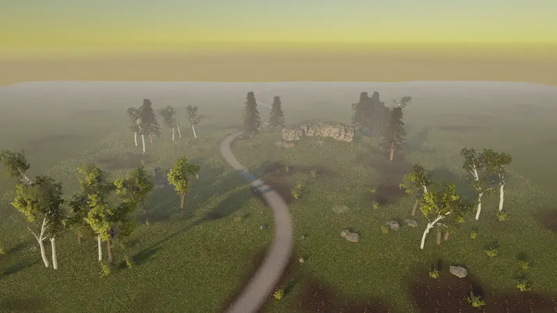

<sub>Every rock, ruin, prop, tree, flower and ground surface in this Unity scene was generated from a written brief and assembled by one recipe, with no manual repair. [How it was made →](#scenes-and-natural-environments)</sub>

[](https://github.com/gysahlgreene/SlopForge/actions/workflows/ci.yml)
[](docs/INSTALL.md)
[](LICENSE)
[](https://buymeacoffee.com/eoinmacd95f)

[Get started](docs/INSTALL.md) · [Documentation](docs/README.md) · [Examples](docs/EXAMPLES.md)

</div>

SlopForge connects ComfyUI generation, Blender processing, human review, and Unity delivery. Run inference locally or on a remote GPU, and keep your assets, approval decisions and provenance in your own project.

## What it makes

| Asset type | Status | Evidence |
| --- | --- | --- |
| [Props](#props) — pickups, furniture, containers, devices | **Provisional** on the H100 `final` tier: three briefs, two independent runs each, passed every check through Unity import. Not yet Qualified. A chest with a hinged lid works through a spike | Ten props as lit turntables, each with concept, Blender and Unity URP views; the chest's lid in motion |
| [Characters](#characters) — rigged humanoids | Generated in four art styles, rigged automatically and walking; experimental, well below shippable model quality | Four characters walking as lit turntables; one character with Unity Humanoid playback |
| [Structures and environments](#structures-and-environments) — buildings, ruins, modular kits | **Provisional** for modular kits on the H100 `final` tier: three kits, two independent runs each, passed every check through an assembled Unity scene. Standalone structures are generated at real size. Not yet Qualified | Stone, timber and sci-fi rooms assembled in Unity; three real-size structures and three ruin pieces as lit turntables |
| [Scenes and natural environments](#scenes-and-natural-environments) — terrain, rocks, trees, ground cover, assembled showcases | **Experimental**: one moorland scene, approved by the owner, built from briefs and rendered in Unity with a flythrough; now a recipe and `scene-render`, rebuilt live from a fresh project | The flythrough above; six stills |
| [Weapons](#weapons) — pistols, swords, crossbows | **Experimental**: a pistol, a longsword and a crossbow through the full pipeline, each from one brief with no manual repair; the owner accepted the look for now (2026-10-24). The pistol's slide and trigger publish as a Unity prefab whose parts move as declared, checked in Play mode. The protocol comes next | The pistol in motion; three weapons as lit turntables beside their concepts |
| Creatures | Planned on the [roadmap](ROADMAP.md) | — |

Every 3D asset type shares the same [materials and textures](#materials-and-textures) stage. Generation is stochastic: candidates must pass checks and human review, or the pipeline reports failure. A successful export alone does not make an asset game-ready.

## Props

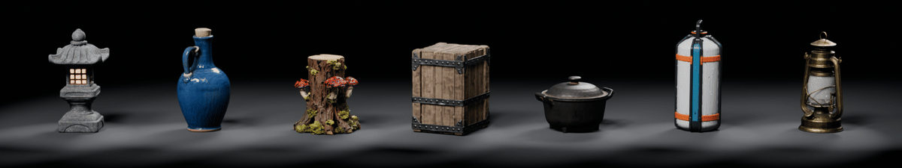

**Three briefs, two independent runs each** (2026-10-21):

| Supply crate | Glazed jug | Stone lantern |
| :---: | :---: | :---: |
| 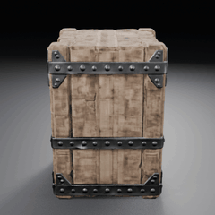 | 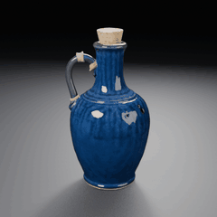 | 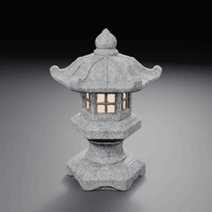 |
| 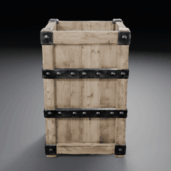 | 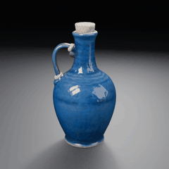 | 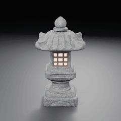 |
| <sub>oak planks + wrought iron</sub> | <sub>cobalt glaze + cork + twine</sub> | <sub>granite + glowing paper + wood</sub> |

**Four more kinds of prop, one run each** (2026-10-22):

| Cast-iron pot | Sci-fi fuel canister | Mossy tree stump | Brass lantern |
| :---: | :---: | :---: | :---: |
| 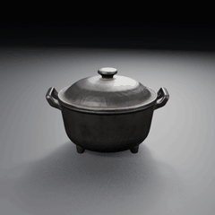 | 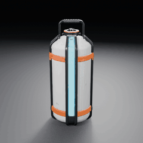 | 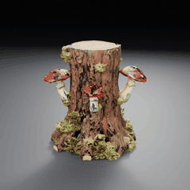 | 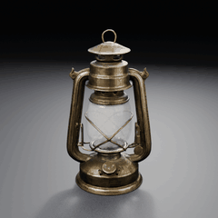 |
| <sub>all cast iron</sub> | <sub>paint + steel + glow strip</sub> | <sub>bark + moss + mushrooms</sub> | <sub>brass + glass globe</sub> |

Each prop was generated on an H100 from a written brief through `generate` → `approve`, with no manual repair, then imported into a fresh Unity 6000.6.3f1 / URP 17.6.0 project. Every run is checked from the concept through to the engine:

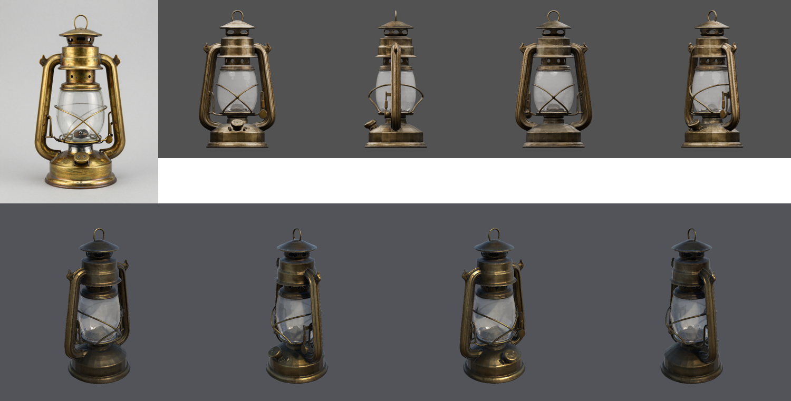

*Brass lantern: the selected concept (left), Blender review views (top) and Unity URP renders (bottom). The globe is a second, transparent material.*

**What the evidence supports.** All six runs of the three protocol briefs passed every stage and every owner-accepted threshold:
- at most five parts, 30,000 triangles and one 4096² material;
- colour within the accepted limits of the concept's hue and saturation (grey concepts are not checked);
- the glowing parts found;
- no metal on non-metal briefs.

That makes static props on this tier **Provisional**. The owner reviewed the runs and rated them better than earlier rounds. Two runs per brief cannot measure a failure rate, so nothing is Qualified.

**Known limits:**
- **Unseen sides are invented.** The canister's front strip was copied onto its sides and back as darker panels ([#63](https://github.com/gysahlgreene/SlopForge/issues/63)).
- **Wording does not always hold proportions.** Every stump's trunk came out taller than wide whatever the wording. An opt-in shape guide fixed it in 12 of 12 concepts and one run through Unity ([evidence](docs/media/concept-proportion-2026-10/README.md), [#65](https://github.com/gysahlgreene/SlopForge/issues/65)).
- **Some surfaces differ from the concept:**
  - crate wood comes out paler than its concept;
  - one crate's open top was rebuilt closed;
  - one jug shows ribbing in Unity.
- **Glass:** glass parts work, but an object made entirely of glass does not reconstruct reliably.
- **Not covered by the checks:** the colour of small parts. Unity is checked in editor batch renders, not in Play mode.

[Protocol evidence →](docs/media/props-provisional-2026-10-v5/README.md) · [New prop kinds →](docs/media/props-coverage-2026-10/README.md) · [Earlier showcase (2026-10-18) →](docs/media/material-showcase-2026-10/README.md)

**Props with moving parts** (2026-10-26):

<p align="center">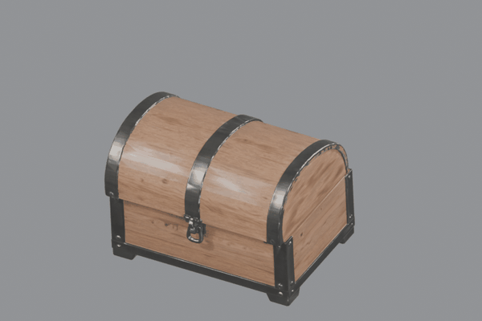</p>

A chest's lid on its hinge. The chest was generated open from an edit of its concept, so its inside comes from a
picture, and its lid was fitted shut before the final pass. It passed the final pass's checks and is a spike, not yet
published. [Evidence and limits →](docs/media/moving-parts-2026-10/README.md)

The brass lantern above was made from this brief:

```sh
slopforge --project ~/UnityProjects/MyGame generate prop brass_lantern "Brass hurricane lantern" --aspect portrait \
  --image-prompt "Front three-quarter view of one brass hurricane lantern, taller than it is wide. A rounded glass globe in the middle, drawn as a solid smooth pale surface with a faint sheen, nothing visible through it. Brass wire guards around the globe. A ring handle on top. A round brass base. Complete object, isolated on a plain light-grey background." \
  --material "frame=metal: aged brass" --material "globe=glass: clear glass"
slopforge --project ~/UnityProjects/MyGame candidates brass_lantern
slopforge --project ~/UnityProjects/MyGame approve brass_lantern 1
slopforge --project ~/UnityProjects/MyGame approve-texture brass_lantern 1
```

Inspect the concept, mesh views, materials, and validation report before each approval. [Writing briefs that reconstruct well →](docs/AGENT-INTEGRATION.md#mesh-aware-materials) · [More prop examples →](docs/EXAMPLES.md)

## Characters

| Realistic | Stylized hero | Anime | Hand-painted |
| :---: | :---: | :---: | :---: |
| 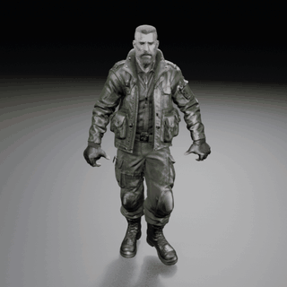 | 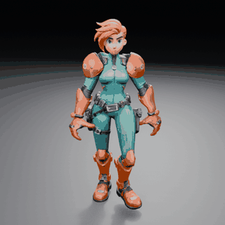 | 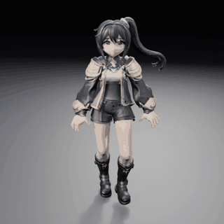 | 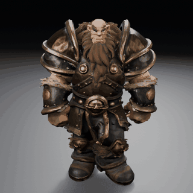 |

Each character is generated from a brief (a pose-conditioned concept, then TRELLIS.2 on an H100), rigged automatically with SkinTokens, and retargeted to a motion-capture walk with no manual repair. The rigging and walk improved through owner review but are not approved; the models are not yet game quality: forms are lumpy, faces soft and fingers fused, the limits of current open single-image 3D generation. Experimental and unapproved. [How they were made, evidence and limits →](docs/media/character-styles-2026-10/README.md)

Unity playback is shown separately: an earlier test character has a valid Unity Humanoid Avatar and plays a retargeted walk ([Unity evidence →](docs/media/character-qualification-2026-10/basalt-warden-unity-preview/README.md) · [diagnostic rig benchmark →](docs/media/character-qualification-2026-10/basalt-corrected-humanoid/README.md)).

Characters continue through [readiness and rigging](docs/CHARACTER-RIGGING.md), then [animation validation](docs/CHARACTER-ANIMATIONS.md).

## Structures and environments

**Three modular kits, assembled in Unity** (2026-10-23). Every module is generated from a written brief at its real
size, checked, published to Unity as a prefab, and placed by the kit's layout. There is no manual repair:

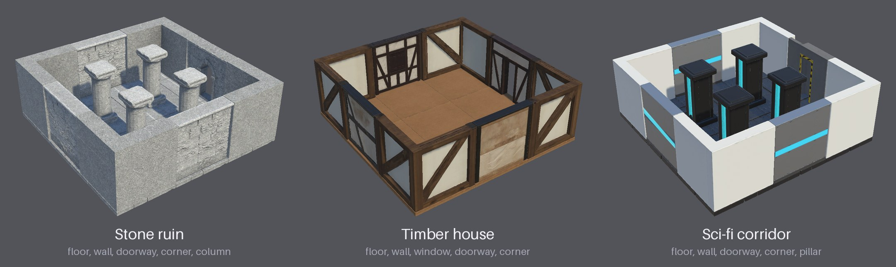

| Kit | Modules | One look across the kit | Protocol runs |
| --- | --- | --- | --- |
| `stone_ruin_kit` | floor, wall, doorway, corner, column | one stone texture sets every module's tint and finish | 2 of 2 passed |
| `timber_house_kit` | floor, wall, window, doorway, corner | dark oak beams and lime plaster, declared per module | 2 of 2 passed |
| `scifi_corridor_kit` | floor, wall, doorway, corner, pillar | painted panels, steel and a cyan light strip | 2 of 2 passed |

All six runs passed every owner-accepted check, so modular kits on this tier are **Provisional**:
- **The pieces fit:**
  - every module is within 5 cm of its declared size and pivot on a 3 m grid;
  - corner arms are as thick as the walls, so joints run flush;
  - Unity finds no seam gap wider than 1 mm.
- **The pieces keep their shape:** no module is stretched more than 1.3 times to reach its size. A corner that
  reconstructs as a solid block or a wedge is rejected, and the next seed is tried.
- **The pieces match their concepts:** concept fit is at least 0.89, and colour stays within the accepted limits
  (hue and saturation; the check for textures turned dark came after these runs).
- **Ready for a scene:** each piece is a prefab with a mesh collider and static flags. Floors use 15k faces, walls
  and corners 40k, columns 20k, and every map is 2048².

Unity checks the assembly; it isn't judged by eye.

```sh
slopforge --project ~/UnityProjects/MyGame recipe run timber_house_kit --name house
slopforge --project ~/UnityProjects/MyGame approve house_wall 1          # then each module in turn
slopforge --project ~/UnityProjects/MyGame approve-texture house_wall 1
slopforge --project ~/UnityProjects/MyGame environment-check house
slopforge --project ~/UnityProjects/MyGame environment-scene house room
```

For the stone kit, approve its `stone` texture first: every module takes its tint and finish from it, and keeps its own generated colours and weathering.

**What the evidence supports:**
- Two independent runs of each kit passed every check on the H100 `final` tier through Unity 6000.6.3f1 / URP
  17.6.0. That makes the kits Provisional.
- Two runs per kit cannot measure a failure rate, so nothing is Qualified.
- The status is for commit `5ceac3b`. The stone kit's material step has since changed: modules now keep their own
  colours with the kit's tint matched (#101). No protocol run covers that yet.
- The owner reviewed the scenes on 2026-10-23 and judged them well below the props. They are not approved.

**Known limits:**
- **Unseen wall backs are invented:** the timber walls' outsides are bare wood, the sci-fi walls' outsides dark.
- **Some texture blemishes remain:** streaked plaster, gouges and green patches in some runs.
- **The sci-fi corners are whiter than its walls,** because that kit has no shared material.
- **S2's pillar is near-black** where its concept is grey metal: TRELLIS sometimes textures a mesh mostly black.
  The [dark-texture check](docs/media/dark-texture-check-2026-10/README.md) now rejects such a texture; these runs
  predate it.
- **Not covered:** Unity is checked in editor batch renders, with no Play mode, lightmaps or LODs.

[Protocol evidence →](docs/media/kits-provisional-2026-10-v3/README.md) · [Earlier rounds: v1](docs/media/kits-provisional-2026-10/README.md), [v2](docs/media/kits-provisional-2026-10-v2/README.md) · [Environment kits guide →](docs/ENVIRONMENT-KITS.md) · [M2 epic →](https://github.com/gysahlgreene/SlopForge/issues/89)

**Standalone structures** use the `architecture` asset type, with the same brief-declared materials as props. They are
generated at real size with `generate --target-size`, and get the same concept-fit and colour checks as props:

| Stone well, 3.2 m tall | Stone shrine, 3.5 m tall | Sci-fi bunker, 3.0 m tall |
| :---: | :---: | :---: |
|  |  |  |
| **Ruined arch, 3.6 m tall** | **Broken window wall, 3 m long** | **Weathered corner, 3 m across** |
| 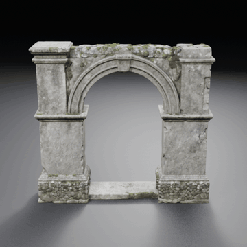 | 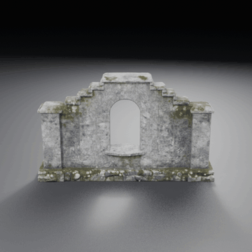 | 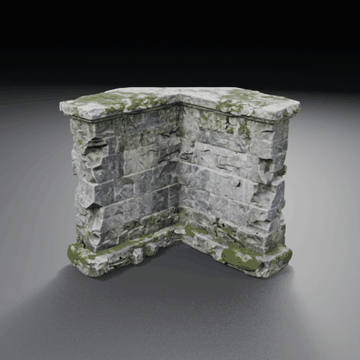 |

The top row is one real-size run each (2026-10-22), and each passed on its first mesh attempt. The bunker's white patch
and invented second door are single-image limits. The bottom row is ruin pieces from the
[live moorland run](docs/media/natural-live-2026-10/README.md) (2026-10-23). None of them is visually approved yet.
[Real-size evidence →](docs/media/structures-real-size-2026-10/README.md) · [The first structure run →](docs/media/structure-showcase-2026-10/README.md)

## Scenes and natural environments

**A whole scene from briefs** (2026-10-23). The flythrough at the top is one Unity scene that SlopForge built from
one recipe, in a blank project:
- **Rocks:** boulders, outcrops and a granite tor of cliff chunks.
- **A broken stone chapel:** jagged walls, a window, a weathered corner, a freestanding arch, columns, fallen drums
  and cracked flagstones.
- **A camp of props:** a crate, a jug, a stone lantern, a pot, a stump and a brass lantern, from the briefs of the
  prop protocol and coverage runs, each generated once by the recipe.
- **Ground:** meadow, forest floor, gravel and granite tiling materials, with 2 million grass blades coloured from
  the meadow.
- **Plants:** heather and wildflower cards, and oak, birch and pine trees built from generated bark and leaf
  cut-outs.

| Inside the chapel | Through the arch | Below the tor |
| :---: | :---: | :---: |
| 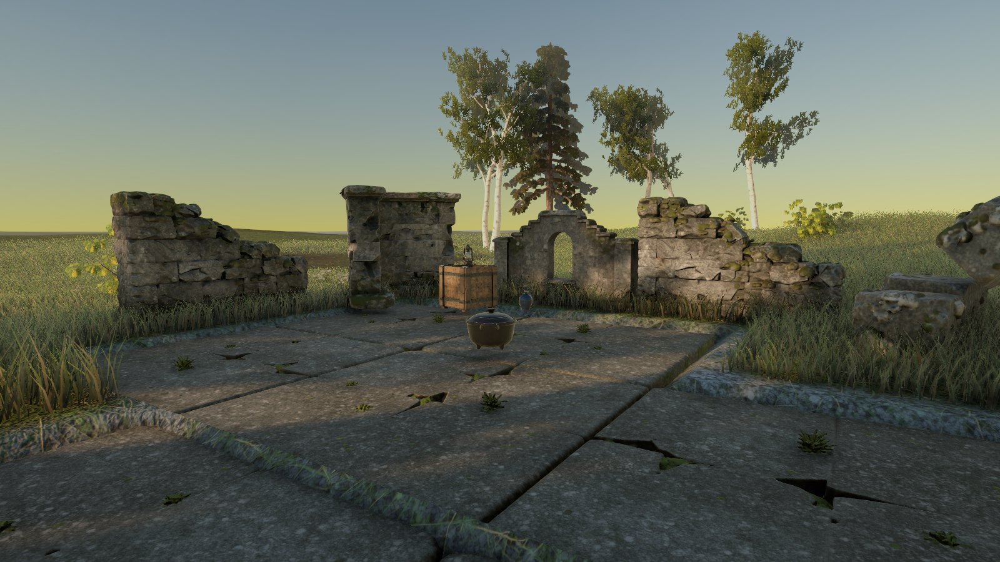 | 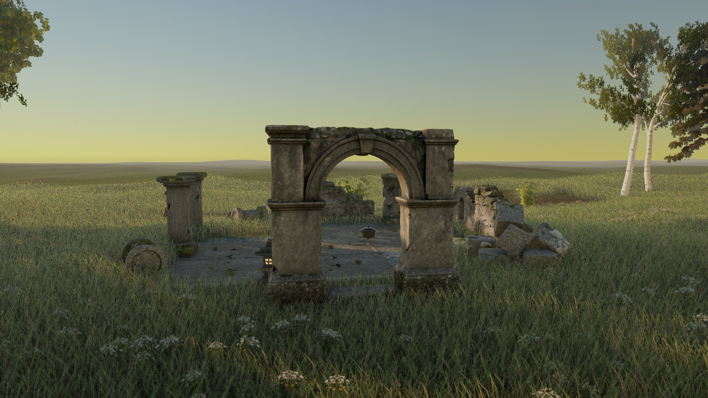 | 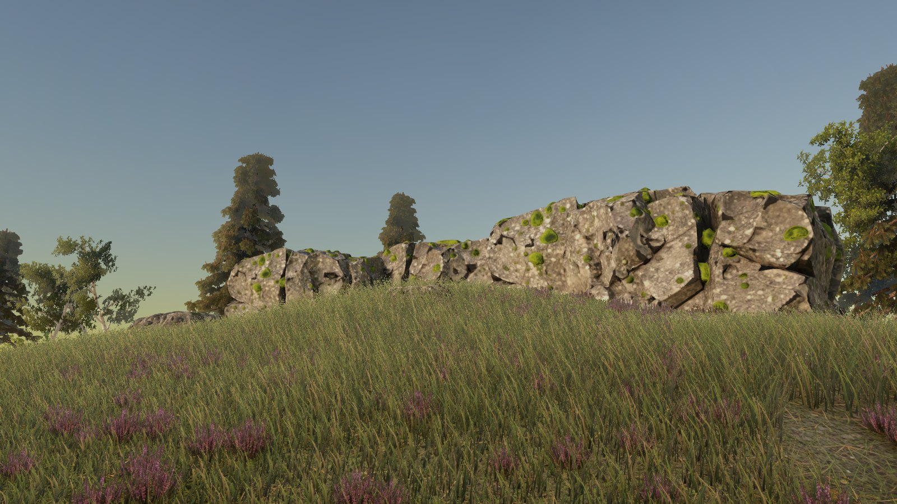 |

```sh
slopforge --project ~/UnityProjects/MyGame recipe run moorland_ruin --name moor
slopforge --project ~/UnityProjects/MyGame approve moor_boulder 1      # each child in turn; 3D ones then approve-texture
slopforge --project ~/UnityProjects/MyGame scene-render moor
```

**How it works:**
- **The recipe:** [`moorland_ruin`](templates/recipes/moorland_ruin.yaml) carries the 30 briefs and a `scene` block:
  terrain rules, plants, scatter, structures, lighting and cameras.
- **Planning:** `scene-render` builds the trees and plans every placement in Python.
- **In Unity:** it builds and lights the scene, bakes global illumination from probe volumes with sky occlusion, and
  renders stills and the flythrough.

**What the evidence supports:**
- **Approved, then rebuilt:** the owner judged a prototype's look "perfect". The recipe then rebuilt the scene from
  a blank project, which is the footage shown. That run found three faults, now fixed, and the agent reselected two
  concepts, one of them for a mesh TRELLIS textured black. It is one run, and the owner has not reviewed it yet.
- **Not a game level:** this is a showcase render. Play mode, frame rate, LODs and wind are not checked, and 2 million
  mesh grass blades would be too heavy for a game.

[Live run evidence →](docs/media/natural-live-2026-10/README.md) · [The approved prototype →](docs/media/natural-showcase-2026-10/README.md) · [Natural environments guide →](docs/NATURAL-ENVIRONMENTS.md)

## Weapons

<p align="center">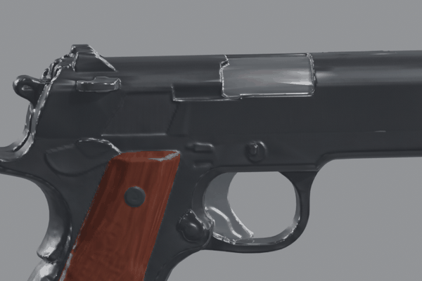</p>

**Moving parts** (2026-10-26): the pistol's slide and trigger move as their own pieces, as declared in the brief. It
is published to Unity as a prefab with colliders, a Rigidbody, sockets and an Animator, and checked in Play mode.
[Evidence and limits →](docs/media/moving-parts-2026-10/README.md)

| Pistol | Longsword | Crossbow |
| :---: | :---: | :---: |
| 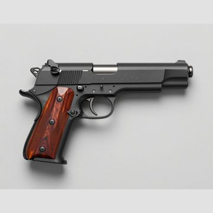 | 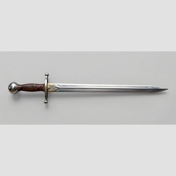 | 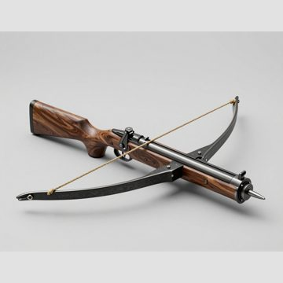 |
| 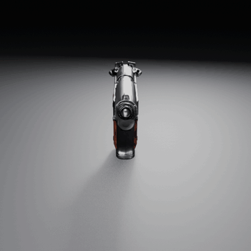 | 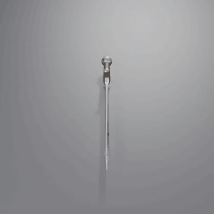 | 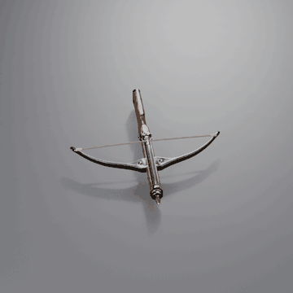 |
| <sub>blued steel + rosewood grips</sub> | <sub>polished steel + leather wrap</sub> | <sub>walnut + forged steel + hemp string</sub> |

Concepts (top) and the generated weapons (bottom), from one run each on the H100 `final` tier (2026-10-24):
- **Concepts:** weapons are drawn side-on, or from above for a crossbow.
- **Shape:** TRELLIS.2 builds the shape, and Blender reduces its full-detail mesh, so flat steel stays flat and edges
  stay sharp.
- **Materials:** metal decoded darker than drawn is brightened to the concept, and small non-metal parts such as grips
  are shifted to the concept's colours.
- **Orientation:** each weapon is turned tip forward and held at the grip drawn on its concept.

**Experimental:** no weapon has been through a protocol. Small mechanisms stay soft, and generated metal is glossier
than drawn.
[How they were made, evidence and limits →](docs/media/weapon-pipeline-2026-10/README.md) ·
[Weapons guide →](docs/WEAPONS.md)

## Materials and textures


<sub>The maps of a stone lantern from the 2026-10-18 showcase, made before the colour and metal checks below. The [Provisional prop runs](docs/media/props-provisional-2026-10-v5/README.md) show current output.</sub>

Every 3D asset gets mesh-aware PBR materials generated with its geometry: base color, roughness, metallic, a baked tangent-space normal map and, for declared glowing parts, an emission map, at 4096² on the H100 final profile (kit modules declare 2048²).

- **Material regions:** the brief declares `nonmetal`, `metal`, `emissive[#rrggbb]` or `glass[#rrggbb]` per region. Glass faces get a second, transparent URP material in Unity.
- **Reconstruction-ready concepts:** every 3D concept prompt asks for even lighting, matte non-metals, thick parts, and glowing or glass parts drawn as solid surfaces so they reconstruct whole.
- **Clean geometry:** raw shapes are remeshed on the GPU, and normals are baked against the full-detail mesh, so thin planks, handles and lattices survive. UV islands are padded by 4 texels and packed tightly.
- **Checks before review:** a candidate is rejected, and the next seed tried, when any of these fail:
  - it has more than five parts;
  - its silhouette does not fit the concept (this catches shattered meshes);
  - its colour drifts from the concept;
  - its texture turns dark where the concept is light ([calibration](docs/media/dark-texture-check-2026-10/README.md));
  - a declared glowing or glass part is not found.

  A metallic map that contradicts an all-non-metal brief also fails before review. Placeholder normal maps cannot be approved.

[How materials are made →](docs/MATERIALS.md)

## How it works

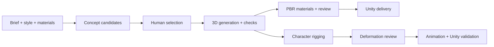

- **Generate:** props, collectibles, architecture, kit modules, foliage cut-outs, tiling ground and bark materials, and humanoid character candidates using configurable ComfyUI workflows; trees and shrubs with `vegetation`.
- **Prepare:** inspect geometry, preserve sources, process meshes and PBR maps, and render review views and turntables in Blender.
- **Review:** compare candidates, approve explicitly, and retain failed attempts and processing evidence.
- **Coordinate:** resume recipes, reuse style/reference libraries, and select quality tiers with bounded candidate budgets.
- **Deliver:** export models/materials, assemble kit layouts into Unity scenes, render whole scenes with `scene-render`, and prepare character animation tooling for Unity.

## Built with

No model weights are bundled; each is downloaded from its publisher. The default `h100` profiles use:

| Stage | Model or tool | Licence |
| --- | --- | --- |
| Concept images | [Z-Image Turbo](https://huggingface.co/Tongyi-MAI/Z-Image-Turbo) with the [Qwen3 4B](https://huggingface.co/Qwen/Qwen3-4B) text encoder ([ComfyUI files](https://huggingface.co/Comfy-Org/z_image_turbo)) | Apache-2.0 |
| Character poses, shape guides | [Z-Image-Turbo Fun ControlNet Union 2.1](https://huggingface.co/alibaba-pai/Z-Image-Turbo-Fun-Controlnet-Union-2.1) | Apache-2.0 |
| Background removal | [BiRefNet](https://github.com/ZhengPeng7/BiRefNet) general, through [rembg](https://github.com/danielgatis/rembg) | MIT |
| Image to 3D mesh and PBR maps | [TRELLIS.2](https://huggingface.co/microsoft/TRELLIS.2-4B) ([ComfyUI files](https://huggingface.co/Comfy-Org/TRELLIS.2)), conditioned by [DINOv3 ViT-L](https://huggingface.co/facebook/dinov3-vitl16-pretrain-lvd1689m) | MIT; DINOv3 License |
| Multi-view 3D (experimental) | [Pixal3D](https://huggingface.co/Comfy-Org/Pixal3D) by TencentARC; views by [Qwen-Image-Edit-2511](https://huggingface.co/Comfy-Org/Qwen-Image-Edit_ComfyUI) with [Qwen2.5-VL 7B](https://huggingface.co/Comfy-Org/Qwen-Image_ComfyUI) and the [multiple-angles LoRA](https://huggingface.co/fal/Qwen-Image-Edit-2511-Multiple-Angles-LoRA) | MIT; Apache-2.0 |
| Open pictures of a chest (experimental) | [Qwen-Image-Edit-2511](https://huggingface.co/Comfy-Org/Qwen-Image-Edit_ComfyUI) with [Qwen2.5-VL 7B](https://huggingface.co/Comfy-Org/Qwen-Image_ComfyUI) | Apache-2.0 |
| Part masks | [Florence-2 large](https://huggingface.co/florence-community/Florence-2-large) and [SAM 2.1 Hiera large](https://huggingface.co/facebook/sam2.1-hiera-large) | MIT; Apache-2.0 |
| Part layout for moving parts | [OmniPart](https://github.com/HKU-MMLab/OmniPart), built on [TRELLIS](https://github.com/microsoft/TRELLIS) | MIT |
| Tiling material upscale | [Real-ESRGAN](https://github.com/xinntao/Real-ESRGAN) x4plus | BSD-3-Clause |
| Character rigging | [SkinTokens](https://github.com/VAST-AI-Research/SkinTokens), or Blender's Rigify | MIT; GPL-2.0+ |
| Character motion | [CMU Graphics Lab Motion Capture Database](http://mocap.cs.cmu.edu/) | Free for any use, not resold |
| Inference server | [ComfyUI](https://github.com/comfyanonymous/ComfyUI), on your machine or a remote GPU | GPL-3.0 |
| Mesh processing, UVs, normal bakes, review renders | [Blender](https://www.blender.org/) 5.1 | GPL-2.0+ |
| Engine delivery, prefabs, Play-mode checks | [Unity](https://unity.com/) 6000.6.3f1, URP 17.6.0, Unity Test Framework | Unity's terms |

**Built with DINOv3.** Its licence allows commercial use, but it is Meta's own licence, not MIT or Apache: it
requires this attribution and excludes military uses. Until 2026-10-26 the cut-outs used rembg's default model, BRIA
RMBG-2.0, which is licensed for non-commercial use only. They now use BiRefNet, with near-identical cut-outs (alpha
IoU 0.995–0.998). The legacy Hunyuan3D 2.0 route, used only when no model workflow is configured, is under Tencent's
community licence; nothing shown here used it. Full model files, hashes and graphs:
[workflow inventory](docs/WORKFLOWS.md) · [ComfyUI setup](docs/COMFYUI.md) · [third-party notices](THIRD_PARTY_NOTICES.md)

## Quick start

Requires **Python 3.10–3.14**, Blender, a compatible ComfyUI service, and an existing Unity project. Model weights and custom nodes are installed separately.

```sh
git clone https://github.com/gysahlgreene/SlopForge.git
cd SlopForge
python3 -m venv .venv
source .venv/bin/activate
pip install -e .
slopforge init ~/UnityProjects/MyGame
slopforge --project ~/UnityProjects/MyGame doctor
```

[Installation](docs/INSTALL.md) covers dependencies. [ComfyUI configuration](docs/COMFYUI.md) covers local/remote inference and model/workflow compatibility. Then follow the [props](#props) or [characters](#characters) example above.

## What is qualified today?

| Area | Current evidence |
| --- | --- |
| Generation, candidate tracking, recipes, provenance | Implemented; offline tests and selected live GPU runs. Visual quality depends on the model and brief. |
| Static props | **Provisional** for `h100`/`final`, commit `221c8d1`, Unity 6000.6.3f1 / URP 17.6.0 import. Three briefs × two independent runs passed every stage and owner-accepted threshold ([criterion v5](docs/media/props-provisional-2026-10-v5/QUALIFICATION-RECORD.md)). Four more prop kinds passed end to end in single exploratory runs; the stump passed only after a UV fix prompted by its failed first run. Not Qualified: six runs cannot measure a failure rate. Since 2026-10-24 meshes are reduced from the full-detail shape ([evidence](docs/media/mesh-reduction-2026-10/README.md)); two protocol props re-approved after it passed, with no protocol rerun. |
| Material and texture generation | Declared non-metal, metal, emissive and glass regions, with baked normal maps at 4096² by default (2048² for kit modules). Candidates are checked for part count, concept fit, colour against the concept, glowing and glass parts, and metal. Metal decoded darker than its concept is brightened to it; weapons also have small parts' colours shifted to the concept, other types do not. |
| Structures and modular kits | **Provisional** for the stone ruin, timber house and sci-fi corridor kits on `h100`/`final`, commit `5ceac3b`, Unity 6000.6.3f1 / URP 17.6.0: two independent runs each passed every owner-accepted M2 criterion through an assembled Unity scene ([criterion M2-v3](docs/media/kits-provisional-2026-10-v3/README.md)). Not Qualified, and the owner judged the kits' look below the props'. The stone kit's material step changed after that commit (#101) and has no protocol run. Standalone structures are generated at real size, one run each. The 2026-10-24 mesh-reduction change also applies to kits, with no protocol rerun. |
| Weapons | **Experimental**: a pistol, a longsword and a crossbow, one run each through Blender on the H100 `final` tier ([evidence](docs/media/weapon-pipeline-2026-10/README.md)); the owner accepted the look for now. A pistol with a slide and trigger publishes to Unity as a prefab whose parts move as declared, with motion checks and Play mode passing on 4 of the last 5 seeds ([evidence](docs/media/moving-parts-2026-10/README.md)). No protocol; the sword and crossbow have no Unity render. |
| Scenes and natural environments | **Experimental**: one owner-approved moorland scene (prototype); `scene-render` and the `moorland_ruin` recipe rebuilt it once from a blank project ([live run](docs/media/natural-live-2026-10/README.md)). Rendering only: no Play mode or performance check. |
| Mesh/material preparation and Unity delivery | 28 of the 30 protocol prop runs imported into Unity URP with materials assigned, rendered in editor batch mode (two stopped earlier). Every M2-v3 kit module and every moorland model was published with `approve-texture`; kit scenes are checked in Unity for grounding, colliders, static flags and seam gaps. Play mode is not run. |
| Humanoid rigging | Four generated characters in four art styles rig automatically with SkinTokens and walk on retargeted motion capture (natural stride, clean feet and shoulders); not approved, and model quality is well below target. Humanoid test 1 has a valid Unity Humanoid Avatar and visible walk playback. A separate diagnostic rig has approved body deformation. |
| Third-party motion retargeting | Humanoid test 1 demonstrates looping idle/walk playback and measured skinned-mesh movement. Broader movement, deformation approval, and production qualification remain open. |
| Safe Unity replacement/reimport | Implemented for props: republishing keeps GUIDs and texture references, and a prefab follows a republished mesh. If a GUID changes, approval stops and the previous files are restored. Checked by an opt-in live Unity test; a deleted `.meta` is only exercised on a fresh checkout. |

Full finger animation is not available on the diagnostic humanoid rig. Reference-input plumbing exists, but the bundled concept graph is text-only. SlopForge assembles showcase scenes for review, not game levels, and does not ship sprites; the pipeline remains a qualified asset workflow rather than a game engine.

## Find your way around

Contributors: read [AGENTS.md](AGENTS.md), the [product contract](docs/PRODUCT_CONTRACT.md), [pipeline contract](docs/PIPELINE_CONTRACT.md), and [current state](CURRENT_STATE.md). Run `make verify` before declaring implementation complete.

| Directory | Purpose |
| --- | --- |
| `slopforge/` | CLI, asset lifecycle, recipes, providers, and Unity integration |
| `blender/` · `processing/` | Background mesh, rigging, turntable and image helpers |
| `workflows/` · `templates/` | ComfyUI graphs, requirement declarations, and project defaults |
| `tests/` | Offline checks and opt-in Blender, Unity, and GPU integrations |
| `docs/` | User guides, contributor notes, and selected qualification examples |

[Contributing](CONTRIBUTING.md) · [Security and publishing](SECURITY.md) · [MIT license](LICENSE) · [Third-party notices](THIRD_PARTY_NOTICES.md)
