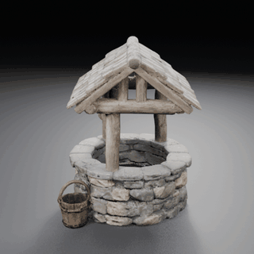
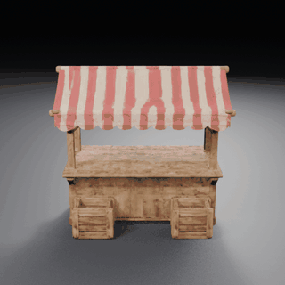
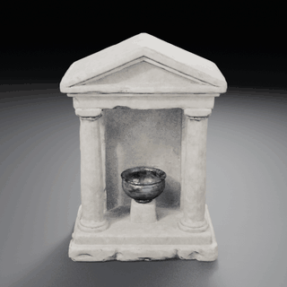
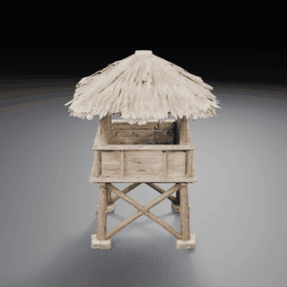
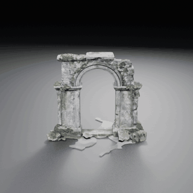
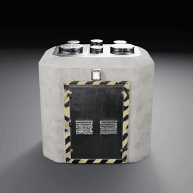
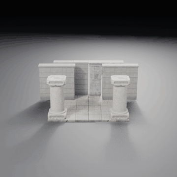
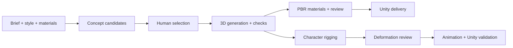

# SlopForge

**Turn an asset brief into a reviewed 3D game asset.**

SlopForge connects ComfyUI generation, Blender processing, human review, and Unity delivery. Run inference locally or on a remote GPU; keep your assets, approval decisions, and provenance in your own project.

[Get started](docs/INSTALL.md) · [Documentation](docs/README.md) · [Examples](docs/EXAMPLES.md)

[](https://buymeacoffee.com/eoinmacd95f)

## What it makes

| Asset type | Status | Evidence |
| --- | --- | --- |
| [Props](#props) — pickups, furniture, containers, devices | Working end to end; owner-rated about 60% of target quality | Five varied-material props as lit turntables |
| [Characters](#characters) — rigged humanoids | Generated in four art styles, rigged automatically and walking; experimental, well below shippable model quality | Four characters walking as lit turntables; one character with Unity Humanoid playback |
| [Structures and environments](#structures-and-environments) — buildings, ruins, modular kits | Standalone structures and real-scale kit modules generated end to end | Six structures and a modular stone-kit courtyard as lit turntables |
| Weapons and mechanical assets, creatures | Planned on the [roadmap](ROADMAP.md) | — |

Every 3D asset type shares the same [materials and textures](#materials-and-textures) stage. Generation is stochastic: candidates must pass checks and human review, or the pipeline reports failure. A successful export alone does not make an asset game-ready.

## Props

| Brass key | Glazed jug | Supply crate | Power relay | Stone lantern |
| :---: | :---: | :---: | :---: | :---: |
|  |  |  |  |  |
| metal | glossy non-metal | wood + iron | ceramic + copper + graphite | granite + paper + wood |

Each prop was generated from a written brief through `generate` → `approve` on an H100, with no manual repair, and rendered as a lit turntable in Blender. One run each; not yet visually approved or imported into Unity. [Showcase evidence, before/after and limits →](docs/media/material-showcase-2026-10/README.md)

```sh
slopforge --project ~/UnityProjects/MyGame generate prop stone_lantern "Weathered stone lantern" \
  --image-prompt "Squat carved stone lantern, ribbed roof, opaque paper window panels behind a wooden lattice, chunky base; matte speckled granite; complete three-quarter view on a plain neutral background." \
  --material "body=nonmetal: matte granite" --material "panels=emissive: off-white paper" \
  --material "lattice=nonmetal: dark wood"
slopforge --project ~/UnityProjects/MyGame candidates stone_lantern
slopforge --project ~/UnityProjects/MyGame approve stone_lantern 1
slopforge --project ~/UnityProjects/MyGame approve-texture stone_lantern 1
```

Inspect the concept, mesh views, materials, and validation report before each approval. [More prop examples →](docs/EXAMPLES.md)

## Characters

| Realistic | Stylized hero | Anime | Hand-painted |
| :---: | :---: | :---: | :---: |
|  |  |  |  |

Each character is generated from a brief (a pose-conditioned concept, then TRELLIS.2 on an H100), rigged automatically with SkinTokens, and retargeted to a motion-capture walk with no manual repair. The rigging and walk are solid; the models are not yet game quality: forms are lumpy, faces soft and fingers fused, the limits of current open single-image 3D generation. Experimental and unapproved. [How they were made, evidence and limits →](docs/media/character-styles-2026-10/README.md)

| Rigged humanoid walking in Unity |
| :---: |
|  |

Humanoid test 1 has a valid Unity Humanoid Avatar and plays a retargeted walk clip; Unity measured movement on all 49,886 imported vertices. This confirms playback, not deformation quality. [Evidence and limits →](docs/media/character-qualification-2026-10/basalt-warden-unity-preview/README.md) · [Diagnostic rig benchmark →](docs/media/character-qualification-2026-10/basalt-corrected-humanoid/README.md)

Characters continue through [readiness and rigging](docs/CHARACTER-RIGGING.md), then [animation validation](docs/CHARACTER-ANIMATIONS.md).

## Structures and environments

| Stone well | Market stall | Stone shrine |
| :---: | :---: | :---: |
|  |  |  |
| **Watchtower** | **Ruined arch** | **Sci-fi bunker** |
|  |  |  |

Standalone structures use the `architecture` asset type with the same brief-declared materials as props. Modular kits are recipes whose modules declare real sizes, so pieces snap on a shared grid:

| Modular stone kit courtyard |
| :---: |
|  |

The floor, wall, doorway and column modules come out at their declared 3 m sizes and pass the kit's grid and pivot rules; the courtyard is assembled from them in Blender as a demonstration. One run each, not yet visually approved or imported into Unity; the kit's corner module reconstructed incorrectly. [Structure evidence and limits →](docs/media/structure-showcase-2026-10/README.md) · [Environment kits →](docs/ENVIRONMENT-KITS.md)

## Materials and textures


Every 3D asset gets mesh-aware PBR materials generated with its geometry: base color, roughness, metallic, a baked tangent-space normal map and, for declared glowing parts, an emission map, at 4096² on the H100 final profile.

- **Material regions:** the brief declares `nonmetal`, `metal` or `emissive[#rrggbb]` per region. A candidate whose metallic map contradicts an all-non-metal brief fails before review.
- **Reconstruction-ready concepts:** every 3D concept prompt asks for even lighting, matte non-metals, thick parts, and glowing parts drawn unlit so they reconstruct as solid surfaces.
- **Clean geometry:** raw shapes are remeshed on the GPU and normals are baked against the full-detail mesh, so thin planks, handles and lattices survive.
- **Checks:** placeholder normal maps cannot be approved; map statistics, UV coverage and topology are recorded with every candidate.

[How materials are made →](docs/MATERIALS.md)

## How it works



- **Generate:** props, collectibles, architecture, and humanoid character candidates using configurable ComfyUI workflows.
- **Prepare:** inspect geometry, preserve sources, process meshes and PBR maps, and render review views and turntables in Blender.
- **Review:** compare candidates, approve explicitly, and retain failed attempts and processing evidence.
- **Coordinate:** resume recipes, reuse style/reference libraries, and select quality tiers with bounded candidate budgets.
- **Deliver:** export models/materials and prepare character animation tooling for Unity.

## Quick start

Requires **Python 3.10–3.14**, Blender, a compatible ComfyUI service, and an existing Unity project. Model weights and custom nodes are installed separately.

```sh
git clone https://github.com/gysahlgreene/SlopForge.git
cd SlopForge
python3 -m venv .venv
source .venv/bin/activate
pip install -e .
slopforge init ~/UnityProjects/MyGame
slopforge --project ~/UnityProjects/MyGame doctor
```

[Installation](docs/INSTALL.md) covers dependencies. [ComfyUI configuration](docs/COMFYUI.md) covers local/remote inference and model/workflow compatibility. Then follow the [props](#props) or [characters](#characters) example above.

## What is qualified today?

| Area | Current evidence |
| --- | --- |
| Generation, candidate tracking, recipes, provenance | Implemented; offline tests and selected live GPU runs. Visual quality depends on the model and brief. |
| Material and texture generation | Five varied-material props generated from briefs on the H100 profile with declared-material checks and baked normal maps; one run each, visual approval pending. |
| Structures and modular kits | Six standalone structures and a five-module stone kit generated on the H100 profile; kit modules keep declared real sizes and pass grid/pivot rules on their measurements. One run each; visual approval, corner reconstruction and Unity evidence pending. |
| Mesh/material preparation and Unity delivery | Demonstrated on selected props; geometry and material defects still require review. |
| Humanoid rigging | Four generated characters in four art styles rig automatically with SkinTokens and walk on retargeted motion capture (natural stride, clean feet and shoulders); not approved, and model quality is well below target. Humanoid test 1 has a valid Unity Humanoid Avatar and visible walk playback. A separate diagnostic rig has approved body deformation. |
| Third-party motion retargeting | Humanoid test 1 demonstrates looping idle/walk playback and measured skinned-mesh movement. Broader movement, deformation approval, and production qualification remain open. |
| Safe Unity replacement/reimport | Stable GUIDs and replacement validation remain open. |

Full finger animation is not available on the diagnostic humanoid rig. Reference-input plumbing exists, but the bundled concept graph is text-only. SlopForge does not assemble game scenes or ship sprites; the pipeline remains a qualified asset workflow rather than a game engine.

## Find your way around

Contributors: read [AGENTS.md](AGENTS.md), the [product contract](docs/PRODUCT_CONTRACT.md), [pipeline contract](docs/PIPELINE_CONTRACT.md), and [current state](CURRENT_STATE.md). Run `make verify` before declaring implementation complete.

| Directory | Purpose |
| --- | --- |
| `slopforge/` | CLI, asset lifecycle, recipes, providers, and Unity integration |
| `blender/` · `processing/` | Background mesh, rigging, turntable and image helpers |
| `workflows/` · `templates/` | ComfyUI graphs, requirement declarations, and project defaults |
| `tests/` | Offline checks and opt-in Blender, Unity, and GPU integrations |
| `docs/` | User guides, contributor notes, and selected qualification examples |

[Contributing](CONTRIBUTING.md) · [Security and publishing](SECURITY.md) · [MIT license](LICENSE) · [Third-party notices](THIRD_PARTY_NOTICES.md)
