# Gallery

What SlopForge has made so far, with what the evidence supports and what it doesn't. Everything here was generated from written briefs. For what each status word means and where each area stands, see the [summary in current state](../CURRENT_STATE.md#summary).

- [Props](#props)
- [Characters](#characters)
- [Structures and environments](#structures-and-environments)
- [Scenes and natural environments](#scenes-and-natural-environments)
- [Weapons](#weapons)
- [Creatures](#creatures)
- [Materials and textures](#materials-and-textures)

## Props

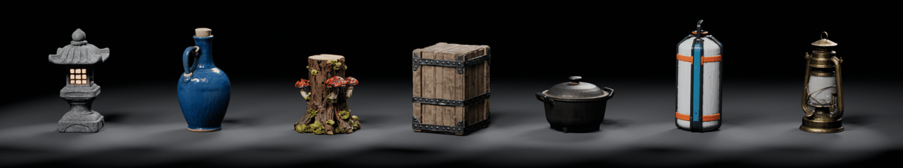

**Three briefs, two independent runs each** (2026-10-21):

| Supply crate | Glazed jug | Stone lantern |
| :---: | :---: | :---: |
| 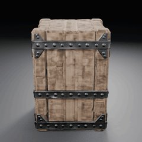 | 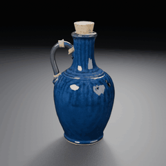 | 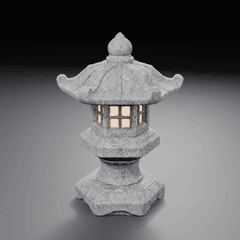 |
| 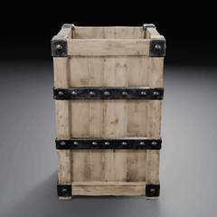 | 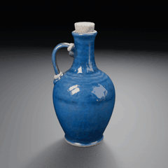 |  |
| <sub>oak planks + wrought iron</sub> | <sub>cobalt glaze + cork + twine</sub> | <sub>granite + glowing paper + wood</sub> |

**Four more kinds of prop, one run each** (2026-10-22):

| Cast-iron pot | Sci-fi fuel canister | Mossy tree stump | Brass lantern |
| :---: | :---: | :---: | :---: |
| 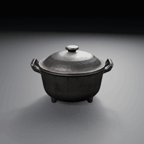 | 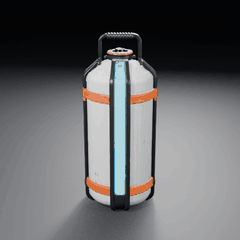 | 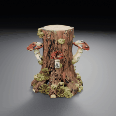 | 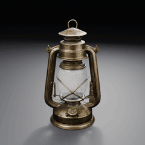 |
| <sub>all cast iron</sub> | <sub>paint + steel + glow strip</sub> | <sub>bark + moss + mushrooms</sub> | <sub>brass + glass globe</sub> |

Each prop was generated on an H100 from a written brief through `generate` → `approve`, with no manual repair, then imported into a fresh Unity 6000.6.3f1 / URP 17.6.0 project. Every run is checked from the concept through to the engine:

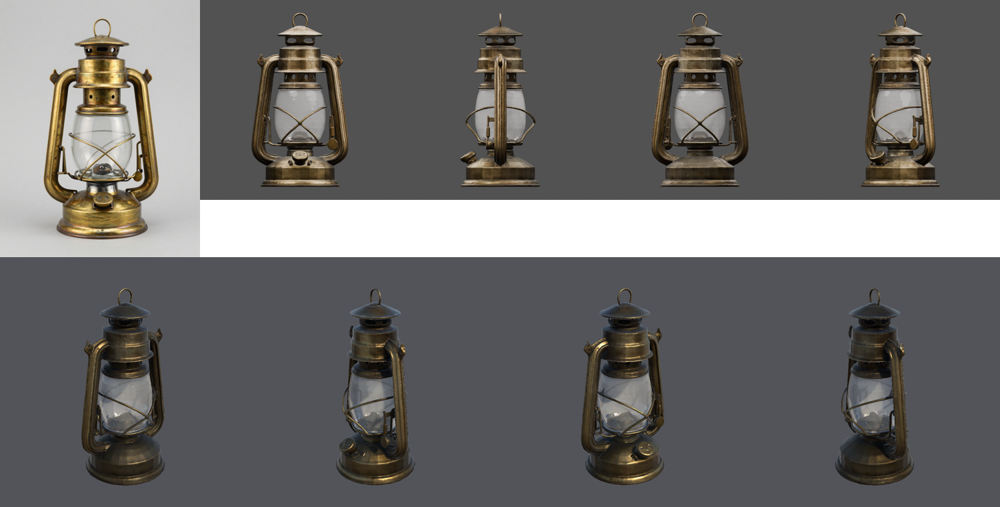

*Brass lantern: the selected concept (left), Blender review views (top) and Unity URP renders (bottom). The globe is a second, transparent material.*

**What the evidence supports.** All six runs of the three protocol briefs passed every stage and every owner-accepted threshold:
- at most five parts, 30,000 triangles and one 4096² material;
- colour within the accepted limits of the concept's hue and saturation (grey concepts are not checked);
- the glowing parts found;
- no metal on non-metal briefs.

That makes static props on this tier **Provisional**. The owner reviewed the runs and rated them better than earlier rounds. Two runs per brief cannot measure a failure rate, so nothing is Qualified.

**Known limits:**
- **Unseen sides are invented.** The canister's front strip was copied onto its sides and back as darker panels ([#63](https://github.com/gysahlgreene/SlopForge/issues/63)).
- **Wording does not always hold proportions.** Every stump's trunk came out taller than wide whatever the wording. An opt-in shape guide fixed it in 12 of 12 concepts and one run through Unity ([evidence](media/concept-proportion-2026-10/README.md), [#65](https://github.com/gysahlgreene/SlopForge/issues/65)).
- **Some surfaces differ from the concept:**
  - crate wood comes out paler than its concept;
  - one crate's open top was rebuilt closed;
  - one jug shows ribbing in Unity.
- **Glass:** glass parts work, but an object made entirely of glass does not reconstruct reliably.
- **Not covered by the checks:** the colour of small parts. Unity is checked in editor batch renders, not in Play mode.

[Protocol evidence →](media/props-provisional-2026-10-v5/README.md) · [New prop kinds →](media/props-coverage-2026-10/README.md) · [Earlier showcase (2026-10-18) →](media/material-showcase-2026-10/README.md)

**Props with moving parts** (2026-10-26):

<p align="center">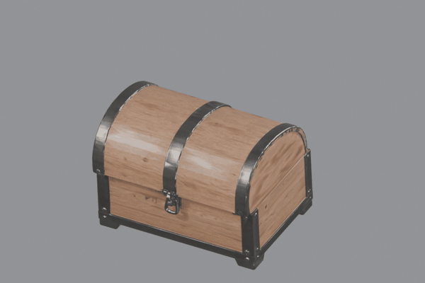</p>

A chest's lid on its hinge. The chest is generated open from an approved open picture of its concept, so its inside
comes from a picture; the lid is closed by a fit before the final pass. Published to Unity on its first seed, with the
lid's motion checked and Play mode passed. [Evidence and limits →](media/moving-parts-2026-10/README.md)

The brass lantern above was made from this brief:

```sh
slopforge --project ~/UnityProjects/MyGame generate prop brass_lantern "Brass hurricane lantern" --aspect portrait \
  --image-prompt "Front three-quarter view of one brass hurricane lantern, taller than it is wide. A rounded glass globe in the middle, drawn as a solid smooth pale surface with a faint sheen, nothing visible through it. Brass wire guards around the globe. A ring handle on top. A round brass base. Complete object, isolated on a plain light-grey background." \
  --material "frame=metal: aged brass" --material "globe=glass: clear glass"
slopforge --project ~/UnityProjects/MyGame candidates brass_lantern
slopforge --project ~/UnityProjects/MyGame approve brass_lantern 1
slopforge --project ~/UnityProjects/MyGame approve-texture brass_lantern 1
```

Inspect the concept, mesh views, materials, and validation report before each approval. [Writing briefs that reconstruct well →](AGENT-INTEGRATION.md#mesh-aware-materials) · [More prop examples →](EXAMPLES.md)

## Characters

<p align="center">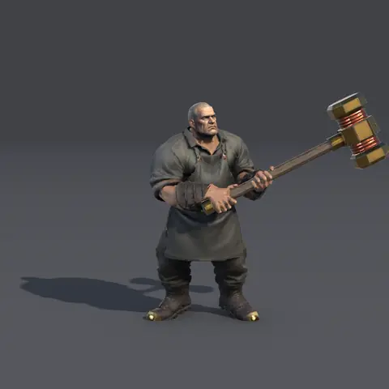</p>

**A character built in parts** (2026-11-05). The head and a headless body are generated separately from one concept, joined on one material, rigged and imported into Unity as a Humanoid, then given a two-handed hold and attack as ordinary clips. This film is one character standing in its hold, seen from a distance. His hands and finger bones come from work not yet in the main branch. [Evidence and limits →](media/character-parts-2026-11/README.md) · [How the route works →](CHARACTER-RIGGING.md#characters-built-in-parts)

**Experimental**, and not finished:
- **Motion:** the owner judged how he moves "still very rough". The attack is computed, not captured.
- **Close up:** hands and wrists still read as rough. This film stays at a distance for that reason.
- **Repeatability:** one build of each character. One of the characters failed first and changed shared code.
- **In a game:** none of them has been played in one.

Earlier characters, kept as a record of where this started: [four art styles walking](media/character-styles-2026-10/README.md), generated as one model and rigged with SkinTokens, which the owner rated well below game quality. Unity playback was first shown on [an earlier test character](media/character-qualification-2026-10/basalt-warden-unity-preview/README.md), with a [diagnostic rig benchmark](media/character-qualification-2026-10/basalt-corrected-humanoid/README.md).

Characters continue through [readiness and rigging](CHARACTER-RIGGING.md), then [animation validation](CHARACTER-ANIMATIONS.md).

## Structures and environments

**Three modular kits, assembled in Unity** (2026-10-23). Every module is generated from a written brief at its real
size, checked, published to Unity as a prefab, and placed by the kit's layout. There is no manual repair:

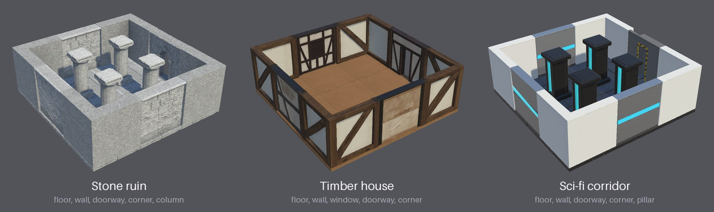

| Kit | Modules | One look across the kit | Protocol runs |
| --- | --- | --- | --- |
| `stone_ruin_kit` | floor, wall, doorway, corner, column | one stone texture sets every module's tint and finish | 2 of 2 passed |
| `timber_house_kit` | floor, wall, window, doorway, corner | dark oak beams and lime plaster, declared per module | 2 of 2 passed |
| `scifi_corridor_kit` | floor, wall, doorway, corner, pillar | painted panels, steel and a cyan light strip | 2 of 2 passed |

All six runs passed every owner-accepted check, so modular kits on this tier are **Provisional**:
- **The pieces fit:**
  - every module is within 5 cm of its declared size and pivot on a 3 m grid;
  - corner arms are as thick as the walls, so joints run flush;
  - Unity finds no seam gap wider than 1 mm.
- **The pieces keep their shape:** no module is stretched more than 1.3 times to reach its size. A corner that
  reconstructs as a solid block or a wedge is rejected, and the next seed is tried.
- **The pieces match their concepts:** concept fit is at least 0.89, and colour stays within the accepted limits
  (hue and saturation; the check for textures turned dark came after these runs).
- **Ready for a scene:** each piece is a prefab with a mesh collider and static flags. Floors use 15k faces, walls
  and corners 40k, columns 20k, and every map is 2048².

Unity checks the assembly; it isn't judged by eye.

```sh
slopforge --project ~/UnityProjects/MyGame recipe run timber_house_kit --name house
slopforge --project ~/UnityProjects/MyGame approve house_wall 1          # then each module in turn
slopforge --project ~/UnityProjects/MyGame approve-texture house_wall 1
slopforge --project ~/UnityProjects/MyGame environment-check house
slopforge --project ~/UnityProjects/MyGame environment-scene house room
```

For the stone kit, approve its `stone` texture first: every module takes its tint and finish from it, and keeps its own generated colours and weathering.

**What the evidence supports:**
- Two independent runs of each kit passed every check on the H100 `final` tier through Unity 6000.6.3f1 / URP
  17.6.0. That makes the kits Provisional.
- Two runs per kit cannot measure a failure rate, so nothing is Qualified.
- The status is for commit `5ceac3b`. The stone kit's material step has since changed: modules now keep their own
  colours with the kit's tint matched (#101). No protocol run covers that yet.
- The owner reviewed the scenes on 2026-10-23 and judged them well below the props. They are not approved.

**Known limits:**
- **Unseen wall backs are invented:** the timber walls' outsides are bare wood, the sci-fi walls' outsides dark.
- **Some texture blemishes remain:** streaked plaster, gouges and green patches in some runs.
- **The sci-fi corners are whiter than its walls,** because that kit has no shared material.
- **S2's pillar is near-black** where its concept is grey metal: TRELLIS sometimes textures a mesh mostly black.
  The [dark-texture check](media/dark-texture-check-2026-10/README.md) now rejects such a texture; these runs
  predate it.
- **Not covered:** Unity is checked in editor batch renders, with no Play mode, lightmaps or LODs.

[Protocol evidence →](media/kits-provisional-2026-10-v3/README.md) · [Earlier rounds: v1](media/kits-provisional-2026-10/README.md), [v2](media/kits-provisional-2026-10-v2/README.md) · [Environment kits guide →](ENVIRONMENT-KITS.md) · [M2 epic →](https://github.com/gysahlgreene/SlopForge/issues/89)

**Standalone structures** use the `architecture` asset type, with the same brief-declared materials as props. They are
generated at real size with `generate --target-size`, and get the same concept-fit and colour checks as props:

| Stone well, 3.2 m tall | Stone shrine, 3.5 m tall | Sci-fi bunker, 3.0 m tall |
| :---: | :---: | :---: |
| 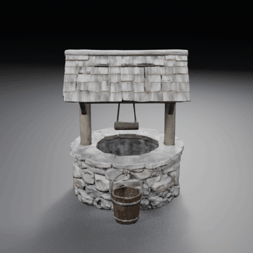 | 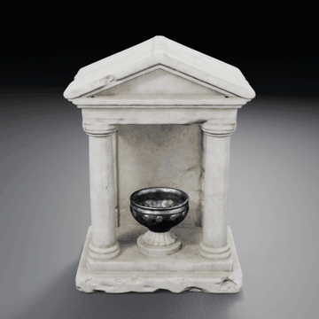 | 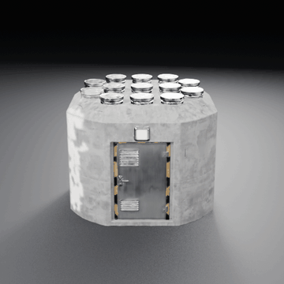 |
| **Ruined arch, 3.6 m tall** | **Broken window wall, 3 m long** | **Weathered corner, 3 m across** |
| 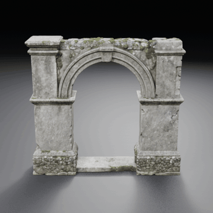 | 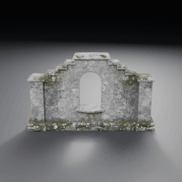 | 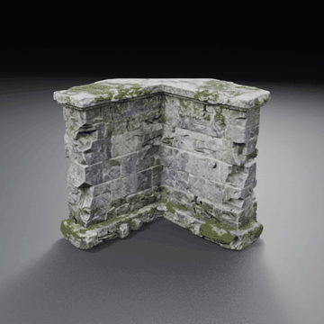 |

The top row is one real-size run each (2026-10-22), and each passed on its first mesh attempt. The bunker's white patch
and invented second door are single-image limits. The bottom row is ruin pieces from the
[live moorland run](media/natural-live-2026-10/README.md) (2026-10-23). None of them is visually approved yet.
[Real-size evidence →](media/structures-real-size-2026-10/README.md) · [The first structure run →](media/structure-showcase-2026-10/README.md)

## Scenes and natural environments

**A whole scene from briefs** (2026-10-23). The flythrough at the top is one Unity scene that SlopForge built from
one recipe, in a blank project:
- **Rocks:** boulders, outcrops and a granite tor of cliff chunks.
- **A broken stone chapel:** jagged walls, a window, a weathered corner, a freestanding arch, columns, fallen drums
  and cracked flagstones.
- **A camp of props:** a crate, a jug, a stone lantern, a pot, a stump and a brass lantern, from the briefs of the
  prop protocol and coverage runs, each generated once by the recipe.
- **Ground:** meadow, forest floor, gravel and granite tiling materials, with 2 million grass blades coloured from
  the meadow.
- **Plants:** heather and wildflower cards, and oak, birch and pine trees built from generated bark and leaf
  cut-outs.

| Inside the chapel | Through the arch | Below the tor |
| :---: | :---: | :---: |
| 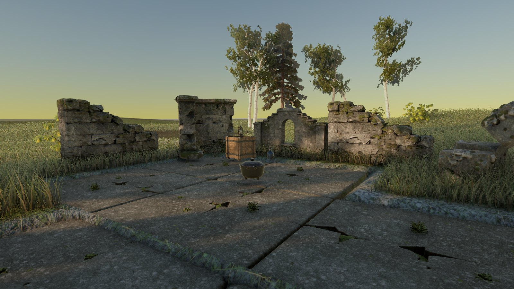 | 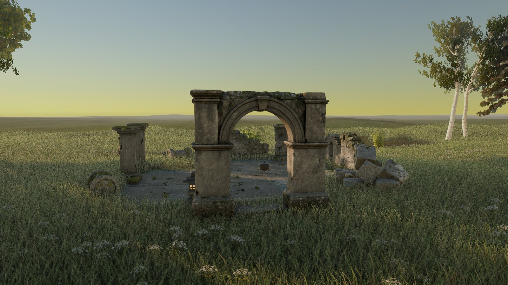 | 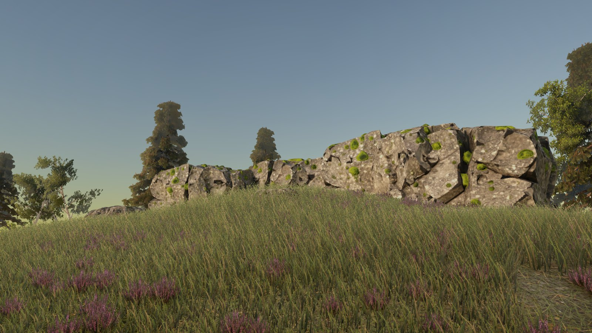 |

```sh
slopforge --project ~/UnityProjects/MyGame recipe run moorland_ruin --name moor
slopforge --project ~/UnityProjects/MyGame approve moor_boulder 1      # each child in turn; 3D ones then approve-texture
slopforge --project ~/UnityProjects/MyGame scene-render moor
```

**How it works:**
- **The recipe:** [`moorland_ruin`](../templates/recipes/moorland_ruin.yaml) carries the 30 briefs and a `scene` block:
  terrain rules, plants, scatter, structures, lighting and cameras.
- **Planning:** `scene-render` builds the trees and plans every placement in Python.
- **In Unity:** it builds and lights the scene, bakes global illumination from probe volumes with sky occlusion, and
  renders stills and the flythrough.

**What the evidence supports:**
- **Approved, then rebuilt:** the owner judged a prototype's look "perfect". The recipe then rebuilt the scene from
  a blank project, which is the footage shown. That run found three faults, now fixed, and the agent reselected two
  concepts, one of them for a mesh TRELLIS textured black. It is one run, and the owner has not reviewed it yet.
- **Not a game level:** this is a showcase render. Play mode, frame rate, LODs and wind are not checked, and 2 million
  mesh grass blades would be too heavy for a game.

[Live run evidence →](media/natural-live-2026-10/README.md) · [The approved prototype →](media/natural-showcase-2026-10/README.md) · [Natural environments guide →](NATURAL-ENVIRONMENTS.md)

## Weapons

<p align="center">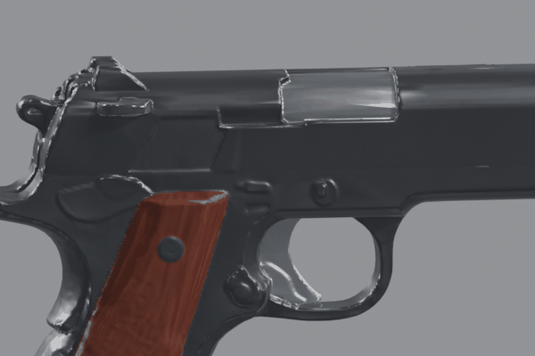</p>

**Moving parts** (2026-10-26): the pistol's slide and trigger move as their own pieces, as declared in the brief. It
is published to Unity as a prefab with colliders, a Rigidbody, sockets and an Animator, and checked in Play mode.
[Evidence and limits →](media/moving-parts-2026-10/README.md)

| Pistol | Longsword | Crossbow |
| :---: | :---: | :---: |
| 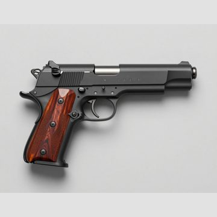 | 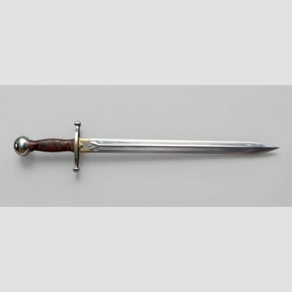 | 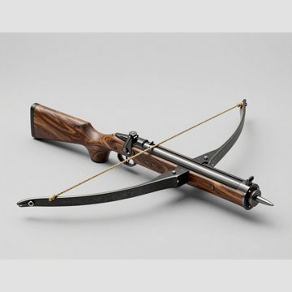 |
| 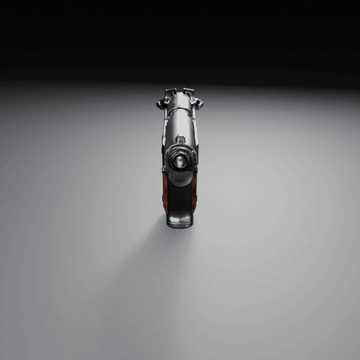 | 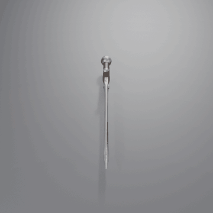 | 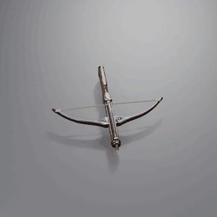 |
| <sub>blued steel + rosewood grips</sub> | <sub>polished steel + leather wrap</sub> | <sub>walnut + forged steel + hemp string</sub> |

Concepts (top) and the generated weapons (bottom), from one run each on the H100 `final` tier (2026-10-24):
- **Concepts:** weapons are drawn side-on, or from above for a crossbow.
- **Shape:** TRELLIS.2 builds the shape, and Blender reduces its full-detail mesh, so flat steel stays flat and edges
  stay sharp.
- **Materials:** metal decoded darker than drawn is brightened to the concept, and small non-metal parts such as grips
  are shifted to the concept's colours.
- **Orientation:** each weapon is turned tip forward and held at the grip drawn on its concept.

**Experimental:** no weapon has been through a protocol. Small mechanisms stay soft, and generated metal is glossier
than drawn.
[How they were made, evidence and limits →](media/weapon-pipeline-2026-10/README.md) ·
[Weapons guide →](WEAPONS.md)

## Creatures

<p align="center">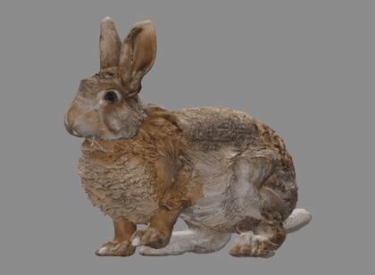</p>

**A second animal through the same pipeline** (2026-11-01): a rabbit from the brief "Wild brown rabbit", rigged
automatically, its hop computed on the rig and played from a Unity prefab, in place. One run of one brief, and the hop's
settings are measured on this rabbit only. [Evidence and limits →](media/creature-rabbit-2026-11/README.md)

Motion comes from two routes. **AI video** reads a clip onto the rig: the wolf's walk came this way, and the owner
preferred it to a computed walk, but it has not yet passed on a second animal. **Computed motion** builds a walk, idle or
hop on the rig with no video and no GPU. [How it works →](CREATURES.md)

## Materials and textures

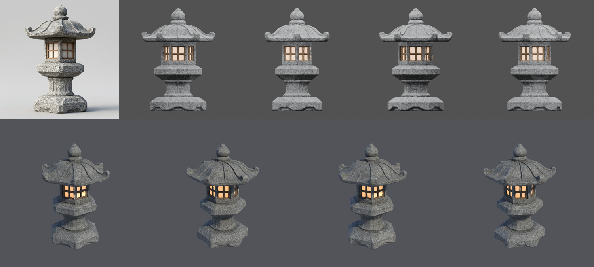

<sub>A stone lantern from the [Provisional prop runs](media/props-provisional-2026-10-v5/README.md): concept, Blender review views and Unity URP renders. The [earlier material showcase](media/material-showcase-2026-10/README.md) shows each map on its own.</sub>

Every 3D asset gets mesh-aware PBR materials generated with its geometry: base color, roughness, metallic, a baked tangent-space normal map and, for declared glowing parts, an emission map, at 4096² on the H100 final profile (kit modules declare 2048²).

- **Material regions:** the brief declares `nonmetal`, `metal`, `emissive[#rrggbb]` or `glass[#rrggbb]` per region. Glass faces get a second, transparent URP material in Unity.
- **Reconstruction-ready concepts:** every 3D concept prompt asks for even lighting, matte non-metals, thick parts, and glowing or glass parts drawn as solid surfaces so they reconstruct whole.
- **Clean geometry:** raw shapes are remeshed on the GPU, and normals are baked against the full-detail mesh, so thin planks, handles and lattices survive. UV islands are padded by 4 texels and packed tightly.
- **Checks before review:** a candidate is rejected, and the next seed tried, when any of these fail:
  - it has more than five parts;
  - its silhouette does not fit the concept (this catches shattered meshes);
  - its colour drifts from the concept;
  - its texture turns dark where the concept is light ([calibration](media/dark-texture-check-2026-10/README.md));
  - a declared glowing or glass part is not found.

  A metallic map that contradicts an all-non-metal brief also fails before review. Placeholder normal maps cannot be approved.

[How materials are made →](MATERIALS.md)
