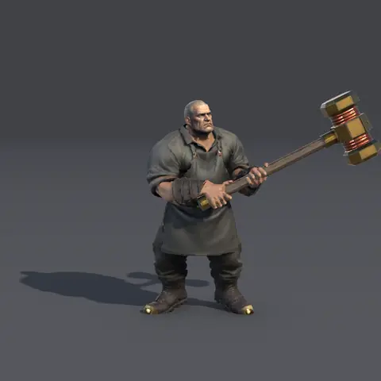
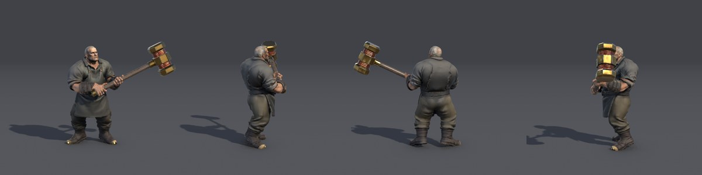
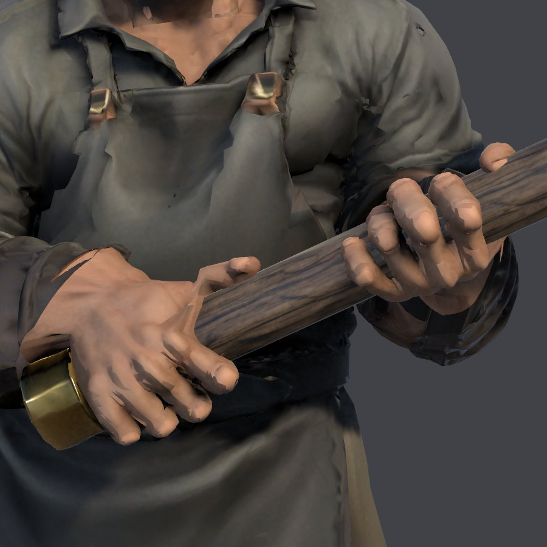

# A character built in parts

One character from a game in development, shown here with its owner's agreement as an example of [the parts route](../../CHARACTER-RIGGING.md#characters-built-in-parts). Its head and headless body were generated separately from one concept, joined on one material, rigged with Rigify and imported into Unity as a Humanoid. **Experimental.**

Rendered in editor batch mode with Unity 6000.3.25f1 and URP 17.3.0, under three directional lights on a plain stage, not game lighting. Model files, briefs and the game's own material aren't published.

## This build's hands

These hands are newer than the route in `main`. They come from work on a branch that isn't merged:

- An open hand is painted from the concept's own forearm, built as its own model, and placed on both arms.
- Its five digits are found from the silhouette, and 15 finger bones per hand go into the Humanoid.
- Fingers close by contact on the handle's measured thickness, and the handle lies at a slight diagonal across the palm where that eases the wrist.

Up close they still read as rough:

## What was measured

On this one build, played through an Animator:

| | Hold (standing, walk, jog) | Swing |
| --- | --- | --- |
| Fist off the handle | 0.1 cm at most | 0.2 cm at most |
| Arm in the body | 0 | 0 |
| Wrist bend, lower and upper hand | 20 and 13 degrees at most | 76 and 45 degrees at most |

Those numbers say the parts meet where they should. They don't say it looks right.

## Limits

- **Motion:** the owner's verdict on this build, 2026-11-05, was "still very rough", and it is about how he moves. The attack is computed, not captured. Its shape changed to ease the wrists after the owner had accepted an earlier one.
- **Close up:** the hand's shape is bent from a flat open hand, and its skin is cleaner than his clothes.
- **Hand builds:** of two open hands built in the last round, two fingers fused on one. A check refuses such a hand, so a character needs several takes.
- **One build:** the other three characters on this route keep their earlier hands and aren't shown. One failed first and changed shared code. This is evidence for this asset, not for repeatability.
- **Not done:** playing it in a game, the manifest entry and notices for a joined character, and a full test of the hand work, which is why it isn't merged.
