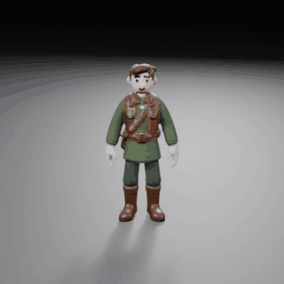
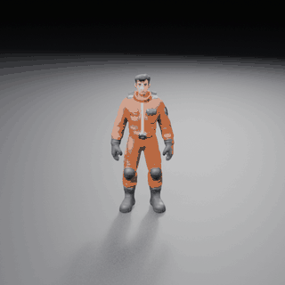
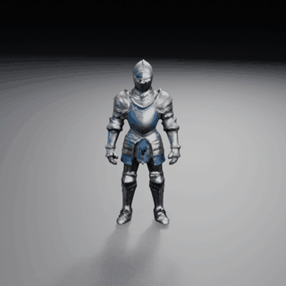
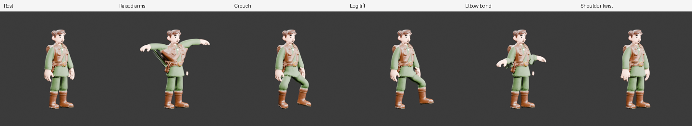
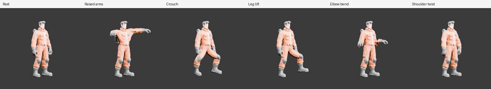
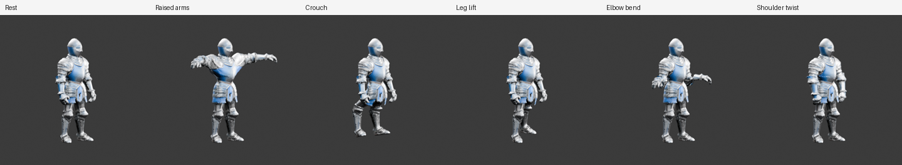

# Character rigging — three generated characters, rigged and walking

Three humanoid characters generated on 2026-10-18 from written briefs (`generate character` →
`approve` on the H100 profile) and rigged automatically with the Blender Rigify provider. Each
GIF is a lit turntable playing a procedural in-place walk test cycle on the rig's FK controls; it
shows how the mesh deforms in motion and is not production animation.

| Ranger | Mechanic | Knight |
| :---: | :---: | :---: |
|  |  |  |

Review poses from the rig report (three-quarter view):

## What changed in rigging

| Before | Now |
| --- | --- |
| Full human metarig scaled to the mesh bounds; on an A-pose character hands, forearms, shins, feet and 73 of 91 face bones sat outside the body | Basic human metarig placed from mesh cross-sections: leg gap, arms beside the torso, limb centroids |
| Bone heat on the raw mesh; on fragmented generated meshes it found no solution and rigging failed | Bone heat on the finest watertight voxel proxy that weights every vertex, transferred to the mesh |
| Arm-envelope and nearest-bone overrides dragged clothing near hanging hands | Forearm/hand weight only on vertices surface-connected to the arm; fused hand–thigh faces cut and counted |
| Front-only, dim review renders; IK raised-arms pose and leg lift/elbow bend posed backwards | Three-quarter lit renders; FK poses with axes measured on the rig |
| Unity Humanoid map named control bones absent from the exported FBX | Map names the exported `DEF-` bones |

On a fragmented 1,092-island dev character the previous rigger failed outright ("Bone Heat
Weighting: failed to find solution"); the landmark rigger weights all its vertices. On these three
clean, single-piece characters both riggers complete, so they were compared on the same five FK poses
with `blender/rig_stretch_metrics.py` — the share of mesh edges stretched past 1.5× their rest length
(lower is better; previous → landmark rigger):

| Pose | Ranger | Mechanic | Knight |
| --- | --- | --- | --- |
| Raised arms | 3.65 → 3.57 | 3.61 → 2.88 | 3.26 → 2.88 |
| Crouch | 1.64 → 0.96 | 1.24 → 0.87 | 0.76 → 0.63 |
| Leg lift | 1.53 → 0.51 | 0.90 → 0.48 | 0.77 → 0.44 |
| Elbow bend | 1.23 → 0.65 | 1.08 → 0.39 | 1.23 → 0.37 |
| Walk stride | 1.52 → 0.83 | 0.95 → 0.41 | 1.04 → 0.52 |

Raw values, including 2× shares and the largest single-edge ratio, are in
[`stretch_comparison.json`](stretch_comparison.json); rig reports (joint fit, proxy voxel sizes,
weighted vertices, contact faces cut, influence cap, provider) are in [`rig_reports.json`](rig_reports.json).

## Conditions

- Generation: SlopForge `feat/character-rigging` (commit `e26c6d0`), `character` asset type with
  `--require-manifold`, `model.trellis2.h100` v5 at the final tier, 60,000-face budget; one concept
  of four selected per character by the agent for evaluation only.
- Rigging and renders: Blender 5.1.0 with bundled Rigify; 35 deform bones; four influences per vertex.
- The rigs were produced by running `blender/rigify_character.py` on each material candidate's FBX,
  outside the CLI approval gates (source review, readiness and texture approval need human decisions).

## Limits

- **Not approved:** no source, readiness, deformation or texture approval was given, and no Unity
  import or Humanoid Avatar was attempted for these three; the earlier Unity walk evidence remains
  the only engine playback record.
- **Shoulders:** raising the arms still stretches about 3% of edges at the shoulders and armpits,
  barely better than before.
- **Ranger artefacts:** the satchel strap stretches between body and arm when the arms rise, and a
  small piece near the hip stays behind after the hand–thigh contact cut.
- **Contact openings:** deleting fused contact faces leaves small openings where a hand touched
  the body.
- **Single extremes:** the largest single-edge stretch is sometimes higher than before.
- **Test cycle:** the walk is a procedural test cycle; real animation retargeting is a separate
  step ([character animations](../../CHARACTER-ANIMATIONS.md)).
