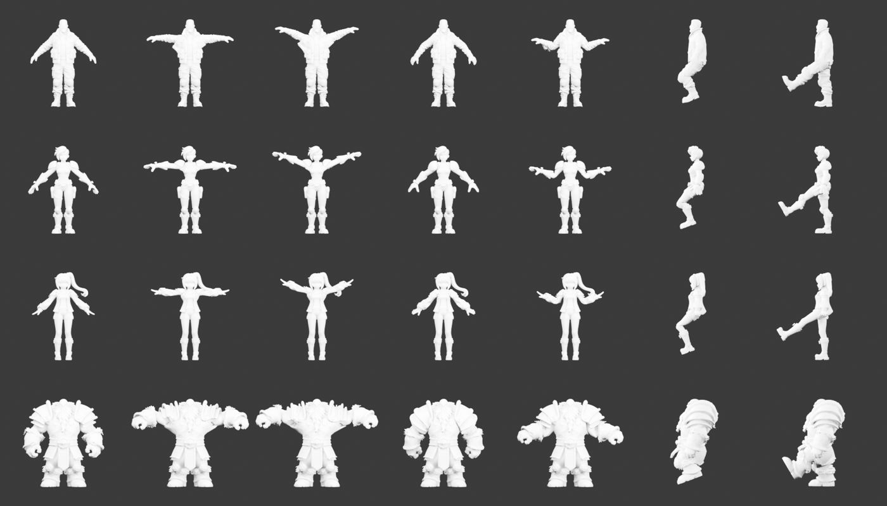

# Character styles — generated, rigged and walking

Four characters in four art styles, each generated from a written brief through the normal CLI
(`generate character` → `approve`), rigged automatically and retargeted to a motion-capture walk, with no
manual repair. Rendered on 2026-10-19 as lit turntables.

| Realistic | Stylized hero | Anime | Hand-painted |
| :---: | :---: | :---: | :---: |
|  |  |  |  |

Rig review poses per character (rows): neutral, T-pose, raised arms, shoulder rotation, elbow bend,
crouch, leg lift.

## How they were made

1. **Concept:** Z-Image Turbo with a pose ControlNet (Z-Image Fun ControlNet Union 2.1, Apache-2.0) holding
   an A-pose skeleton, so arms and hands stay clear of the body (`workflows.character_image`).
2. **Model:** TRELLIS.2 on one H100 with the character graph
   (`trellis2_image_to_model_h100_character_api.json`: 1536 shape upsample, 512 QEF remesh, crease-preserving
   QEM decimation to 60k faces, 4096² maps), local manifold repair, a Blender MikkTSpace normal bake from the
   full-detail remesh, and the front concept projected onto camera-facing base color (skipped for the dwarf,
   whose model came out 8% wider than its concept). A front-silhouette check retries turned reconstructions.
3. **Rig:** SkinTokens (VAST-AI, MIT, revision `273b691`) on the H100 through the provider's SSH path, with its
   voxel-reachability postprocess; weights that jump across the skeleton are removed (69–537 influences per
   character); Unity Humanoid bone names.
4. **Walk:** CMU Graphics Lab clip 07_02, retargeted with limb rest alignment, the actor's stride heading,
   stance-referenced feet, arm clearance from the character's own mesh, slight stance widening and relaxed
   fingers (`blender/retarget_mocap.py`). Seeds: realistic 2386052982, hero 1558869780, anime 875475747,
   hand-painted 371609922.

## Limits

- **Experimental, not approved:** no source, deformation or appearance approval, and no Unity import of these
  four. One generation run per character.
- **Model quality:** owner review rates the models well below shippable game characters: lumpy forms,
  soft faces (eyes painted on smooth surfaces), fused fingers and straps, and textures with baked lighting.
  These are the limits of current open single-image 3D generation, not settings left untuned.
- **Animation:** the walk is good but in place, with no wrist or finger motion from the clip; SkinTokens gave
  the dwarf fewer finger bones.
- **CMU mocap:** free for all uses including commercial products, not resellable directly; clips are kept
  outside Git.
