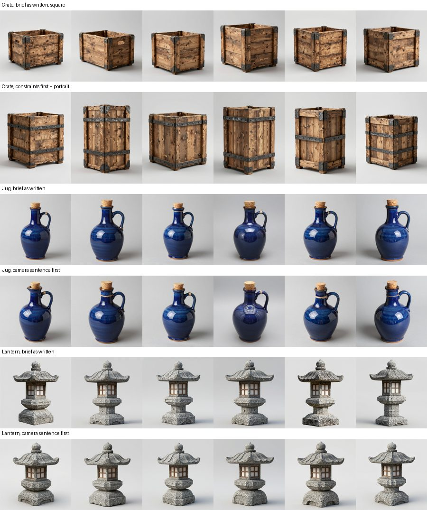

# Concept adherence (2026-10-20)

In the six-run props protocol ([evidence](../props-provisional-2026-10/README.md)), most runs failed at the
concept stage: every crate concept was wider than tall and had no straps, and every jug concept was a side
view. This controlled test ([issue #65](https://github.com/gysahlgreene/SlopForge/issues/65)) looks for what
moves those concept properties.

## Set-up

- **Workflow:** the bundled concept workflow (`image_text2img_api.json`, Z-Image Turbo, 8 steps, CFG 1), on
  the H100 `h100` profile.
- **Seeds:** the same six seeds (1001–1006) for every variant, so only the stated variable changes.
- **Prompts:** each brief's image prompt plus the pipeline's reconstruction rules and material regions,
  exactly as `generate` builds them.
- **Measures:** height/width is measured on the background-removed silhouette. Straps, view angle and lit
  panels were judged by eye from the contact sheet below.
- **Evidence location:** raw images and the harness are in the Git-ignored `private/` folder.

## Results

| Variant | Taller than wide | Straps visible | View |
| --- | --- | --- | --- |
| Crate, brief as written, square canvas | 0/6 (h/w 0.74–0.86) | 0/6 (corner brackets only) | three-quarter |
| Crate, portrait canvas only | 3/6 | 0/6 | three-quarter |
| Crate, constraints first, square canvas | 2/6 | 6/6 | three-quarter |
| Crate, constraints first, portrait canvas | **6/6** (h/w 1.01–1.46) | **6/6** | three-quarter |
| Crate, as above plus a camera sentence | 5/6 | 6/6 | elevated three-quarter; lids closed |
| Jug, brief as written | n/a | n/a | 6/6 profile, handle side-on |
| Jug, view stated first | n/a | n/a | 6/6 profile; images almost unchanged per seed |
| Jug, camera sentence first | n/a | n/a | 6/6 profile; images almost unchanged per seed |
| Lantern, brief as written (current emitter rule) | n/a | n/a | near-frontal; panels unlit 6/6 |
| Lantern, camera sentence first | n/a | n/a | slightly more elevated on some seeds; panels unlit 6/6 |

"Constraints first" restates the crate brief so the view and proportion lead, and each part has its own
sentence with its form and count: "two horizontal iron straps around the body". The camera sentence is
"elevated three-quarter view from the front left, looking down about 30 degrees, with the object turned 45
degrees so its front and one side are both visible and its top surface shows".

**Fresh-seed check through the CLI:** `generate --aspect portrait` with the constraints-first prompt gave
three 896×1152 concepts. All three were taller than wide, with straps and in three-quarter view. The canvas
size is recorded in the concept identity.

## What moves concepts

- **Missing parts:** name each part in its own sentence, with its form and count. Straps went from 0/6 to
  6/6 with that sentence, and the canvas alone did not add them.
- **Proportions:** the canvas shape and the stated proportion each help, and both together reach 6/6. Use
  `generate --aspect portrait` (or `landscape`) for objects clearly taller (or wider) than they are deep.
- **View angle, boxy and architectural objects:** these already follow "three-quarter view". A camera
  sentence makes them more elevated. On the crate it also closed the open top, so it can change the design
  and is an authoring choice, not an automatic rule.
- **View angle, round objects (the jug):** no wording tried moved the jug off the profile view; each seed's
  image barely changed. The qualification record's "three-quarter view" criterion may not suit
  rotationally symmetric props. Changing the criterion is the owner's decision.

## Limits

- One brief per object type and six seeds per variant, on one concept model.
- Straps, views and lighting were judged by eye.
- No mesh was generated from these concepts, so the effect on reconstruction is not measured.
