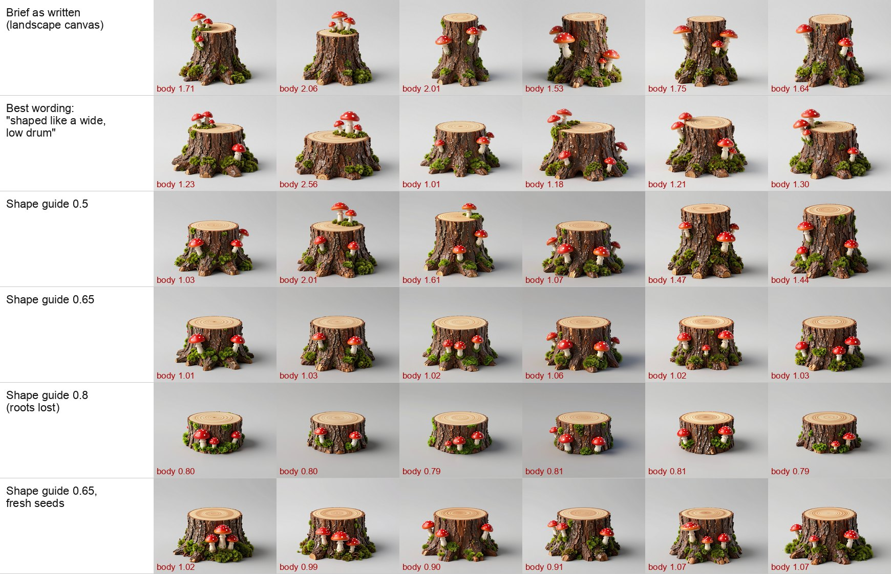
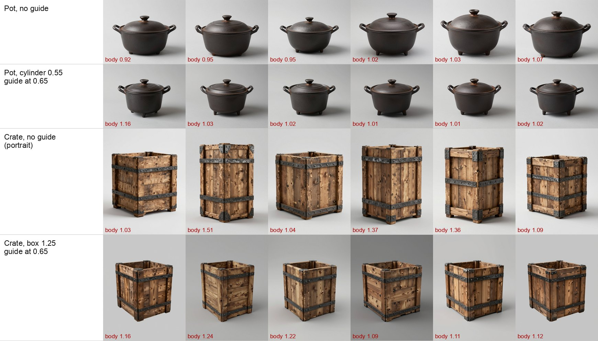
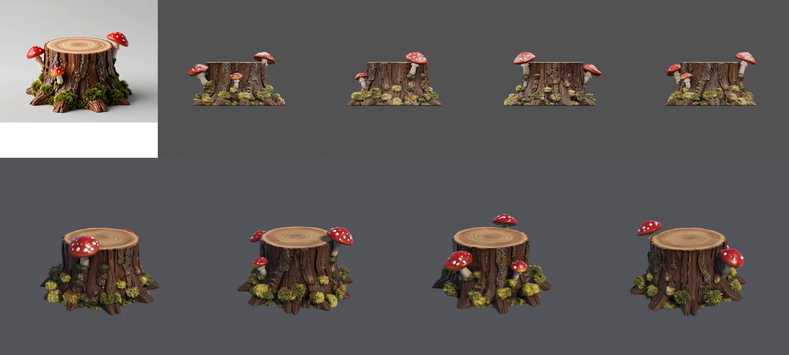
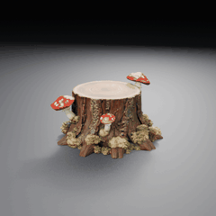

# Concept proportions and the shape guide (2026-10-22)

In the [prop coverage exploration](../props-coverage-2026-10/README.md), the stump brief asked for "one short
mossy tree stump, wider than it is tall" on a landscape canvas. Every one of its 12 concepts had a trunk taller
than its diameter. This controlled test ([issue #65](https://github.com/gysahlgreene/SlopForge/issues/65)) looks
for what holds that proportion.

## Set-up

- **Workflow:** the bundled concept workflow (Z-Image Turbo, 8 steps), on the H100 `h100` profile.
- **Seeds:** the same six seeds (1001–1006) for every variant, so only the stated variable changes. One check uses
  six fresh seeds (2001–2006).
- **Prompt:** the coverage brief plus the pipeline's reconstruction rules and material regions, exactly as
  `generate` builds them. Each variant changes one thing.
- **Evidence location:** raw images and the harness are in the Git-ignored `private/` folder.

**How proportions were measured.** An outline (bounding box) measure does not work here. The roots and mushrooms
widen the silhouette, so the original 12 concepts measured near square (h/w 0.78–1.23) although every trunk was
tall.

The "body" measure instead divides the cut-out's height by the trunk's width, taken from the narrower rows between
20% and 80% of its height. From the concepts' raised three-quarter view, the top ellipse adds to the apparent
height. Calibrated on rendered cylinders:
- a cylinder as tall as it is wide measures 1.19;
- a cylinder half as tall as it is wide measures 0.77.

**Below 1.19 means a trunk wider than it is tall.**

## Results

| Variant (one change from the brief as written) | Trunks wider than tall | Body h/w | Brief parts |
| --- | --- | --- | --- |
| Brief as written, landscape canvas | 0/6 | 1.53–2.06 | all present |
| Square canvas | 0/6 | 1.56–2.27 | all present |
| "about twice as wide as it is tall" | 0/6 | 1.49–2.02 | all present |
| "cut low, close to the ground" | 0/6 | 1.29–1.55 | all present |
| "the stump of a very thick old tree" | 0/6 | 1.95–2.65 | all present |
| "shaped like a wide, low drum" | 2/6 | 1.01–2.56 | all present |
| Shape guide, strength 0.3 | 0/6 | 1.25–2.16 | all present |
| Shape guide, strength 0.5 | 2/6 | 1.03–2.01 | all present |
| **Shape guide, strength 0.65** | **6/6** | **1.01–1.06** | **all present** |
| Shape guide, strength 0.8 | 6/6 | 0.79–0.81 | roots lost; stumps read as log sections |
| Blurred shape guide, strength 0.8 | 4/6 | 0.98–1.30 | all present |
| **Shape guide 0.65, fresh seeds** | **6/6** | **0.90–1.07** | **all present** |

**The shape guide.** It is a depth map of a cylinder half as tall as it is wide, rendered at the concept's
canvas and view. It goes through the Z-Image ControlNet Union graph that character concepts already use for their
pose skeleton, so no new model was installed. At 0.65 the concept takes the guide's mass but draws its own
outline, so the roots, moss and mushrooms survive. At 0.8 it copies the cylinder.

Mushrooms growing on the top add to the measured height, so some values are inflated, for example 2.56 for the
"drum" variant's seed 1002. The images above show the trunks.

## Other props

- **Pot (cylinder 0.55 guide):** the handles, lid knob and feet all survive. The pot was already wider than tall
  without a guide, so it does not need one.
- **Crate (box 1.25 guide, portrait):**
  - the open top and the two straps survive;
  - the crates turn to the guide's angle and look squarer;
  - the backgrounds come out darker.

  The crate already follows its wording, so a guide is not needed there either.

## What changed as a result

- **New option, `generate --shape-guide cylinder|box:<height/width>`:**
  - it renders the guide with Blender (`blender/shape_guide.py`) on the concept canvas set by `--aspect`;
  - it routes the concept through `workflows.guided_image` at strength 0.65;
  - the guide's hash and strength join the concept identity.
- **It is opt-in:** use it when wording and `--aspect` do not hold a proportion. It is for props only; character
  concepts keep their pose skeleton.
- **Stable bytes:** the guide is rendered without dither or metadata, so the same request gives the same bytes and
  the same identity.

## Live run

This run went through the CLI from a fresh copy of the Unity 6000.6.3f1 / URP 17.6.0 blank project, on the H100
`h100` profile, at commit `f8444ef`.
- **Command:** `generate prop tree_stump` with the coverage brief unchanged, plus `--aspect landscape
  --shape-guide cylinder:0.5`.
- **Concepts:** all six had trunks wider than tall by eye. Two grew their mushrooms on the top, against the brief.
- **Approval:** concept 1 was approved. It passed on the first mesh attempt and went through materials and a Unity
  import.
  - Concept fit 0.92.
  - Colour against the concept: hue difference 0.09, chroma ratio 1.50.
  - No warnings.
- **The 3D stump follows the brief.** Measured on the mesh, against the unguided coverage stump (F2):

| Stump | Whole mesh h/w | Trunk h/w (middle band) |
| --- | --- | --- |
| Coverage F2, no guide | 1.01 | 1.67 |
| L1, shape guide | 0.55 | 0.79 |

| Concept → Blender → Unity | Turntable |
| :---: | :---: |
|  |  |

The moss came out yellower on the mesh than in the concept. This is the known gap: the colour of small parts is
not checked.

## Limits

- One brief was tested in depth, with spot checks on two others, and only one guided run went through to Unity.
- The body measure has a known error: mushrooms on the top add to the height.
- Elements were judged by eye.
- The guide sets the mass and view angle, so it can also change a design. The crate turned to the guide's angle.
