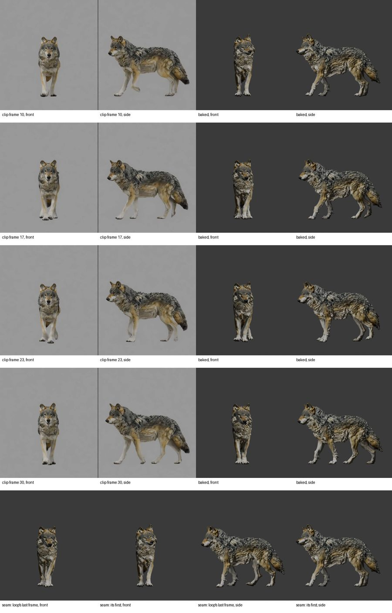

# Creature extraction, bake and review (B6): the wolf's first generated walk (2026-10-28)

This is the live run of package B6 ([Creatures](../../CREATURES.md#extraction-and-bake-b6); epic
[#128](https://github.com/gysahlgreene/SlopForge/issues/128)) on `walk_s2`, the first clip B5 accepted (see
[B5's evidence](../creature-video-b5-2026-10/README.md)). The wolf's rig is still awaiting its deformation review, so
the clip cannot be approved yet. The commands:

```sh
slopforge creature extract wolf walk_s2
```

**What this shows:** a generated video's motion read with video2rig, baked onto the rig in place and cut to a loop,
exported as FBX, and laid out for the owner's review.

**What it does not show:**
- the owner's verdict;
- Unity playback, which is B7;
- more than one clip.

## Result

| Measure | Value |
| --- | --- |
| Plants per leg (front L, front R, hind L, hind R) | 4, 3, 1, 2 (hind L is a `weak_legs` warning: its steps lift 2–3 % of the height) |
| Period | 1.69 s (the median interval between one leg's plants) |
| Speed and stride | 0.41 m/s; 0.70 m per period |
| In place | 3.1 m of video2rig `steps` travel removed; 5 cm of surge left along the body |
| Loop | 4 periods (keys 10–118, whole frames 16–178 at 24 fps) |
| Seam | 6.6° mean bone angle, 4.0 cm at the root: a visible pop, shown in the sheet's last row |
| Stance slide at the delivered speed | 0.05 m/s |

**video2rig's warnings,** recorded and not gated, since D8's limits are not set:
- the side view's outline is weak from frame 4, where `steps` carries the fit out of the camera before the bake makes
  it in place;
- `FrontPaw.L` turns 68° in one frame at frame 75;
- the body goes under the floor in 2 frames.

## The review sheet

Four phases half a cycle apart, then the seam. Each phase row shows the clip's two panels beside the baked Action in
the same start cameras. The last row shows the loop's last frame beside its first.



## Found while running it

The first live attempt refused the clip, because its hind left planted once. Requiring two plants of every leg would
have passed only g2 of #149's 18 imported walks, though g3, g4 and e1 walked by eye. The rule is now #149's plants per
leg: every leg plants at least once. The period comes from the legs that plant twice, and a leg that plants once is a
warning. See the guide.
