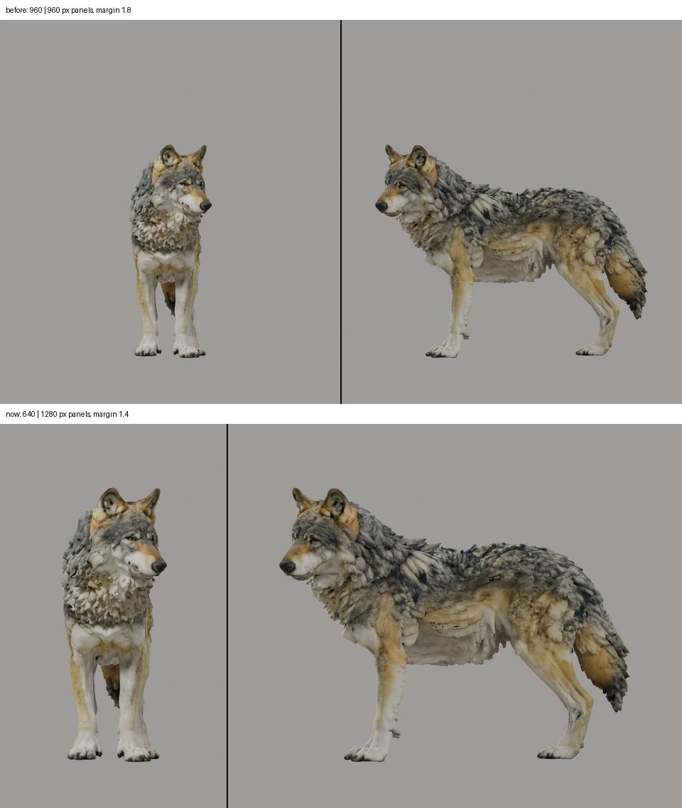

# A larger start frame and a refit for the clip's frame rate: the generated wolf's walk (2026-10-30)

The owner judged the wolf's first delivered walk (B5's clip → B6's fit and bake → B7's Unity) "the worst ive ever
seen it": stuttery, then "robotic". Unity played the bake faithfully (the feet within 0.2–0.5 cm, median), so the
loss was in reading and fitting the clip. This page records what was tried and what the owner chose. The pipeline now
does the chosen fit ([Creatures](../../CREATURES.md): the start frame in B2, the refit in B6, the exam in B3; epic
[#128](https://github.com/gysahlgreene/SlopForge/issues/128)).

**What this shows:**
- Three camera layouts compared on the same wolf, prompt and seed.
- Five fits of one reading compared, and the owner's choice.
- The pipeline's refit reproducing the chosen fit exactly (largest quaternion difference 3e-16).

**What it does not show:**
- A walk the owner judges good: "significantly better but needs improvement".
- A passed exam: the scapulae's swap rate still waits on the owner's ruling (B3).
- Other creatures, motions or seeds. Every number here is one clip of one wolf.

## The start frame

| Layout | Clip passed intake | Fit | Owner |
| --- | --- | --- | --- |
| Front + side, 960 + 960 px, margin 1.8 | seed 2 (body 1.2 %) | median miss 4.99 px, 53 one-frame spikes smoothed | "robotic" |
| Three-quarter (front-left) + right side | seed 2 (body 0.67 %) | median miss 3.58 px; left and right paws cross in 34 of 109 frames (front) and 40 (hind), by up to 33 cm | "its legs are crossing over" |
| Front + side, 640 + 1280 px, margin 1.4 | seed 2 (body 1.37 %, limbs 0.92 %) | median miss 5.68 px; no crossing (paw gaps 10.1 and 12.2 cm, median) | "significantly better but needs improvement" |

Each two-view layout leaves part of a quadruped's walk unmeasured:
- The side view hides the far legs (reader confidence 0.19).
- The front view sees swing end on.
- In three-quarter + right side, no view measures the right legs' sideways place.

video2rig's check needs exactly two views, so a third view would mean changing the tool. The type keeps front + side
at the larger scale. A larger wolf barely raised the reader's confidence in Wan's front view (0.58 to 0.61–0.66).

## The fit

video2rig's reader fit counts its thresholds in frames, tuned for Seedance's 24 fps; Wan's clips are 16 fps. The
same reading of the larger layout's clip was fitted five ways:

| Fit | Mean leg turn a frame | Largest one-frame turn | Spikes smoothed | Median miss |
| --- | --- | --- | --- | --- |
| A: as `run` fits | 5.34° | 107° | 131 | 5.68 px |
| B: per-frame settings converted to 16 fps | 5.94° | 118° | 92 | 5.55 px |
| C: B, and a wider outlier scale | 6.19° | 152° | — | — |
| **D: B, within walk-sized paw ranges (FrontPaw 90°, FrontToes 60°)** | **5.77°** | **78°** | **89** | **5.53 px** |
| E: D without foot pinning | — | front paw and toe flips unchanged (24) | — | — |

Shown side by side, the owner chose D: "i think d is best yeah". E shows the remaining paw flips come from the toe
readings, not from pinning the feet: in D, 24 front paw and toe turns exceed 30° in one frame (B: 32).

The pipeline now does D. Extraction refits each clip's reading with `video2rig.reader.fit` at the clip's frame rate,
within the motion's `fit_joint_limits`. The reader keeps training on the type's wide ranges, and the exam judges the
same refit. On the larger layout, a newly trained reader's exam passes 11 of 12 limits (bone median 1.68°, worst body
p95 9.2°) and fails the swap rate on the scapulae only (0.54), as in B3.

## Still open

- Front paw and toe flips from noisy toe readings. Next: stronger paw smoothing, or SlopForge's own whole-sequence
  fit on video2rig's readings.
- The face and chest stretch (the rig's weights, [#154](https://github.com/gysahlgreene/SlopForge/issues/154)), and a
  mesh the owner puts at about half the quality hoped for: both outside the motion's fit.
- video2rig's outline match reads 0.08–0.12 in the side view even on the exam's rendered clip, so it is not yet a
  usable measure here.

The clips, readings, fits and comparison films are private.
