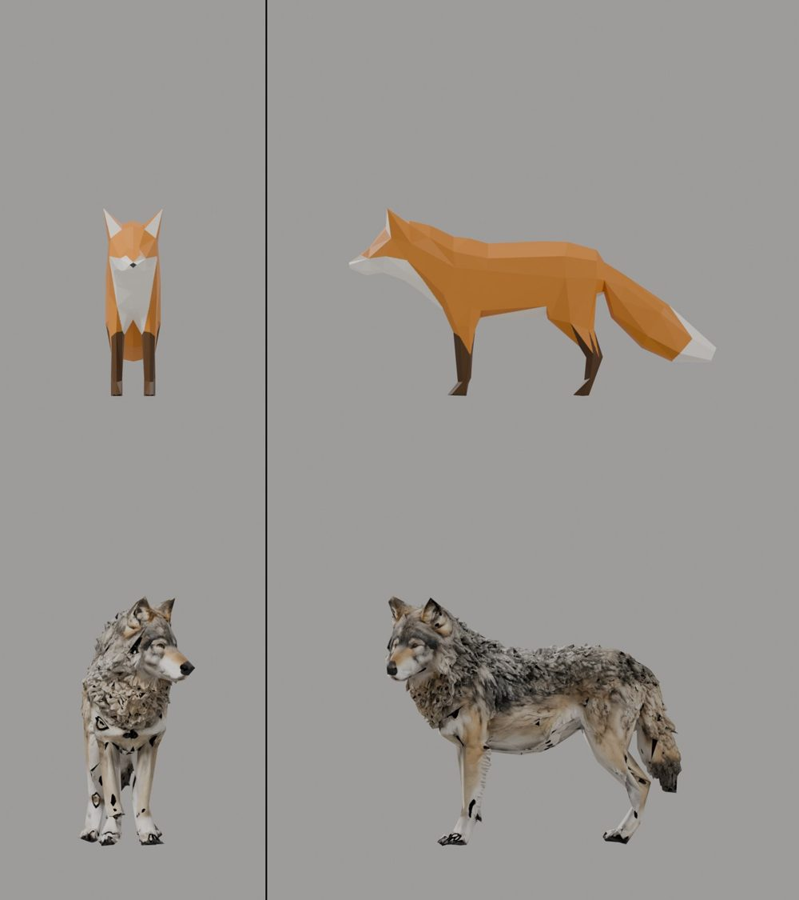
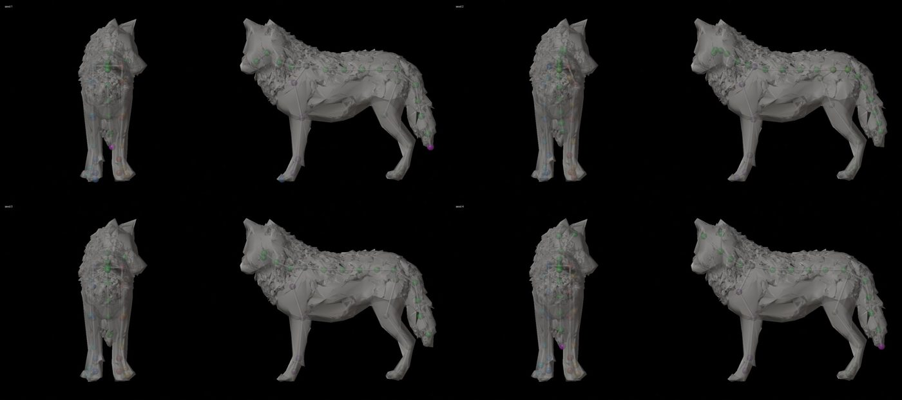
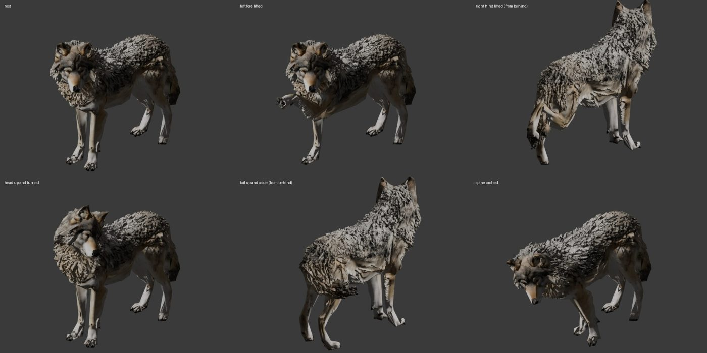
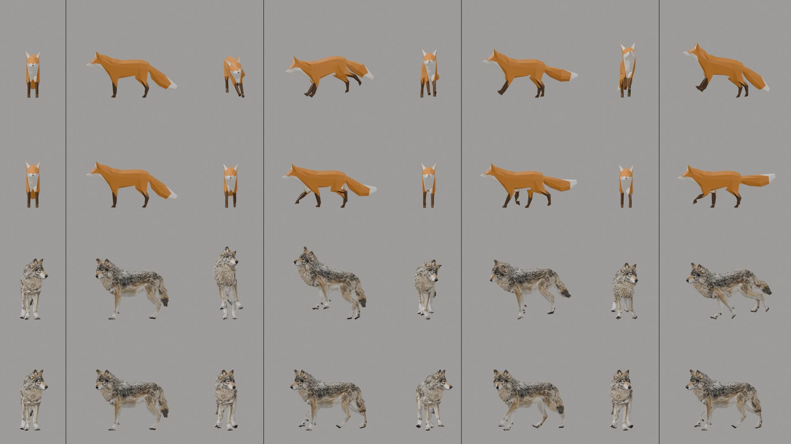
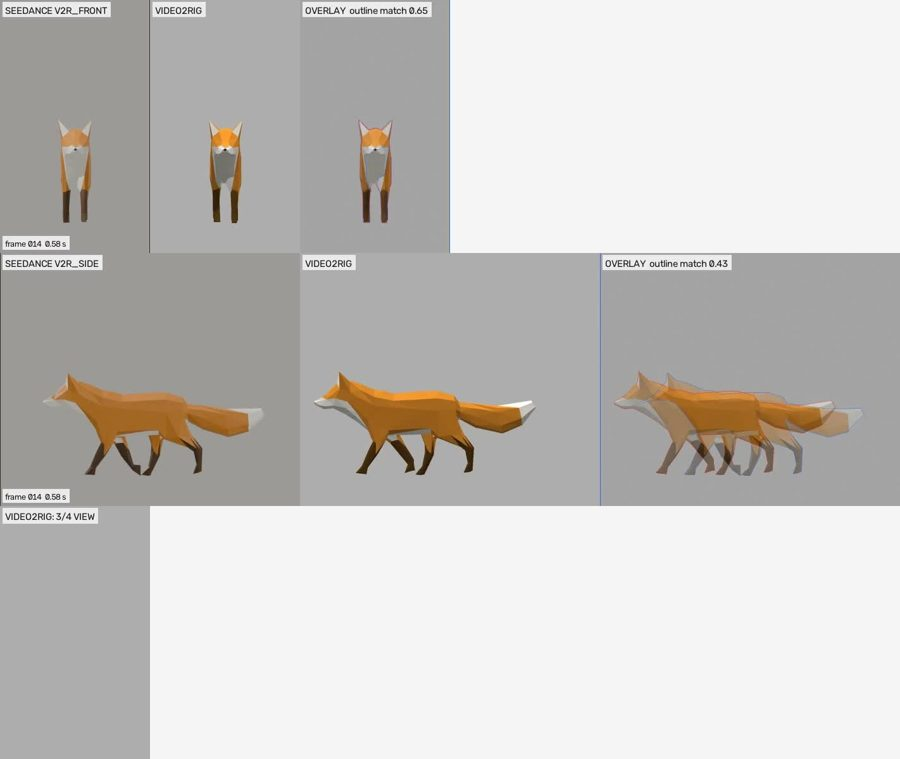

# Creature motion: video2rig reading known motion back (2026-10-27)

The bounded check [#129](https://github.com/gysahlgreene/SlopForge/issues/129), part of M5
([#128](https://github.com/gysahlgreene/SlopForge/issues/128)). **The question:** can a per-creature joint reader
recover a known motion from two calibrated views? It was tested on a generated quadruped and on a control.

**The setup:**
- The reader and the fit are [video2rig](https://github.com/canitcode/video2rig) at `55d51b3` (AGPL-3.0), run
  unmodified as a separate program and never imported ([Creatures](../../CREATURES.md)).
- No video model is involved. The known motions are rendered through video2rig's own cameras and studio.

**What this does not claim:** creature qualification, any threshold (the owner sets D5–D9 from these numbers), any
statement about real or generated video, or anything beyond these two creatures. The scratch scripts and full
records are in the private run folder `private/spike-129-2026-10-27` (`LEDGER.md`).

## The creatures and their start frames

**Wolf (generated):**
- A `prop` through the TRELLIS.2 mesh-aware route on the `h100` profile: 28,472 faces, facing −Y.
- Its lineage is `attribution_required` ("Built with DINOv3.").
- Rigged by SkinTokens `273b691` (checkpoint sha256 `f4e4706a`).

**Fox (control):** the Khronos glTF Sample Assets Fox.
- Model by PixelMannen, CC0.
- Rigging and animation by tomkranis, CC-BY 4.0.
- glTF conversion by @AsoboStudio and @scurest, CC-BY 4.0.
- Its bones were made to point at their children, and the authored actions re-keyed so the deformation is unchanged.

**The start frames:** `render_start.py --widths 640,1280 --margin-wide 1.45`. The default equal panels cut off the
Fox's head and tail.

## The rig check (B1, structural)

Four SkinTokens seeds were checked:
- exactly one armature;
- a bone chain per foot, standing on the floor the way video2rig's `standing_legs` tests it;
- left and right chains with the same bone count and mirrored joints;
- every joint inside the mesh by generalized winding number;
- the weights.

| seed | result |
| --- | --- |
| 1 | fails: front legs have 5 and 6 bones; the tail-tip joint is outside the mesh (winding 0.002) |
| 2 | fails: the hind legs come off no hub and do not mirror (gap 0.28 of the height); 3 joints are outside |
| 3 | **passes**: 4 chains of 5 bones, mirror gap 0.005 of the height, every joint inside (winding ≥ 0.978), 4 influences, weight sums 1.0 |
| 4 | fails: the tail-tip joint is outside the mesh |

Seed 3's bones were renamed the way video2rig's own auto-rig names a quadruped, and every bone's local X was laid
across the body.

**Deformation (owner review, not judged here):** the six poses are rest, left foreleg lifted, right hind leg lifted,
head raised and turned, tail moved (the pose tucked it under), and spine bent.

## The readers

Each reader was trained for 9000 steps on the H100: 3000 random poses, two views each, rendered on the SlopForge
machine.

| | minutes | held-out median px, front / side | both views together |
| --- | --- | --- | --- |
| Fox | 14.6 | 4.15 / 2.79 | 3.39 |
| Wolf | 12.7 | 4.83 / 3.51 | 4.08 |

The author reports 2–4 px for the readers in use.
- The wolf's reader is above that, which is the spike's third stopping condition.
- The owner ruled that the Fox exam stands, and the wolf exam was run past the stopping condition by owner
  direction.

## The exam

**The known motions** (4 s at 24 fps; the walk 3.3 s):
- **Random:** every fitted joint follows smooth seeded noise inside video2rig's own joint priors. Knees and elbows
  fold their own way only. The skin stays on the floor.
- **Fox walk:** the authored Walk, eased in from the start pose and looped four times. It was lifted by 1.85 cm,
  because it sinks the front paws under the start floor.
- **Wolf gait:** a procedural in-place walk. No authored walk exists for a generated creature.

**How they are rendered:** with video2rig's `render_poses.py`, through the start frame's own cameras, each panel
1:1. The fit is `video2rig check`, then `run --cpu`.

**How the metrics are measured:**
- *joint position error*: per joint per frame, the 3-D miss over the creature's height. Also given with the body's
  travel taken out (root-relative).
- *bone rotation error*: the angle between the fitted and true head-to-tail directions.
- *detection*: the share of frames a joint is read at confidence ≥ 0.4, the fit's own "unsure" limit.
- *near/far swap rate*: per left/right pair, in the body's side plane.

| | Fox random | Fox walk | Wolf random | Wolf gait |
| --- | --- | --- | --- | --- |
| frames | 96 | 80 | 96 | 96 |
| `check` verdict (views disagree, body / limbs, of height) | WARN¹ (0.009 / 0.008) | WARN¹ (0.006 / 0.011) | OK (0.0025 / 0.0027) | OK (0.0026 / 0.0027) |
| joint position error, root-relative, median / p95 / max | 0.011 / 0.050 / 0.163 | 0.020 / 0.071 / 0.254 | 0.008 / 0.029 / 0.151 | 0.007 / 0.064 / 0.123 |
| fitted travel at the end (heights) | 0.00 | 4.13 forward | 0.00 | 5.33 forward |
| bone rotation error, median / p95 / max (°) | 2.7 / 12.0 / 31.3 | 3.1 / 16.6 / 169.4 | 2.7 / 10.6 / 51.2 | 2.0 / 18.4 / 31.6 |
| detection, both views / front / side | 0.67 / 0.69 / 0.98 | 0.64 / 0.65 / 0.995 | 0.50 / 0.56 / 0.92 | 0.52 / 0.59 / 0.92 |
| near/far swap rate, worst pair | 0.00 | 0.14 | 0.01 | 0.10 |
| worst bone (p95 °) | tail tip 27.2 | right front paw 155.7 | Tail4 24.9 | Tail1 28.5 |

¹ The tool's check says the start pose covers only 0.73 of the first frame in the Fox's front view. The clips' first
frame matches `start.png` to a mean of 1.2 grey levels, so the cause is not the clip. Not investigated.

**Notes on the exam:**
- **Without the travel, the world-space joint error of the in-place clips is 1.7 (Fox walk) and 2.5 (wolf gait)
  heights at the median.** video2rig turns a walk on the spot into travel by design ("the body moved N heights by its
  steps").
- **The hips, spine and tail base are never read in the front view**, which sees them only behind the chest. Their
  both-views detection is 0 by construction, so per-view rates are given beside it.
- **The truth exceeds one tool prior slightly.** The random motion turns paws 25° both ways, while video2rig lets a
  paw fold only 20° against its own way. The wolf's left hind paw sat at that limit in 32 frames.

## The Fox walk's paws, re-run with a declared range

The authored Walk folds the front paws 139–148° past the start pose. video2rig limits a bone named "hand" to 70°.
The re-run declared `joints.<paw>.range: 2.7` rad for the two front paws and changed nothing else (same reader, same
reading, same clip):

| | default | paw range declared |
| --- | --- | --- |
| right paw: fitted fold (true −25..148°) | −70..70° | −66..94° |
| frames with a paw off by more than 45° (right / left, of 80) | 21 / 21 | 15 / 21 |
| right paw p95 | 155.7° | 126.8° |
| joint position error, root-relative, median / p95 | 0.020 / 0.071 | 0.040 / 0.088 |

**The paw failure does not go away.** Projected through the start cameras, the reader reads the paw's wrist and tip
within 1–4 px in ordinary frames. In the frames the fit gets wrong, it misses the paw tip by 46–69 px (front) and
15–25 px (side), at confidence 0.74–1.0.

The reader's training poses are drawn within the same joint bounds, so it never saw a paw folded past 70°. The next
check is to retrain with the range declared ([#140](https://github.com/gysahlgreene/SlopForge/issues/140)).

## Findings, filed under #128

- **[#139](https://github.com/gysahlgreene/SlopForge/issues/139) (B1/B2): the default fitted-bone rule drops the
  wolf's lower legs.** video2rig fits only bones that lead more than 0.4 % of the skin weight. The wolf's paws carry
  0.09–0.17 %, and its shins 0.39 % (left) and 0.46 % (right), so the lower legs are not fitted, and not
  symmetrically. The Fox's limbs carry 1.9–5.3 %. SlopForge declares `fit_bones` from its own limb declaration; the
  exam above did so for the wolf.
- **[#140](https://github.com/gysahlgreene/SlopForge/issues/140) (B2): joint ranges must come from the creature's own
  limits, not bone names**, and be declared before the reader trains.
- **[#141](https://github.com/gysahlgreene/SlopForge/issues/141) (D9/B9): in-place clips come back as root travel.**
  B9 either keeps it, with stride and speed, or strips it.
- **[#142](https://github.com/gysahlgreene/SlopForge/issues/142) (B2/B3): two client gaps.** The client cannot pass
  `render_start` framing options, and cannot train on the GPU provider. Both were run around the client here.

## Rulings made during the check

- **Standing on the floor:** B1 uses video2rig's own standing-leg test, not a joint-height limit.
- **Bone names and axes:** the wolf's bones get video2rig's auto-rig names, and a bone past a limb's names becomes an
  unfitted `…End`. Each leaf's tail continues along its chain, and every bone's local X lies across the body.
- **Fox configuration:** the Fox's knees and elbows are declared as hinges by name, with its root at the hips.
- **Wolf material:** made opaque, with the source base colour reused. Black blotches remain where SkinTokens' changed
  UV seams sample texture gutters, the same in every render.
- **The wolf's second motion is a procedural in-place gait.**
