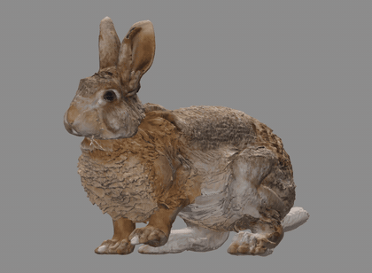
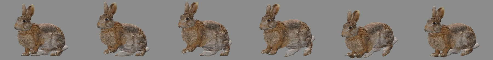
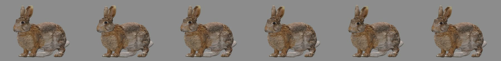

# The rabbit, M5's second creature: from a brief to Unity (2026-11-01)

The same pipeline that made the wolf, on a different animal ([Creatures](../../CREATURES.md); epic
[#128](https://github.com/gysahlgreene/SlopForge/issues/128)). This is one run of one brief, **Experimental**, and not
the M5 protocol (package B8).

The hop, played from the delivered Unity prefab with its own material, in place. In a game, the controller supplies
the forward movement at the clip's speed.

**What this shows:**
- A second animal, with a different body and skeleton from the wolf's, got through concept, model, rig, reader,
  exam, approved motions and Unity Play mode, with the owner's review at each gate.
- A computed idle carried over to a second creature with the wolf's settings unchanged, first try.
- A computed hop the owner passed, in Blender and in Unity.

**What it does not show:**
- That the AI video route repeats. It has made a passing clip on the wolf only. See [below](#the-ai-video-route).
- That the hop's settings work on another creature. They were set on this rabbit.
- That the pipeline is reliable on this brief. Half the models broke and one rig seed in eight passed.
- Turning, blending between clips, uneven ground, a walk or a run on this rabbit, or Windows.
- Shippable model quality. The fur came out paler than the concept's, and the owner chose among what passed.

## The stages

| Stage | Result | Checked by |
| --- | --- | --- |
| Concept | Brief "Wild brown rabbit". Twelve drawn; four reared on their hind legs because the prompt said "standing up", so the wording changed. The first chosen concept's mottled fur was lost in the 3D model, so it was redrawn with even chestnut fur | Owner |
| Model | 14 TRELLIS.2 models from the chosen concept: 7 broke into pieces, 4 passed every check. The owner chose model 14, one of 5 made on the H100 graph | Checks, then owner |
| Rig | 40 bones, 5 bending spine bones, 3-bone ears, head straightened from 0.098 to 0.015 of the height. One of 8 seeds passed | Checks, then owner |
| Reader and exam | 9,000 training steps in 16 minutes; held-out error 6.34 and 5.49 px. All 12 exam limits pass, bone median 2.1°, under the owner's ruling that a joint counts as seen when either camera sees it | Checks; the ruling is the owner's |
| Idle | 6 s loop, 0.13° seam, the wolf's settings unchanged | Owner |
| Hop | 8 hops in 6 s, 0.17° seam, no IK miss, 0.003 m/s stance slide, every foot off the floor for 16 % of the time | Checks, then owner |
| Unity | Generic controller and prefab; Play mode passed with the hop at 0.38 m/s and the idle at 0 m/s | Play-mode tests, then owner on a film |

Unity 6000.6.3f1 on macOS, URP. The owner's verdict on the Unity film was "Yes, both good". The test lighting is plainer
than the Blender review's, so the colours read greyer.

Output rights are `attribution_required`, through the DINOv3 licence that TRELLIS.2's conditioning carries.

## The motions

The hop, every fourth frame of one hop:

The idle, one frame a second:

The hop took three versions:

| Version | What changed | Verdict |
| --- | --- | --- |
| 1 | The body tips about the hips | Not shown: the chest dropped almost to the floor and the feet could not reach (34 mm miss) |
| 2 | The body tips about the middle of its back | Owner: "right idea, too stiff"; "two front legs feel like they are a mirror and a bit stiff" |
| 3 | A leading front paw, shoulders that swing, landings that sink, hanging toes, trailing ears and tail | Owner: "good, keep it" |

## The AI video route

The plan was to read the hop from AI video, as the wolf's walk is. That has not worked.

| Prompt | Seeds | Views disagree on the body (limit 1.5 %) | Result |
| --- | --- | --- | --- |
| "small, slow, relaxed hops", feet in two stages | 1-5 | 5.9, 4.6, 2.8, 4.3, 3.5 % | All refused |
| "all four feet leave the floor at the same instant" | 6 | 6.8 % | Refused; run stopped once the owner chose the computed hop, so this wording has one seed of evidence |

The limit is not what is wrong. A comparison that does not use the joint reader looks at the top and bottom of the
silhouette in each view, which should rise and fall together:

| Clip | Silhouette tops: correlation between views | Median gap |
| --- | --- | --- |
| A rendered known motion, as a control | 1.00 | 0.1 px |
| The five hop clips | -0.56 to 0.14 | 15-41 px |

The top is mostly ears, so this may overstate the difference on the body; the check's body reading agrees in direction.
In the side view, the rabbit's lowest point moves only 7-13 px in every clip: it never leaves the floor there.

**A video walk on the rabbit** is the fairer test of whether the route repeats, because it uses the wolf's prompt
and limits. Seed 1 was refused narrowly (body 1.6 %, limbs 1.8 %). The run was still going when this page was written;
[current state](../../../CURRENT_STATE.md) has the latest.

## Failures and interventions

- **The wrong model graph.** The first 12 models ran on the project's default graph, with no baked normals, because
  the wolf's H100 setting was an environment variable the project did not record. `approve-texture` refused the
  result. The project now declares it, and the docs say so.
- **A rig with no spine passed.** The first passing rig ran straight from hips to chest, which showed as a spike in a
  pose review; every check had passed it. A rig now needs bending spine bones (`min_rig_spine_bones`, provisional).
- **A sound skeleton was refused.** The naming rules expected the wolf's layout. They now accept a root behind the hind
  legs and single leaf bones on the body; a rig read backwards is still refused.
- **Paler fur.** TRELLIS.2 lightens this concept on every passing model (lightness 54.5-73 against the concept's 45.2),
  on both graphs. Colour corrections tested offline stayed pale or came out flat, and the owner chose neither. Nothing
  was repaired by hand. There is still no check for a texture much lighter than its concept.
- **A flip refusal that misread hanging toes.** The check now stops at the paw and names the bone and frame.
