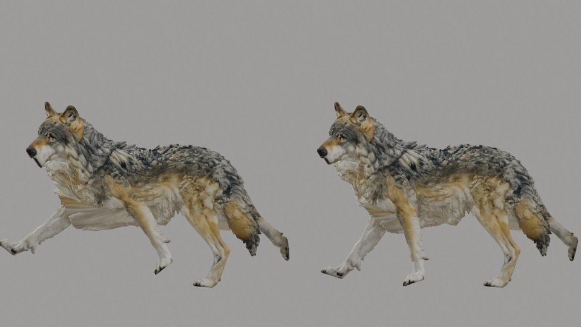

# Reader training and the exam (B3): the generated wolf (2026-10-30)

This is the live run of package B3 ([Creatures](../../CREATURES.md#reader-training-and-the-exam-b3); epic
[#128](https://github.com/gysahlgreene/SlopForge/issues/128)) on the B1 wolf, which is calibrated at B5's framing
and whose rig still awaits its deformation review. The commands:

```sh
slopforge creature train wolf      # providers.video2rig.train_host: the GPU provider (an H100)
slopforge creature exam wolf
```

**What this shows:**
- A reader trained on the GPU provider and brought back, as a recorded stage.
- The motion exam run end to end on it, with its verdict.
- Two things the exam found.

**What it does not show:**
- A passed exam on a generated creature: the verdict below turns on a decision that is yours to make.
- Exams of other creatures or other known motions.

## Training

| Measure | Pipeline (this run) | By hand (2026-10-28, B5) |
| --- | --- | --- |
| Steps | 9000 | 9000 |
| Minutes on the H100 | 11.3 | 11.4 |
| Held-out median, front view | 5.6 px | 5.6 px |
| Held-out median, side view | 4.07 px | 4.04 px |

The project went to a fresh folder on the GPU provider and the reader came back. The folder was then removed.

## The exam

Exam v1's limits ([#145](https://github.com/gysahlgreene/SlopForge/pull/145)) on the known gait (96 frames), read
with the trained reader:

| Measure | Limit | Wolf |
| --- | --- | --- |
| Bone direction error, median | ≤ 5° | 1.86° |
| Worst non-tail bone's median | ≤ 10° | 5.0° |
| Worst non-tail bone's p95 | ≤ 25° | 9.5° |
| Worst tail bone's p95 | ≤ 40° | 26.6° |
| Joint error with travel removed, median | ≤ 0.025 | 0.0064 |
| Joint error with travel removed, p95 | ≤ 0.10 | 0.034 |
| Detection, side view | ≥ 0.85 | 0.887 |
| Detection, front view | ≥ 0.45 | 0.567 |
| Limb-end tips in their better view | ≥ 0.95 | 0.969 |
| Near/far swap rate, worst pair | ≤ 0.15 | **0.66** (scapulae; every limb pair ≤ 0.033) |
| D7: views disagree, body | ≤ 1.5 % | 0.22 % |
| D7: views disagree, limbs | ≤ 2.0 % | 0.41 % |

**The swap rate fails on the shoulders only.** The spike's rig had no scapulae, and B1's wolf has one above each
front leg. The gait's 3° chest sway moves one shoulder forward and the other back, by up to 5.3 % of the height. The
fit reads that sway on the wrong side in 66 % of those frames. The limbs, which the metric was set for, swap at most
3.3 % of the time.

Whether exam v1's swap rate counts the shoulders was the owner's decision. **Ruled 2026-10-30: it does not.** The
shoulder blades' rate is still measured and recorded (`swap_shoulder_blades`), but not judged. See the
[fit D evidence](../creature-fit-d-2026-10/README.md) for the exam under that ruling.

## Found while running it

**The known gait kicked on B1's rig.** The first exam was refused before reading: "the gait motion leaves the frame".
B2's gait swung a scapula as well as each upper arm, flexed every remaining leg bone, end bones included, and bobbed
the head's end bones with the head. The spike's rig had no scapula and moved no end bone. On B1's wolf, a front leg
kicked level and the toes flicked out of the side panel.

Now one bone swings each leg, only the paws and toes flex, and only the neck and head bob. A Blender test pins it.
Frame 35 of the gait, before (left) and after (right):



The pale stretch under the chest is the rig's skinning (deformation review #154), not the motion.

**The port of the spike's comparison.** On the spike's own data it reproduces the spike's numbers to 0.001: 471
numbers on the wolf gait, and 365 on the failing Fox walk, detection and swap rate included. One rule did not carry
over. The spike counted limb-end tips by "Hand" or "Foot" in a keypoint's label, which matches none of the wolf's
`FrontToes.L.tip`-style labels; the port takes each declared leg's last bone.
