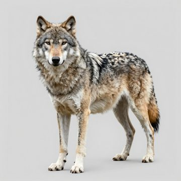
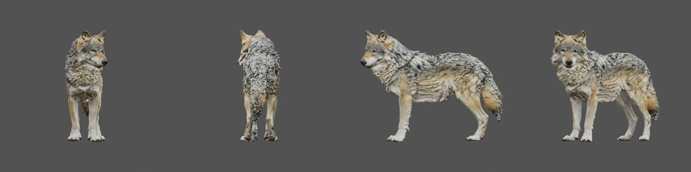
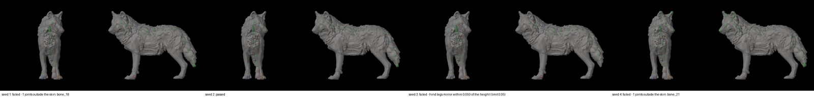
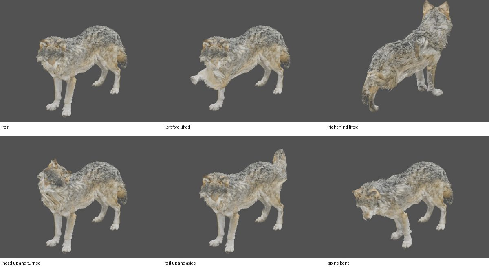

# Creature rig (B1): a generated wolf rigged live (2026-10-27)

This is the live gate of package B1 of the [AI motion sources plan](../../CREATURES.md), run on epic
[#128](https://github.com/gysahlgreene/SlopForge/issues/128). A wolf was generated through the new `creature` type and
rigged by `slopforge creature rig` with SkinTokens.

**What this page claims:** structural evidence for one creature. A seed's verdict, the kept rig's names and its
`fit_bones` are recorded.

**What it does not claim:** deformation quality, which is the owner's review of the contact sheet below and is still
pending. It also claims no motion, no Unity delivery of the rig, and nothing beyond this one creature.

## The creature

 

The wolf was made with `generate creature wolf` on the H100 profile at the `final` tier.
- **Concept:** 3 of 6 was approved; all four of its legs stand straight and apart.
- **Model:** TRELLIS.2 at the character face budget. 57,000 faces in one piece, concept fit 0.89, passed on the first seed.
- **Publication:** `approve-texture` published material candidate 1 through Unity, with output rights
  `attribution_required` ("Built with DINOv3.").

The first `approve-texture` failed. Unity's lightmap unwrap aborted on the 57,000-face model ("Could not pack uvs"), and
the FBX then had no PBR material. A creature is now published without lightmap UVs (`lightmap_uvs: false`), since Unity
lights a deforming mesh with probes. The publish then passed.

## The seeds

`creature rig wolf` ran three times on the same published model (commits `e063530`, `6455382` and the review fixes
between them). Each run tried SkinTokens seeds 1 to 4 on the H100 and checked each raw rig in local Blender. Each run
took 5 to 6 minutes.

| seed | run 1 | run 2 | run 3 (above) |
| --- | --- | --- | --- |
| 1 | passed (mirror 0.040) | 1 joint outside the skin | 1 joint outside the skin |
| 2 | **passed (0.025), kept** | **passed (0.030), kept** | **passed (0.035), kept** |
| 3 | 1 joint outside the skin | 1 joint outside the skin | hind legs mirror within 0.0501 of the height (limit 0.05) |
| 4 | cannot be named: its hind legs leave the body away from the root | the same | 1 joint outside the skin |

**Two later runs (2026-10-27, after the rulings).**
- Run 4, with the fix below: 0 of 4 seeds passed. Three had one joint outside the skin, and one had a chain off the
  spine.
- Run 5, with 8 seeds: 5 passed, and seed 2 was kept.
- Over the five runs, 9 of 24 seeds passed.
- Nine of the rejections were one joint outside the skin, and every one was at the front right wrist, 4–7 mm outside a
  thin part of the skin, 2–3.5 cm above the floor.

**The kept rigs of runs 1–3 had a see-through material.** Blender's FBX import wired the published base colour's
Color into the material's Alpha. Cycles, which video2rig's studio renders with, drew the wolf see-through. The finish
now makes the skin opaque (run 4 on). The contact sheet below, from run 3, was rendered with EEVEE, which hid it.

**SkinTokens is not reproducible per seed.** The same seed on the same model gave a different skeleton every run: seed
1 had 36 bones in run 1 and 40 in run 2, and every raw rig's hash differs. The runtime seeds Python, NumPy, torch and
CUDA. The likely cause is nondeterministic GPU sampling, where one changed token changes every token after it. That is
a hypothesis, not a measurement. The seed is recorded, but it does not reproduce a candidate. Over the three runs, 4 of
12 seeds passed.

## The kept rig (run 3, seed 2)

- **Structure.** 38 bones, every joint inside the skin (lowest winding number 0.989), and twin legs mirrored within 0.035
  of the height. At most four influences per vertex, every vertex weighted, and weight sums 1.0.
- **Names.** Video2rig's quadruped names, facing −Y:
  - the body: `Hips`, `Spine1-3`, `Chest`, `Neck1-3`, `Head`, `Tail1-6`;
  - each front leg: `Scapula`, `UpperArm`, `Forearm`, `FrontPaw`, `FrontToes`, plus a sixth bone, `FrontToesEnd`;
  - each hind leg: `Thigh`, `Shin`, `HindPaw`, `HindToes`, plus a fifth bone, `HindToesEnd`.
- **`fit_bones`.** All 38 bones. The first rule left out the five `…End` bones (33). Under the owner's ruling, every
  end bone that leads skin is fitted, and all five do: `HeadEnd` 3.7 %, `FrontToesEnd` 0.45–0.47 % and
  `HindToesEnd` 0.40–0.46 % of the skin. In this rig, `HindToes.L` (0.19 % of the skin),
  `HindToes.R` (0.25 %), `FrontToes.R` (0.26 %), `HindPaw.R` (0.26 %) and `FrontToes.L` (0.30 %) all lead under 0.4 % of
  the skin. Video2rig's auto rule would not fit them; the declaration does
  ([#139](https://github.com/gysahlgreene/SlopForge/issues/139)).
- **Bone axes.** Every bone's local X lies across the body.
- **Material.** The source material was reused, since its UVs matched.
- **Outputs.** `wolf_rig.fbx` and a packed `wolf_rig.blend`, registered as the pending `rig` artifact.

**Deformation:** the owner's review, not judged here. The six poses are rest, left foreleg lifted, right hind leg
lifted (seen from behind), head up and turned, tail up and aside, and spine bent.

**The review renders were relit before run 3.** Run 1's single sun left the wolf's near side dark (mean luminance 64
against its material preview's 138). Run 2's character-review lights, sized for a humanoid, blew it out (218). Run 3
uses the material previews' lights (149).
