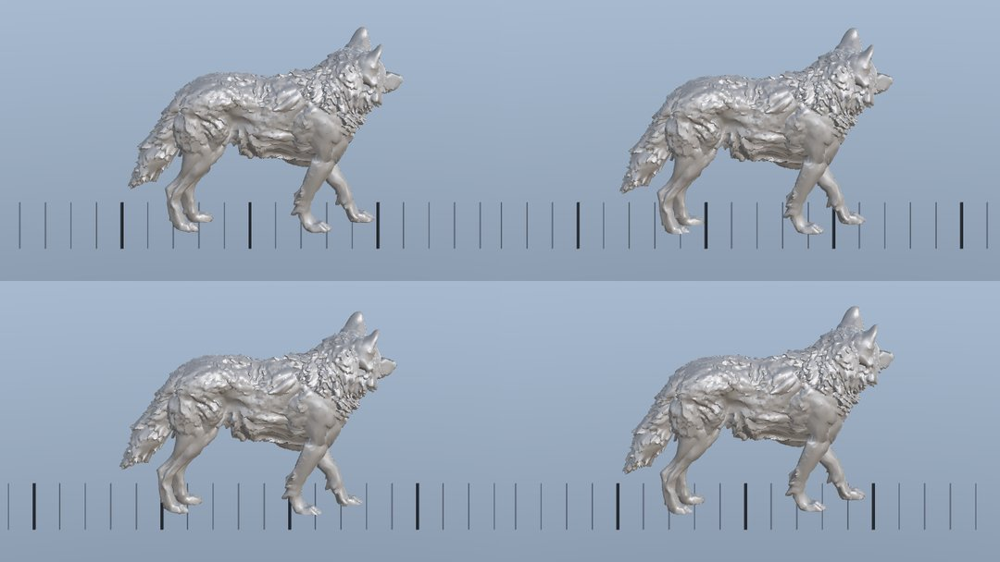

# Creature Unity delivery (B7): the generated wolf's walk in Unity (2026-10-30)

This is the live check of package B7 ([Creatures](../../CREATURES.md#unity-delivery-b7); epic
[#128](https://github.com/gysahlgreene/SlopForge/issues/128)). It covers two runs:
- **The live gate:** the fixture quadruped's keyed walk, baked by B6 in Blender, built into a fresh Unity project and
  played through Unity's test runner (`SLOPFORGE_RUN_UNITY_ANIMATION=1 pytest tests/test_creature_unity_blender.py`).
- **The wolf:** its rig FBX and the walk B6 baked from clip `walk_s2` ([B6's evidence](../creature-extract-b6-2026-10/README.md)),
  built and played with the same builder and Play-mode tests. The wolf's rig still awaits its deformation review, so
  `animation unity-setup wolf` refuses it. This run called the builder and the tests directly, on copies, and
  recorded nothing in the wolf's project.

Unity 6000.6.3f1 on macOS, Built-in render pipeline, `com.unity.test-framework` 1.8.0.

**What this shows:**
- A baked creature clip, imported Generic, that binds to the rig and plays in Play mode.
- The prefab faces +Z at its rigged size.
- The clip stays in place and carries its speed as a controller parameter.
- With the creature moved at that speed, its planted feet slip about as much in Unity as the bake measured in Blender.

**What it does not show:**
- The owner's verdict, or a delivery through the approval gates of an approved generated creature.
- The creature's published material: the render below uses a plain grey material.
- Turning, blending between clips, idles, or Windows.

## The wolf in Unity

`walk_s2` played while the wolf moves along +Z at its `walk_s2_speed` (0.41 m/s), filmed from the side with a marker
every 10 cm. Frames 0, 10, 20 and 30 at 24 fps:

| Play-mode test | Result | Measured | Limit or reference |
| --- | --- | --- | --- |
| Faces +Z at its size | passed | front feet 0.53 m ahead; 0.7803 m tall | ahead by over 10 % of the height; within 5 % of B1's 0.7803 m |
| Plays on its own | passed | the default state advances, bones turn; its own transform stays put | — |
| `walk_s2` plays | passed | loops; 6.750 s long; `walk_s2_speed` 0.4134 | the bake's 4-period loop, 6.750 s |
| `walk_s2` in place | passed | the root bone sways 5.2 cm over the loop | under a quarter stride, 17.4 cm |
| Stance slide at 0.41 m/s | recorded | 0.055 m/s | the bake measured 0.054 m/s in Blender; no limit set (D9) |

## The live gate

| Run | Result |
| --- | --- |
| 1 | Failed: `FacesForwardAtItsSize` measured 0.0095 m against 0.95 m rigged; `Plays` found no bone turning |
| 2–4 | The binding fixed; the size measurement corrected (below) |
| 5 | Passed: 0.9500 m tall, front feet 0.80 m ahead, the 7.125 s loop at its baked length, the root bone swaying 2.1 cm |

The fixture walk's stance slide equals its speed, because its keyed feet ride with the body. That is a property of
the fixture, not of the delivery.

## Found while running it

- **The clip did not bind to the rig.** B6 exports a clip's armature alone, and the rig FBX holds the armature and
  the mesh. Unity folds a lone top-level node into the file's root, so the clip's curves were keyed `Hips/...` while
  the prefab's bones sat at `Armature/Hips/...`.
  - No bone moved, and the curves on the armature node landed on the prefab's own transform, turning it 90° and
    scaling it 100 times.
  - The `in place` test passed only because nothing moved.
  - Both importers now keep their FBX root (Preserve Hierarchy), so the clip's paths are the rig's. The builder is
    shared with characters' `animation unity-setup`, so their clips get the same import.
  - `Plays on its own` now also requires the creature's own transform to keep its rotation and scale. Rerun on the
    first run's project, built before the fix, it fails with "turned 90 deg, scale (100, 100, 100)".
- **Measuring the size.** An imported mesh is not readable at run time. `SkinnedMeshRenderer.BakeMesh` with
  `useScale` gives the bind pose in the renderer's own space, and the renderer's world matrix places it at 0.95 m.
  The two other pairings measured 1/100 and 100 times the creature.
