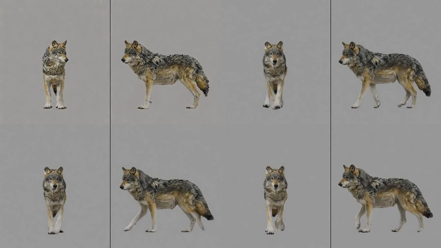
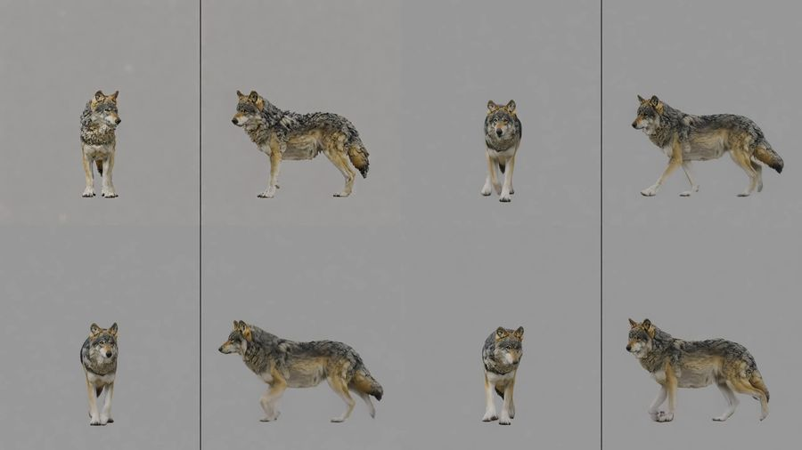

# Creature video and intake (B5): the generated wolf's walk (2026-10-28)

This is the live gate of package B5 ([Creatures](../../CREATURES.md#video-generation-and-intake-b5); epic
[#128](https://github.com/gysahlgreene/SlopForge/issues/128)). It ran on the B1 wolf's kept rig from run 5, which is
still awaiting its deformation review, and every stage records that. The command:

```sh
slopforge creature video wolf walk
```

**What this shows:**
- Seeded Wan 2.2 clips from the creature's start frame, made on the GPU provider's ComfyUI.
- The intake reading every clip before anything else does.
- Every refused clip kept with its reason.
- The framing fault the gate found, and its fix.

**What it does not show:** motion on the rig. That is B6's extraction and bake.

## Setup

- **Graph:** `workflows/video_wan22_i2v_api.json`. Its four model files are Apache-2.0 and cleared.
- **Clips:** 1280×720 at 16 fps, 121 frames, about 22 minutes each on the H100.
- **Prompt:** the type's split-screen continuous-walk prompt, #149's.
- **Reader:** trained per calibration with video2rig's `reader.train`, 9000 steps.

## The framing fault

The first run framed the wolf with the type's `margin_wide` 1.45. That margin, applied across the side panel, set the
scale: the wolf was 344 px tall, against 400 px in #149.

- **Seeds 1–5 at that framing:** none passed.
  - Seed 1's backdrop drifted 25.7 grey levels.
  - The other four failed video2rig's check of the two views.
- **The same seeds and prompt in #149:** passed.
- **Recalibrated at #149's scale:** `margin_wide` 1.2, where the height margin sets the scale. The wolf was 400 px tall
  and it got its own reader.

| Seed | 344 px: body / limbs disagreement | 400 px: body / limbs disagreement | 400 px verdict |
| --- | --- | --- | --- |
| 2 | 3.0 % / 1.9 % | 1.2 % / 1.5 % | accepted |
| 3 | 1.8 % / 1.8 % | 0.9 % / 1.3 % | accepted |
| 4 | 1.1 % / 3.2 % | 1.3 % / 2.1 % | refused: limbs over 2 % |
| 5 | 1.7 % / 1.7 % | 1.1 % / 1.2 % | accepted |
| 6 | not made | 0.9 % / 1.2 % | accepted |

The limits are D7's: 1.5 % of the height for the body and 2 % for the limbs. At 400 px, 4 of seeds 2–6 passed.

The type's `margin_wide` is now 1.2. A regression test pins the wolf's framing to #149's scale.

**Why scale matters:**
- The reader's error is roughly fixed in pixels: a held-out median of 5.5–5.6 px in the front view at both scales. A
  smaller creature therefore disagrees more as a share of its height.
- Scaling the 344 px numbers to 400 px still leaves seeds 2–4 failing. Wan may also draw a smaller creature's two views
  less alike.

## Seed 2 at both framings

400 px, accepted. Frames 0, 40, 80 and 120:



344 px, refused: the views disagree on the body by 3.0 % of its height. Same frames:



## Intake on the accepted clips

Seeds 2, 3, 5 and 6 at 400 px:

| Measure | Range |
| --- | --- |
| Duplicated frames | none (16 fps content in a 16 fps container) |
| Frame 0's difference from the start image | 3.6–3.8 grey levels |
| Creature present | in every frame |
| Backdrop drift | 3–4 grey levels |
| Pixels moved | 6.1–6.6 % |
| Facing change | 0.09–0.11 |
| Identity drift (recorded, not refused) | 9–23 |

## Not covered

- Cuts are not detected.
- Identity drift is recorded, not refused.
- The rig's deformation review is still pending.
