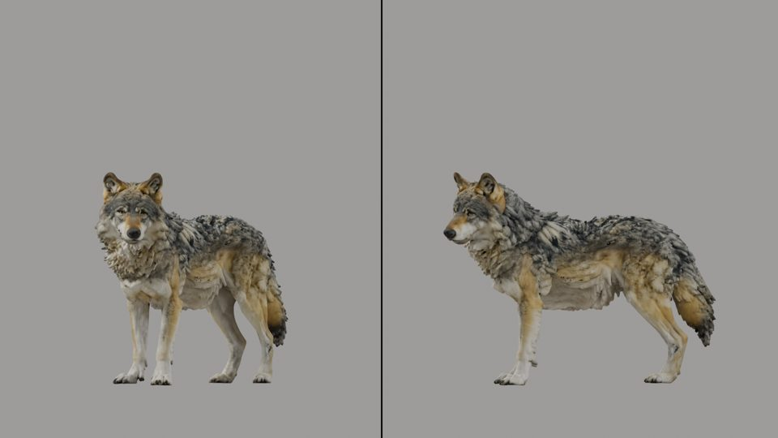
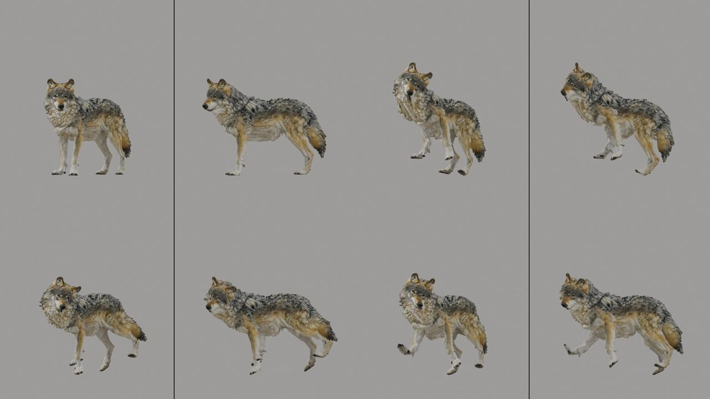

# Creature views and known motion (B2): the generated wolf (2026-10-27)

This is the live gate of package B2 ([Creatures](../../CREATURES.md#views-training-pictures-and-known-motions-b2);
epic [#128](https://github.com/gysahlgreene/SlopForge/issues/128)), run on the B1 wolf's kept rig from run 5. That rig
is still awaiting its deformation review, and every stage records that.

**What this shows:** structure only. `creature calibrate` wrote the creature's video2rig settings, rendered its start
frame and its 3000 training pictures, and `creature synth` rendered a known motion through the start cameras.

**What it does not show:** a trained reader, an exam score or motion read from video. Those are B3 and later.

## The start frame

- **Views:** `three-quarter,side`, the `creature` type's pair (#140).
- **Widths:** 942 + 978 px, split by each view's span, so both panels draw the wolf at 1.56 mm a pixel.
- **Facing:** declared `-Y`, passed to render_start.
- **Check:** every skin vertex projects inside its panel.
- **`creature.json`:** 34 fitted bones (#139); the knees and elbows as hinges; 29 declared ranges by role (#140).

**The training pictures:** 3000 poses, 124 s to render on the SlopForge machine. video2rig reports 0.77 and 0.82 of the
keypoints seen in the two panels.

## A known motion

`creature synth wolf random_s0 --kind random --seed 0`: 96 frames at 24 fps, frames 0, 30, 60 and 90 shown.
- Every channel of every bone stays inside its declared range; the knees and elbows fold about their bend axis only.
- The truth (`poses.npz`, `labels.npz`, `truth.json`) sits beside the clip.
- Each joint stays inside both panels in every frame.

The whole gate took 3 minutes.
