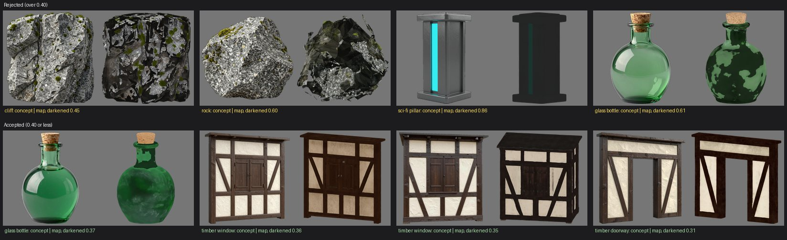
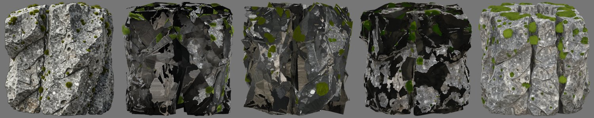

# Dark-texture check: calibration (2026-10-24)

TRELLIS.2 sometimes textures a mesh mostly black on the very side its concept shows. Two published examples:
- the moorland live run's cliff;
- the S2 pillar from the M2-v3 kits.

The existing colour checks compare only hue and saturation. They skip near-grey concepts, so grey stone and steel
were never checked. A new check, `colour_darkened`, now rejects such a texture, and the next seed is tried.

## Cause

- **It is TRELLIS's own colour:** the published base colour is byte for byte the native texture TRELLIS baked.
  SlopForge's processing does not add it.
- **It is not the bake:** on the cliff, faces baked dark sit as close to TRELLIS's own surface as faces baked
  light (median 0.0007 units in both), with the same facing. So the colours were predicted dark; they were not
  sampled off the surface.
- **The remedy is the existing one:** another seed. With a wider concept, the cliff came out light granite.

## The measure

`concept_darkened_share` (in `slopforge/validation.py`) compares two images:
- the approved concept's cut-out;
- the base colour rendered unlit from the concept's fitted view (the view the hue and saturation checks
  already use).

It works in three steps:
1. **Crop and average:** both images are cropped to the object's bounds and averaged onto a grid of cells, so they
   line up without pixel registration.
2. **Count darkened cells:** a cell counts when the concept is lit (CIELAB L* above 30) and the map is under 0.6
   of the concept's lightness there.
3. **Average the grids:** the share of darkened cells is averaged over 8, 12, 16 and 24-cell grids, because
   single grids gave unstable margins.

A share above `max_concept_darkened_share` (0.4 for `prop` and `architecture`) fails the candidate as
`colour_darkened`, which is retryable. Near-grey concepts are checked too. Without a fitted view, the check is
skipped with a warning.

## Calibration

The data was every material candidate in the private evidence runs with a concept-side view: 147 unique views,
from props v1–v5, the kit protocol runs, structures, glass trials and the moorland runs. The agent labelled each
one by eye against its concept, before measuring.

**Labels:**
- **Darkened:** 5. They are the cliff, a prototype rock, the M2-v3 S2 pillar, and two glass-bottle trials.
- **Borderline:** 5. They are four sci-fi doorways that came out mid-grey, and one blotched bottle.
- **Fine:** 136.
- **Excluded:** one shattered mesh, which the concept-fit check already rejects.

**Two labels changed after measuring:** two other sci-fi pillars looked dark on the sheet, but their median
lightness matched their concepts. They had lost detail instead (the cyan strip), so they count as fine here.

**Results:**

| Group | Darkened share |
| --- | --- |
| Darkened (5) | 0.45 (cliff), 0.60 (rock), 0.61 and 0.83 (bottles), 0.86 (pillar) |
| Borderline blotched bottle | 0.48 |
| Highest fine | 0.37 (bottle), 0.36 and 0.35 (timber windows), 0.31 (timber doorway) |
| Sci-fi doorways, mid-grey | 0.00–0.06 |

At 0.4, the check rejects every darkened view and the blotched bottle, and no fine one.

**What failed first:** five other measures did not separate the groups. They were:
- median and mean lightness ratios;
- upper percentiles;
- near-black shares;
- the share below the concept's darkest tones;
- a two-part gate on the concept's lightness.

They all failed for the same reason. Dark-beamed timber walls are two-tone, and a shift between beam and plaster
moves those statistics as much as a black patch does. Comparing by position separates them, because the beams are
dark in the concept too.

## Limits

- **Five darkened views is little data.** The cliff, the case that started this, is the closest to the limit, at
  0.45 against 0.4.
- **Timber is close below the limit.** Timber walls whose beams came out thicker and near-black score 0.28–0.36.
  They are accepted at 0.4, but they are milder darkening of the same kind.
- **Recalibrate when new failures appear.** The figures above are the data to recalibrate against.
- **Existing projects need the key added.** Projects initialised before this change keep their own asset types.
  Add `max_concept_darkened_share: 0.4` to `ai/asset_types/prop.yaml` and `architecture.yaml` to turn the check on.

## Live check

The moorland cliff's original concept 3 was re-approved on the H100 `final` tier, at commit `1139b94`, with the check
on. This was the concept whose first mesh published black on 2026-10-23.

| Seed | Darkened share | Result |
| --- | --- | --- |
| 1 | 0.522 | rejected: `colour_darkened`, also `component_budget` |
| 2 | 0.499 | rejected: `colour_darkened`, also `component_budget` |
| 3 | 0.594 | rejected: `colour_darkened` |
| 4 | 0.013 | accepted (concept fit 0.95) |

Seed 1 ran first, and then the run stopped. Another project's image jobs held 77.8 of the H100's 79.2 GiB, so the
next bake ran out of memory. The out-of-memory recovery freed the cache and retried once, but that project kept
reloading its models. The rest ran once the H100 was idle.

This concept textures black on most seeds: four of five seeds tried here and on 2026-10-23. The check turns
that from a published black cliff into retries. A concept closer to the brief, like the live run's concept 5,
avoids the retries.
