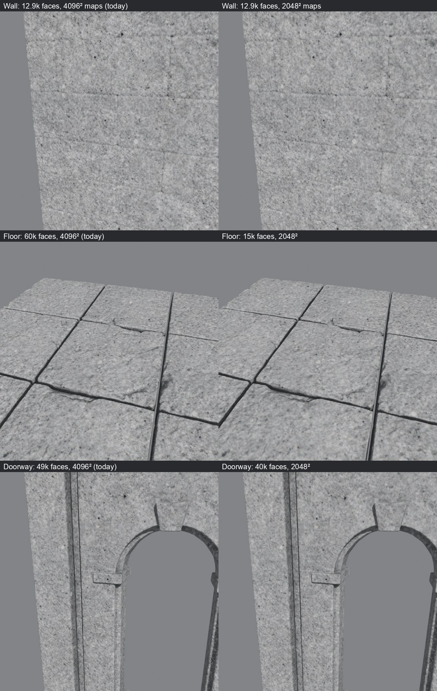

# Kit budgets (2026-10-22)

M2's exit evidence includes project budgets. Before this change, every architecture module was decimated to the
60,000-face budget and got 4096² maps: a flat 3 × 3 m floor tile used 59,988 faces.

**How the comparison was made:** each module from a live stone-kit run was rendered close up at its generated
budget. Then it was rendered again with Blender's decimation to the proposed face count and its maps halved to
2048².
- The wall had only 12.9k faces already, because the GPU decimation stops below budget on simple shapes, so only
  its texture size changes.
- The floor drops from 60k to 15k faces, and the doorway from 49k to 40k.

**The owner's decision:** having seen this comparison, the owner accepted these M2 budgets:

| Module | Faces | Maps |
| --- | --- | --- |
| Floor | 15,000 | 2048² |
| Wall, doorway, window, corner | 40,000 | 2048² |
| Column or pillar | 20,000 | 2048² |

**What it saves:** for the stone kit, map memory falls 4× (335M to 84M texels across base colour, normal,
metallic/smoothness and emission) and faces from about 230k to 100k.

**Live:** a fresh stone-kit run at these budgets built its courtyard and corner joint in Unity with no check errors.
`environment-check` reported 100,177 faces and 83.9M map texels.

**Limits:**
- The comparison used Blender's decimation in place of the GPU's, at one viewing distance.
- Lightmapping and Play mode were not run.
