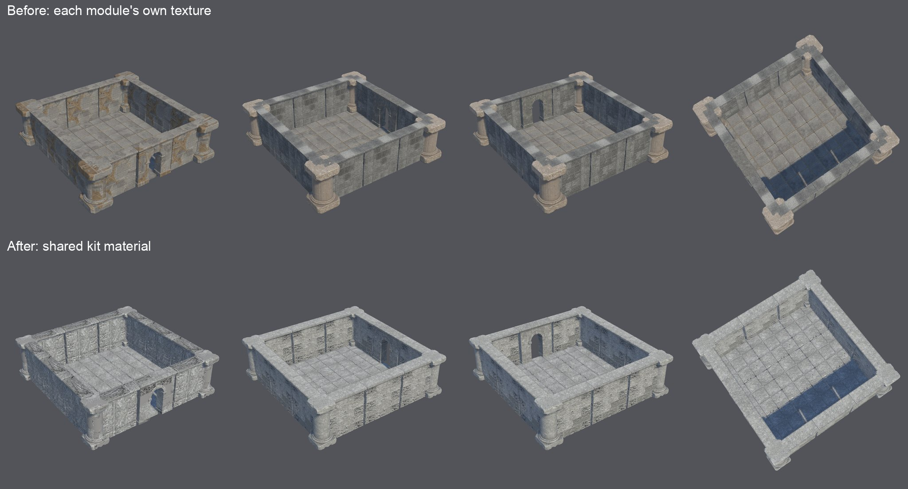
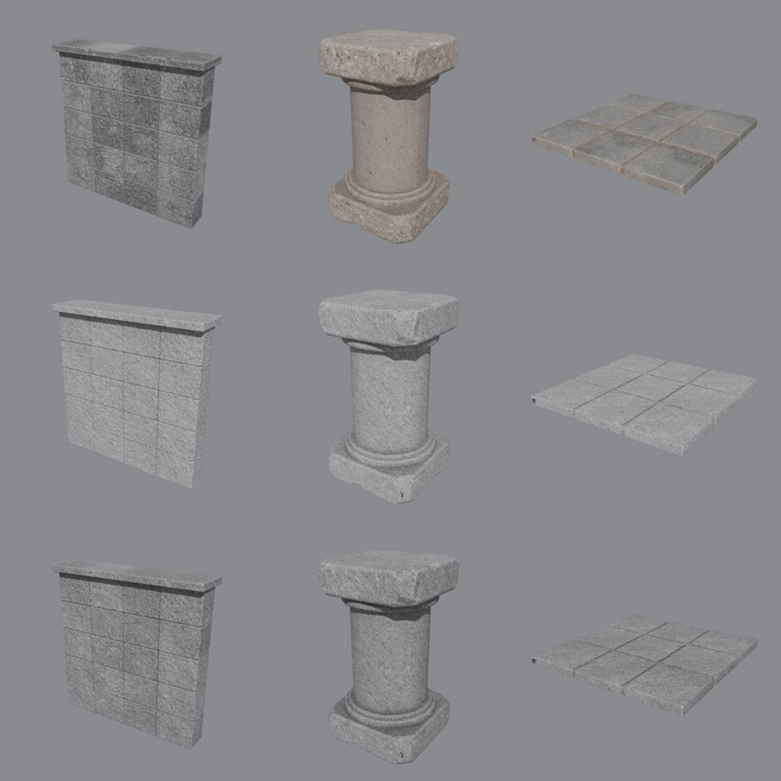
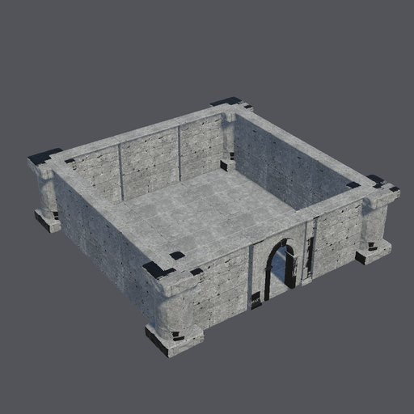
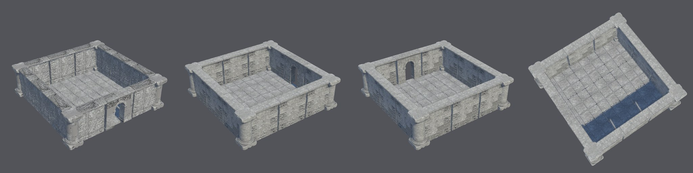
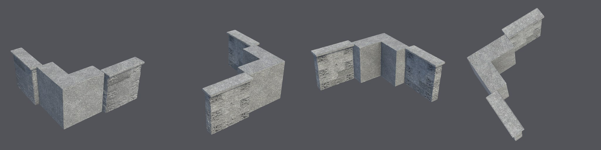

# Shared kit material (2026-10-22)

The first assembled courtyard ([kit scene evidence](../kit-scene-2026-10/README.md)) showed that kit modules
generated one at a time do not match. The columns came out sandy, the walls grey, and the wall backs had rusty
invented patches. The owner chose one shared material per kit. This page records how it was tried, the two
defects the live runs found, and the final run.

*Two separate live runs of the shipped `stone_ruin_kit`. The meshes differ as well as the material. Top: commit
`3477e6c`, each module's own TRELLIS texture. Bottom: commit `8559ba4`, the shared kit material.*

## How it works

- **The texture:** the recipe names a texture child as `kit_constraints.material`, with a tile size (2 m). Its
  approved image is made seamless: the wrap-edge difference fell from 42 to 14 grey levels, about the same as
  neighbouring texels.
- **The re-bake:** each declared module's base colour is re-baked in its own UVs as:
  - the swatch, box-projected in metres;
  - × baked ambient occlusion;
  - × the module's own brightness relative to its mean, at 60%.
- **What a module keeps:** its own normal, roughness and metallic maps.

## Trial

The trial ran on the first kit run's modules, in rows from top to bottom:
1. **Original:** a sandy column beside a grey wall.
2. **Swatch × AO:** the stone matches, but the wall lost its block-to-block light and dark.
3. **Swatch × AO × 60% of the module's own brightness:** matching stone that keeps the block variation. This is
   what ships.

## Live runs

Each run went from a fresh copy of the Unity 6000.6.3f1 / URP 17.6.0 blank project, on the H100 `final` tier:
`recipe run stone_ruin_kit`, the texture approved, then each module approved and published, then
`environment-check` and both `environment-scene` layouts. The agent selected concepts for evaluation only.

**First run: two defects found.**

- **Black patches in Unity:**
  - *Seen:* black patches on column capitals and the doorway frame, though not in Blender.
  - *Cause:* the bake cleared everything outside the UV islands to black (about 60% of each atlas). Unity's
    smaller mip levels blended that black into the islands' edges. TRELLIS's own maps fill that space instead.
  - *Fix:* uncovered texels now take the module's mean colour. A Blender test checks that none stays black.
- **A corner rebuilt as a solid block:**
  - *Seen:* its footprint filled every quarter at 0.86, where an L leaves one quarter at 0.00.
    `environment-scene` could not find an open side to turn.
  - *Fix:* a module rule can declare `footprint: corner`. Such a corner fails as the retryable
    `module_footprint` code when its emptiest quarter is above 0.15, so the next seed is tried, and
    `environment-check` fails a published one.
  - *Checked on real data:* the new check failed this corner and passed the other four modules.
  - *Record so far:* one of three inside-view stone corners rebuilt as a block.

**Final run** (commit `8559ba4`):

- **Generation:** every module passed on its first mesh attempt. The corner was an L: one quarter 0.00, the others
  0.81–0.96. So the retry was not exercised live; an offline test covers it.
- **Textures:** no base-colour texel is black.
- **Checks:** `environment-check` passed. The courtyard (25 instances) and the corner joint built with no errors:
  every module stands at its placement height, has a collider and is static, with no seam gaps.

## Limits

- **Same-colour regions keep their brightness:** an invented back face takes the swatch's colour but keeps 60% of
  its brightness pattern, so some wall backs show patchy light and dark blocks.
- **The corner joint still steps out:** module thickness is not declared (wall 0.74 m against corner arms of
  about 1 m in the earlier run).
- **Texture memory:** each module still has its own 4096² atlas. The material is shared in appearance, not as one
  Unity material.
- **Not done:** visual approval, Play mode and lightmapping. Two live runs of one kit.
