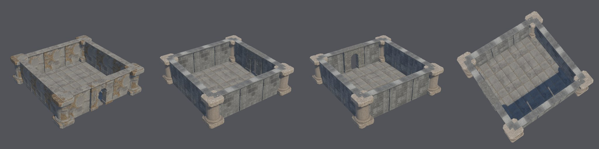
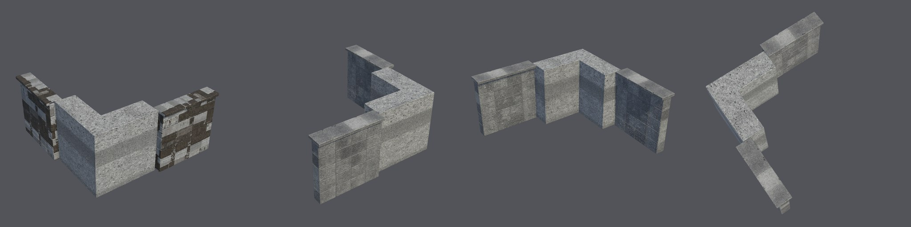

# Stone ruin kit assembled in Unity (2026-10-22)

This is the first M2 evidence that kit modules work together in Unity.
- **Generation:** the shipped `stone_ruin_kit` recipe ran from a fresh copy of the Unity 6000.6.3f1 / URP 17.6.0
  blank project, on the H100 `final` tier at commit `3477e6c`.
- **Through Unity:** each module was approved for 3D and published with `approve-texture`. Then `environment-check`
  and `environment-scene` ran.
- **Selection:** the agent selected one concept per module, for evaluation only. Nothing here is visually approved.

## Courtyard

- **Layout:** 25 instances. Nine 3 m floor tiles, eleven walls on the perimeter lines, the doorway in the south
  wall, and columns at the four outer corners.
- **Unity checks:**
  - every module stands at its placement height (0.000 m error);
  - every instance has a mesh collider and is static;
  - there are no seam gaps between neighbours.

## Corner joint

- **Auto-turn:** the corner has `rotation: auto`. Unity read its open side from the mesh and turned it 90° to face
  the layout's centre.
- **Thickness mismatch:** the corner's arms are thicker than the walls, so the joint steps out, and nothing declares
  the thickness yet. The walls are centred on the cell's edge lines while the corner's arms sit inside its bounds.

## Modules

| Module | Size (m) | Pivot | Axis stretch | Footprint quadrants |
| --- | --- | --- | --- | --- |
| Floor | 3.000 × 3.000 × 0.158 | top centre | 1.01 | full |
| Wall | 3.000 × 0.742 × 3.000 | bottom centre | 1.11 | full |
| Doorway | 3.000 × 0.818 × 3.000 | bottom centre | **1.45** | full |
| Corner | 3.000 × 3.000 × 3.000 | bottom centre | 1.22 | 0.69, 0.92, 0.75, **0.00** |
| Column | 1.682 × 1.684 × 3.000 | bottom centre | 1.00 | full |

`environment-check` passed for all five published modules.

## Found and fixed during this run

The floor tiles at first stood 0.158 m too high, their whole thickness:
- **Why:** an FBX's root carries the Blender object's location as a translation. Nesting the model under the
  prefab's identity root brought that translation back.
- **Why the boxes missed it:** they had their origin at z = 0, so they were unaffected.
- **Fix:** the prefab now zeroes the model's local position, so the module's origin is the prefab's pivot.
- **Protection:** the opt-in Unity test now places a module whose origin is its top. It fails without the fix.

## Limits

- **Appearance:**
  - the modules do not match: sandy columns and grey walls;
  - the wall backs have rusty or dark blotches that the single-image reconstruction invented for their unseen
    sides;
  - the doorway was squeezed 45% horizontally, because its concept was wider than square.
- **Joints:** module thickness is not declared, so wall (0.74 m), doorway (0.82 m) and corner arms (about 1 m)
  differ.
- **Not run:** Play mode and lightmapping. Static flags exclude lightmap contribution.
- **Repeatability:** this is one run of one kit.
