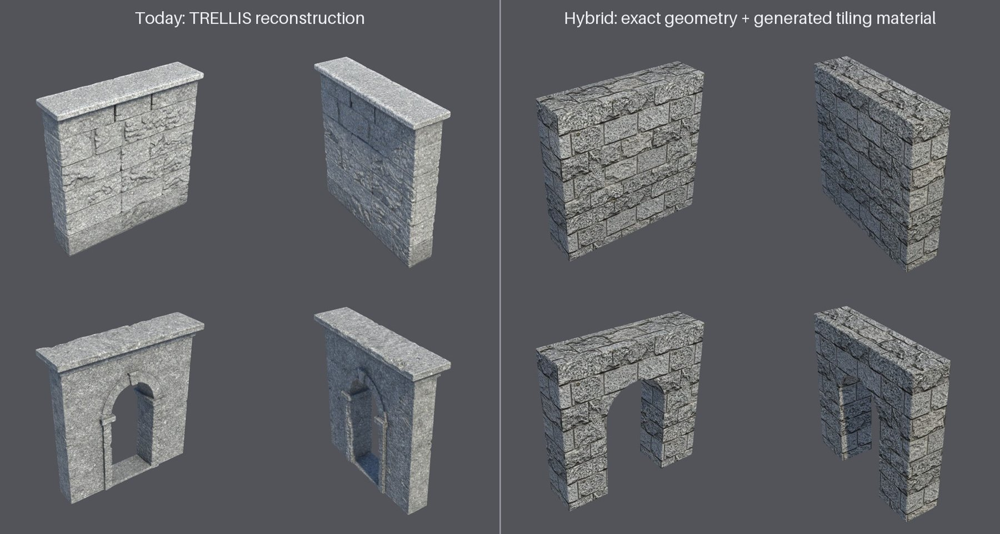
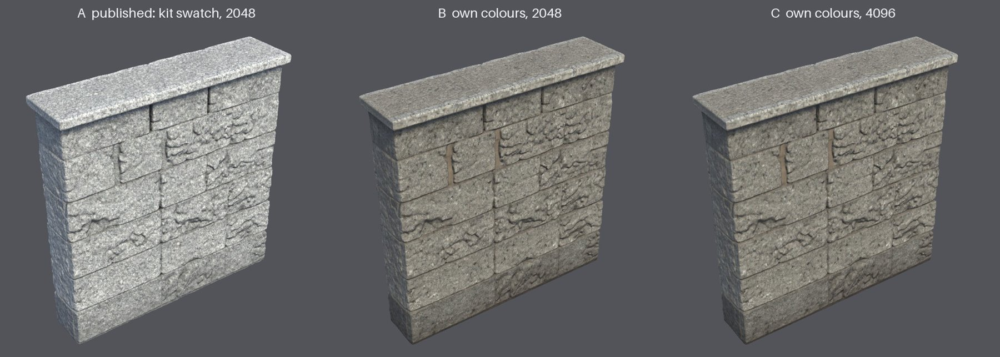
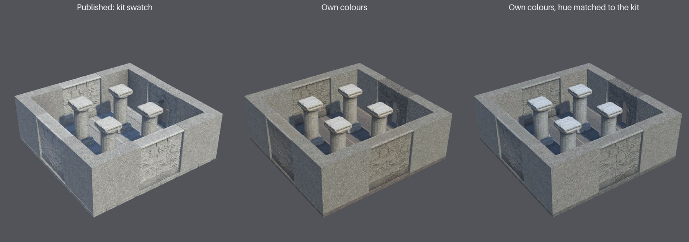

# Kit look: own colours with the tint matched (2026-10-23)

After the stone, timber and sci-fi kits became Provisional (criterion
[M2-v3](../kits-provisional-2026-10-v3/README.md)), the owner judged them well below the props. Three
comparisons in Unity 6000.6.3f1 / URP 17.6.0, on K2's published meshes and with the same lighting, settled how
the stone kit should look. The agent made each variant; the owner chose.

## 1. Reconstruction or SlopForge-built geometry

**The hybrid:**
- **Geometry:** exact geometry from the kit's numbers, with bevelled edges and a round-arched opening; the wall is
  54 faces and the doorway 205.
- **Material:** a generated granite-block texture, made seamless by repainting the seam cross, upscaled, and
  mapped in metres at about 1,000 px/m.
- **Maps:** height, normal and roughness derived from that texture.

The reconstructed modules carry 130–340 px/m.

**The owner's choice:** the reconstruction ("trellis reconstruction looked better honestly"). It has the
architectural form the hybrid lacks: a coping stone, a moulded arch, a sculpted surface. The hybrid read as a
textured box.

## 2. The wall's finish

**The variants:**
- **A, as published:** the base colour is re-baked from the kit's seamless swatch, so the wall reads uniform light
  granite.
- **B:** the wall's own TRELLIS colours at 2048², with the kit's matte 0.75 roughness kept.
- **C:** B at 4096², which is only slightly sharper at this distance.

**The owner's choice:** B.

## 3. The courtyard

**The variants:**
- **Own colours:** each module keeps its generated colour exactly. K2's modules differ in tint (CIELAB b 2.5–7.5;
  the columns are the warmest) and in lightness (L 48–60).
- **Tint matched:** each module's average a and b move to the kit texture's, at most 7.9 units for K2's column.
  Lightness and all variation are kept.

**The owner's choice:** own colours with the tint matched. The pipeline now does this in place of the swatch bake
([guide](../../ENVIRONMENT-KITS.md#shared-kit-material)).

## Not checked

- A protocol run with the new material stage. The M2-v3 Provisional status is for commit `5ceac3b`, with the
  swatch bake.
- The timber and sci-fi kits. They have no kit texture, so the change does not touch them.
