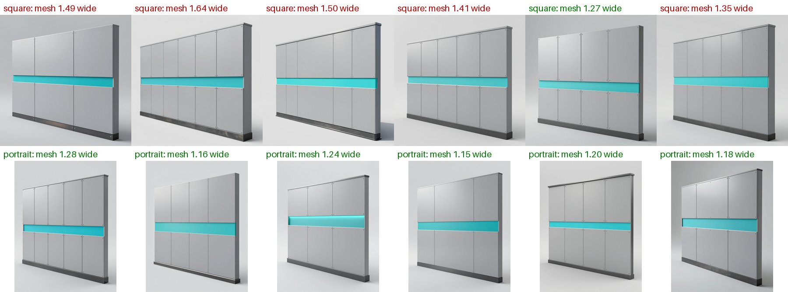

# Modular environment kits: qualification record, criterion M2-v2

Declared on 2026-10-23, before any M2-v2 run. It replaces
[criterion M2-v1](../kits-provisional-2026-10/QUALIFICATION-RECORD.md) for new runs; the
[M2-v1 runs](../kits-provisional-2026-10/README.md) and their results stay as they are. Results for M2-v2 go in the
[evidence report](README.md). Six runs cannot make anything Qualified; at most they make kits Provisional for the
tested scope.

## What changed from M2-v1

No criterion is loosened. The owner-accepted limits of 2026-10-22 (issue #94) are unchanged.

The pipeline is the current code, not M2-v1's commit `d3d6c31`; the commit is recorded per run. These changes
come from the M2-v1 findings:
- **Corner arms:** the arm rescale reads the bounds after bottom-centring. In M2-v1 an off-centre corner kept its
  generated arms (T1).
- **Queue time:** ComfyUI time spent pending in the queue no longer counts toward a job's timeout. In M2-v1 three
  concept jobs that ran for 2–13 s timed out after 600 s in the queue (K2, T2, S2).
- **Stretch stop:** the message states its specific remedy, once.
- **Stone kit tolerances:** 0.05 m snap and pivot, matching this record. M2-v1 checked K1 at 0.1 and 0.15 m.
- **Kit finish:** the stone kit's material declares roughness 0.75. Every stone module's roughness map takes that
  mean. In M2-v1, K1's floor came out at 0.22 beside walls at 0.67, and Unity showed a glossy floor.
- **Sci-fi wall canvas:** the sci-fi wall's concepts render on a portrait canvas (`aspect: portrait`). On S1's six
  seeds, square-canvas walls reconstructed 1.27–1.64 times wider than tall, and portrait ones 1.15–1.28.
  - The test ran the h100 `final` shape stage on S1's own concept prompts and seeds and its mesh seed. S1's
    selected wall reproduced its run value, 1.49.
  - The sci-fi doorway stays square. Its six square-canvas concepts reconstructed 1.03–1.24 times wider than tall,
    all within the limit. Portrait canvases gave 0.78–1.02, so nothing gained.

One gate is added, from the owner's decision of a shared kit material: the stone kit's modules also take its
declared roughness.

## Scope

- **Kits** (`templates/recipes`), two independent runs each:
  - `stone_ruin_kit`, with layout `courtyard`;
  - `timber_house_kit`, with layout `room`;
  - `scifi_corridor_kit`, with layout `room`.
- **Environment:** compute profile `h100`, quality tier `final`. Each run starts from a fresh copy of the Unity
  6000.6.3f1 / URP 17.6.0 blank project.
- **Code:** one fixed SlopForge commit for all runs, recorded per run.

## Procedure, per run

1. `slopforge init`, then `recipe run <kit> --name <run>`.
2. The agent selects one concept per module, for evaluation only. It records the reason for each pick, judged
   against:
   - the module's brief;
   - a face close to the module's declared shape (square for walls);
   - the inside view of the L for corners.
3. The stone kit only: approve its `stone` texture, the shared kit material, first.
4. For each module: `approve <module> <concept>`, then `approve-texture` with its lowest-numbered valid material
   candidate.
5. `environment-check <run>`.
6. `environment-scene <run> <layout>`, which saves and renders the assembled Unity scene.

Runs may overlap on the GPU.

**Permitted interventions** (each recorded):
- **After an infrastructure interruption** (a lost or restarted remote job, or a timeout): one resume of the
  interrupted command.
- **After a `module_stretch` stop:** one fresh selection of a different concept for that module. This is the
  remedy the stop asks for.

## Criteria (owner-accepted 2026-10-22)

A run passes when every module and the assembled scene meet all of these.

| Gate | Criterion | Where it is measured |
| --- | --- | --- |
| Size | Each declared `target_size` axis within 0.05 m | `environment-check` (grid, max dimension) and validation dimensions |
| Pivot | Each module's origin at its declared pivot within 0.05 m | `environment-check` |
| Stretch | Face stretch at most 1.3 | validation `axis_stretch`; `environment-check` |
| Corner shape | The emptiest footprint quarter at most 0.15 | validation `open_quadrant`; `environment-check` |
| Joints | Corner arms within 0.05 m of the declared thickness | `environment-check` |
| Concept fit | At least 0.8 | validation `concept_fit` |
| Colour | Hue difference at most 4 and chroma ratio at least 0.6, against a coloured concept (near-grey concepts are not checked) | validation |
| Budgets | Faces within each module's declared budget; maps at its declared size (2048²) | validation; `environment-check` budgets |
| Unity | Every module stands at its placement height (0.05 m), has a mesh collider and is static; no seam gap wider than 0.05 m; the scene builds and renders | `environment-scene` report |
| Matching look | The stone kit's modules take their base colour from its approved kit texture, and their roughness maps average its declared 0.75 (within 0.02) | the kit material stage; the published roughness maps |

## Unchecked gates

Not checked by this protocol, and reported as open:
- the owner's visual approval of the assembled scenes, which is reviewed after the runs;
- Play mode;
- lightmapping, which the static flags leave out;
- LODs;
- a part limit for structures;
- the finish of the timber and sci-fi kits. They use two or more materials, so they have no shared kit material, and
  their roughness is as generated. M2-v1's timber modules averaged 0.50–0.59.

## Status rule

- **Provisional** for "modular environment kits, `h100`/`final`, the fixed commit, Unity 6000.6.3f1 / URP 17.6.0" if
  all six runs pass.
- **Not Qualified** in any case: six runs cannot measure a failure rate.
