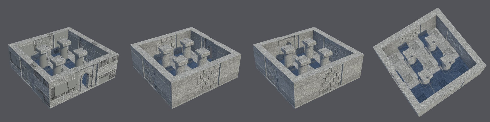
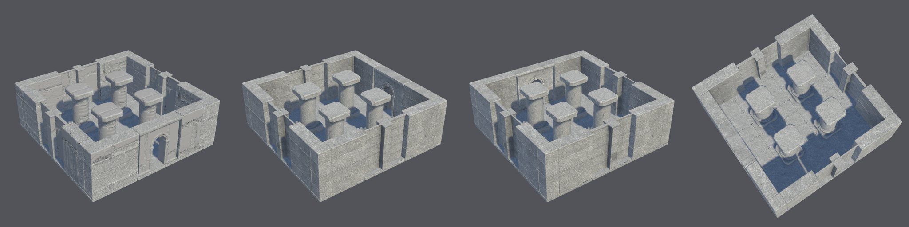
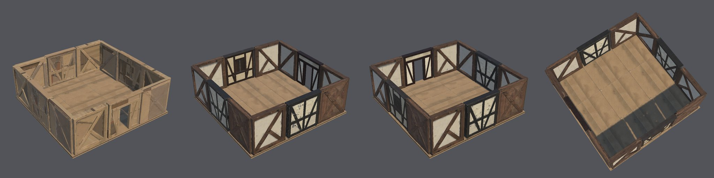
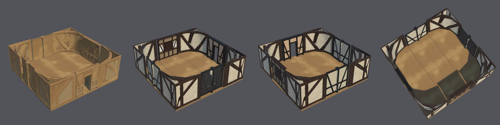
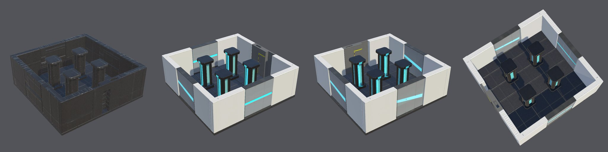
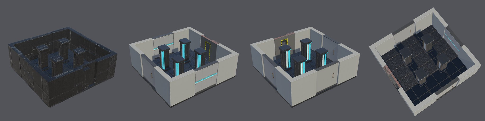

# Modular environment kits: protocol evidence, criterion M2-v2

These runs follow the [qualification record](QUALIFICATION-RECORD.md), committed before the first run. All six used
commit `5c17d4d` on the H100 `final` tier, each from a fresh copy of the Unity 6000.6.3f1 / URP 17.6.0 blank project.
They ran side by side on 2026-10-23 and took about an hour each.

**Outcome: five of six runs pass every criterion. That is not Provisional,** which needs all six. T2's timber corner
reconstructed as a wedge instead of an L. The kit check caught it, as its arms measure 0.27 m against 0.4 m.

| Run | Kit | Result | Interventions |
| --- | --- | --- | --- |
| K1 | stone ruin, `courtyard` | **Pass** | none |
| K2 | stone ruin, `courtyard` | **Pass** | none |
| T1 | timber house, `room` | **Pass** | none |
| T2 | timber house, `room` | **Fail**: Joints, corner arms 0.272 and 0.259 m against 0.4 m | two, both permitted (below) |
| S1 | sci-fi corridor, `room` | **Pass** | none |
| S2 | sci-fi corridor, `room` | **Pass** | none |

Every M2-v1 fix held in these runs:
- **Concept stage:** no concept job timed out.
- **Corner arms:** T1's corner measures exactly 0.400 m, and every stone and sci-fi corner 0.750 and 0.500 m.
- **Sci-fi walls:** they stretched 1.15 and 1.24, within the 1.3 limit; M2-v1's stretched 1.49.
- **Stone roughness:** every stone module's roughness averages 0.75.

## Assembled scenes

Each scene is the recipe's layout, built and rendered in Unity by `environment-scene` from the published modules.
The agent selected the concepts for evaluation only. Nothing here is visually approved by the owner.

**Stone ruin courtyard (K1, K2):** 21 instances each.

**Timber room (T1, T2):** 17 instances each. T2's corners came out curved: its wedge-shaped corner, squeezed toward
the declared arm thickness, left a rounded fillet inside each corner.

**Sci-fi room (S1, S2):** 21 instances each.

**Visual observations.** These are not criteria; they are for the owner's review.
- **Invented outsides.** Each concept shows one face, so the back of every wall is invented:
  - the timber walls' outsides are bare timber;
  - the sci-fi walls' outsides are dark;
  - the stone walls' outsides are flatter than their block faces.
- **Sci-fi colours:** the corners are whiter than the grey walls. The kit has no shared material.
- **Shadowed faces:** faces turned away from the light read blue-grey in all three kits; the sky lights them.

## T2: interventions and the wedge corner

1. **Fresh selection.** Concept 1 stopped with `module_footprint`: its emptiest quarter was 0.234, so it was
   partly solid. It also stopped with `module_stretch` (1.33). The record allows one fresh selection after a stretch
   stop, and corner 6 was chosen: an inside view of the L, its height close to its arm length.
2. **Resume.** Corner 6's first two seeds reconstructed as solid blocks (emptiest quarters 0.258 and 0.645) and were
   retried, as designed. The third stopped on an infrastructure timeout: the mesh worker's health check
   (`GET /system_stats`) timed out once, while the service was up. The record allows one resume, and the resumed
   seed qualified.

The resumed seed's mesh is a wedge. Measured on that mesh at 3 × 3 × 3 m, the arm's thickness from its outer face
falls steadily, from 2.9 m beside the other arm to 0.46 m at its end. Mesh preparation measured the arms at 1.27 m
and squeezed them to 0.4 m. Inspection then sampled a different stretch of the tapering arm and measured 0.27 m. The
open-quarter check passed it at 0.023, because the diagonal fill leaves the open quarter empty.

**Corner arm thickness along the outer half of each arm (max ÷ min),** every corner mesh from M2-v1 and M2-v2:

| Corner meshes | Max ÷ min |
| --- | --- |
| Every published L corner: K1 (v1, v2), K2, T1 (v1, v2), S1 (v1, v2), S2 | 1.00–1.03 |
| T2's wedge | 3.59, 3.66 |

Solid blocks have no open side and were rejected before this measure applies.

## Findings

1. **Wedge corners are not rejected.** A corner whose arms taper passes the open-quarter check and is published.
   This is the run's failure.
2. **Timber corner concepts reconstruct poorly.** T2 used three seeds of two concepts before even the wedge. The
   concepts look straight into the inside of the L from eye level, where the arms' depth can't be seen. Background
   removal is ruled out: the TRELLIS inputs keep every plaster panel.
3. **The mesh worker's start-up health check has no retry.** One network timeout costs an attempt. Polling during a
   job already retries.

## Measured values

Stretch is the face stretch to the declared size (limit 1.3). The open quarter is a corner's emptiest footprint
quarter (limit 0.15). Arms are declared at 0.75 m for stone, 0.4 m for timber and 0.5 m for sci-fi (tolerance 0.05
m). Concept fit's limit is 0.8. Colour is checked only against a coloured concept. Stone roughness is declared at
0.75. Every module was within its declared size and pivot at 0.05 m, and every map is 2048².

| Run | Module (concept) | Stretch | Open quarter | Arms (m) | Concept fit | Colour (hue / chroma ratio) | Faces / budget | Roughness |
| --- | --- | --- | --- | --- | --- | --- | --- | --- |
| K1 | floor (1) | 1.00 | – | – | 0.91 | near-grey | 14,988 / 15,000 | 0.75 |
| K1 | wall (2) | 1.20 | – | – | 0.95 | near-grey | 20,292 / 40,000 | 0.75 |
| K1 | doorway (2) | 1.17 | – | – | 0.93 | near-grey | 29,530 / 40,000 | 0.75 |
| K1 | corner (1) | 1.01 | 0.00 | 0.750, 0.750 | 0.98 | near-grey | 31,302 / 40,000 | 0.75 |
| K1 | column (1) | 1.00 | – | – | 0.96 | near-grey | 18,514 / 20,000 | 0.75 |
| K2 | floor (1) | 1.00 | – | – | 0.91 | near-grey | 8,810 / 15,000 | 0.75 |
| K2 | wall (2) | 1.12 | – | – | 0.94 | near-grey | 22,972 / 40,000 | 0.75 |
| K2 | doorway (2) | 1.09 | – | – | 0.94 | near-grey | 15,864 / 40,000 | 0.75 |
| K2 | corner (1) | 1.11 | 0.00 | 0.750, 0.750 | 0.98 | near-grey | 28,392 / 40,000 | 0.75 |
| K2 | column (1) | 1.00 | – | – | 0.97 | near-grey | 19,978 / 20,000 | 0.75 |
| T1 | floor (4) | 1.00 | – | – | 0.90 | 1.84 / 0.85 | 15,000 / 15,000 | 0.54 |
| T1 | wall (2) | 1.00 | – | – | 0.98 | near-grey | 39,943 / 40,000 | 0.61 |
| T1 | window (6) | 1.19 | – | – | 0.96 | near-grey | 18,750 / 40,000 | 0.68 |
| T1 | doorway (3) | 1.14 | – | – | 0.94 | near-grey | 22,134 / 40,000 | 0.68 |
| T1 | corner (1) | 1.25 | 0.00 | 0.400, 0.400 | 0.99 | 2.22 / 1.26 | 39,889 / 40,000 | 0.74 |
| T2 | floor (1) | 1.00 | – | – | 0.90 | 2.34 / 1.16 | 5,182 / 15,000 | 0.79 |
| T2 | wall (6) | 1.16 | – | – | 0.92 | near-grey | 31,324 / 40,000 | 0.56 |
| T2 | window (6) | 1.00 | – | – | 0.96 | near-grey | 20,309 / 40,000 | 0.73 |
| T2 | doorway (3) | 1.02 | – | – | 0.97 | near-grey | 33,577 / 40,000 | 0.52 |
| T2 | corner (6) | 1.13 | 0.00 | **0.272, 0.259** | 0.98 | near-grey | 37,564 / 40,000 | 0.59 |
| S1 | floor (1) | 1.10 | – | – | 0.91 | near-grey | 11,700 / 15,000 | 0.41 |
| S1 | wall (6) | 1.15 | – | – | 0.90 | near-grey | 17,768 / 40,000 | 0.30 |
| S1 | doorway (2) | 1.22 | – | – | 0.94 | near-grey | 33,956 / 40,000 | 0.50 |
| S1 | corner (1) | 1.18 | 0.00 | 0.500, 0.500 | 0.97 | near-grey | 25,574 / 40,000 | 0.32 |
| S1 | pillar (2) | 1.00 | – | – | 0.95 | near-grey | 19,998 / 20,000 | 0.39 |
| S2 | floor (1) | 1.00 | – | – | 0.87 | near-grey | 15,000 / 15,000 | 0.40 |
| S2 | wall (6) | 1.24 | – | – | 0.87 | near-grey | 15,688 / 40,000 | 0.34 |
| S2 | doorway (3) | 1.20 | – | – | 0.95 | near-grey | 30,450 / 40,000 | 0.53 |
| S2 | corner (1) | 1.13 | 0.00 | 0.500, 0.500 | 0.99 | near-grey | 34,331 / 40,000 | 0.58 |
| S2 | pillar (2) | 1.00 | – | – | 0.98 | near-grey | 17,262 / 20,000 | 0.34 |

The stone kit texture was approved first in K1 (concept 5) and K2 (concept 6).

**Unity, every run:** 21 instances (stone, sci-fi) or 17 (timber); worst ground error 0.000 m; every instance has a
mesh collider and is static; no seam gap wider than 1 mm; the scene built and rendered with no errors.

**Kit totals:** 96,016–135,716 faces per kit, and 83.9 million map texels in every kit: five modules, each with
four 2048² maps.

## Not checked

- The owner's visual approval of the scenes.
- Play mode, lightmapping and LODs.
- A part limit for structures.
- The timber and sci-fi kits' finish, which is as generated.
