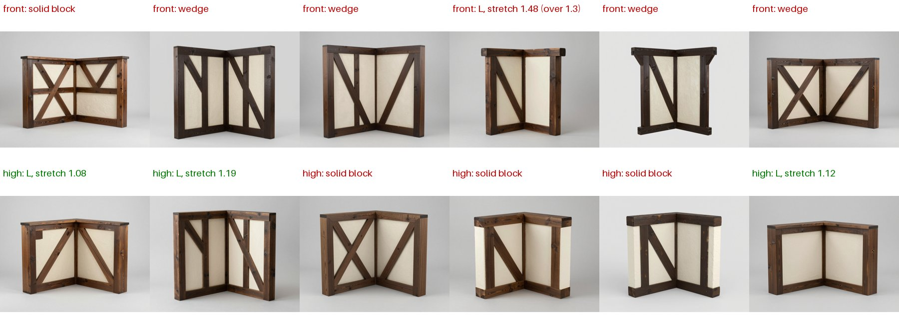

# Modular environment kits: qualification record, criterion M2-v3

Declared on 2026-10-23, before any M2-v3 run. It replaces
[criterion M2-v2](../kits-provisional-2026-10-v2/QUALIFICATION-RECORD.md) for new runs; the
[M2-v2 runs](../kits-provisional-2026-10-v2/README.md) and their results stay as they are. Results for M2-v3 go in the
[evidence report](README.md). Six runs cannot make anything Qualified; at most they make kits Provisional for the
tested scope.

## What changed from M2-v2

No criterion changes. The owner-accepted limits of 2026-10-22 (issue #94) and M2-v2's matching-look gate stand.

The pipeline is the current code, not M2-v2's commit `5c17d4d`; the commit is recorded per run. These changes
come from the M2-v2 findings:
- **Wedge corners are retried.** Inspection records each corner arm's taper: its thickness across the middle of its
  far half over that across its end.
  - On published meshes, every M2 L corner measured 1.00–1.01. T2's wedge measured 1.72 and 1.82; it passed the
    open-quarter check, and the kit check failed it on 0.27 m arms.
  - Above 1.25 a corner candidate fails as `module_taper`, and the next seed is tried, as for a solid block. The 1.25
    limit is set by the agent from this evidence; it is a retry trigger, not a criterion.
- **The mesh worker retries its start-up health check** for 2 minutes. In M2-v2 one timeout cost T2 an attempt while
  the service was up.
- **Timber corner view:** the timber corner's brief asks for a high front three-quarter angle, looking down into the
  inside of the L so the flat tops of both arms show.
  - The test ran T2's six concept seeds and its corner mesh seed through the h100 `final` shape stage.
  - Eye-level concepts, as in M2-v2, gave one solid block, four wedges, and one L stretched 1.48.
  - High-angle ones gave three Ls (stretch 1.08–1.19, taper 1.01–1.03) and three solid blocks, which approval
    retries.

## Scope

- **Kits** (`templates/recipes`), two independent runs each:
  - `stone_ruin_kit`, with layout `courtyard`;
  - `timber_house_kit`, with layout `room`;
  - `scifi_corridor_kit`, with layout `room`.
- **Environment:** compute profile `h100`, quality tier `final`. Each run starts from a fresh copy of the Unity
  6000.6.3f1 / URP 17.6.0 blank project.
- **Code:** one fixed SlopForge commit for all runs, recorded per run.

## Procedure, per run

1. `slopforge init`, then `recipe run <kit> --name <run>`.
2. The agent selects one concept per module, for evaluation only. It records the reason for each pick, judged
   against:
   - the module's brief;
   - a face close to the module's declared shape (square for walls);
   - the inside view of the L for corners.
3. The stone kit only: approve its `stone` texture, the shared kit material, first.
4. For each module: `approve <module> <concept>`, then `approve-texture` with its lowest-numbered valid material
   candidate.
5. `environment-check <run>`.
6. `environment-scene <run> <layout>`, which saves and renders the assembled Unity scene.

Runs may overlap on the GPU.

**Permitted interventions** (each recorded):
- **After an infrastructure interruption** (a lost or restarted remote job, or a timeout): one resume of the
  interrupted command.
- **After a `module_stretch` stop:** one fresh selection of a different concept for that module. This is the
  remedy the stop asks for.

## Criteria (owner-accepted 2026-10-22)

A run passes when every module and the assembled scene meet all of these.

| Gate | Criterion | Where it is measured |
| --- | --- | --- |
| Size | Each declared `target_size` axis within 0.05 m | `environment-check` (grid, max dimension) and validation dimensions |
| Pivot | Each module's origin at its declared pivot within 0.05 m | `environment-check` |
| Stretch | Face stretch at most 1.3 | validation `axis_stretch`; `environment-check` |
| Corner shape | The emptiest footprint quarter at most 0.15 | validation `open_quadrant`; `environment-check` |
| Joints | Corner arms within 0.05 m of the declared thickness | `environment-check` |
| Concept fit | At least 0.8 | validation `concept_fit` |
| Colour | Hue difference at most 4 and chroma ratio at least 0.6, against a coloured concept (near-grey concepts are not checked) | validation |
| Budgets | Faces within each module's declared budget; maps at its declared size (2048²) | validation; `environment-check` budgets |
| Unity | Every module stands at its placement height (0.05 m), has a mesh collider and is static; no seam gap wider than 0.05 m; the scene builds and renders | `environment-scene` report |
| Matching look | The stone kit's modules take their base colour from its approved kit texture, and their roughness maps average its declared 0.75 (within 0.02) | the kit material stage; the published roughness maps |

## Unchecked gates

Not checked by this protocol, and reported as open:
- the owner's visual approval of the assembled scenes, which is reviewed after the runs;
- Play mode;
- lightmapping, which the static flags leave out;
- LODs;
- a part limit for structures;
- the finish of the timber and sci-fi kits. They use two or more materials, so they have no shared kit material, and
  their roughness is as generated. M2-v1's timber modules averaged 0.50–0.59.

## Status rule

- **Provisional** for "modular environment kits, `h100`/`final`, the fixed commit, Unity 6000.6.3f1 / URP 17.6.0" if
  all six runs pass.
- **Not Qualified** in any case: six runs cannot measure a failure rate.
