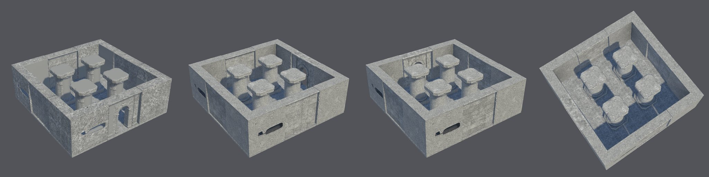
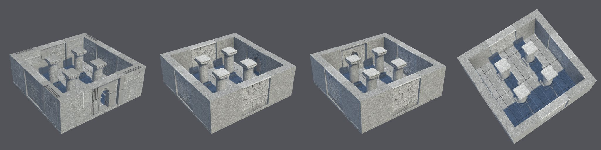
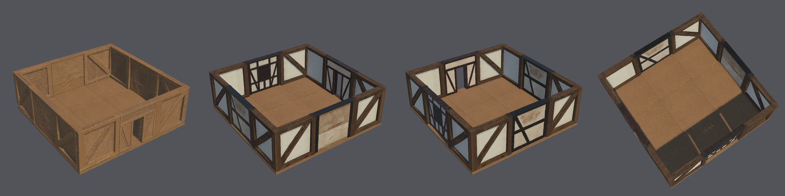
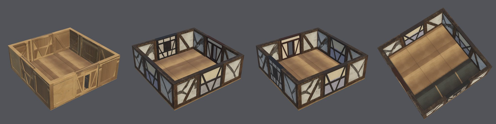
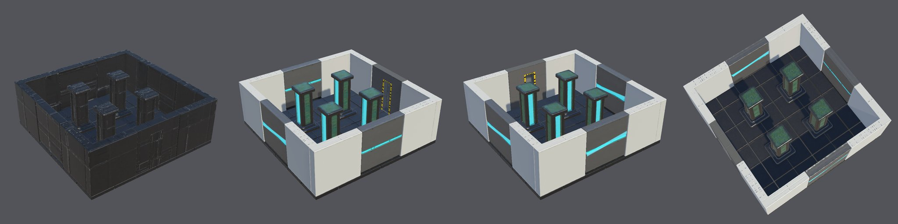
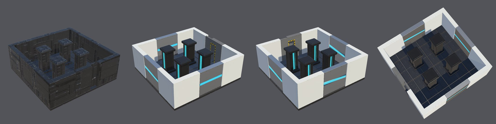

# Modular environment kits: protocol evidence, criterion M2-v3

These runs follow the [qualification record](QUALIFICATION-RECORD.md), committed before the first run. All six used
commit `5ceac3b` on the H100 `final` tier, each from a fresh copy of the Unity 6000.6.3f1 / URP 17.6.0 blank project.
They ran side by side on 2026-10-23, taking 2 h 50 min to 3 h 40 min each.

**Outcome: all six runs pass every criterion.** Under the record's status rule, modular environment kits are
**Provisional** for this scope:
- `h100`/`final`;
- commit `5ceac3b`;
- Unity 6000.6.3f1 / URP 17.6.0;
- the stone ruin, timber house and sci-fi corridor kits, with their recipe layouts.

They are not Qualified: six runs cannot measure a failure rate. Nothing here is visually approved by the owner.

| Run | Kit | Result | Interventions |
| --- | --- | --- | --- |
| K1 | stone ruin, `courtyard` | **Pass** | none |
| K2 | stone ruin, `courtyard` | **Pass** | one permitted fresh selection (corner) |
| T1 | timber house, `room` | **Pass** | none |
| T2 | timber house, `room` | **Pass** | none |
| S1 | sci-fi corridor, `room` | **Pass** | none |
| S2 | sci-fi corridor, `room` | **Pass** | none |

## Assembled scenes

Each scene is the recipe's layout, built and rendered in Unity by `environment-scene` from the published modules.
The agent selected the concepts for evaluation only.

**Stone ruin courtyard (K1, K2):** 21 instances each. Every module takes its colour from the kit's approved stone
texture and its roughness from the kit's declared 0.75.

**Timber room (T1, T2):** 17 instances each. Both corners are clean Ls with 0.400 m arms. In M2-v2, T2's corner came
out a wedge and the room had curved corners.

**Sci-fi room (S1, S2):** 21 instances each.

**Visual observations.** These are not criteria; they are for the owner's review.
- **Invented outsides.** Each concept shows one face, so the back of every wall is invented:
  - the timber walls' outsides are bare timber;
  - the sci-fi walls' outsides are dark;
  - the stone walls' outsides are flatter than their block faces.
- **Texture blemishes:**
  - some of T2's plaster panels carry dark curved streaks;
  - K1's outer walls show dark gouges;
  - S1's pillars have green patches.
  - S2's pillar is near-black where its concept is grey metal. TRELLIS's own texture is black (96% of its texels),
    so this is a generation failure that no check catches yet. It was found on 2026-10-23, after the run, while
    tracing a black cliff in the moorland scene; see [Natural environments](../../NATURAL-ENVIRONMENTS.md).

  K2, T1 and S2, shown in the README, were judged the cleanest of each pair before S2's pillar was noticed.
- **Sci-fi colours:** the corners are whiter than the grey walls. The kit has no shared material.
- **Shadowed faces:** faces turned away from the light read blue-grey; the sky lights them.

## Retries and the intervention

Approval retried six corner seeds that reconstructed as solid blocks: one in K2, one in T1, two in T2 and two in S2.
Their emptiest footprint quarters measured 0.24–0.56, against the limit of 0.15. Every corner except K2's first
concept qualified within its budget of three seeds. No corner came out a wedge, so the new `module_taper` check never fired in these runs.

**K2's fresh selection:** corner concept 1's first seed was a solid block (0.562), and its second stretched 1.3085
past the 1.3 limit. The record allows one fresh selection after a stretch stop. Concept 3, an inside view of the L,
qualified on its third seed.

**No other infrastructure trouble:** no concept or mesh job timed out or was lost. The H100's ComfyUI service
restarted once, at 05:31 UTC, when a login hold ended. No job was lost: every approval completed.

## Measured values

Stretch is the face stretch to the declared size (limit 1.3). The open quarter is a corner's emptiest footprint
quarter (limit 0.15). Arms are declared at 0.75 m for stone, 0.4 m for timber and 0.5 m for sci-fi (tolerance 0.05
m). Concept fit's limit is 0.8. Colour is checked only against a coloured concept (limits: hue difference 4, chroma
ratio 0.6). Stone roughness is declared at 0.75. Every module was within its declared size and pivot at 0.05 m, and
every map is 2048².

| Run | Module (concept) | Stretch | Open quarter | Arms (m) | Concept fit | Colour (hue / chroma ratio) | Faces / budget | Roughness |
| --- | --- | --- | --- | --- | --- | --- | --- | --- |
| K1 | floor (5) | 1.00 | – | – | 0.91 | near-grey | 7,288 / 15,000 | 0.75 |
| K1 | wall (1) | 1.07 | – | – | 0.92 | near-grey | 23,087 / 40,000 | 0.75 |
| K1 | doorway (2) | 1.03 | – | – | 0.95 | near-grey | 32,394 / 40,000 | 0.75 |
| K1 | corner (1) | 1.04 | 0.00 | 0.750, 0.750 | 0.97 | near-grey | 29,951 / 40,000 | 0.75 |
| K1 | column (1) | 1.00 | – | – | 0.95 | near-grey | 19,951 / 20,000 | 0.75 |
| K2 | floor (1) | 1.01 | – | – | 0.90 | near-grey | 14,986 / 15,000 | 0.75 |
| K2 | wall (1) | 1.24 | – | – | 0.95 | near-grey | 23,324 / 40,000 | 0.75 |
| K2 | doorway (2) | 1.07 | – | – | 0.95 | near-grey | 38,620 / 40,000 | 0.75 |
| K2 | corner (3) | 1.18 | 0.00 | 0.750, 0.750 | 0.98 | near-grey | 15,330 / 40,000 | 0.75 |
| K2 | column (1) | 1.00 | – | – | 0.97 | near-grey | 19,994 / 20,000 | 0.75 |
| T1 | floor (2) | 1.00 | – | – | 0.91 | 0.22 / 1.04 | 7,612 / 15,000 | 0.81 |
| T1 | wall (4) | 1.05 | – | – | 0.93 | near-grey | 28,040 / 40,000 | 0.55 |
| T1 | window (2) | 1.09 | – | – | 0.94 | near-grey | 23,084 / 40,000 | 0.66 |
| T1 | doorway (3) | 1.10 | – | – | 0.96 | near-grey | 18,253 / 40,000 | 0.61 |
| T1 | corner (2) | 1.01 | 0.00 | 0.400, 0.400 | 0.97 | 0.34 / 1.16 | 38,751 / 40,000 | 0.78 |
| T2 | floor (1) | 1.07 | – | – | 0.89 | 0.96 / 0.97 | 6,636 / 15,000 | 0.50 |
| T2 | wall (4) | 1.14 | – | – | 0.94 | near-grey | 16,644 / 40,000 | 0.64 |
| T2 | window (3) | 1.02 | – | – | 0.95 | near-grey | 32,315 / 40,000 | 0.62 |
| T2 | doorway (3) | 1.28 | – | – | 0.95 | near-grey | 23,174 / 40,000 | 0.69 |
| T2 | corner (2) | 1.00 | 0.00 | 0.400, 0.400 | 0.97 | 1.11 / 0.86 | 26,759 / 40,000 | 0.69 |
| S1 | floor (1) | 1.00 | – | – | 0.90 | near-grey | 14,996 / 15,000 | 0.46 |
| S1 | wall (1) | 1.14 | – | – | 0.91 | near-grey | 30,403 / 40,000 | 0.38 |
| S1 | doorway (6) | 1.08 | – | – | 0.94 | near-grey | 16,072 / 40,000 | 0.53 |
| S1 | corner (1) | 1.01 | 0.00 | 0.500, 0.500 | 0.97 | near-grey | 36,298 / 40,000 | 0.32 |
| S1 | pillar (4) | 1.00 | – | – | 0.95 | near-grey | 10,360 / 20,000 | 0.32 |
| S2 | floor (1) | 1.00 | – | – | 0.90 | near-grey | 14,929 / 15,000 | 0.45 |
| S2 | wall (6) | 1.15 | – | – | 0.92 | near-grey | 39,996 / 40,000 | 0.50 |
| S2 | doorway (4) | 1.09 | – | – | 0.95 | near-grey | 25,872 / 40,000 | 0.53 |
| S2 | corner (1) | 1.22 | 0.00 | 0.500, 0.500 | 0.95 | near-grey | 15,678 / 40,000 | 0.26 |
| S2 | pillar (3) | 1.00 | – | – | 0.94 | near-grey | 19,998 / 20,000 | 0.37 |

The stone kit texture was approved first in K1 (concept 6) and K2 (concept 1). Every stone module records the same
seamless swatch hash as the other modules in its run.

**Unity, every run:**
- 21 instances (stone, sci-fi) or 17 (timber);
- worst ground error 0.000 m;
- every instance has a mesh collider and is static;
- no seam gap wider than 1 mm;
- the scene built and rendered with no errors.

**Kit totals:** 105,528–116,473 faces per kit, and 83.9 million map texels in every kit: five modules, each with four
2048² maps.

## Not checked

- The owner's visual approval of the scenes.
- Play mode, lightmapping and LODs.
- A part limit for structures.
- The timber and sci-fi kits' finish, which is as generated.
- The wedge check in a live run; it is tested on T2's preserved M2-v2 mesh and a Blender fixture.
- A failure rate: six runs can't measure one.
