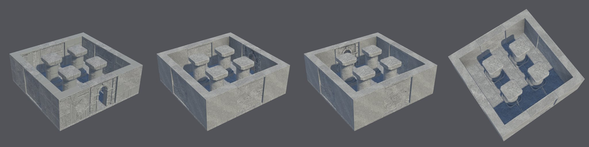
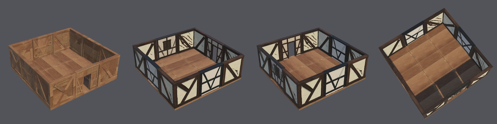

# Modular environment kits: protocol evidence, criterion M2-v1

These runs follow the [qualification record](QUALIFICATION-RECORD.md), which was committed before the first run.
All six runs used commit `d3d6c31` on the H100 `final` tier, each from a fresh copy of the Unity 6000.6.3f1 /
URP 17.6.0 blank project.

**Outcome: no status.** One run passed every criterion. Two failed: one through a pipeline bug and one at the
stretch limit. The other three stopped before selection when a concept job timed out on the shared GPU.
Criterion M2-v1 is closed with these results. The findings are fixed, and all six runs repeat under a new record.

| Run | Kit | Result | Where it stopped |
| --- | --- | --- | --- |
| K1 | stone ruin, `courtyard` | **Pass**, every criterion | — |
| T1 | timber house, `room` | **Fail**: Joints | the corner's arms measure 0.351 and 0.335 m against the declared 0.4 m |
| S1 | sci-fi corridor, `room` | **Fail**: Stretch | the wall stretched 1.49 to reach 3 × 3 m (limit 1.3); no scene, as the wall never published |
| K2 | stone ruin | **Stopped** (infrastructure) | the doorway's concept job timed out |
| T2 | timber house | **Stopped** (infrastructure) | the doorway's concept job timed out |
| S2 | sci-fi corridor | **Stopped** (infrastructure) | the corner's concept job timed out |

## Assembled scenes

K1, the stone courtyard: 21 instances.

T1, the timber room: 17 instances. It was built and rendered, but the run fails on its corner arms.

**Visual observations.** These are not criteria. The owner's visual review is an unchecked gate, and no module
here is visually approved.
- **K1:** walls, doorway, corner and columns read as one stone. The floor reads blue and glossy. Its roughness map
  averages 0.22 against about 0.67 for the other modules, so Unity reflects the sky in it.
- **T1:** the outside faces of the walls are bare timber with braces. The plaster panels show only on the inside,
  because the concepts showed one face and the backs were invented. Some plaster panels read grey-blue.
  - The timber modules' roughness averages 0.50–0.59, glossier than matte plaster. Timber has no shared kit
    material, so nothing sets its finish.

## Findings and fixes

Each fix has a regression test. They are on branch `fix/m2-v1-findings`.

1. **Corner arms (T1), a code bug.** The arm rescale read the module's bounds from before it was bottom-centred.
   A corner whose L sat off-centre had its open side missed, so its arms kept their generated thickness. The rescale
   now reads the recentred bounds. The Blender test moves its L off-centre, and it failed before the fix.
2. **Concept timeouts (K2, T2, S2), infrastructure.** All six runs were started in two batches of three. The second
   batch's concept jobs queued behind the first batch's mesh jobs.
   - Afterwards, ComfyUI's history showed all three "timed out" jobs had succeeded, after 2–13 s of execution.
   - They had waited more than 600 s in the queue, and the client counted that wait against the job's timeout.
   - Fix: while ComfyUI reports a job as pending, its deadline now moves with it, up to 3 hours. A timeout
     reports the seconds spent queued.
3. **Duplicated remedy.** The stretch stop printed the generic remedy twice around the specific one. A stretch stop
   now names its own remedy (approve a concept closer to the module's proportions), stated once.
4. **Stone kit tolerances.** The stone recipe kept the starter kit's 0.1 m snap and 0.15 m pivot tolerances, looser
   than the record's 0.05 m. K1's saved measurements, rechecked at 0.05 m and at 0.01 m, still pass. The recipe now
   uses 0.05 m.
5. **Glossy stone floor (K1).** The kit material now declares a roughness. Each module's roughness map moves to that
   mean, keeping 60% of its own variation. The stone kit declares 0.75.
6. **Sci-fi wall proportions (S1).** All six sci-fi wall concepts on the square canvas came out wider than tall.
   Their outlines did not show it: the selected one measured 1.09 tall for its width, but its mesh was 1.49 times
   wider than tall. On S1's six seeds, a portrait canvas brought all six walls within the limit; see the
   [M2-v2 record](../kits-provisional-2026-10-v2/QUALIFICATION-RECORD.md).

## Measured values

From each run's manifest and Unity scene report. Stretch is the face stretch to the declared size (limit 1.3). The
open quarter is the corner's emptiest footprint quarter (limit 0.15). Arms are the corner's measured arm
thickness (declared 0.75 m stone, 0.4 m timber, 0.5 m sci-fi; tolerance 0.05 m). Concept fit's limit is 0.8.
Colour is checked only against a coloured concept. Every module was within its declared size and pivot at 0.05 m.

### K1, stone ruin

The stone kit texture was approved first (concept 2, even fine granite).

| Module | Concept | Stretch | Open quarter | Arms (m) | Concept fit | Colour | Faces / budget | Maps |
| --- | --- | --- | --- | --- | --- | --- | --- | --- |
| floor | 2 | 1.00 | – | – | 0.91 | near-grey concept | 14,900 / 15,000 | 2048² |
| wall | 1 | 1.10 | – | – | 0.93 | near-grey concept | 29,015 / 40,000 | 2048² |
| doorway | 2 | 1.15 | – | – | 0.94 | near-grey concept | 29,470 / 40,000 | 2048² |
| corner | 1 | 1.00 | 0.00 | 0.749, 0.750 | 0.98 | near-grey concept | 16,396 / 40,000 | 2048² |
| column | 1 | 1.00 | – | – | 0.94 | near-grey concept | 19,966 / 20,000 | 2048² |

Unity: 21 instances. Worst ground error 0.000 m. Every instance has a mesh collider and is static. No seam gap is
wider than 1 mm. The scene built and rendered with no errors.

### T1, timber house

| Module | Concept | Stretch | Open quarter | Arms (m) | Concept fit | Colour (hue diff / chroma ratio) | Faces / budget | Maps |
| --- | --- | --- | --- | --- | --- | --- | --- | --- |
| floor | 4 | 1.07 | – | – | 0.91 | 2.74 / 1.06 | 14,606 / 15,000 | 2048² |
| wall | 5 | 1.02 | – | – | 0.94 | near-grey concept | 19,327 / 40,000 | 2048² |
| window | 5 | 1.05 | – | – | 0.94 | near-grey concept | 30,063 / 40,000 | 2048² |
| doorway | 3 | 1.01 | – | – | 0.93 | 2.48 / 1.26 | 31,227 / 40,000 | 2048² |
| corner | 4 | 1.15 | 0.00 | **0.351, 0.335** | 0.97 | 0.11 / 1.33 | 31,742 / 40,000 | 2048² |

Unity: 17 instances. Worst ground error 0.000 m. Every instance has a mesh collider and is static. No seam gap is
wider than 1 mm. The scene built and rendered with no errors. `environment-check` failed on the corner's arms.

### S1, sci-fi corridor

| Module | Concept | Stretch | Open quarter | Arms (m) | Concept fit | Colour | Faces / budget | Maps |
| --- | --- | --- | --- | --- | --- | --- | --- | --- |
| floor | 1 | 1.00 | – | – | 0.91 | near-grey concept | 15,000 / 15,000 | 2048² |
| wall | 6 | **1.49** | – | – | – | – | – | – |
| doorway | 2 | 1.05 | – | – | 0.95 | near-grey concept | 27,054 / 40,000 | 2048² |
| corner | 1 | 1.06 | 0.00 | 0.500, 0.500 | 0.97 | near-grey concept | 20,026 / 40,000 | 2048² |
| pillar | 3 | 1.00 | – | – | 0.98 | near-grey concept | 19,980 / 20,000 | 2048² |

- The wall stopped with `module_stretch`, which does not retry.
- The permitted fresh selection was not used: all six wall concepts were wider than tall.
- `environment-scene` refused, because the wall was not published.

## Not checked

- The owner's visual approval of the scenes.
- Play mode, lightmapping and LODs.
- A part limit for structures.
- Runs K2, T2 and S2 beyond their concept stage.
