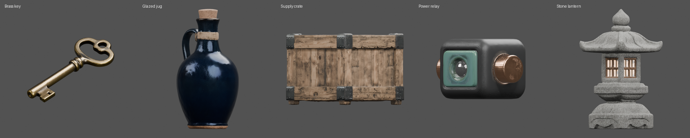
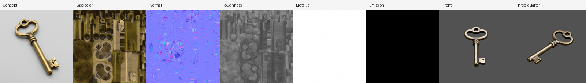
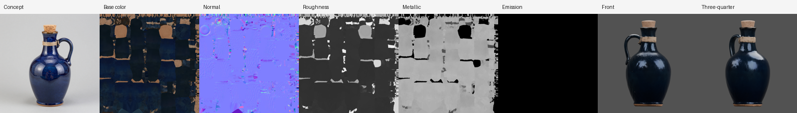
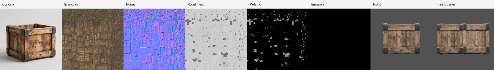
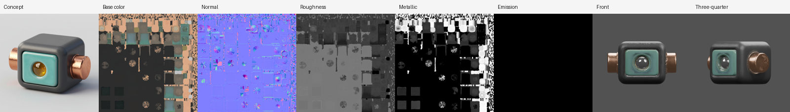

# Material showcase — five props from brief to PBR

Five props generated on 2026-10-18 from written briefs through the normal CLI
(`generate` → `approve`), with no manual repair of any generated asset. Each strip shows
the selected concept, the generated base color, baked normal, roughness, metallic and
emission maps, and two Blender review renders.

| Brass key | Glazed jug | Supply crate | Power relay | Stone lantern |
| :---: | :---: | :---: | :---: | :---: |
|  |  |  |  |  |

Turntables rotate each prepared asset once under fixed key, fill and rim lights (Blender EEVEE,
48 frames), so highlights show how roughness and metallic respond:

```sh
blender --background --python blender/render_turntable.py -- <material_NN>/<name>_preview.blend frames/<name>
python3 scripts/turntable_gif.py frames/<name> <name>_turntable.gif
```



| Prop | Declared materials | Result |
| --- | --- | --- |
| [Brass key](brass_key.png) | key = metal | Fully metallic brass with darker recesses; one connected component |
| [Glazed jug](ceramic_jug.png) | jug, stopper, twine = non-metal | Glossy cobalt glaze stays non-metallic; handle, cork and twine reconstructed |
| [Supply crate](supply_crate.png) | planks = non-metal, brackets = metal | Weathered oak planks with iron brackets and rivets |
| [Power relay](power_relay_v2.png) | housing, plate = non-metal, end caps = metal, lens = `emissive#e0a030` | Graphite, turquoise ceramic and copper regions; lens reads as grey glass |
| [Stone lantern](stone_lantern_v3.png) | stone, lattice = non-metal, paper panels = emissive | Speckled granite, roof ribs and lattice; panels reconstructed solid and lit from the declaration |







## Conditions

- SlopForge commit `01ff304`; compute profile `h100`, quality tier `final`.
- Concept workflow `image.text_to_image` v1; model workflow `model.trellis2.h100` v5
  (TRELLIS.2 bf16, 1536 shape upsample, UDF remesh at 384, GPU decimation to the 30,000-face
  budget, 4096² base color/roughness/metallic bake, 4096² normal bake).
- ComfyUI 0.37.0 on one H100 80 GB; Blender 5.1.0 for UV preparation, assembly and renders.
- Three concepts per prop; the agent selected one per prop for evaluation only.
- Model weight hashes and custom-node revisions are not exposed by the ComfyUI API and remain unknown.
- Each `*.json` file next to a strip records map statistics, normal/emission sources,
  validation warnings and SHA-256 hashes for every image in the strip.

## What changed to get here

Earlier runs of the same briefs exposed shared defects, each fixed in the pipeline and
covered by regression tests:

- Agent-written concept prompts skipped the reconstruction rules, producing glossy concepts
  decoded as metal. Rules and declared materials are now appended to every 3D concept prompt.
- Every native candidate had a 1×1 placeholder normal map. The H100 TRELLIS.2 graphs now bake
  a real normal map, and approval refuses the placeholder.
- Glowing or translucent concept regions reconstructed as holes. Concepts now show emissive
  regions switched off; the material stage adds emission from the declaration.
- Blender's voxel remesh erased thin open parts of TRELLIS.2 raw meshes (a crate kept 13% of
  its surface and lost its planks; a jug lost its handle). Raw shapes are now UDF-remeshed on
  the GPU at a resolution matched to the face budget.
- Flat props were reviewed edge-on and wide props were clipped; preview cameras now adapt.
- Two commands on one project could erase each other's manifest records; writes now hold a
  project lock.

## Review and progress

The project owner reviewed this set on 2026-10-18 and rated it about **60% of the target
quality for props**. Measured against the start of this work, on the same briefs and H100:

| Area | Before | Now |
| --- | --- | --- |
| Normal map | 1×1 placeholder on every native candidate | 4096² baked tangent normal |
| Metallic | Glossy stone decoded as metal; no check | Declared materials; mismatch fails before review |
| Thin parts | Planks, handles and lattices erased by Blender voxel repair | UDF remesh on the GPU keeps them |
| Surface | Blocky blotches at 1024/2048; hole "shards" from over-decimation | Fine texture at 1536/4096; remesh matched to face budget |
| Glowing parts | Painted white or reconstructed as holes | Solid unlit panels; emission from the declaration |
| Review renders | Edge-on flat props, clipped wide props, no turntable | Adaptive cameras and lit turntables |

The remaining 40% is listed below; the largest visible gaps are unseen sides, small detached
parts and emitter detection.

## Limits

- **Not approved:** no visual or material approval was given, and none of these assets was
  imported into Unity. This page shows generation and structural evidence only.
- **Not qualified:** one run per prop is not repeatability evidence.
- **Multiple components:** components range from 1 to 9 per prop. Small detached parts are
  reported in validation, not removed.
- **Unseen faces:** single-image conditioning guesses the hidden sides; the relay back still
  repeats front detail.
- **Partial metal (found 2026-10-20):** the jug's glaze has no fully metallic texels, but its metallic map averaged 0.41–0.59 when measured (not in the recorded JSON), so "stays non-metallic" above holds only for full metal; see the [props provisional evidence](../props-provisional-2026-10/README.md).
- **Emitter detection:** the relay lens was not found as an emitter. TRELLIS.2 bakes a dark
  albedo, so colour matching only finds distinct emitters.
