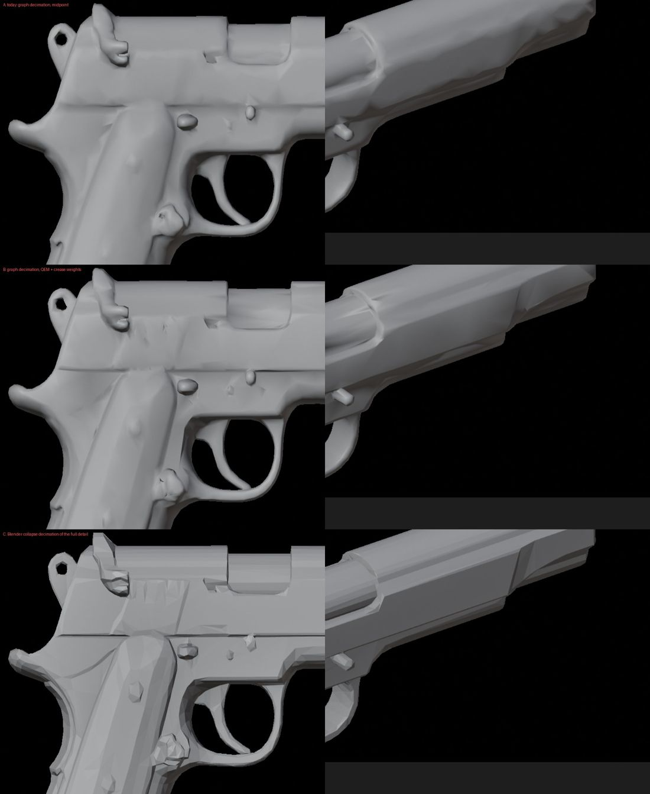
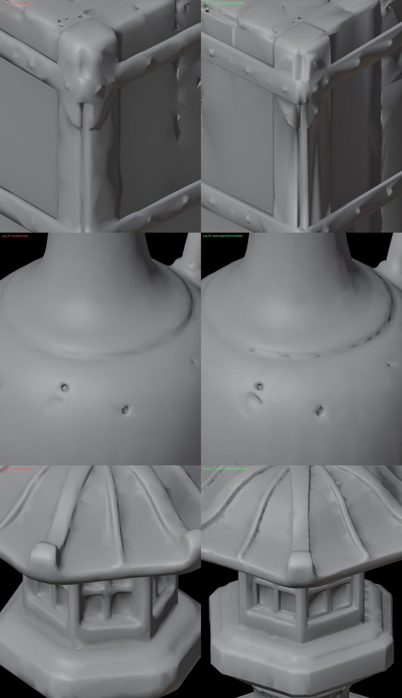
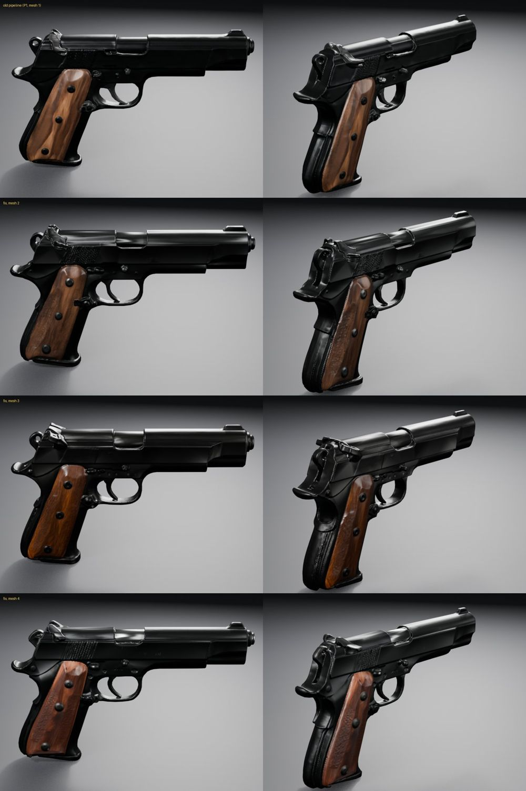
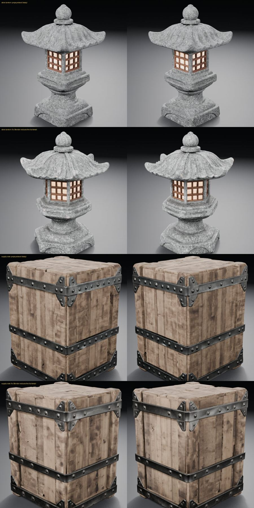

# Mesh reduction: Blender reduces the full-detail shape (2026-10-24)

**Problem:** generated weapons looked soft and lumpy next to their concepts:
- wavy flat steel;
- rounded edges;
- slide serrations and small mechanisms melted into blobs.

**Cause:** the shape generator was not at fault. Every model graph on the `h100` profile remeshes TRELLIS.2's shape at
384 voxels and saves it in full detail (`save_detail`, about a million faces). That shape is crisp. The graph then
reduced it to the 30,000-face budget with ComfyUI's `DecimateMesh` in its midpoint mode, which moves each collapsed
edge to its midpoint. Blender received that reduced mesh. Midpoint placement bent flat planes and wore down edges.

**Fix:** where a graph reduces with midpoint `DecimateMesh`, the worker hands Blender `save_detail` instead. Blender's mesh pass already removes enclosed inner shells,
collapse-decimates to the budget, unwraps UVs and bakes the normal map from `save_detail`; now it reduces the
full-detail shape itself.

## The same shape, reduced three ways

One TRELLIS.2 pistol shape (seed 1369223131), untextured:
- **A, today:** the graph's midpoint decimation;
- **B:** the graph's QEM decimation with crease weights, as the character graph uses;
- **C:** Blender's collapse decimation of the full detail.

C keeps the flat slide planes, the slide step, the front bevel and part of the rear serrations. B is creased. A is
wavy. Small round parts such as the screws become faceted in C; the normal map baked from the full detail covers that
in shading.

The full-detail shapes behind A and B have the same 533,595 vertices and the same bounds. Decimation was the only
difference.

## Props, the same shapes

Each prop protocol's own full-detail shape, run through the mesh pass exactly as the worker calls it, with
`save_detail` as its input. Left: what was shipped. Right: the fix.

| Prop | Shipped | From full detail |
| --- | --- | --- |
| Supply crate (A1) | 29,956 faces, 1 piece | 28,494 faces, 1 piece |
| Glazed jug (B1) | 29,096 faces, 1 piece | 28,496 faces, 1 piece |
| Stone lantern (C1) | 14,404 faces, 1 piece | 28,499 faces, 1 piece |
| Stone lantern (C2) | 27,278 faces, 1 piece | 28,500 faces, 1 piece |

- **Crate:** plank edges and the iron brackets are crisp rather than melted.
- **Lantern:** the octagonal base, the lattice and the roof ribs are sharper. Its lattice did not break, the failure
  the 384 remesh was chosen to avoid.
- **Jug:** about the same, with a few small facets at the rim.
- **Budget:** the C1 lantern shipped 14,404 faces because its inner shell had spent half the budget before Blender
  removed it. Removing shells first gives the visible surface the whole budget.

## Through the whole pipeline

**Pistol:** the same concept, re-approved on `h100` at this commit. Three new seeds, textured and lit as the props
are, against the pipeline before the fix (top).

All three seeds keep flat slide planes, sharp edges and the rear serrations. They were rejected by the dark-texture
check (darkened share 0.407 to 0.462, limit 0.4). The one run before the fix passed at 0.395. The generated blued
steel is near-black (0.13 sRGB) in every run, against dark grey in the concept, so that check's verdict on dark metal
is a separate open question.

**Props:** the props protocol's stone lantern (C2, concept 4) and supply crate (A1, concept 2), re-approved at this
commit. Each passed on its first mesh attempt:

| Prop | Darkened share | Hue difference | Inner-shell vertices removed before reduction |
| --- | --- | --- | --- |
| Lantern | 0.008 | 1.49 | 252k |
| Crate | 0.024 | 1.13 | 162k |

These are new seeds, so shape differences from the protocol runs (below: protocol, then this commit) are mostly seed
variation.

## Limits

- **Comparisons:** same-shape comparisons cover one pistol and four prop shapes. The textured runs are new seeds.
- **Props' Provisional status:** the props protocol runs (v5) and the kit protocol runs predate this change. Two props
  have been re-approved, and neither protocol has been rerun.
- **Characters:** their graph reduces with crease-preserving QEM (of a 512 QEF remesh), and their manifold repair and
  rigging were tuned on that output. The worker keeps it, so characters are unchanged.
- **Multi-view props:** the `h100_multiview` Pixal3D graph has the same midpoint structure, so it changes too. It has not
  been run since.
- **Graphs without a prepare step:** the single-view Pixal3D graph decimates in-graph and has no Blender prepare step,
  so it is unchanged.
