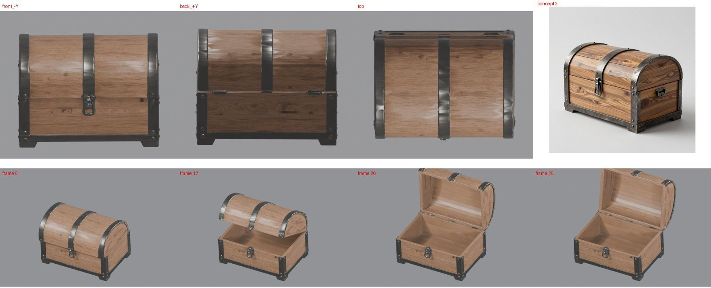

# Moving parts: a pistol and a chest (2026-10-26)

Two assets whose parts move as declared, both pipeline publications on the `h100` profile. The private run folders
are `private/weapons-parts-2026-10-25/HP13` and `.../OPEN7` (commit of each run in its `commit.txt`).

## Pistol: slide and trigger (Experimental)

**Output rights (recorded 2026-10-27): restricted.** OmniPart's part synthesis, which made this pistol's part labels, runs NVIDIA FlexiCubes and nvdiffrast, licensed for non-commercial use only. It is kept as M3 evidence, not for a sold game, and will be regenerated on a cleared parts route ([#134](https://github.com/gysahlgreene/SlopForge/issues/134)).

The brief declares the slide as a slide along the barrel, `-0.03..0`, and the 1911's trigger as a slide, `-0.005..0`.
`approve` and `approve-texture` ran on commit `67043b4` with no manual step. The GIF moves the parts exactly as
declared.

**The route** (`part_model: hybrid`, the weapon and prop default):
- TRELLIS.2 builds the surface, and faces no outside ray reaches are deleted before the reduction.
- OmniPart and the concept's part masks only say where each part is. The surface is labelled along its own creases.
- The labels are cut through the faces along a smoothed boundary, not around the triangles.
- Each part and the body are closed where they were cut apart.

**What passed on this seed:**
- The slide covers 1.00 of its mask and the trigger 0.90.
- No more than 0.005 of either part's vertices go deep into the frame through its range, in Blender. Unity read 0.0
  for both on the published prefab.
- Backs of faces seen from 14 directions: 0.0009 at rest, 0.0023 with the slide back, 0.0011 with the trigger pulled.
- The prefab has a convex collider per mesh, a 1 kg Rigidbody, grip, muzzle and part sockets, and an Animator with a
  trigger and a hold bool per part.
- Play mode passed: each part pulses and returns, and the pistol settles on a floor.

**Repeatability so far:** of the five seeds tried since the seat rule (`c206c36`), four published: HP10's second,
and the first seeds of HP11, HP12 and HP13. HP10's first failed the component budget, a fault fixed since. TRELLIS.2
gives a different mesh for the same seed number from run to run. This is one brief: Experimental.

**Fixed on the way here** (each has a regression test, [weapons guide](../../WEAPONS.md)):
- The stray-face cleanup re-oriented the open surface and turned half a pistol inside out.
- A trigger cut from the frame it was fused to failed the motion check by float noise. A slide entering its seat
  now goes into its housing; hinges still count every point.
- The grips' dark grain stayed metal as grey flecks; coloured non-metals now match by hue.
- Hidden-face removal cut visible patches loose; the hidden faces joining them now stay.
- The slide/frame cut ran in triangle-sized teeth that showed as grey shards when racked; faces are now cut along
  the boundary.

**Known limits:**
- **Travel is in model units.** Weapons have no real-world size, so this pistol is one unit long and its 30 mm
  slide travel is 3% of its length. A real 1911's is about 14%. Since fixed for new runs: a slide now needs
  the model's real size (`--target-size`).
- **Small flakes** remain under the ejection port with the slide back.
- **Grip texture varies by seed:** some seeds carry the concept's checkering, this one is plain wood.
- **The chroma check is unreliable on a black weapon:** its concept's median chroma is near grey.

## Chest: lid on a hinge (Experimental)

**Output rights (recorded 2026-10-27): attribution_required** ("Built with DINOv3.", through TRELLIS.2). The open route splits the lid by its mask alone and never runs OmniPart.

Generated closed and cut apart, a chest's inside is invented and its cut wanders along plank grooves: no seed passed.
This chest is generated **open** (`slopforge open`, then `approve chest 2 --open 8`; [guide](../../WEAPONS.md#props-generated-open)):

1. **Open picture.** Qwen-Image-Edit-2511 edits the approved closed concept to show the lid open on a plank inside;
   the open picture is approved as a second concept (2 of 3 edits were usable; one opened the chest like a cabinet).
2. **Mesh.** TRELLIS.2 builds the chest open, inside and all. No hidden faces are removed on this route.
3. **Split.** The open picture's lid mask alone splits the lid off along its hinge.
4. **Closing.** `blender/close_part.py` turns the lid shut about the line where it touches the body, then a search
   over the turn and an offset seals the box. This seed's lid needed a 6% stretch to fit.
5. **Final pass.** The side the lid touched is the back; the frame is the footprint's rectangle; the lid hinges on
   its back edge's seam; colours move to the closed concept's.

**Results (run on `aefecb5`, first seed):**
- the lid covers 0.99 of the closed concept's lid mask; 0.0025 of its vertices go deep into the body through its
  swing (limit 0.02);
- backs of faces 0.0014 at rest and 0.0005 open (limit 0.01); hue 0.17 from the concept (limit 4);
- Unity: the lid turns -100° about a fixed pivot, penetration 0.0025; Play mode 2/2 (the lid pulses and returns, the
  chest rests on the ground).

**Fixed on the way** (2026-10-26, each with a regression test): a hasp's top lifted into the lid and swung below the
closed chest; a seal search that stopped short (a slit) or drooped the lid over the front; a lid pivoting under a
latch at its front, so it lifted off; holes inside from hidden-face removal on the half-open mesh; the lock at the
back and a crooked swing (the silhouette fit could not tell front from back; vertex-weighted axes leaned 6-9°); a
chest as deep as it is tall standing pitched; colour transfer off in stale project type files (doctor now warns).

**Known limits:**
- **One run, one seed.** Repeatability of the open route is not shown; earlier runs' seeds failed on a torn lid end,
  a broken mesh and a misread lid shape (not yet diagnosed).
- **The edit model changes details**, and the dome's outside is invented where the open picture cannot see it.
- **Hidden faces are kept** on this route, so part of the face budget pays for faces inside the walls.
