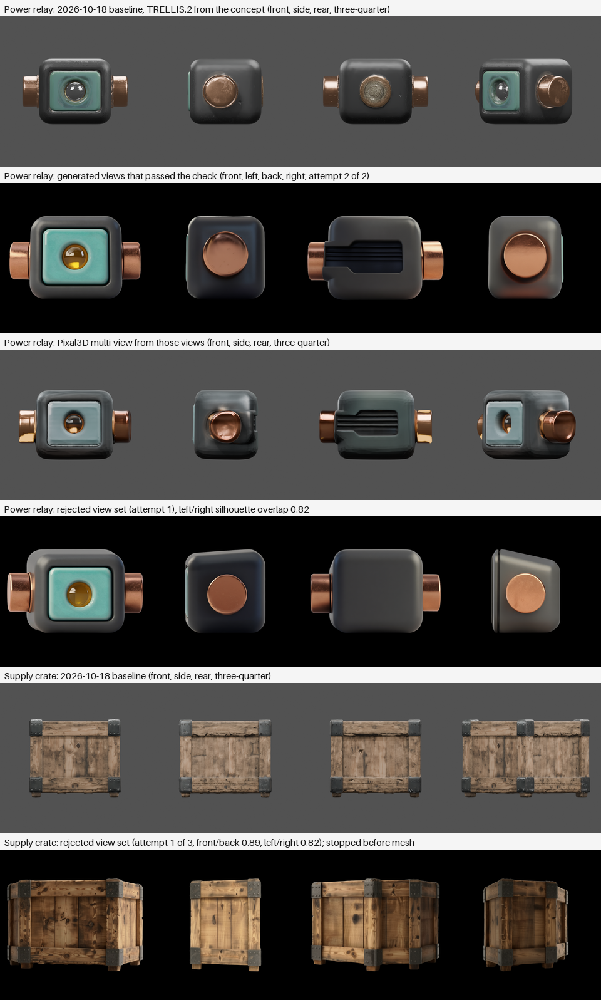

# Multi-view conditioning for props — 2026-10-20 (experimental)

The 2026-10-18 [material showcase](../material-showcase-2026-10/README.md) reconstructed each prop
from one three-quarter concept, so TRELLIS.2 guessed the unseen sides and copied front details onto
them: the power relay's plain back got a copper disc with a lens. This run fed the mesh stage
generated front, side and back views of the same approved concepts instead. No visual approval is
claimed; this is one run per prop.

## What ran

- Same approved concepts as the baseline (concept SHA-256 `7489ff94209f…` relay, `8a50d9734ecc…`
  crate), the same briefs and material declarations, compute profile `h100_multiview`, tier `final`.
- Views: `image_views_qwen_edit_api.json` (Qwen-Image-Edit-2511 with fal's multiple-angles LoRA)
  makes an eye-level front from the concept, then left, back and right from that front with the
  concept prompt appended. `processing/prepare_views.py` frames them at one scale and measures how
  well opposite silhouettes mirror each other; a set below 0.9 is regenerated, up to three sets.
- Mesh: `pixal3d_multiview_image_to_model_h100_api.json` (Pixal3D multi-view weights, 1536 shape
  upsample, UDF remesh 384, Blender UVs and normal bake, 4096² maps).
- ComfyUI 0.37.0 (`8d534945`) on one H100 80 GB; Blender 5.1.0. Model weight SHA-256 values are in
  the workflow sidecars; custom-node revisions remain unknown.

## Results

| Prop | Views | Mesh | Validation |
| --- | --- | --- | --- |
| Power relay | Set 1 rejected (left/right overlap 0.82; one side drawn in perspective). Set 2 accepted (0.96 / 0.94); its back shows an invented vent panel instead of the brief's plain back | Back has no copied lens or disc; the vent panel from the back view is modelled; copper caps on both sides; front plate lighter and greyer than the concept's turquoise | Passed, no warnings: 29,778 faces, 1 component, 0 boundary edges, 64 non-manifold edges; amber lens found for emission. Baseline: 9 components, 6 boundary edges, 70 non-manifold edges, debris and emitter warnings |
| Supply crate | All three sets rejected (best 0.89 / 0.82): the editor closed the open top and drew several views at three-quarter angles | Not run: approval stopped before mesh inference with a `candidate_quality` failure listing the retained attempts | — |

Each relay view set took about 3 minutes and the mesh stage about 2 minutes. View generation added
about 6.5 minutes to the relay approval.

## Earlier prototypes the pipeline is based on

Recorded privately, one seed each, before the pipeline change:

- A Wan 2.2 image-to-video turntable turned about 150° and copied the front plate onto the back;
  Z-Image four-view sheets put the wrong view in a panel in every relay sheet tried; an in-context
  Z-Image inpaint copied the concept into every panel. None gave usable views.
- Pixal3D multi-view rebuilt a plain relay back when its four views agreed; when a generated side
  view also showed a plate on the back edge, the back got the plate. Front and back views alone
  flattened the crate into a slab. Views with a raised camera tilted the reconstruction.
- From the raised concept the angle LoRA's "eye-level" front stayed raised and its side views
  stopped 45–60° short; its "low-angle" front was level and a plain "move the camera 90 degrees"
  instruction gave exact profiles. Backs generated with the brief appended were plain in 9 of 9
  tries on one front, and 2 of 3 on another.

## Limits

- Hidden sides are now drawn by the image editor rather than the 3D model. They follow the brief
  more often than the 3D guess did, but can still be invented (the relay's vent); the silhouette
  check sees angle and scale errors, not wrong details. Review the retained views.
- The orbit is eye level only: tops that only a raised view shows (the crate's open top) are lost.
- Colours shift: the relay plate came out lighter and greyer than in the concept and baseline.
- One run per prop; no repeatability, visual approval, Unity import or default-profile change.
