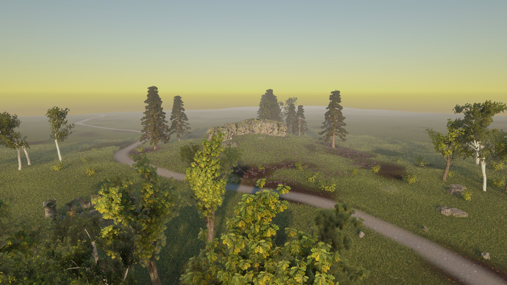
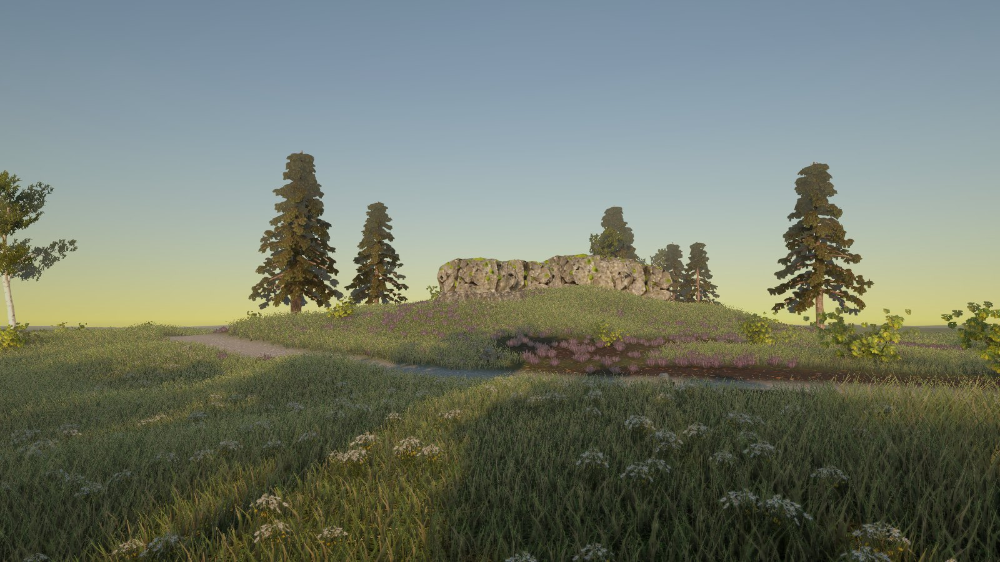
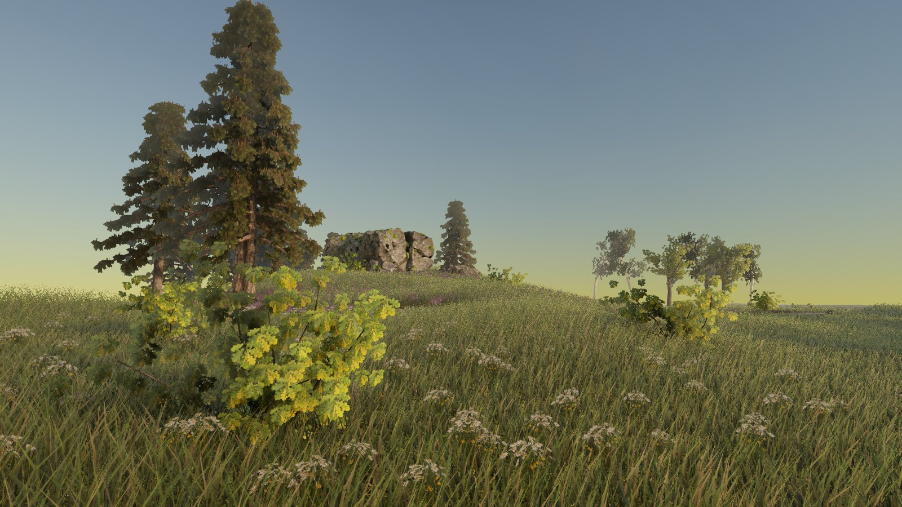
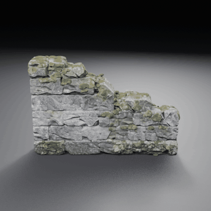

# The moorland scene, live from the recipe (2026-10-23)

The owner approved a [prototype moorland scene](../natural-showcase-2026-10/README.md). This page is that scene
rebuilt by the pipeline alone:
- a fresh copy of the Unity 6000.6.3f1 / URP 17.6.0 blank project;
- `slopforge recipe run moorland_ruin --name moor` on the H100 `final` tier;
- each child approved, the 3D children published with `approve-texture`;
- `slopforge scene-render moor`.

The agent selected every concept. No asset was repaired by hand.

| | |
| :---: | :---: |
|  |  |
|  |  |
|  |  |

## Ruin pieces

Four of the chapel's eight pieces, as Blender turntables of the published models:

| Arch | Window wall | Corner | Wall |
| :---: | :---: | :---: | :---: |
|  |  |  |  |

## The run

- **Children:** 30, all made by the recipe:
  - 7 tiling materials;
  - 5 foliage cut-outs;
  - 10 props: four rocks and six camp props;
  - 8 ruin pieces.
- **Commits:**
  - children built at `9e88a1e`, with the tiling seam fix `746438f` applied part-way;
  - the final render and the cliff and floor fresh selections at `d29fb05`.
- **Build:** 16:01–17:57 UTC, approvals run one at a time.
- **Render:** `scene-render moor` took 85 s:
  - 140 objects, 2.0 million grass blades and 6,600 cover cards;
  - a 33 s probe-volume bake;
  - six 1600 × 900 stills and 360 frames at 1280 × 720, with no errors.

  The scene block came from the project's recipe file (`scene_source`).

## Interventions and what they found

1. **The project lock.** A first build script started while a boulder approval held the project lock, so every
   approval stopped at the lock. They were rerun in order. This was operator error; no generation was lost.
2. **Tiling seams.** The meadow showed dark bands where the default seam repaint met the tile edge. The seam fix,
   cut paths by default, landed during the run, and the four ground layers were re-approved with `--force`.
3. **Flat frames.** The first render wrote 360 frames of flat colour: flythrough frames had no field of view.
   Fixed, with a test.
4. **Three regressions against the prototype**, from the first full render:

   | Seen | Cause | Remedy |
   | --- | --- | --- |
   | the tor's cliff chunks almost black | TRELLIS textured that mesh mostly black (its median lightness from the concept's side was 0.48 of the concept's; the other 17 models had 0.71–1.20) | fresh selection: cliff concept 5 |
   | the arch side-on | sized by height alone, it kept the facing TRELLIS gave it, and the live run's differed from the prototype's | the recipe declares its 3.8 m width and turns it 90 |
   | dark insets in the camp floor | the agent chose a floor concept with a broken diamond centre | fresh selection: floor concept 5 |

The black texture has no automatic check yet. Three lightness measures over 125 published models did not
separate it from accepted timber modules. The guide records the next step:
[Natural environments](../../NATURAL-ENVIRONMENTS.md).

## Against the prototype

**Matches:** the tor, the chapel and its camp, the arch, the path, the heather and the light.

**Differs:**
- **Placement:** seeded placement differs from the prototype's, which used Unity's random numbers. The grove still
  has no birch trunks in front of the camera.
- **No hand tuning:** the prototype's leaves and flower cards were tuned by eye; this run has no such tuning.

## Status

**Experimental.** One live run of one recipe.

**Not checked:**
- the owner's review of this footage;
- Play mode, frame rate and memory;
- a second run;
- any qualification criteria for scenes, of which none are declared.
