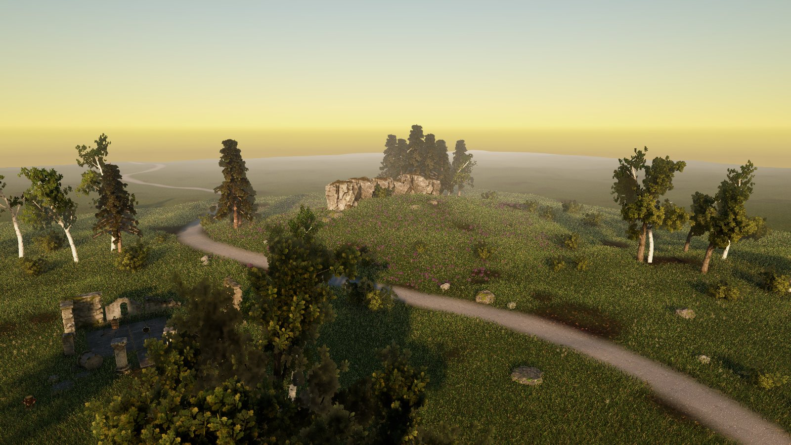
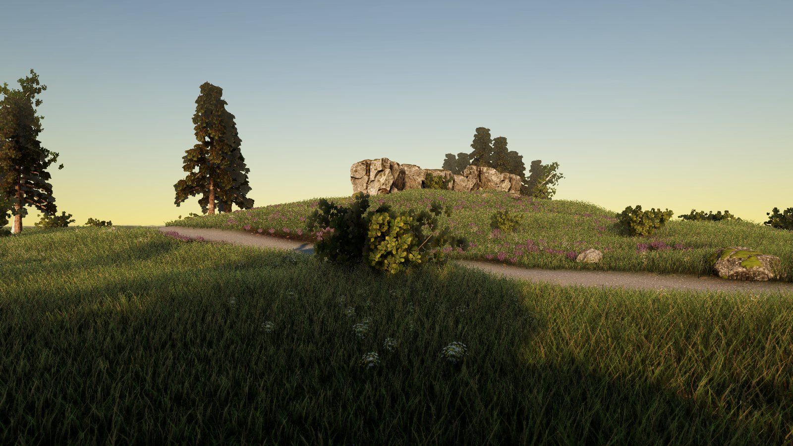
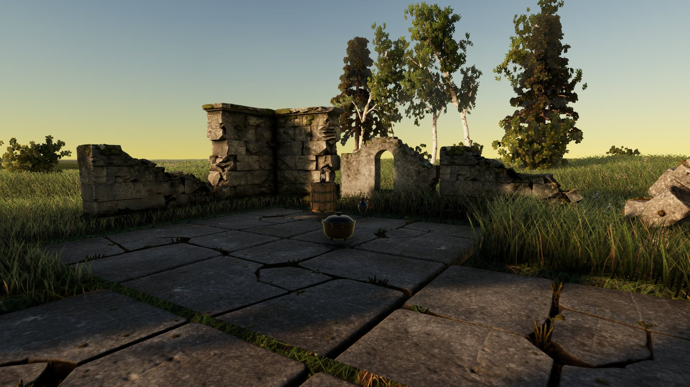
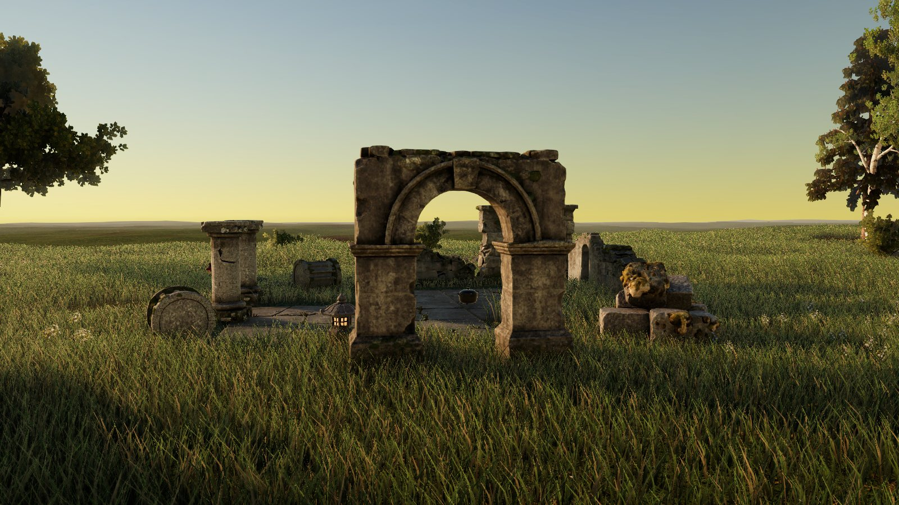
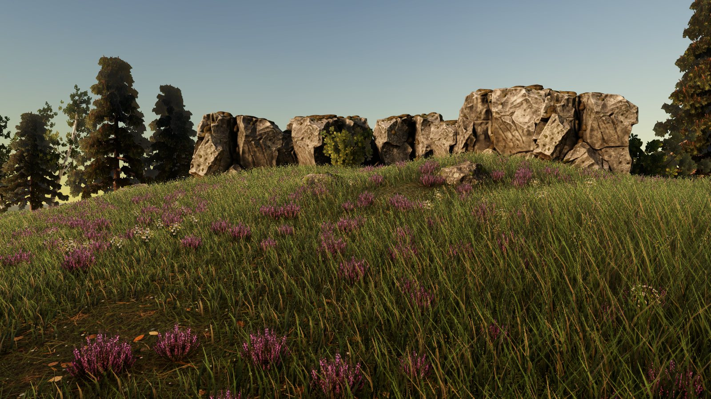
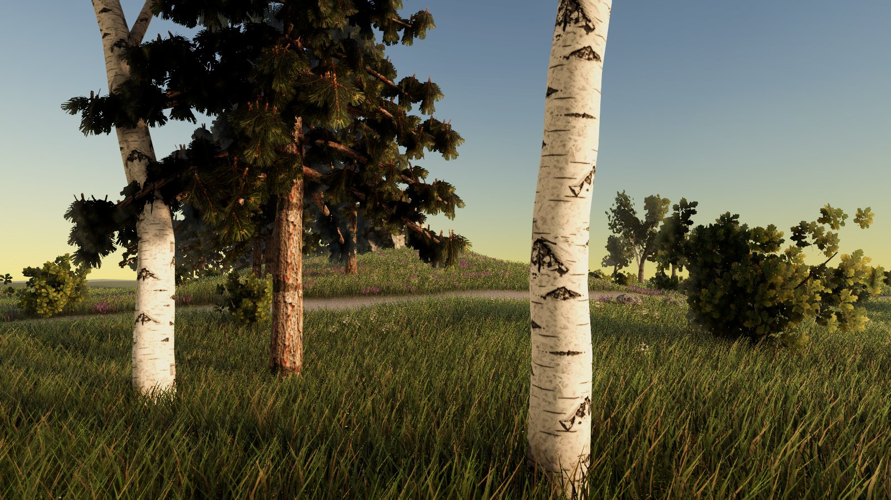

# A moorland scene from briefs (2026-10-23)

One Unity 6000.6.3f1 / URP 17.6.0 scene, in which SlopForge generated every rock, ruin piece, prop, tree, flower and
ground surface from a written brief, on the H100 `final` tier, with no manual repair. The owner asked for a scene
that "should show off a mix of things": a natural environment, some ruins and a few props, with a camera moving
through each element. After four rounds on its look, the owner called it "perfect".

| | |
| :---: | :---: |
|  |  |
|  |  |
|  |  |

## What it is made of

| Element | How | From the pipeline |
| --- | --- | --- |
| Boulders, rocks, outcrops, cliff chunks | `prop` through TRELLIS at real size | yes |
| Chapel walls, window, corner, arch, columns, drums, blocks, floor | `architecture` through TRELLIS at real size | yes |
| Crate, jug, stone lantern; pot, stump, brass lantern | the Provisional prop protocol (first three) and single coverage runs | yes |
| Meadow, forest floor, gravel and granite ground; oak, birch and pine bark | generated surfaces made to tile | prototype scripts, now `tiling_material` |
| Oak, birch and pine sprigs, wildflowers, heather | generated plants cut out | prototype scripts, now `foliage` |
| Trees and shrubs | procedural branching with bark and leaf-card atlases | prototype scripts, now `vegetation` |
| Terrain, grass blades, scatter, layout, lighting, cameras | a Unity editor script | prototype scripts, now `scene-render` |

**The rounds on its look**, each judged by the owner from Unity renders:
1. **Rocks and terrain:** rocks generated through the existing pipeline, and tiling ground layers.
2. **Trees and ground cover:** card leaves and grass.
3. **"A bit dated like Xbox 360 era":**
   - blade grass in place of grass cards;
   - three tree species with leaf atlases and crown-facing normals;
   - golden-hour light, with probe-volume global illumination and sky occlusion.
4. **"Can we make the ruins nicer":** ruin-specific pieces in place of the stone kit's modules, laid out as an open,
   broken chapel.

The kit modules' flat backs had read as invented. Generated as objects, the ruin pieces' backs and broken tops read
as built.

**Measured:** about 2.2 million grass blades, and a probe-volume bake of 15–30 s.

**Tuned by eye, in the scene, not in the assets:** the oak leaf atlas was toned down (less yellow, a little darker),
and the wildflower and heather cards were brightened 15%. The pipeline's `scene-render` has neither adjustment.

## Status

**Experimental.** This is one prototype run, approved for its look. The prototype's steps are now SlopForge features
(PR #102): the `moorland_ruin` recipe carries every brief that made this scene, and `scene-render` assembles it. The
[live run](../natural-live-2026-10/README.md) rebuilt it from a blank project, and its flythrough replaced this
prototype's in the README.

**Not checked:**
- **Play mode, frame rate and memory:** 2 million mesh grass blades would be too heavy for a game.
- **Wind, LODs and impostors.**
- **Qualification:** no criteria are declared for scenes.

[Natural environments guide →](../../NATURAL-ENVIRONMENTS.md)
