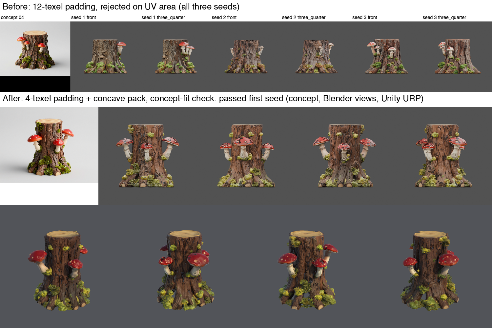
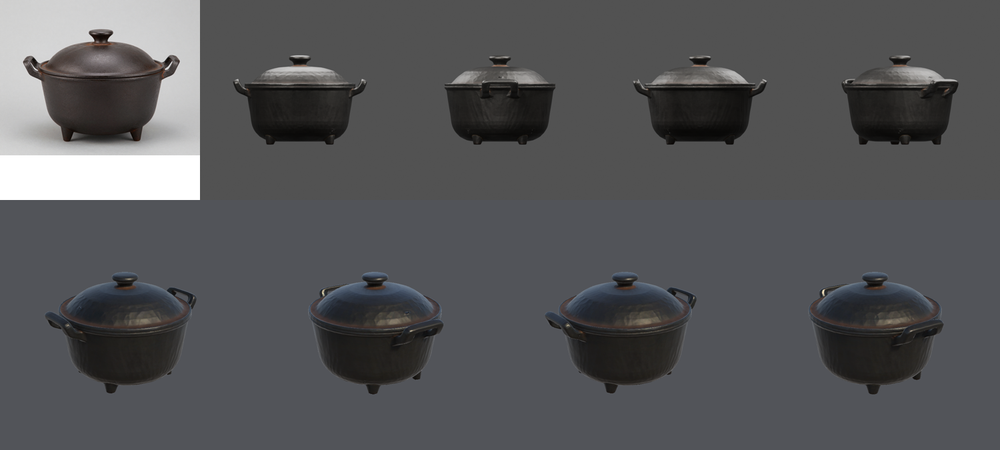
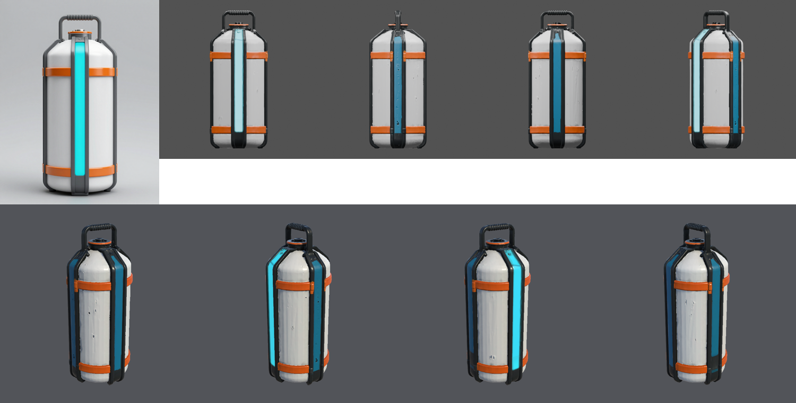
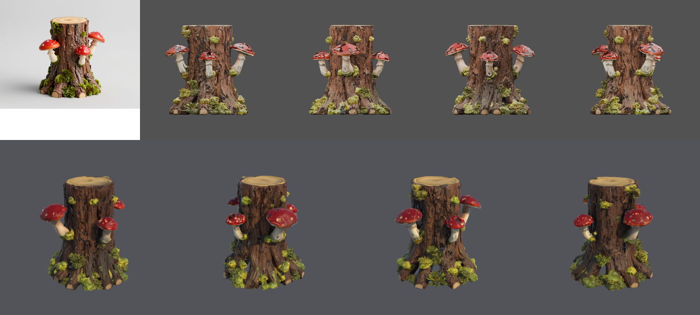

# Prop coverage exploration (2026-10-22)

The protocol briefs cover wood and iron, glazed ceramic, and stone. This exploration ran one fresh run of
each of four other prop kinds, to find the pipeline's next failures. It is exploration evidence, not a
qualification protocol: there is one run per brief and no record committed in advance.

- **Environment:** H100 `final` tier, a fresh copy of the Unity 6000.6.3f1 / URP 17.6.0 blank project per run,
  and the authoring guidance for the briefs.
- **Code:** commit `8af19a2`. F2 also included this change's unwrap and concept-fit edits, then uncommitted.

| Run | Prop kind | Result | Notes |
| --- | --- | --- | --- |
| D1 | Fully metal: cast-iron pot | Pass, first mesh attempt, through Unity | Handles, lid with knob and feet reconstructed; dark iron |
| E1 | Sci-fi hard surface: fuel canister | Pass, first mesh attempt, through Unity | The declared cyan strip was found by the concept projection (fit 0.99, 0.67% of the map), and it glows in the Unity views that face the front. TRELLIS also painted darker blue panels between the frame ribs on the sides and back, copying the front strip onto sides the concept does not show (#63). They do not glow, as the brief declares one strip |
| F1 | Organic: tree stump | **Fail**: all three mesh attempts rejected on UV area (0.017–0.044) | The meshes were whole. Bark and moss unwrapped into about 10,600 islands, and 12-texel padding left 2–4% of the map for surface |
| F2 | Organic: tree stump, with this change | Pass, first mesh attempt, through Unity | Concept fit 0.95; UV area 0.084 |
| G1 | Glass part: brass lantern globe | Pass, first mesh attempt, through Unity | 6.7% glass found; the globe reads as frosted glass |

**Concept stage:** every stump concept (12 of 12) was taller than wide, although the brief and the landscape
canvas asked for wider than tall. The lantern globes were drawn see-through despite the solid wording.

## What changed as a result

- **UV padding:** islands are padded by 4 texels (`4 / texture size`), not 0.003 of the map (12 texels at
  4096), and are re-packed with Blender's concave packer.
  - Re-unwrapping the same meshes: a stump 0.044 → 0.190, a crate 0.30 → 0.545, a jug 0.54 → 0.65.
  - Texel-density spread is unchanged (p90/p10 about 1.3–1.4).
  - Unwrapping a smoothed copy instead gave larger UV area, but stretched texel density by up to 487,000×,
    so it was rejected.
- **Shattered-mesh check:** with the new padding, UV area no longer separated shattered meshes from organic
  ones. Shattered glass bottles measured 0.107–0.124 and whole stumps 0.098–0.19. The concept silhouette fit
  does separate them: shattered 0.71–0.75, every whole prop 0.86–0.99. Props therefore retry on a concept fit
  under 0.8 (`concept_fit`) instead of a UV area under 0.2.

## Evidence

| D1 iron pot | E1 fuel canister | F2 tree stump | G1 brass lantern |
| :---: | :---: | :---: | :---: |
|  |  |  |  |

The turntables are Blender renders of each run's first valid material candidate. Each strip shows the selected concept and the Blender front, side, rear and three-quarter renders (top), and
the Unity URP render from four sides (bottom).

Run folders, logs and manifests are kept outside Git.
