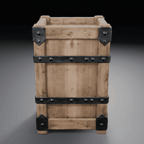
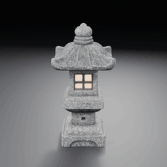
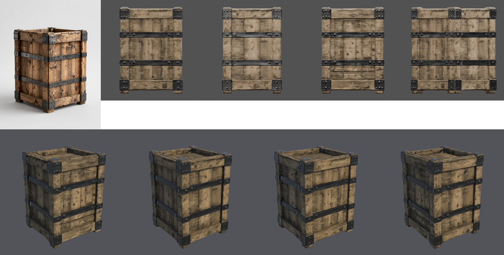
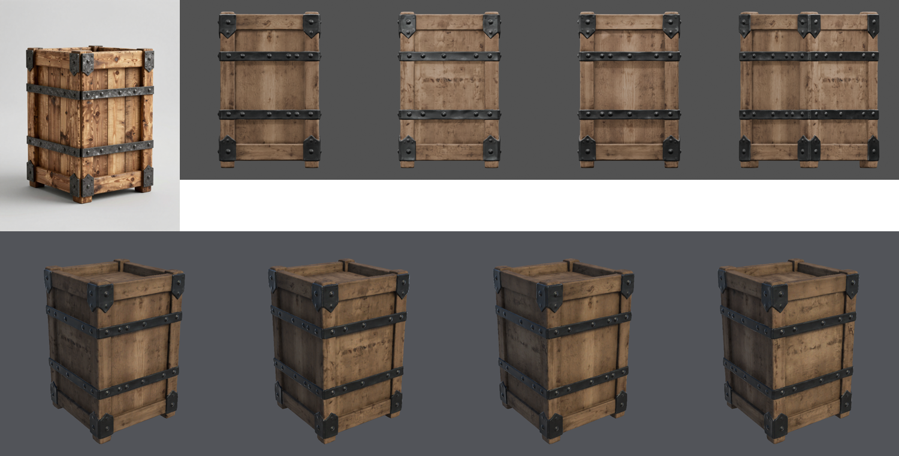
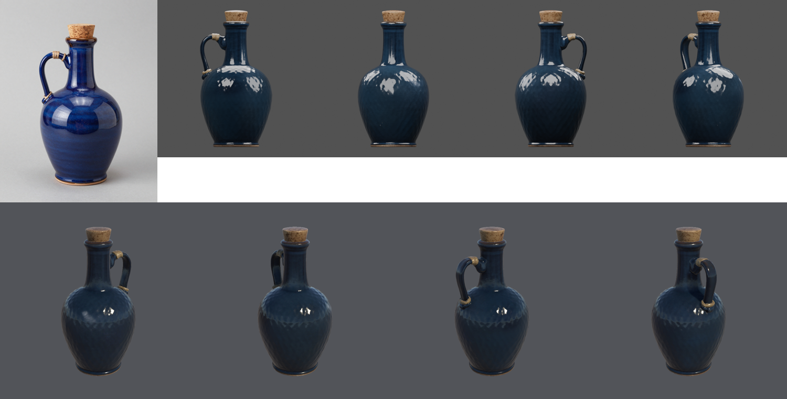
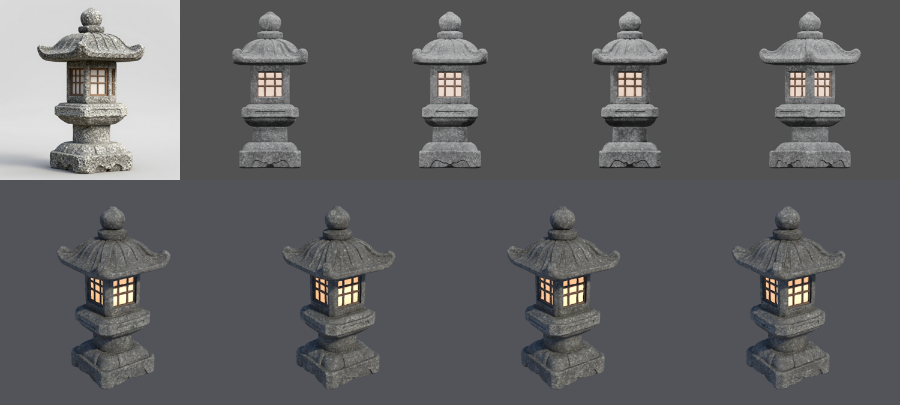
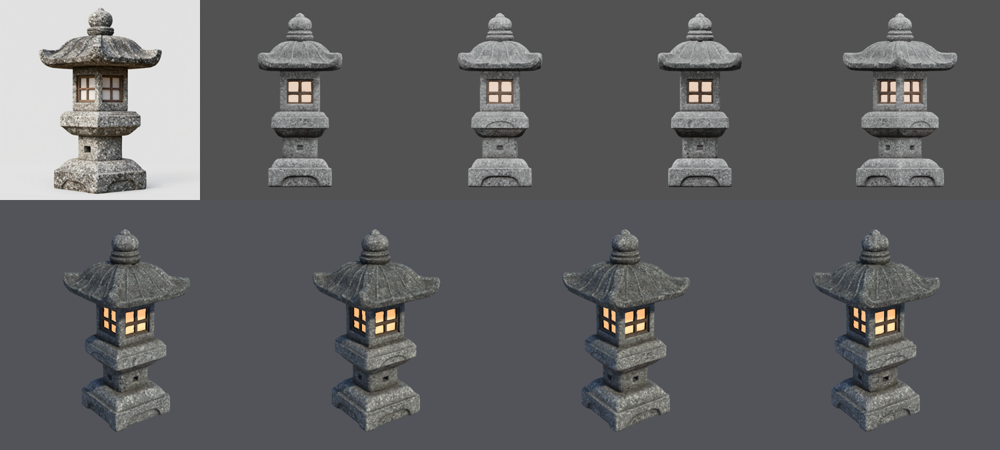

# Props provisional evidence, criterion v2 (2026-10-21)

This page reports six independent runs of the props pipeline under the
[criterion v2 qualification record](QUALIFICATION-RECORD.md), which was committed (`ca15b1c`) before
the first run. Every run used commit `ca15b1c` from a fixed worktree, the H100 `final` tier, and a
fresh copy of the Unity 6000.6.3f1 / URP 17.6.0 blank project.

- **Five of the six runs pass every stage and every v2 threshold.** Each passed on its first mesh
  attempt, with no validation warning.
- **B2 failed** during conditioning, before any 3D work. The local background-removal step crashed
  while exiting, after writing its outputs. This was not a quality failure, but under the record it is
  a failed run, and failed runs are kept.
- **Status:** the set is **Experimental**, because Provisional needs all six runs to pass.
- **Owner review (2026-10-21):** all three props rated better than the v1 runs, which had themselves
  been rated better than the 60% baseline. No percentage or asset approval was given.

## Results by gate

| Run | Concept (of 6) | Geometry and mesh/UV | Materials | Review renders | Unity import | Criterion v2 |
| --- | --- | --- | --- | --- | --- | --- |
| A1 crate | 01 | Pass: 26,424 tris, 1 part, UV 0.38 | Pass | 4 views + turntable | Imported, Lit material assigned, URP render | Pass |
| B1 jug | 03 | Pass: 29,208 tris, 1 part, UV 0.61 | Pass: metallic mean 0 | 4 views + turntable | Imported, Lit material assigned, URP render | Pass |
| C1 lantern | 02 | Pass: 15,560 tris, 1 part, UV 0.42 | Pass: emitter 2.9%, metallic mean 0 | 4 views + turntable | Imported, Lit material assigned, URP render | Pass |
| A2 crate | 01 | Pass: 19,184 tris, 1 part, UV 0.54 | Pass | 4 views + turntable | Imported, Lit material assigned, URP render | Pass |
| B2 jug | 03 | Not reached | Not reached | Not reached | Not reached | **Fail** (conditioning crash) |
| C2 lantern | 02 | Pass: 22,121 tris, 1 part, UV 0.37 | Pass: emitter 3.1%, metallic mean 0 | 4 views + turntable | Imported, Lit material assigned, URP render | Pass |

- **Concepts.** Every run had a concept that met all four v2 criteria.
  - Both crates are taller than wide, in the concept and in the mesh (height/width 1.36 and 1.50).
    They have two riveted straps and brackets on every corner. In v1, all twelve crate concepts were
    wider than tall, and A1 had no straps.
  - The jugs are side-on with cork, handle and twine visible, which v2 allows for round props.
  - The lantern panels are unlit in every concept.
- **Thresholds.** Every passing run has:
  - one part (at most 5 allowed);
  - UV area 0.37–0.61 (at least 0.20);
  - at most 30,000 triangles and 4096² maps.

  The lanterns' emitters cover 2.9% and 3.1% (at least 0.5%). The jug and lanterns declare no metal,
  and their metallic maps are zero (at most 0.05). The crates declare metal brackets; their metallic
  means are 0.27 and 0.19.
- **Recorded only.**
  - Non-manifold edges: 0–19.
  - Boundary edges: 0–12.
- **B2.** The background-removal step (`processing/prepare_3d_input.py`, rembg on onnxruntime
  1.30.0, Python 3.14.7) wrote its cutout and 3D input, then died with SIGABRT
  (`libc++abi … recursive_mutex lock failed: Invalid argument`) while the interpreter shut down.
  - Its outputs are byte-identical to clean re-runs on the same concept.
  - Repeated runs on the same concept reproduced it twice in 64.
  - The pipeline stopped correctly, classified the failure as `unknown`, and kept the run.
  - The record allows a resume only after an environment failure, so B2 was not resumed.

## Visual evidence

Each strip shows the selected concept and the Blender front, side, rear and three-quarter renders
(top), and the Unity URP render from four sides (bottom).

| Brief | v1 run 1 | v2 run 1 | v2 run 2 |
| --- | :---: | :---: | :---: |
| Supply crate |  |  |  |
| Glazed jug |  |  | failed |
| Stone lantern |  |  |  |

### Agent observations

These are observations only, not an approval.

- **Crate:** the straps, brackets and rivets are reconstructed on every side. The wood is still
  paler than the concept's warm grain.
- **Jug:**
  - the glaze is still darker navy than the concept's cobalt;
  - faint ribbing shows on the body in the Unity render;
  - the twine is on the handle.
- **Lantern:** the panels glow in every Unity view, and the roof ribs, finial, lattice and base are
  reconstructed.

## Repeatability

- The five passing runs took the same path: the first mesh attempt was valid, and one material
  candidate was made.
- Every passing mesh was a single part.
- Elapsed time per run:
  - concepts: 24–26 s
  - `approve`: 128–273 s
- Two runs per brief cannot measure a failure rate. The conditioning crash happened once in 6
  protocol runs, and twice in 64 follow-up runs on the same input. It is fixed for
  [criterion v3](../props-provisional-2026-10-v3/QUALIFICATION-RECORD.md).

## Conditions

| Item | Value |
| --- | --- |
| SlopForge | Commit `ca15b1c` for all six runs |
| Compute profile and tier | `h100` and `final`: 6 concepts, 3 mesh attempts, 3 material candidates |
| Concept workflow | `image_text2img_api` v1; 896×1152 canvas for briefs A and B (`--aspect portrait`), 1024×1024 for C |
| Model workflow | `trellis2_image_to_model_h100_api` v6 |
| Service | ComfyUI 0.37.0 on one H100 80 GB; model weight hashes and custom-node revisions unknown |
| Local tools | Blender 5.1.0; Unity 6000.6.3f1 with URP 17.6.0 in batch mode on macOS arm64; Python 3.14.7; onnxruntime 1.30.0 |

Measurements are in [`runs.json`](runs.json). Run folders, logs and manifests are kept outside Git.
