# Props provisional evidence, criterion v3 (2026-10-21)

This page reports six independent runs under the [criterion v3 qualification record](QUALIFICATION-RECORD.md),
which was committed (`ee61783`) before the first run.
- Every run used commit `ee61783` from a fixed worktree, the H100 `final` tier, and a fresh copy of the
  Unity 6000.6.3f1 / URP 17.6.0 blank project.
- The briefs, criteria and thresholds are the same as [v2](../props-provisional-2026-10-v2/README.md).
  The only change is the conditioning exit fix.

**All six runs pass every stage and every owner-accepted threshold.** Each passed on its first mesh
attempt, with no validation warning and with no intervention beyond those the record permits.
- **Status:** by the record, this supports at most **Provisional**, for "static props, `h100`/`final`,
  commit `ee61783`, Unity 6000.6.3f1 / URP 17.6.0 import". That status also needs the owner's visual
  review of these runs, which is pending.
- **Not Qualified:** six runs cannot qualify the pipeline.

## Results by gate

| Run | Concept (of 6) | Geometry and mesh/UV | Materials | Review renders | Unity import | Criterion v3 |
| --- | --- | --- | --- | --- | --- | --- |
| A1 crate | 06 | Pass: 29,422 tris, 1 part, UV 0.38 | Pass | 4 views + turntable | Imported, Lit material assigned, URP render | Pass |
| B1 jug | 06 | Pass: 28,765 tris, 1 part, UV 0.58 | Pass: metallic mean 0 | 4 views + turntable | Imported, Lit material assigned, URP render | Pass |
| C1 lantern | 01 | Pass: 29,962 tris, 1 part, UV 0.37 | Pass: emitter 3.2%, metallic mean 0 | 4 views + turntable | Imported, Lit material assigned, URP render | Pass |
| A2 crate | 05 | Pass: 27,476 tris, 1 part, UV 0.40 | Pass | 4 views + turntable | Imported, Lit material assigned, URP render | Pass |
| B2 jug | 06 | Pass: 26,936 tris, 1 part, UV 0.61 | Pass: metallic mean 0 | 4 views + turntable | Imported, Lit material assigned, URP render | Pass |
| C2 lantern | 03 | Pass: 23,450 tris, 1 part, UV 0.41 | Pass: emitter 1.5%, metallic mean 0 | 4 views + turntable | Imported, Lit material assigned, URP render | Pass |

- **Concepts.** Every run had a concept that met all four criteria.
  - The crates are taller than wide in the concept and in the mesh (height/width 1.49 and 1.51), with two
    riveted straps and brackets on every corner.
  - The jugs are side-on, with cork, handle and twine on the handle.
  - Every selected lantern concept has unlit panels.
- **Thresholds.**
  - Every run: one part (at most 5); UV area 0.37–0.61 (at least 0.20); at most 30,000 triangles; 4096²
    maps.
  - Lanterns: the emitters cover 3.2% and 1.5% (at least 0.5%).
  - Jugs and lanterns: they declare no metal, and their metallic maps are zero (at most 0.05).
  - Crates: they declare metal brackets; their metallic means are 0.16 and 0.13.
- **Conditioning.** All six conditioning steps exited 0. B2 had failed this stage under v2.
- **Recorded only.**
  - Non-manifold edges: 1–125.
  - Boundary edges: 0–160. The crates' open tops and plank gaps have the most.

## Visual evidence

Each strip shows the selected concept and the Blender front, side, rear and three-quarter renders
(top), and the Unity URP render from four sides (bottom).

| Brief | v2 run 1 | v3 run 1 | v3 run 2 |
| --- | :---: | :---: | :---: |
| Supply crate | 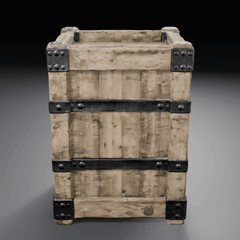 | 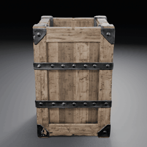 | 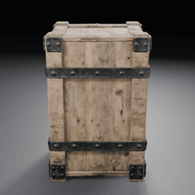 |
| Glazed jug | 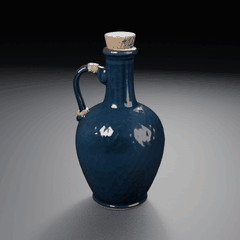 | 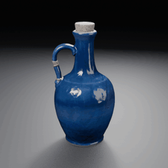 | 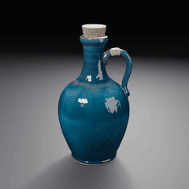 |
| Stone lantern | 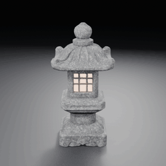 | 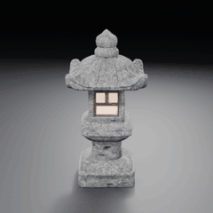 | 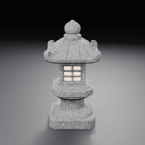 |

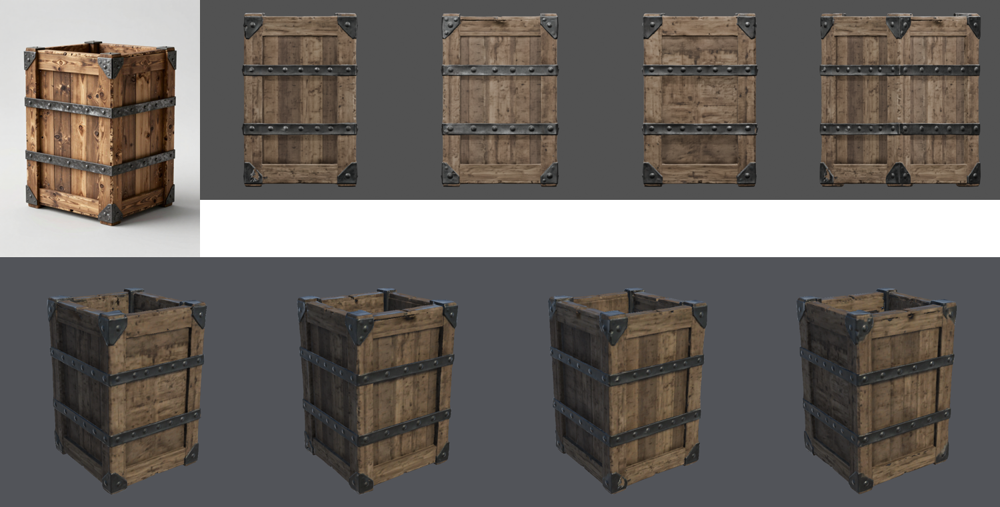
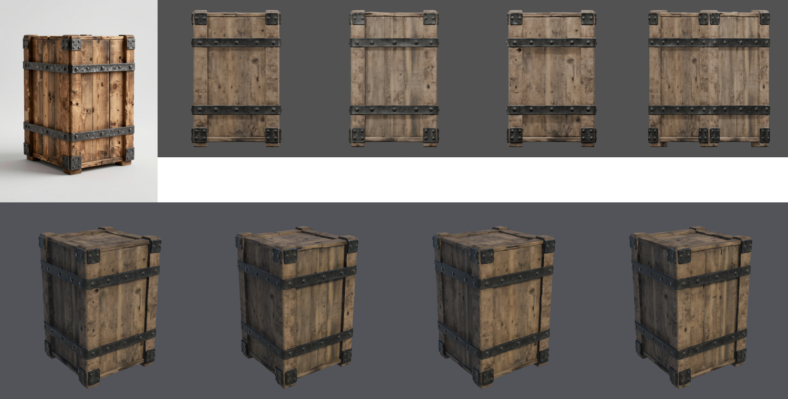
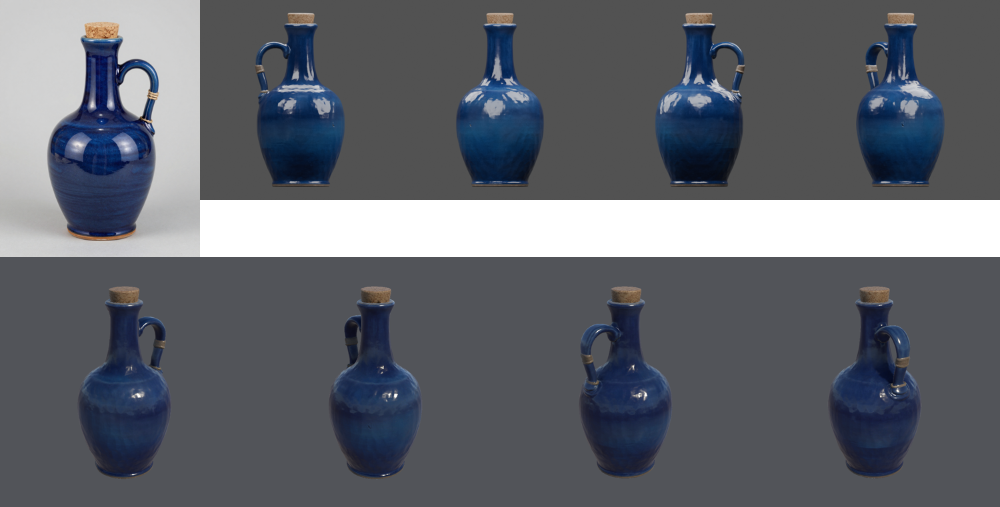
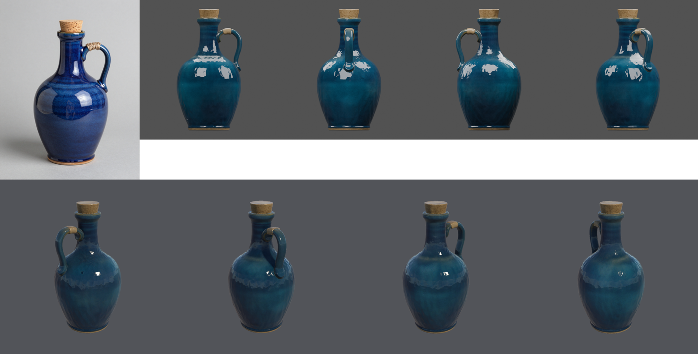
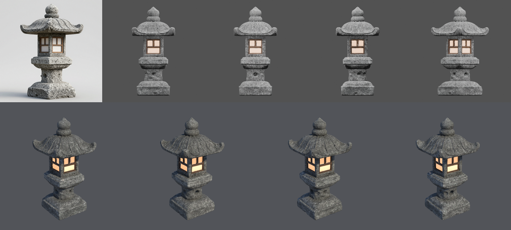
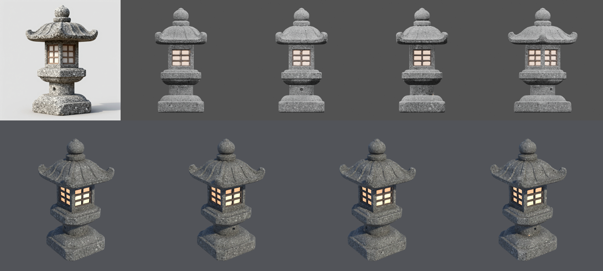

### Agent observations

These are observations only, not an approval.

- **Crate:** straps, brackets and rivets are reconstructed on every side, and the open top is kept.
  The wood is still paler than the concept's warm grain.
- **Jug:**
  - B1's glaze is closer to the concept's cobalt than v2's darker navy.
  - **B2's glaze came out teal**, although its concept is cobalt. None of the declared thresholds
    measures base-color fidelity, so this passes the record.
  - Faint ribbing still shows on both bodies in Unity.
- **Lantern:** the panels glow in every Unity view. C1's lattice is simpler than its concept's.

## Repeatability

- All six runs took the same path: the first mesh attempt was valid, and one material candidate was
  made.
- Every mesh was a single part.
- Elapsed time per run:
  - concepts: 24–34 s
  - `approve`: 140–299 s
- Two runs per brief cannot measure a failure rate. The conditioning exit crash (2 of 64 runs before
  the fix) did not recur in these six runs or in 96 fixed runs.

## Conditions

| Item | Value |
| --- | --- |
| SlopForge | Commit `ee61783` for all six runs |
| Compute profile and tier | `h100` and `final`: 6 concepts, 3 mesh attempts, 3 material candidates |
| Concept workflow | `image_text2img_api` v1; 896×1152 canvas for briefs A and B (`--aspect portrait`), 1024×1024 for C |
| Model workflow | `trellis2_image_to_model_h100_api` v6 |
| Service | ComfyUI 0.37.0 on one H100 80 GB; model weight hashes and custom-node revisions unknown |
| Local tools | Blender 5.1.0; Unity 6000.6.3f1 with URP 17.6.0 in batch mode on macOS arm64; Python 3.14.7; onnxruntime 1.30.0 |

Measurements are in [`runs.json`](runs.json). Run folders, logs and manifests are kept outside Git.
