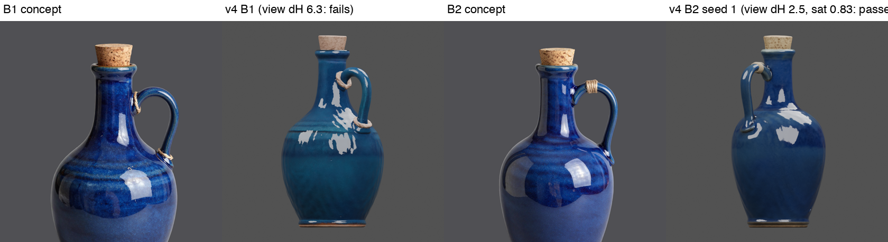
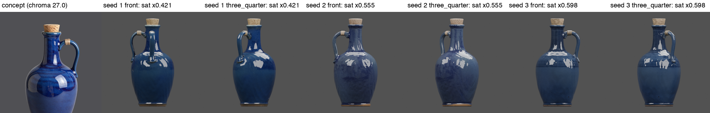
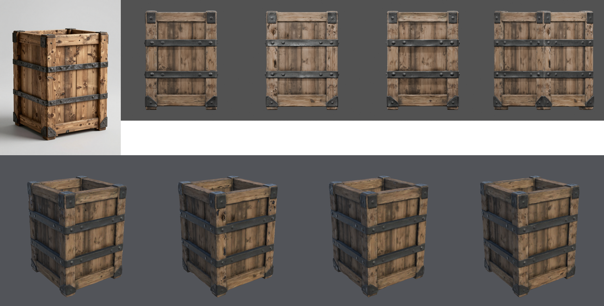
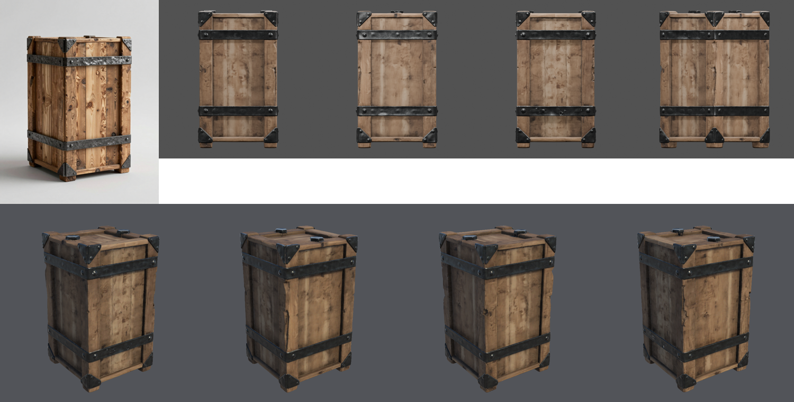
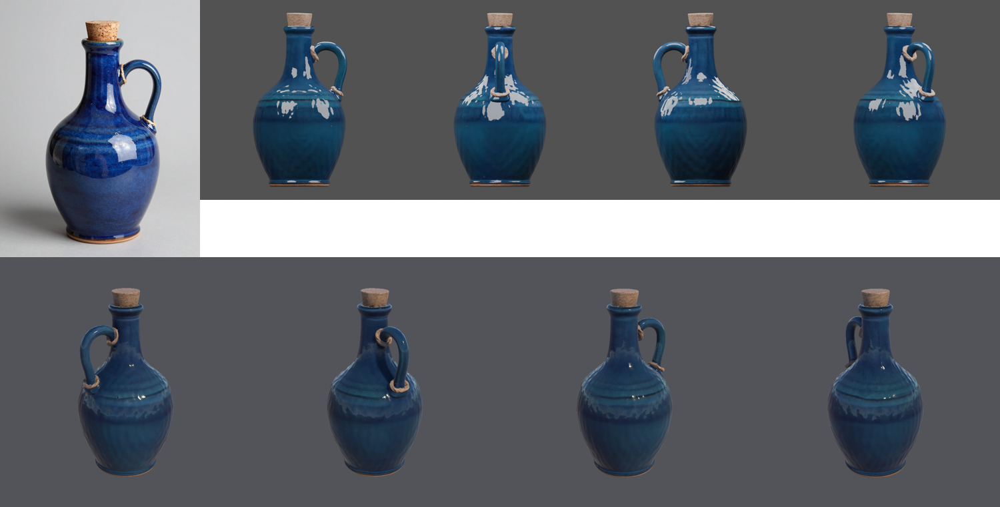
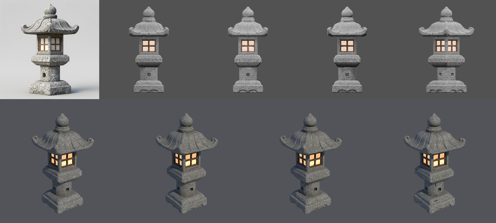
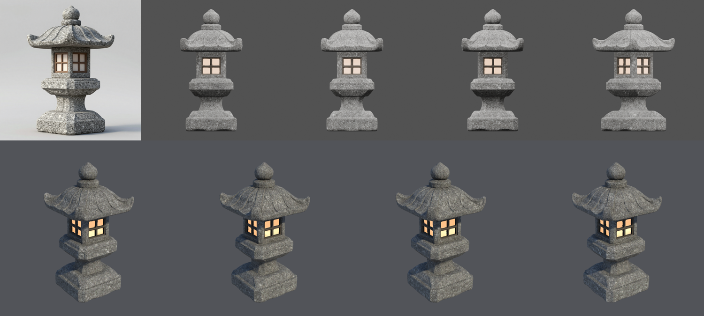

# Props provisional evidence, criterion v4 (2026-10-21)

This page reports six independent runs under the [criterion v4 qualification record](QUALIFICATION-RECORD.md),
which was committed (`0465073`) before the first run. Criterion v4 is v3 plus the owner-accepted colour check.
Every run used commit `0465073` from a fixed worktree, the H100 `final` tier, and a fresh copy of the
Unity 6000.6.3f1 / URP 17.6.0 blank project.

**Five of six runs pass every stage and threshold; B2 failed the colour check on all three mesh attempts.**
Reviewing that failure showed that the check measured the wrong thing in both directions:
- It **failed a good jug.** B2's first candidate is cobalt, like its concept, but the check measured the whole
  texture atlas. That includes the jug's hidden inside and base, which pulled saturation down to 0.42 of the
  concept's. Seen from the concept's side, it is 0.83.
- It **passed a teal jug.** B1's glaze is visibly teal against a cobalt concept. The atlas hue difference
  was 3.9 (limit 4); from the concept's side it is 6.3.

The check now compares the concept with the base colour rendered from the concept's side. That is a
pipeline change, so it is tested under [criterion v5](../props-provisional-2026-10-v5/QUALIFICATION-RECORD.md).
The status here is **Experimental**.

## Results by gate

| Run | Concept (of 6) | Geometry and mesh/UV | Materials | Unity import | Colour (atlas, as checked) | Criterion v4 |
| --- | --- | --- | --- | --- | --- | --- |
| A1 crate | 06 | Pass: 26,884 tris, 1 part, UV 0.22 | Pass | Imported, URP render | dH* 1.5, sat 0.68 | Pass |
| B1 jug | 04 | Pass: 29,410 tris, 1 part, UV 0.58 | Pass: metallic 0 | Imported, URP render | dH* 3.9, sat 0.90 | Pass (visibly teal) |
| C1 lantern | 04 | Pass: 24,866 tris, 1 part, UV 0.27 | Pass: emitter 1.5%, metallic 0 | Imported, URP render | grey, not checked | Pass |
| A2 crate | 01 | Pass: 23,989 tris, 1 part, UV 0.57 | Pass | Imported, URP render | dH* 0.8, sat 0.77 | Pass |
| B2 jug | 03 | 3 attempts, each 1 part | **Fail**: `colour_desaturated` on all three (sat 0.42, 0.56, 0.60) | Not reached | dH* 0.5–2.6 | **Fail** |
| C2 lantern | 02 | Pass: 16,896 tris, 1 part, UV 0.42 | Pass: emitter 3.2%, metallic 0 | Imported, URP render | grey, not checked | Pass |

Measured from the concept's side, B2's candidates keep 0.83, 0.63 and 0.66 of the concept's saturation, so all
three pass. B1 shifts hue by 6.3 and fails. On the earlier cases the side-on measurement agrees with the
atlas on hue to within 0.7: the v3 teal jug scores 10.5 and the v2 navy jug 6.1.

## Visual evidence

Measurements are in [`runs.json`](runs.json). Run folders, logs and manifests are kept outside Git.
