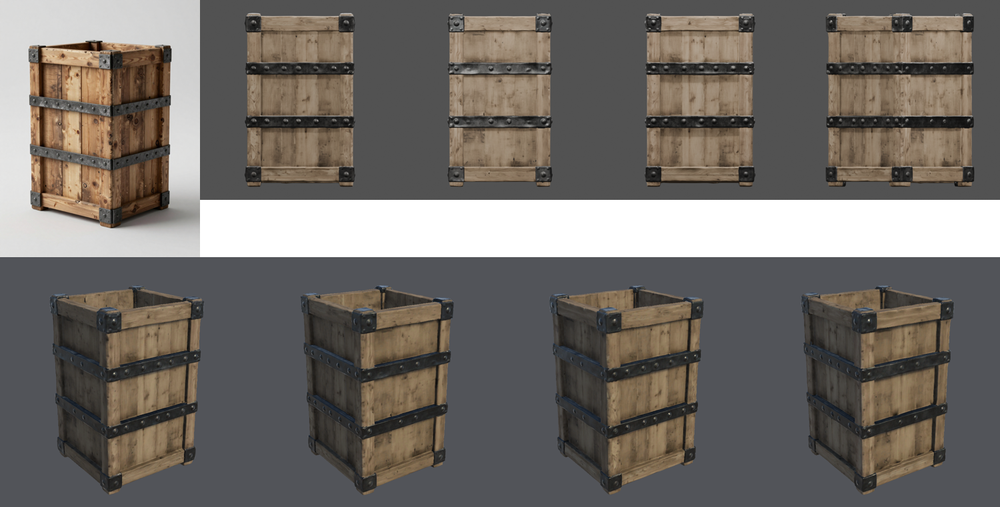
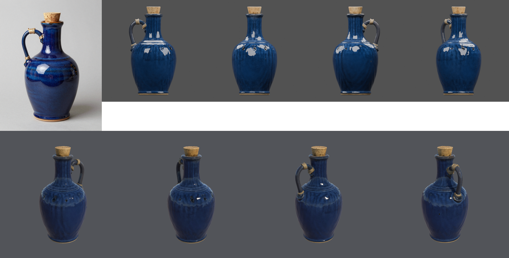
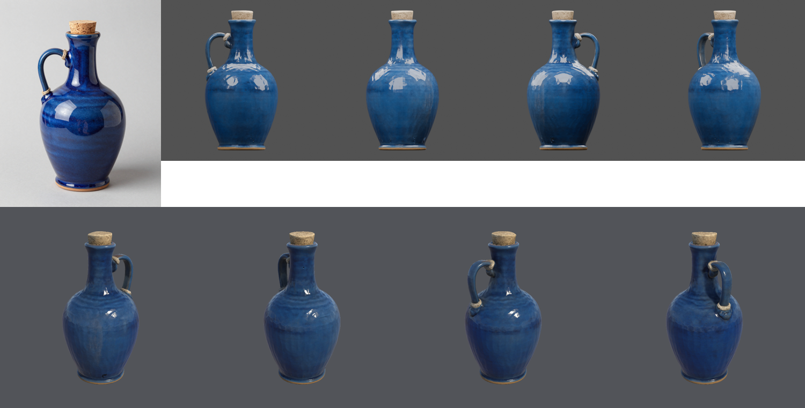
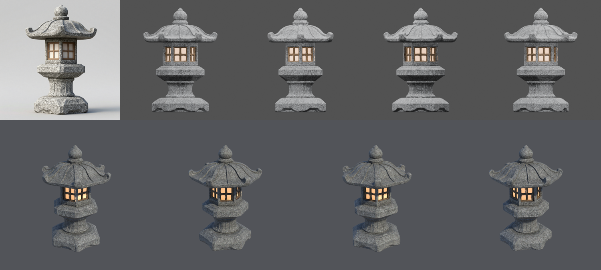
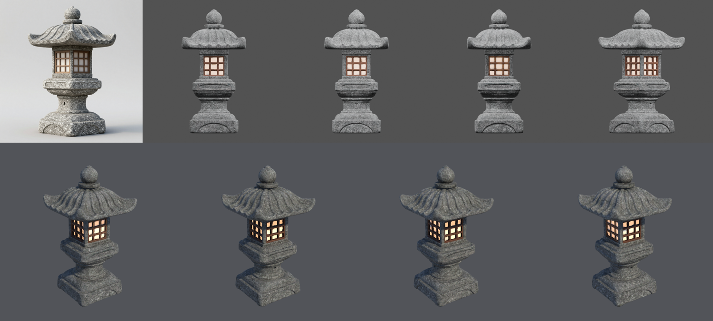

# Props provisional evidence, criterion v5 (2026-10-21)

This page reports six independent runs under the [criterion v5 qualification record](QUALIFICATION-RECORD.md),
which was committed (`221c8d1`) before the first run. Criterion v5 is v4 with the colour check measured from
the concept's side. Every run used commit `221c8d1` from a fixed worktree, the H100 `final` tier, and a fresh
copy of the Unity 6000.6.3f1 / URP 17.6.0 blank project.

**All six runs pass every stage and every owner-accepted threshold, including the colour check.** Five passed
with no intervention. C1 used the record's one permitted `approve --resume` after an interruption.

- **Status: Provisional** for "static props, `h100`/`final`, commit `221c8d1`, Unity 6000.6.3f1 / URP 17.6.0
  import". On 2026-10-21 the owner reviewed these runs and rated them better than v3.
- **Not Qualified:** six runs cannot qualify the pipeline.

## Results by gate

| Run | Concept (of 6) | Geometry and mesh/UV | Materials | Colour (from the concept's side) | Unity import | Criterion v5 |
| --- | --- | --- | --- | --- | --- | --- |
| A1 crate | 02 | Pass: 29,956 tris, 1 part, UV 0.30 | Pass | dH* 1.4, saturation 0.76 | Imported, URP render | Pass |
| B1 jug | 05 | Pass: 29,096 tris, 1 part, UV 0.54 | Pass: metallic 0 | dH* 0.7, saturation 1.32 | Imported, URP render | Pass |
| C1 lantern | 01 | Pass: 14,404 tris, 1 part, UV 0.38 | Pass: emitter 1.8%, metallic 0 | grey concept, not checked | Imported, URP render | Pass (one resume) |
| A2 crate | 05 | Pass: 28,286 tris, 1 part, UV 0.40 | Pass | dH* 3.7, saturation 0.86 | Imported, URP render | Pass |
| B2 jug | 02 | Pass: 28,624 tris, 1 part, UV 0.63 | Pass: metallic 0 | dH* 3.1, saturation 1.26 | Imported, URP render | Pass |
| C2 lantern | 04 | Pass: 27,278 tris, 1 part, UV 0.23 | Pass: emitter 3.1%, metallic 0 | grey concept, not checked | Imported, URP render | Pass |

- **Colour.**
  - Every coloured run was measured from the concept's side, with silhouette fit 0.93–0.98.
  - All passed on the first mesh attempt, so no colour retry was needed.
  - Both jugs are cobalt like their concepts. The v3 B2 jug had baked teal, and v4 B1 had passed with a
    teal glaze.
- **Other thresholds.**
  - Every run: one part (at most 5); UV area 0.23–0.63 (at least 0.20); at most 30,000 triangles; 4096²
    maps.
  - Lanterns: emitters 1.8% and 3.1% (at least 0.5%).
  - Jugs and lanterns: they declare no metal, and their metallic maps are zero (at most 0.05).
- **C1's interruption.** The H100's login hold ended during C1, and the ComfyUI service restarted.
  - The queued mesh job was lost: it was neither in the queue nor in the history.
  - The CLI would have waited until its deadline, so the agent interrupted it with SIGINT. That was
    recorded as an `interruption` on the stage.
  - Once the other runs had finished, `approve --resume` finished C1 in 110 s.
  - The interrupted execution is kept.
- **Recorded only.**
  - Non-manifold edges: 10–27.
  - Boundary edges: 0–18.

## Visual evidence

| Brief | v5 run 1 | v5 run 2 |
| --- | :---: | :---: |
| Supply crate |  |  |
| Glazed jug |  |  |
| Stone lantern |  |  |

### Agent observations

These are observations only, not an approval.

- **Jugs:**
  - Both glazes are cobalt.
  - B1 shows vertical ribbing and a few small dark marks on the body in Unity.
- **Crates:**
  - A1's top reads as closed in the reconstruction, while its concept is open-topped.
  - A2's wood is greyer and paler than its concept.
  - This systematic paleness passes the colour check: saturation is 0.76 and 0.86 of the concepts'.
- **Lanterns:** the panels glow in every Unity view.

## Repeatability

- All six runs took the same path: the first mesh attempt was valid, and one material candidate was made.
  C1's resumed attempt is numbered 2.
- Every mesh was a single part.
- Elapsed time per run:
  - concepts: 18–29 s
  - `approve`: 119–209 s
- Two runs per brief cannot measure a failure rate.

## Conditions

| Item | Value |
| --- | --- |
| SlopForge | Commit `221c8d1` for all six runs |
| Compute profile and tier | `h100` and `final`: 6 concepts, 3 mesh attempts, 3 material candidates |
| Concept workflow | `image_text2img_api` v1; 896×1152 canvas for briefs A and B, 1024×1024 for C |
| Model workflow | `trellis2_image_to_model_h100_api` v6 |
| Service | ComfyUI 0.37.0 on one H100 80 GB; model weight hashes and custom-node revisions unknown |
| Local tools | Blender 5.1.0; Unity 6000.6.3f1 with URP 17.6.0 in batch mode on macOS arm64; Python 3.14.7; onnxruntime 1.30.0 |

Measurements are in [`runs.json`](runs.json). Run folders, logs and manifests are kept outside Git.
