# Props provisional evidence (2026-10-20)

This page reports six independent runs of the props pipeline: three briefs, two runs
each. The runs used the H100 final tier and went through to a Unity 6000.6.3f1 / URP
17.6.0 import. They follow the [qualification record](QUALIFICATION-RECORD.md)
(criterion version 1), which was committed before the first run.

All six runs reached a Unity import with no edits to any generated asset. Four of the six
pass every technical criterion in the record, but only A2 passes every stage. By the
record's concept-selection criteria, A1 (no concept shows the brief's straps) and both jug
runs (no concept is in three-quarter view) are concept-stage failures; this was corrected
after post-merge review. Both lantern runs miss their declared emissive region, so this set
is **Experimental**, not Provisional. Visual approval is the
owner's decision and has not been given.

## Results by gate

Structural, technical, Unity and visual results are kept separate.

| Run | Concept (of 6) | Geometry and mesh/UV | Materials | Review renders | Unity import | Criterion v1 |
| --- | --- | --- | --- | --- | --- | --- |
| A1 crate | 05; **Fail**: no concept shows straps | Pass: 29,912 tris, 8 components | Pass | 4 views + turntable | Imported, Lit material assigned, URP render | **Fail** (concept) |
| B1 jug | 05; **Fail**: no three-quarter view | Pass: 29,562 tris, 3 components | Pass | 4 views + turntable | Imported, Lit material assigned, URP render | **Fail** (concept) |
| C1 lantern | 03 | Pass: 29,892 tris, 9 components | **Fail**: declared emissive region not found | 4 views + turntable | Imported, Lit material assigned, URP render | **Fail** |
| A2 crate | 04 | Pass: 29,977 tris, 17 components | Pass | 4 views + turntable | Imported, Lit material assigned, URP render | Pass |
| B2 jug | 05; **Fail**: no three-quarter view | Pass: 29,684 tris, 4 components | Pass | 4 views + turntable | Imported, Lit material assigned, URP render | **Fail** (concept) |
| C2 lantern | 02 | Pass: 27,589 tris, 25 components | **Fail**: declared emissive region not found | 4 views + turntable | Imported, Lit material assigned, URP render | **Fail**; one environment failure, resumed |

- **Structural.** All six pass the pipeline's mesh validation, with warnings. Every run has:
  - finite bounds and one UV layer, with no UVs outside 0–1;
  - no degenerate faces;
  - at most 30,000 exported triangles.

  Detached components (3–25) are reported as warnings because no threshold is declared.
- **Technical.**
  - Every material candidate has 4096² maps and a Blender MikkTSpace normal bake (not a
    placeholder). None raised the false-metal `material_mismatch` error.
  - The lantern brief declares `paper panels=emissive`. In both lantern runs the emissive
    mask found no region (`emissive_fraction` 0), so the lanterns have no emission.
  - The pipeline reports that as a warning. The record's pass condition says "no
    declared-material mismatch", and a declared emitter that is absent counts as one
    here, so C1 and C2 fail that criterion.
- **Unity.**
  - `unity-preview` imported each candidate into a fresh copy of the URP blank project and
    assigned a URP Lit material with base, normal, metallic-gloss and emission maps. The
    assignment check passed in all six. Import times were not recorded.
  - It also saved a four-view render in the editor's batch mode.
  - Not run: Play mode, an in-scene check, and `approve-texture` publication.
- **Environment.** Before C2's `approve`, the H100's ComfyUI service had stopped, because
  the last login session on that host closed (cause and remedy are in
  [ComfyUI](../../COMFYUI.md)).
  - The CLI stopped at `mesh_workflow_execution`, classified it as `environment`, and
    spent no generation retry.
  - After the service was restored, `approve --resume` reused the conditioning stage and
    finished, which the record permits once.
  - The failed execution is kept.

## Visual evidence for owner review

Each strip shows the selected concept and the Blender front, side, rear and three-quarter
renders (top row), and the Unity URP render from four sides (bottom row). The left column
is the 2026-10-18 baseline that the owner rated about 60% of target.

| Brief | Baseline (2026-10-18) | Run 1 | Run 2 |
| --- | :---: | :---: | :---: |
| Supply crate |  | 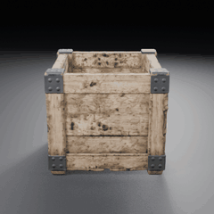 | 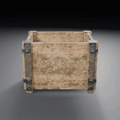 |
| Glazed jug |  | 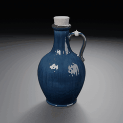 | 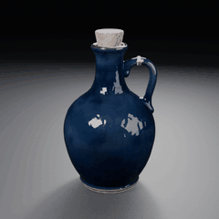 |
| Stone lantern |  | 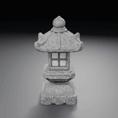 | 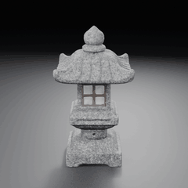 |

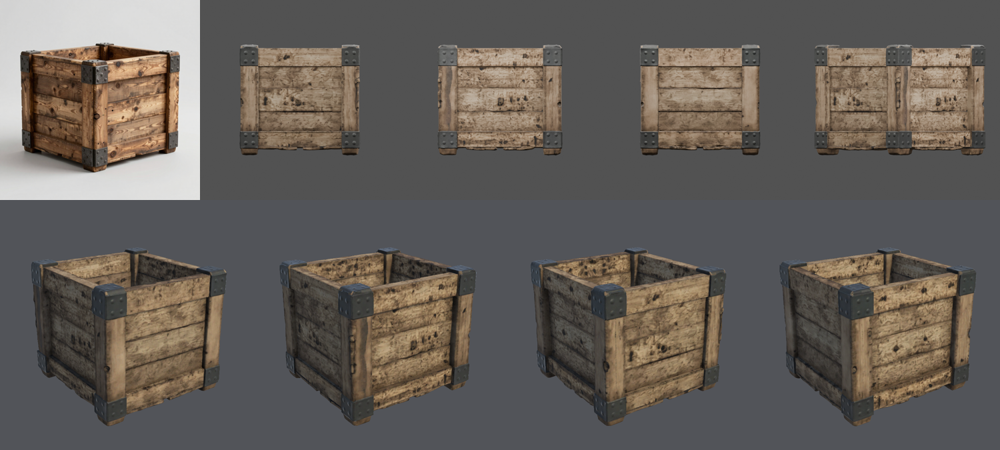
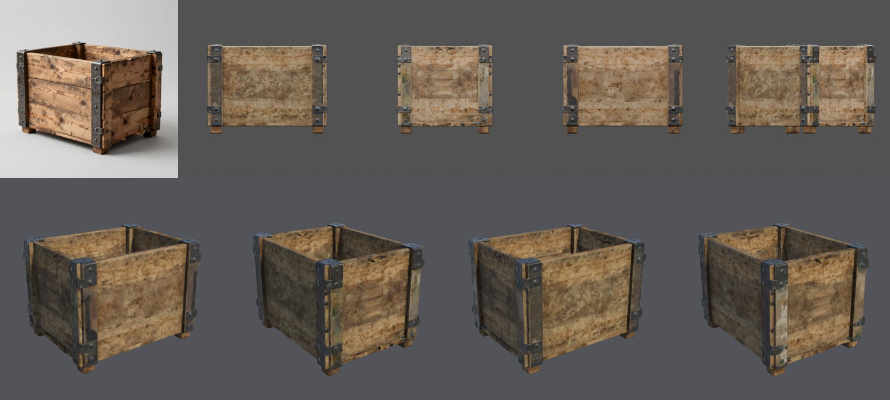
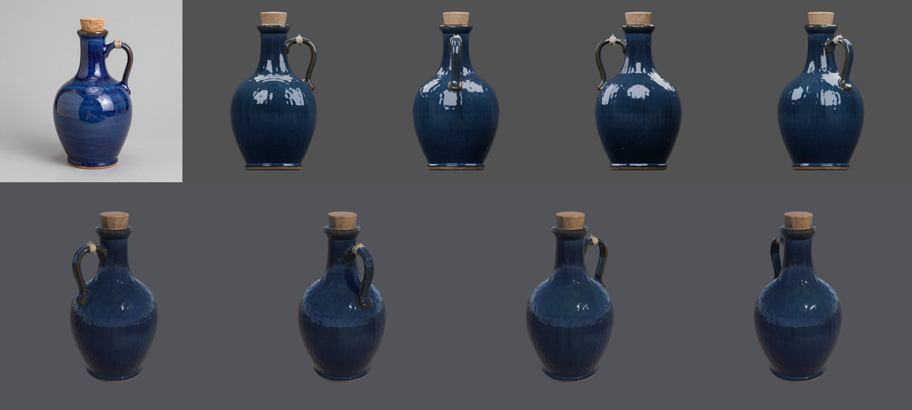
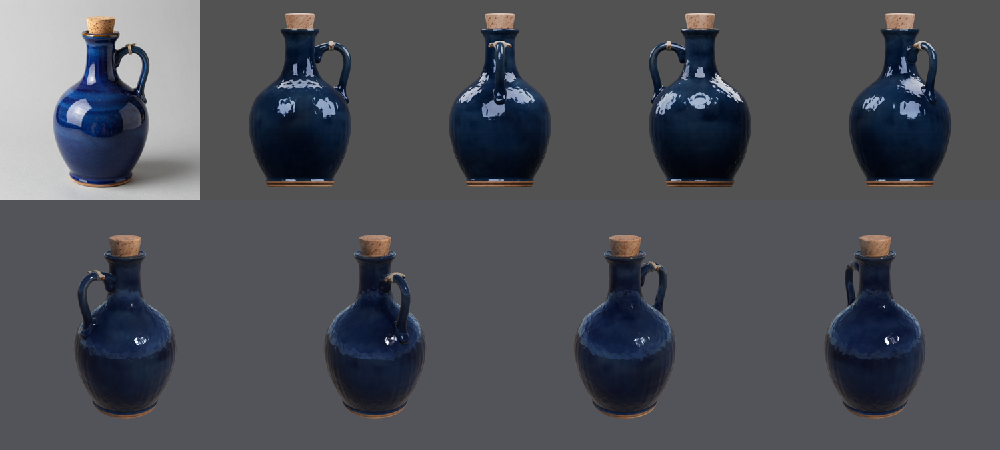
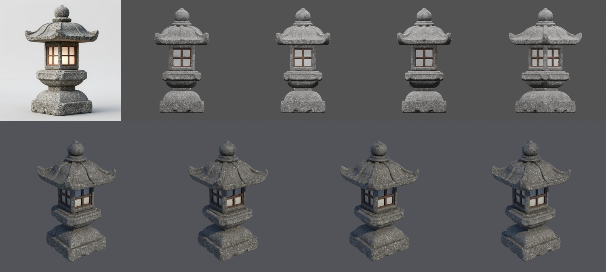
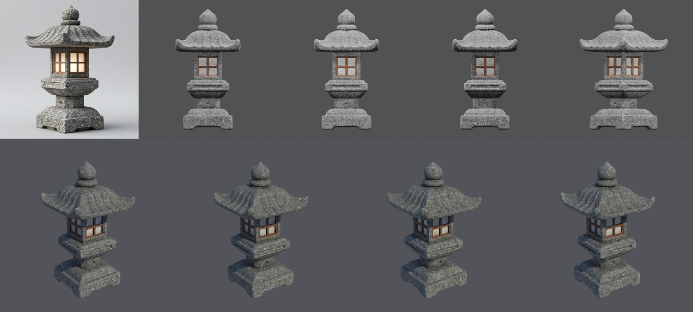

### Agent observations

These are observations only. They are not an approval and not a rating against the
baseline.

**Concepts**
- All twelve crate concepts are open-topped and wider than tall, although the brief asks
  for "slightly taller than wide".
- All twelve lantern concepts show the paper panels lit, although the prompt asks for
  them unlit.
- The jug concepts are closer to side views than three-quarter views.

**Crate**
- Planks, riveted brackets and the open interior are reconstructed; straps only in A2,
  because A1's concept has none.
- The wood is paler and blotchier than the concept's warm grain.
- On A2, the side straps partly carry wood colour.

**Jug**
- The silhouette, an open handle, the cork and the twine are reconstructed in both runs.
- The glaze reads darker navy than the concept's cobalt.
- The jug is declared non-metal, yet its metallic map averaged 0.30 (B1) and 0.48 (B2),
  and the baseline jug's candidates 0.41–0.59, when measured during the runs. These means
  are not in `runs.json`, which records only the fully metallic fraction (issue #61).
- The mismatch gate counts only fully metallic texels, so partial metal on glossy
  non-metal passes it. This also corrects the showcase's claim that the glaze "stays
  non-metallic".
- Faint vertical faceting shows on the body in the Unity render.

**Lantern**
- The roof ribs, finial and lattice are reconstructed, and the panels are solid and pale
  rather than the empty cavities seen in the earlier lantern.
- The panels do not glow, because no emissive region was detected.
- C2 has 25 components and 345 non-manifold edges.
- The baseline lantern's first candidate also had no emission. The showcase used its
  second candidate (emissive fraction 1.6%), so emitter detection was already unreliable
  before these runs.

## Repeatability

- Both runs of each brief took the same path through every stage. Each run's first
  generated mesh was structurally valid. C2's is numbered attempt 2, because the
  environment failure took attempt 1 before anything was generated.
- The geometry differs per seed, as expected.
- Detached components varied: 8/17 (crate), 3/4 (jug) and 9/25 (lantern).
- The lantern's emissive miss repeated in both runs, which points to a shared cause
  rather than a seed.
- Elapsed time per run:
  - concepts: 30–155 s
  - `approve`: 168–397 s
  - Unity preview: under 30 s

Two runs per brief cannot measure a failure rate.

## Conditions

| Item | Value |
| --- | --- |
| SlopForge | Commit `4d3ea32` for all six runs |
| Compute profile and tier | `h100` and `final`: 6 concepts, 3 mesh attempts, 3 material candidates. Each run produced one material candidate |
| Concept workflow | `image_text2img_api` v1 |
| Model workflow | `trellis2_image_to_model_h100_api` v6 (1536 shape, UDF remesh 384, 4096² maps, Blender normal bake) |
| Service | ComfyUI 0.37.0 on one H100 80 GB. Model weight hashes and custom-node revisions unknown |
| Local tools | Blender 5.1.0; Unity 6000.6.3f1 with URP 17.6.0 in batch mode on macOS arm64; Python 3.14.7 |
| Independence | Each run used a new project copy, `slopforge init`, and seeds drawn by the CLI. No seed was passed and no artifact was reused across runs |
| Seeds, selections, stage timings, measures | [runs.json](runs.json) |
| Interventions | Agent concept selection (reasons in `runs.json`); `unity-preview`; one `approve --resume` (C2); turntable rendering. Nothing was edited, forced or waived |

## What this establishes and what it does not

**It establishes**, for these three briefs on this commit and profile, that the CLI runs
end to end from brief to a Unity URP import with no manual repair, in six of six fresh
runs. Structural validation and the Unity material assignment pass every time, and an
environment failure stops cleanly and resumes.

**It does not establish:**
- visual, material or style acceptance (owner review pending);
- any comparison with the 60% baseline;
- reliable emissive regions;
- correct metallic values on glossy non-metal;
- performance against runtime budgets, or collision, LOD, scale or pivots in a game scene;
- Play-mode behaviour;
- other briefs, profiles or tiers;
- a failure rate.

Under the record this is **Experimental**, and nothing here is Qualified.
