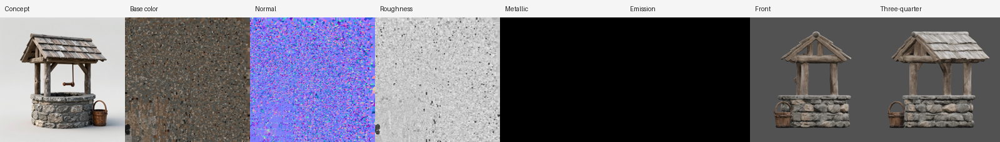
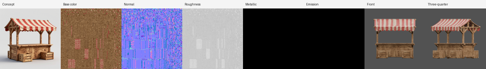
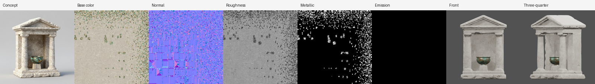
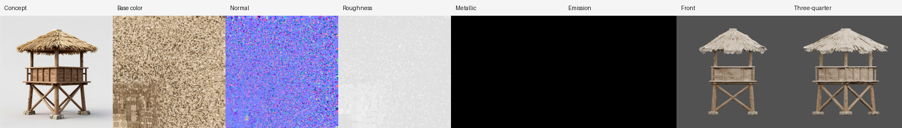
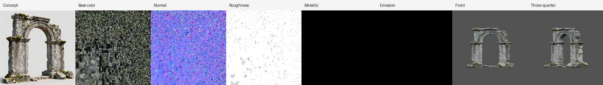
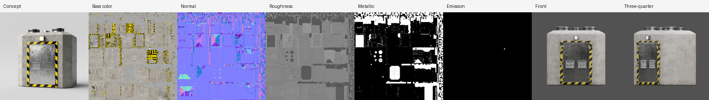

# Structure showcase — six buildings from brief to PBR

Six standalone structures generated on 2026-10-18 from written briefs through the normal CLI
(`generate architecture` → `approve`), with no manual repair. Each was rendered as a lit
turntable in Blender, and each strip shows the selected concept, the generated PBR maps and
two review renders.

| Stone well | Market stall | Stone shrine |
| :---: | :---: | :---: |
|  |  |  |
| **Watchtower** | **Ruined arch** | **Sci-fi bunker** |
|  |  |  |

| Structure | Declared materials | Result |
| --- | --- | --- |
| [Stone well](stone_well.png) | fieldstone, timber shingles, oak bucket = non-metal | Fieldstone wall, round timber posts, shingle roof and bucket; the thin crank did not survive |
| [Market stall](market_stall.png) | pine frame, striped canvas, crates = non-metal | Crisp red-and-cream awning, timber frame, counter and crates |
| [Stone shrine](stone_shrine.png) | limestone = non-metal, bowl = metal | Limestone base, fluted columns and pediment; green-patina bronze bowl is the only metal |
| [Watchtower](watchtower.png) | fieldstone, timber, thatch = non-metal | Braced timber legs, plank lookout and thatch roof; the stone base became small footings |
| [Ruined arch](ruined_arch.png) | granite, moss = non-metal | Weathered blocks, broken top and moss ledges; a few pale fragments sit around the rubble |
| [Sci-fi bunker](scifi_bunker.png) | concrete, stripes = non-metal, door and vents = metal, light = emissive | Concrete block, steel blast door with hazard stripes and steel vents; the small light barely registered as emissive |

## Conditions

- Generation behaviour of SlopForge commit `01ff304` (the later kit `--target-size` option does
  not apply to standalone structures); compute profile `h100`, quality tier `final`, the
  `architecture` asset type (60,000-face budget).
- Model workflow `model.trellis2.h100` v5: TRELLIS.2 bf16, 1536 shape upsample, UDF remesh at
  384, GPU decimation to the budget, 4096² base color/roughness/metallic and normal bakes.
- ComfyUI 0.37.0 on one H100 80 GB; Blender 5.1.0 for UV preparation, assembly, renders and turntables.
- Three concepts per structure; the agent selected one per structure for evaluation only.
- Each `*.json` next to a strip records map statistics, normal/emission sources, validation
  warnings and SHA-256 hashes. Model weight hashes and custom-node revisions remain unknown.

## Modular stone kit

A five-module `stone_ruin_kit` recipe (floor, wall, doorway, corner, column) was run with
`recipe run`, one concept per module selected for evaluation, and each module approved for 3D.
Each module declares a real size in `kit_constraints.modules.<id>.target_size`; mesh preparation
now scales to it instead of normalising every model to a largest side of 1.0. The courtyard
above places four floor tiles, three walls, the doorway and two columns on the 3 m grid in
Blender; it is an assembly demonstration, not a game scene.

| Module | Target | Measured (m) | Axis stretch | Kit rules |
| --- | --- | --- | --- | --- |
| Floor | 3 × 3 × free | 3.000 × 3.000 × 0.163 | 1.001 | Pass |
| Wall | 3 × free × 3 | 3.000 × 0.753 × 3.000 | 1.236 | Pass |
| Doorway | 3 × free × 3 | 3.000 × 0.803 × 3.000 | 1.204 | Pass |
| Corner | 3 × 3 × 3 | 3.000 × 3.000 × 3.000 | 1.006 | Pass, but visually wrong |
| Column | free × free × 3 | 1.346 × 1.346 × 3.000 | 1.000 | Pass |

"Kit rules" is `validate_environment_kit` (grid fit, flat/vertical axes, maximum size, pivot)
applied to each module's material-candidate measurements. The formal `environment-check`
reports the modules as pending, because it only measures modules made `ready` by
`approve-texture`, which needs a Unity project and was not run.

Kit limits: the corner concept showed the inside of the L and reconstructed as a closed block
with a hole in its top, so it is left out of the courtyard; the wall and doorway concepts were
wider than tall and were squeezed about 20% horizontally to fit 3 × 3; the stone renders paler
than the concepts.

## Limits

- **Not approved:** no visual approval or Unity import was performed; this page shows generation
  and structural evidence only, from one run per structure.
- **Detached parts:** structures report 2 to 18 detached components (posts, crates, rubble);
  they are measured, not removed or merged.
- **Thin parts:** very thin parts (the well crank) still disappear at the 384 remesh resolution.
- **Hidden sides:** single-image conditioning guesses the back and sides of each structure.
