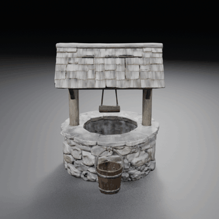
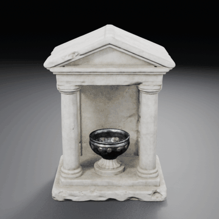
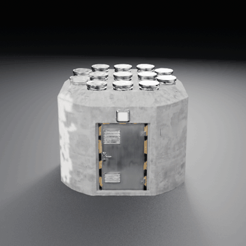
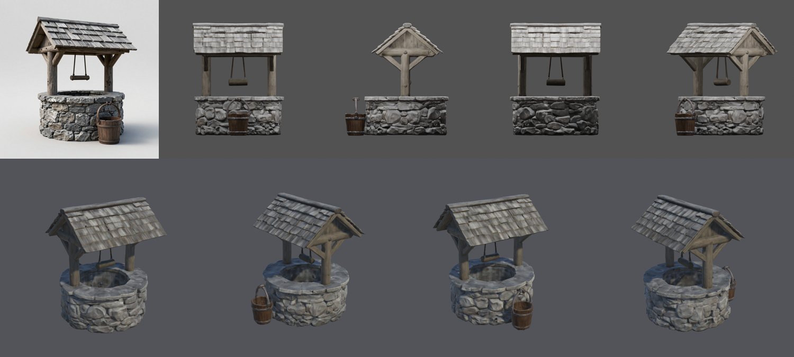
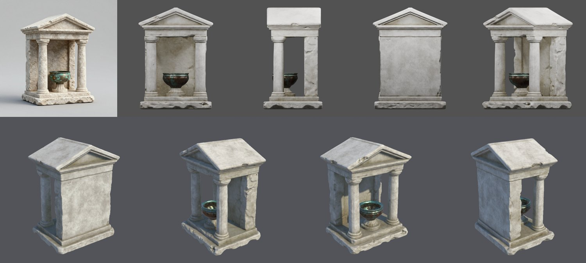
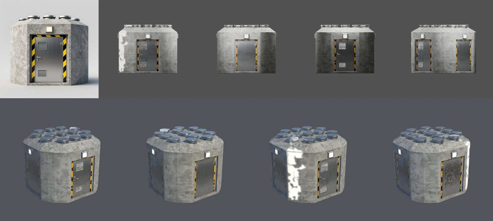

# Standalone structures at real size (2026-10-22, issue #92)

The three structures from the 2026-10-22 baseline were run again from a fresh copy of the Unity 6000.6.3f1 /
URP 17.6.0 blank project, on the H100 `final` tier at commit `04830d7`:
- the same briefs and declared materials;
- each with `generate --target-size=-,-,<height>`;
- each through `approve` and `unity-preview`.

The agent selected concepts for evaluation only. Nothing here is visually approved.

| Structure | Declared height | Measured (m) | Pivot | Concept fit | Colour hue difference |
| --- | --- | --- | --- | --- | --- |
| Stone well | 3.2 m | 2.60 × 2.93 × 3.20 | bottom centre | 0.93 | 0.05 |
| Stone shrine | 3.5 m | 2.56 × 2.03 × 3.50 | bottom centre | 0.94 | 0.99 |
| Sci-fi bunker | 3.0 m | 3.73 × 3.72 × 3.00 | bottom centre | 0.98 | 0.77 |

Before this change these structures were scaled to a 1 m largest side, and `architecture` had none of the prop
checks. They now get the owner-accepted concept fit (at least 0.8) and colour limits. All three passed on their
first mesh attempt. The hue differences are measured, not checked: all three concepts are near-grey (chroma 2.3–8.8,
below the check's 10), so the colour check skips them.

| Stone well | Stone shrine | Sci-fi bunker |
| :---: | :---: | :---: |
|  |  |  |

The turntables were rendered on 2026-10-23 with `blender/render_turntable.py` from each structure's material
candidate `.blend`.

## Limits

**The bunker shows single-image limits:**
- a second door invented on an unseen side (#63);
- a bright white patch on one side;
- hazard stripes faded against the concept.

The colour check uses the median of the concept's colour, which is near-grey here, so it skips the bunker; the
colour of small parts like the stripes is not checked.

**Not decided yet:** a part limit for structures. The owner's M2 criteria (#94, closed 2026-10-23) cover kit modules only.
