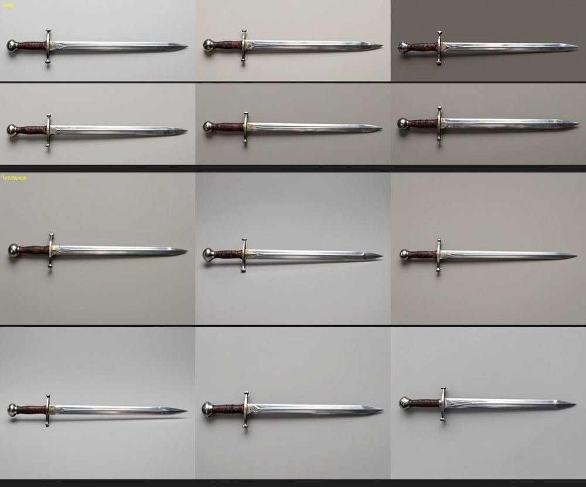
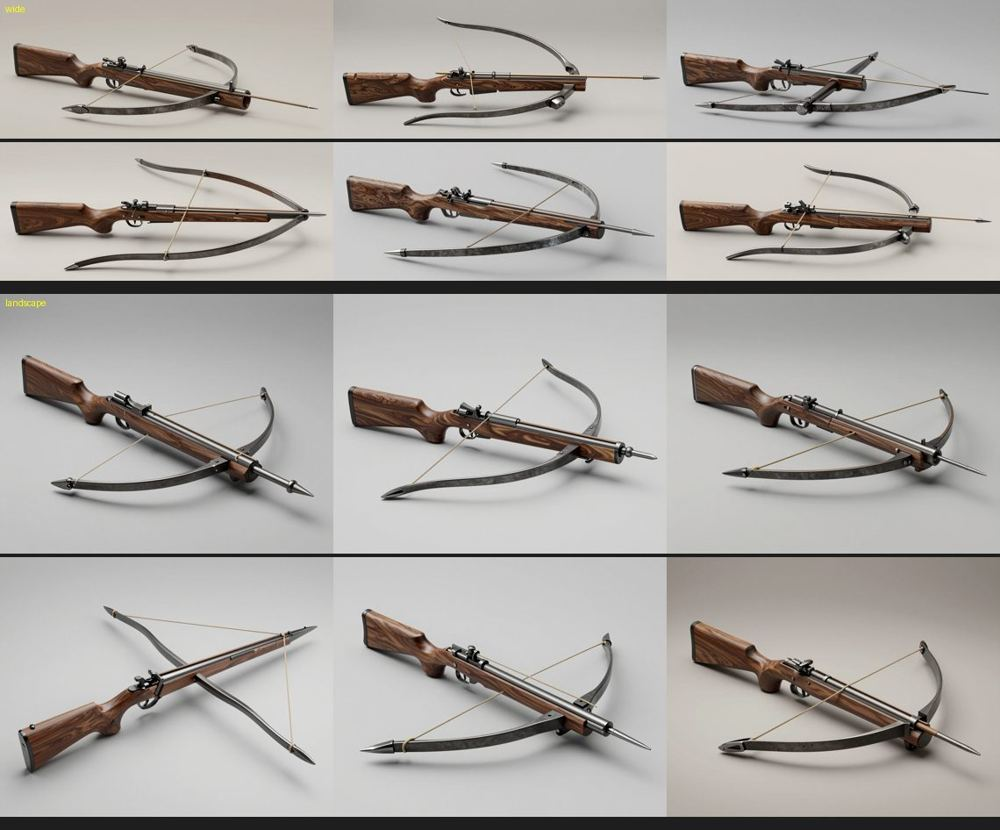
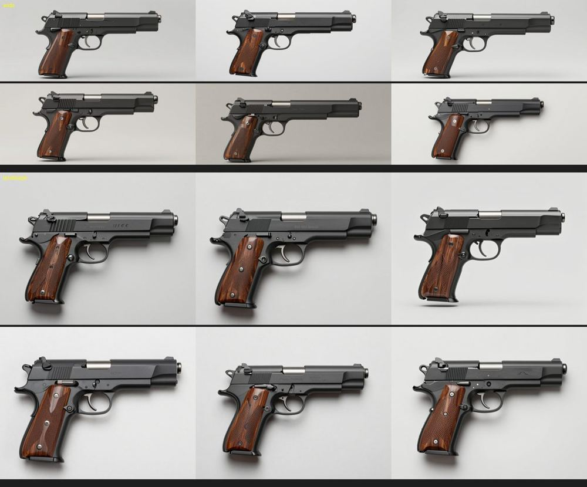

# Weapon concepts: the wide canvas and the shape rule (2026-10-24)

Step W1 of M3 ([epic #107](https://github.com/gysahlgreene/SlopForge/issues/107)). The run used the new `weapon` type,
whose shape rule asks for blades, guards, limbs and barrels at their real thickness and a bowstring as one taut line.
Six Z-Image concepts were made for each of three briefs, on the H100, once on the new `wide` canvas (1536 × 640) and
once on `landscape` (1152 × 896). Every concept was kept.

**Longsword, side profile.** All twelve are side profiles with the tip right, a straight crossguard, a leather grip
and a round pommel. On the wide canvas the sword fills the frame. On landscape, the same sword sits in a band with
empty space above and below.

**Crossbow, three-quarter from above.** A flat side profile would hide both the bow and the string, which lie across
the stock, so this brief asks for a view from above. All twelve show the stock, the bow, a thin string and the trigger.
Most also carry a loaded bolt that the brief did not ask for. On the wide canvas the bow's arms leave the frame in some
concepts; landscape fits them.

**Pistol, side profile.** All twelve show:
- the slide with rear serrations;
- the trigger inside its guard;
- walnut grip panels.

Landscape draws the pistol larger.

**Decision:**
- The weapon type keeps `wide` as its default, for long weapons such as swords, spears and rifles.
- Shorter weapons, around 1.5:1 like pistols and crossbows, should pass `--aspect landscape`.

**Reconstruction:** one concept of each weapon was rebuilt by three mesh graphs in step W3 ([graph comparison](../weapon-graph-2026-10/README.md)).
