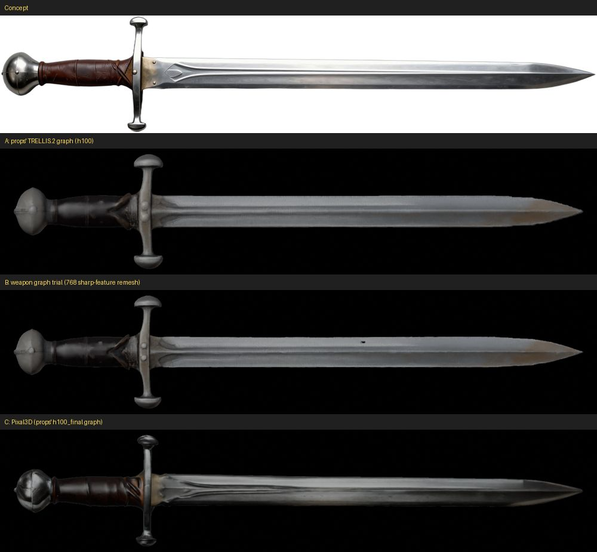
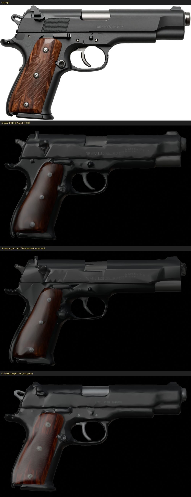
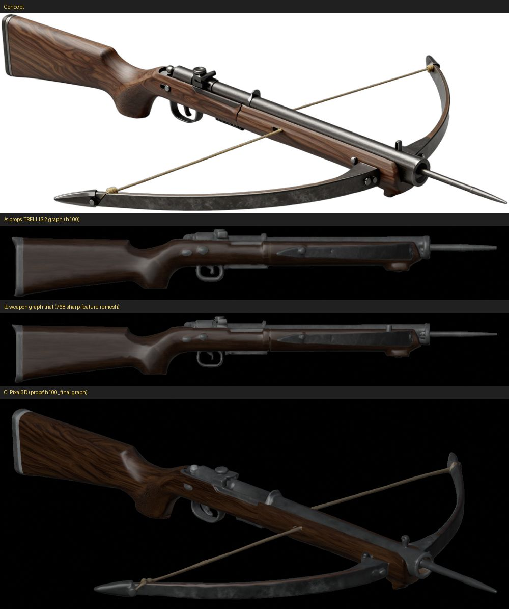
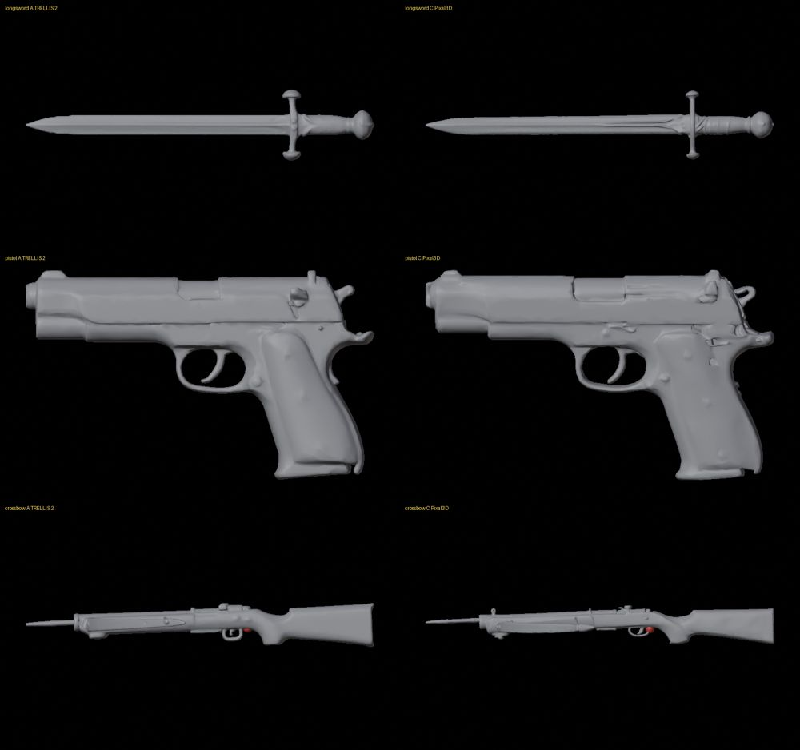

# Weapon reconstruction: which mesh graph (2026-10-24)

Step W3 of M3 ([epic #107](https://github.com/gysahlgreene/SlopForge/issues/107)). The question was whether weapons
need a mesh graph of their own. The plan expected one: a finer remesh, and a graph that keeps small parts instead of
dropping them, so that thin blades and bowstrings survive.

**Run:**
- **Concepts:** three from the [concept trial](../weapon-concepts-2026-10/README.md):
  - a longsword on the wide canvas;
  - a pistol on landscape;
  - a crossbow on landscape, drawn from above at three-quarters.
- **Input:** each concept's cut-out, as the pipeline sends it.
- **Seed and settings:** seed 424242 for every run, at the final tier's settings: crop pad 1.1, 4096 maps, and for
  TRELLIS.2 a 1536 shape upsample.
- **Graphs compared:**
  - A: the props' TRELLIS.2 graph, which the `h100` profile uses;
  - B: a weapon graph built for this trial, a copy of the character graph with a 768 sharp-feature remesh that keeps
    parts down to 0.1% of the mesh;
  - C: Pixal3D, the `h100_final` profile's model graph.

| Weapon | Graph | Concept fit | Thin-part recall | Pieces (largest share) |
| --- | --- | --- | --- | --- |
| Longsword | A | 0.919 | 0.892 | 1 |
| | B | 0.931 | 0.966 | 1 |
| | C | 0.912 | 1.000 | 3 (0.66) |
| Pistol | A | 0.971 | 0.984 | 1 |
| | B | 0.972 | 0.940 | 2 (0.999) |
| | C | 0.992 | 1.000 | 4 (0.99) |
| Crossbow | A | 0.784 | 0.608 | 1 |
| | B | 0.762 | 0.573 | 3 (0.99) |
| | C | 0.853 | 0.509 | 3 (0.92) |

Pieces are counted after welding vertices by position, since the textured GLB splits them along UV seams.

**What the renders show:**
- **Graph A** already keeps every thin part: the blade, the crossguard, the trigger, the bow and the bowstring. Its
  surfaces are softer and slightly wavy.
- **Graph B** is crisper but adds defects:
  - a hole through the sword blade;
  - folded triangles at the rear of the pistol slide and a jagged muzzle;
  - a split through the crossbow stock.
- **Graph C** is closest to every concept:
  - the sword's leather-wrapped grip and the fuller groove in its blade;
  - the pistol's silver barrel and chequered grips;
  - the crossbow's wood grain, its bow, and its string tied to the bow tips.

C also keeps the concept's pose, while TRELLIS.2 turns every weapon side-on, lengthwise along X: the crossbow drawn
from above came back as drawn, tilted.

**Decision:**
- Weapons use each profile's model graph, as props do: Pixal3D on `h100_final`, the TRELLIS.2 graph on `h100`.
- Graph B was not kept, so no weapon graph ships.
- The weapon protocol (step W10) should run on `h100_final`. Props were qualified on the `h100` graph, so Pixal3D has
  no protocol evidence yet.

**Orientation follows from this.** Step W5 turned the concept's right and up to the weapon's forward and top, using
the best-fitting view. On these meshes that failed twice:
- **The sword rolled 30° about its length.** A flat weapon's outline barely changes with tilt, and the mesh's blade
  is a little deeper than drawn (5.4% of its length against 4.8%). The fit therefore preferred a 30° tilt: 0.92,
  against 0.83 level.
- **The crossbow would have turned 45°.** TRELLIS.2 laid it lengthwise, but its best view is turned 45°, because the
  concept is drawn at three-quarters.

The final pass now levels the weapon from its own shape (see [Weapons](../../WEAPONS.md#the-weapon-type)). Every mesh
above then came out tip forward and top up, held at its grip mask (from a box at approval). The Pixal3D crossbow came
out flat, like the TRELLIS.2 one.

**A pitfall found on the way:**
- **What happened:** the first run fed the graphs the white-backed concepts made for the part masks. Every mesh came
  back as its weapon on a card or inside a box of its backdrop.
- **Why:** the model graphs crop to the input's transparency and remove no background.
- **Remedy:** `processing/comfy_generate_3d.py` now stops before inference when a model workflow is given an image
  without an alpha channel. The opt-in live integration test was sending an opaque concept too; it now cuts it out first.

**Limits:**
- **Sample size:** one seed per weapon and graph.
- **Pieces:** C's longsword is three pieces (the largest 66% of the mesh), and the weapon type allows five.
- **Thin-part recall on the three-quarter crossbow:** it was low on every graph (0.51 to 0.61), though the string and
  bow tips are visible on A and C. The fitted view's coarse steps misplace parts a few pixels wide, so recall there
  measures registration as much as loss. No weapon limit is declared.
- **Concept fit:** the crossbow fits 0.78 on A, under the type's 0.8, and 0.85 on C.
- **Not checked:** the material pass and Unity.
