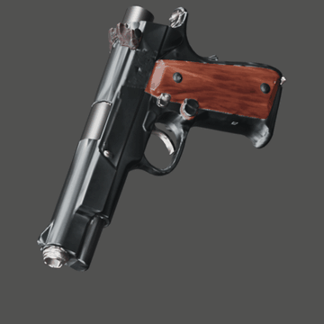
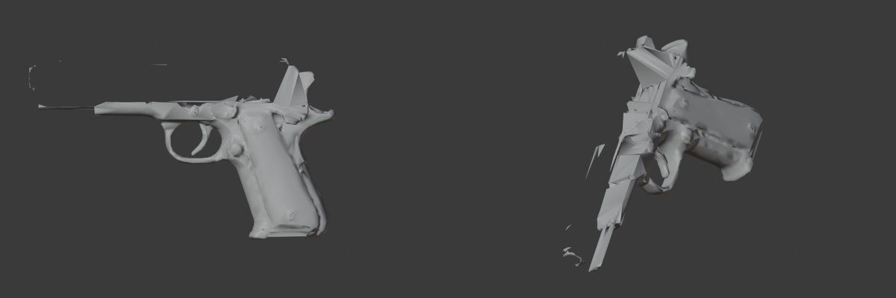
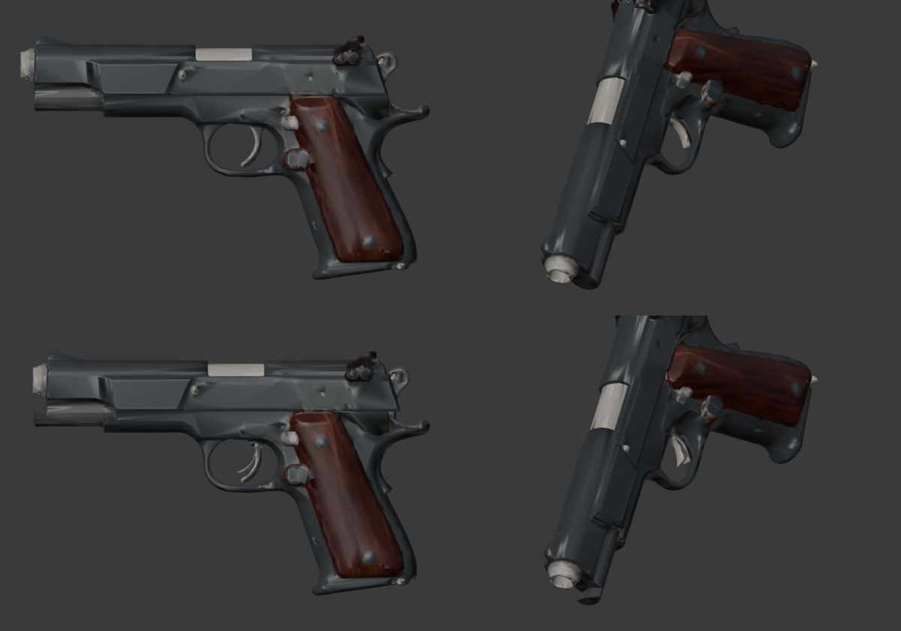
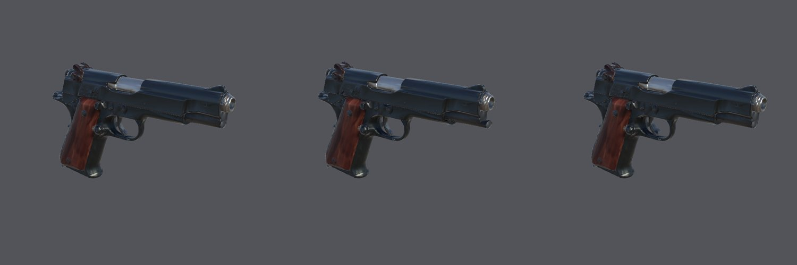

# Moving parts split from one generated weapon (2026-10-24)

Step W8 of M3 ([epic #107](https://github.com/gysahlgreene/SlopForge/issues/107)). A pistol's slide and trigger were
cut from its one generated mesh along the masks drawn on its concept, closed, parented to the body, and given
pivots by their kind. Nothing was modelled or repaired by hand.



**Brief:** the pistol of the [full-pipeline run](../weapon-pipeline-2026-10/README.md), with two moving parts declared:

```sh
--part "grip=grip: the walnut grip panels" --part "slide=slide:z:-0.03..0: the slide on top of the frame" \
--part "trigger=hinge:x:-20..0: the curved trigger inside the guard"
```

At approval each part was given a box on the concept. SAM 2.1 masked the slide (47% of the object), the grips
(25%) and the trigger (0.6%):


**How the cut works** (`blender/mesh_cleanup.py`, `separate_part`), in the final Blender pass after texturing, because
the single-view Pixal3D graph has no prepare step between shape and texture:
1. Vertices are welded by position: the textured GLB splits them along UV seams, and every seam would read as a cut.
2. A face belongs to the part when most of its corners project onto the mask from the concept's fitted view. Each face
   then takes the majority of itself and its neighbours, four times, which removes spikes along the cut.
3. Any island of either side that touches the cut joins the side around it.
4. The seam edges are split, each side's opening is closed with flat caps, and each cap takes one texel of the
   surface beside it: the texel nearest the median colour along the cut.
5. The part becomes a child of the body. A slide pivots at its bounding box centre; a hinge at the centre of its cut.
6. The FBX exports the body and its children, with each part's kind as a custom property. Inspection records
   `parts` (name, kind, faces, parent, pivot) and leaves them out of the component count.

**Two faults found on the way:**
- **Slivers.** The first run's bodies came out in 12–19 pieces: ragged masks left strips of body enclosed by slide
  faces, which survive the majority smoothing. Step 3 above fixed it; all later bodies were one piece.

  

- **Pale caps.** A cap took one boundary texel, which on this pistol was a pale outlier, so the cuts showed as white
  triangles. Step 4's median choice fixed it.

**Live runs** (commit of each in `private/weapons-pipeline-2026-10-24/M*/commit.txt`):

| Run | Seeds | Result |
| --- | --- | --- |
| M1 (first cut) | 3 | every seed cut both parts, then failed the component budget on slivers |
| M2 (islands fixed) | 2 | seed 1's trigger was too small to separate (`part_missing`, retried); seed 2 passed, body in one piece |
| M3 (caps fixed) | 2 | the same: one retry on a missing trigger, then passed; slide 14,834 faces, trigger 120 |



## In Unity

Publishing the M3 pistol (`approve-texture`) built its prefab, an animator with one state per part, and one clip per
part, then sampled each clip at rest and at its limit:

| Part | Declared | Measured | Pivot drift |
| --- | --- | --- | --- |
| slide | −0.03 m along z | −0.0300 m | 0 |
| trigger | −20° about x | −20.00° | 0 |

The weapon points along +Z from the root, and the root (the grip) lies inside its bounds.



The travel check caught a real fault on its first run: Unity imports the FBX root scaled by 100 under its 0.01 file
scale, so a slide clip written in the part's local space moved it 3 m. The travel now goes through the parent's
scale. An opt-in test (`tests/test_unity_weapon.py`) builds a slab with a slide and a hinged lever in Blender,
exports it as the final pass does, and checks the same numbers in Unity.

**Limits:**
- **Masks project straight through** the concept's view, so a part must be separate in that view. The frame under
  the slide is only kept because it shows below the slide line; a part hidden behind another cannot be cut.
- **Caps are flat.** Where the slide comes off, the frame's top is a flat slab and the slide is hollow, since the
  generator made one closed surface. At rest nothing shows; at full travel the frame's cap shows at the muzzle.
- **A small part can fail to separate.** The trigger is 0.6% of the concept, and one seed in two left too few faces
  under its mask. The pipeline retries the next seed (`part_missing`).
- **One concept, one weapon.** Three runs of the same pistol concept; no other weapon with moving parts yet.
- **Editor sampling only.** The clips are sampled in the editor for the checks and the strip; Play mode is not run.
