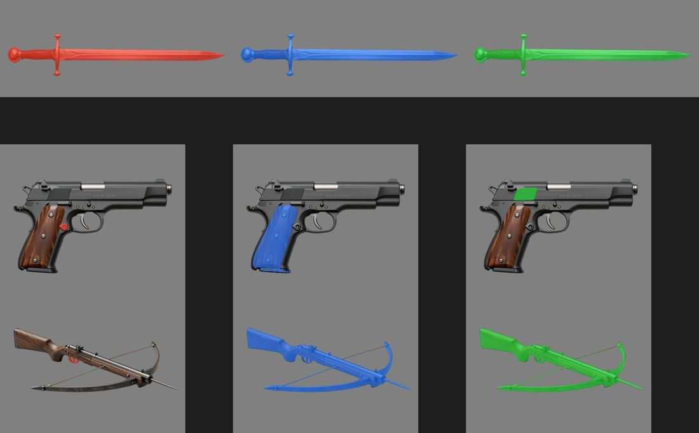
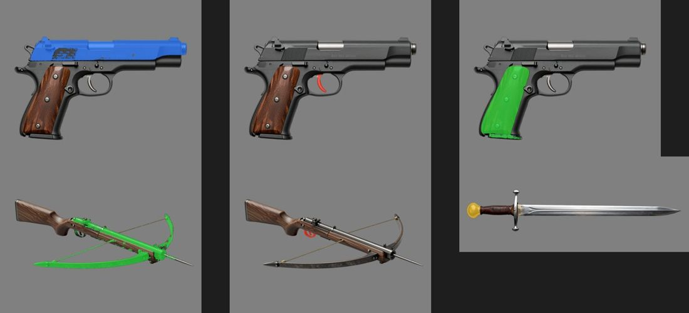

# Weapon part masks: detection against boxes (2026-10-24)

Step W4 of M3 ([epic #107](https://github.com/gysahlgreene/SlopForge/issues/107)). A weapon's moving parts will be split
from its one generated mesh along masks drawn on the approved concept, so each part's mask has to be right. The concepts
are a longsword (side profile, wide canvas), a pistol (side profile) and a crossbow (three-quarter from above). Each was
cut out as approval does it, and SAM 2.1 (Apache-2.0) cut every mask, on the H100.

**Text detection: unreliable.** These are [Florence-2 large](https://huggingface.co/florence-community/Florence-2-large)
(MIT) open-vocabulary detection results, one row per weapon:
- **Longsword:** "grip", "crossguard" and "blade" each came back as the whole sword.
- **Pistol:**
  - "slide" boxed the grip panel;
  - "grip panel" boxed a patch of the slide;
  - "trigger" found a spot beside the trigger.
- **Crossbow:** "bowstring" and "bow" each boxed the whole crossbow; only the trigger was right.

The two other Apache-2.0 detectors did no better:
- **Grounding DINO base** boxed the whole weapon for every part.
- **OWLv2 large** found the sword's blade and the pistol's grip panel, but missed the slide, the trigger and the bow.

**Single points: partly.** A point inside each part found the sword's grip, crossguard and blade, the pistol's grip
panel, and the crossbow's trigger and stock. It missed the pistol's trigger: the point fell in the gap inside the guard.
It returned the whole pistol for the slide, which shares the frame's black finish, and nothing for the bowstring.

**Boxes: clean.** A box per part, drawn on the concept, gave each part on its own:
- the pistol's slide, separate from the frame despite the shared finish;
- the pistol's curved trigger and its grip panel;
- the crossbow's trigger;
- the sword's pommel.

The one failure was the crossbow's bow: a long diagonal limb whose box also covered the barrel. It is not a moving part.

**Decision:**
- Parts are located with `approve --part-box name=x0,y0,x1,y1`, given on the approved concept.
- Detection stays as the fallback for parts without a box. On a lantern, it found the globe, the wire guard and the
  ring.
- `masks.json` records each part's `box_source`.
- Thin parts like bowstrings are built procedurally, not masked.

**Not checked:** the masks have not yet been used to split a mesh (step W8).
