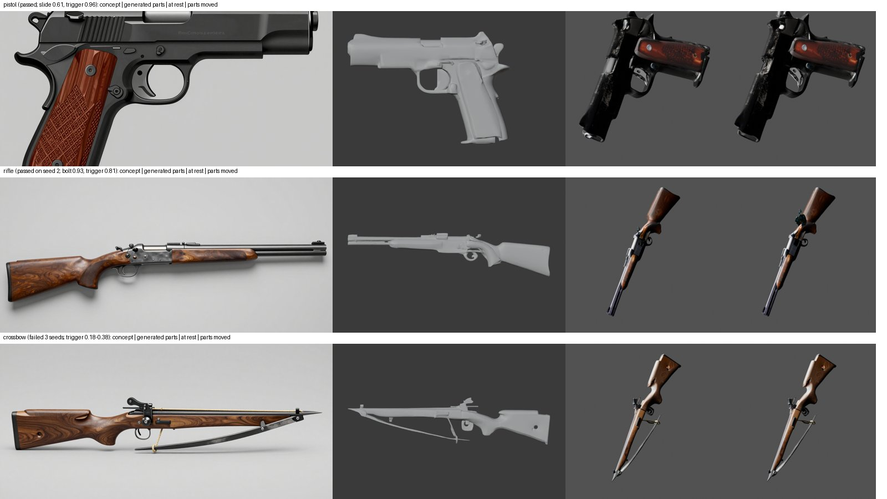
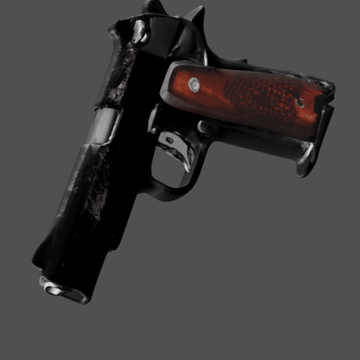
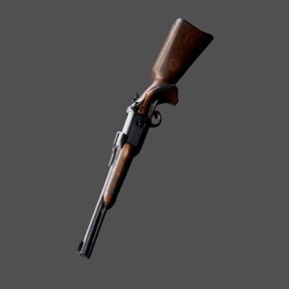
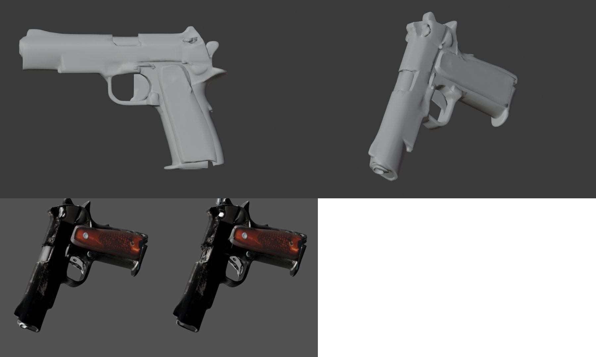
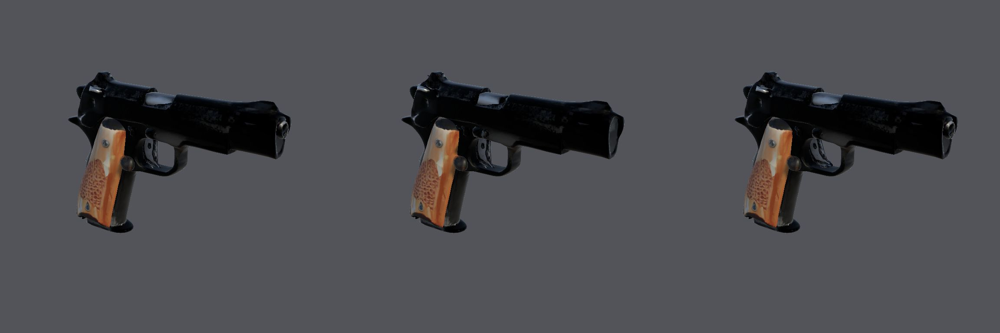
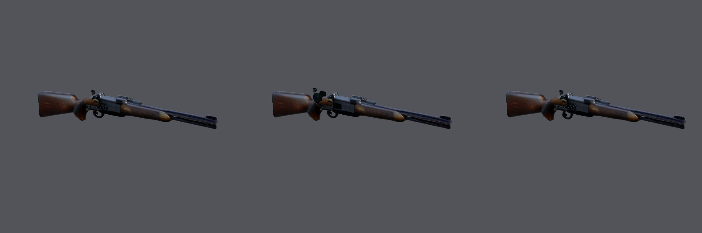

# Weapons with moving parts generated as parts (2026-10-25)

Step W8b of M3 ([epic #107](https://github.com/gysahlgreene/SlopForge/issues/107)): the moving parts of a weapon come
from part-level generation (OmniPart) instead of a cut through one mesh, after the owner rejected the cut
three times. Three briefs went through `approve` on the `h100` profile with the route described in
[the weapons guide](../../WEAPONS.md#moving-parts-from-part-level-generation); the private run folders are
`private/weapons-parts-2026-10-25/{P1,R1,X1}` (commit of each in `commit.txt`).

**Output rights (recorded 2026-10-27): restricted.** OmniPart's part synthesis, which made these parts, runs NVIDIA FlexiCubes and nvdiffrast, licensed for non-commercial use only. The assets are kept as M3 evidence, not for a sold game, and will be regenerated on a cleared parts route ([#134](https://github.com/gysahlgreene/SlopForge/issues/134)).

| Weapon | Declared parts | Seeds | Result |
| --- | --- | --- | --- |
| Pistol (bold concept 4 of the 2026-10-24 runs) | grip, slide, trigger | 1 | passed: slide covers 0.61 of its mask, trigger 0.96; body one piece; 25,644 faces |
| Bolt-action rifle (concept 2) | grip, bolt (slide), trigger | 2 | seed 1 rejected (`part_missing`: trigger 0.29); seed 2 passed: bolt 0.93, trigger 0.81 |
| Crossbow (concept 6) | grip, trigger lever | 3 | rejected three times (`part_missing`: trigger 0.18, 0.38, 0.38): the long thin lever comes out as a short blob |

 

**What the live runs found and fixed** (each with a regression test):
- the part masks' names nested in the request were not placed in the remote work directory;
- OmniPart's merged GLB has a `world` root node;
- the final pass's join left the parts' meshes as orphans, so the children came out as `slide.001`;
- static parts (the grip) stayed in the body as loose pieces and counted as components; every part is a child now;
- the colour atlas was black: glTF's default metallic factor is 1 and a diffuse bake of a metal is black (baked as
  emission now);
- an all-black map made the colour metrics NaN, the failure record unserialisable, and a retryable failure final;
- the rear-part rule (body above the slide's line as its own part) spanned the whole slide band through the sights
  on top of the slide, and OmniPart grew a second shell over the slide: dropped; what rests on a slide joins it;
- OmniPart lays a long weapon along grid y, not x: the frame picks the axis by silhouette overlap;
- the coverage gate measured OmniPart's sparse-structure voxels, which a thin lever barely registers in; it now
  projects the generated mesh through the concept's fitted view.

**Pistol run, closer:**

## In Unity

Both passing weapons were published with `approve-texture`, which built the prefab, one clip per part and the W9
motion checks (unchanged from the cut route):

| Weapon | Part | Declared | Measured | Pivot drift |
| --- | --- | --- | --- | --- |
| pistol | slide | −0.03 m along z | −0.0300 m | 0 |
| pistol | trigger | −20° about x | −20.00° | 0 |
| rifle | bolt | −0.08 m along z | −0.0800 m | 0 |
| rifle | trigger | −20° about x | −20.00° | 0 |

Both point along +Z from the root with the root inside the grip.

**Limits seen:**
- The slide's coverage sat at the limit (0.61) on the passing seed, and one earlier seed gave a slide in 7 pieces:
  seed variance in how OmniPart resolves the overlap of the body's box with the slide's.
- A long thin part (the crossbow's lever) is not reproduced; the gate rejects every seed. Hinges that are blobs
  (a trigger inside a guard) pass.
- The parts are reduced to the 30,000 budget (90% headroom) from OmniPart's ~100k faces per part, and the textures
  come from a Gaussian bake at TRELLIS v1 quality: softer and darker than the concept. Both are parameters now, not
  method limits (the face budget is an owner decision).
- Static-weapon quality is untouched (TRELLIS.2 route).
