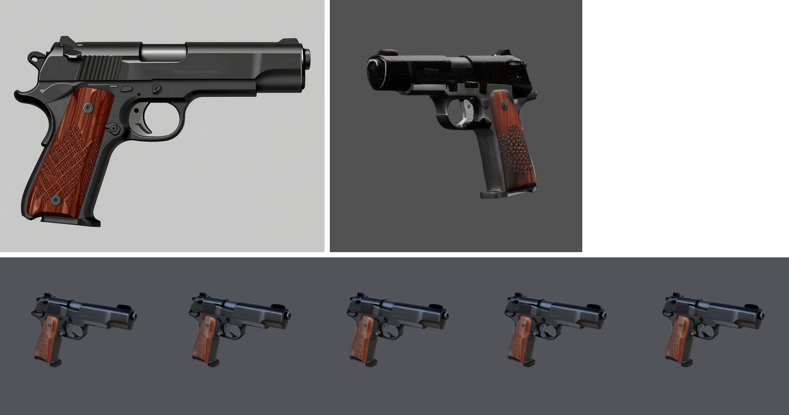
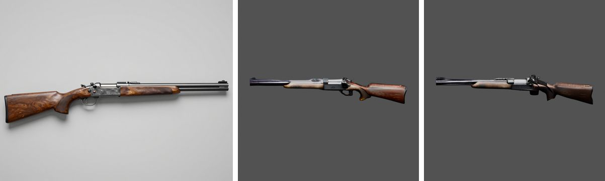
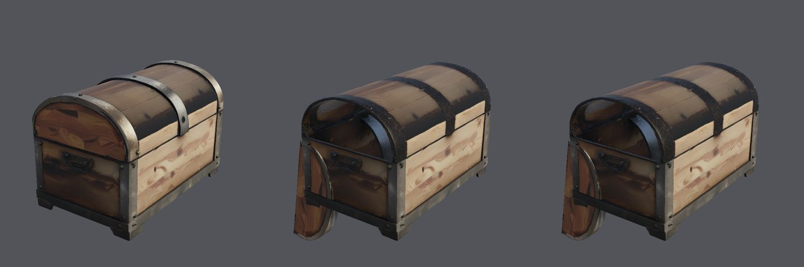

# Multi-part weapons and props: quality and in-game function (2026-10-25)

M3 ([epic #107](https://github.com/gysahlgreene/SlopForge/issues/107)) after the first part-level runs
([weapon-parts-2026-10](../weapon-parts-2026-10/README.md)): the owner asked for multi-part weapons and props that
look right close up and work in a game, defined as pickup and hold sockets, colliders and physics, playable
animations verified in Play mode, and first-person close-up quality; a chest with a lid as the first prop. This
page is the live evidence for the branch that followed (`feat/weapon-parts-quality`): the private run folders are
`private/weapons-parts-2026-10-25/{P2,P3,R2,C2,C3,C4}` (commit of each in `commit.txt`), all on the `h100` profile.

## What changed on the route

- **Quality:** the concept-side view joins the parts before it renders, so the metal-lightness match and the
  concept colour transfer run on this route (every parts candidate failed the one-mesh check before); a tangent
  normal map is baked per part from the pre-reduction meshes and sharp edges over 30° are marked; the parts'
  textures and the atlas are baked at the type's `texture_size` (4096 for weapons) and Unity imports them at it;
  metallic by part text, the finish word's roughness; colours move to the concept's the whole way on this route,
  metal keeps the concept's chroma.
- **Function:** every weapon, and every type with `unity_prefab: true` (props), publishes a prefab with a convex
  `MeshCollider` per mesh, a `Rigidbody` of the type's mass, the type's layer, sockets (`Socket_Grip`,
  `Socket_Muzzle`, `Socket_<part>`), an Animator with `Rest`, a trigger and a hold bool per part, the W9 clip
  checks, an interpenetration check through each part's range, lightmap UVs on static assets, and a Play-mode run
  (each trigger pulses its part and returns; the Rigidbody settles on a floor).
- **Props with parts:** a prop with a declared hinge or slide is framed from its concept (front to the camera, top
  up) and goes through the same route; `@face[-face]` anchors a hinge on an edge of its own bounds.
- **Guards found by these runs:** a part narrower than 3 cells of OmniPart's 64-cell structure stops before the
  run; thin parts keep a cell of OmniPart's 37×37 mask grid; a penetration failure names the sign that clears.

## Pistol: published and played

The P2 run (branch at PR1–5) passed its gates with the colour transfer and the metal-lightness match measured for
the first time on this route (metal gain 2.9×, darkened share 0.053, slide 0.90 of its mask, trigger 0.99) and
published through Unity: slide −0.0300 m, trigger 20.00°, penetration 0.002 and 0.001 over rest, no pivot drift.
Its trigger had been declared `-20..0`, which in Unity's sense swings a hanging trigger forward; P3 is the same
brief with `0..20` (a pull), run on the finished branch — its results are in the table below.

## Rifle: rejected by the coverage gate, and why

The R2 run first tripped the new box-order check: OmniPart reads the part mask on a 37×37 grid over a 1.2× square
crop of the object and pairs part k with mask id k, so the rifle's bolt handle (3.6×1.7 cells of its 64-cell
structure) and trigger (2.8×2.2) had vanished from the mask, and in the earlier R1 run OmniPart had generated both
without their image features. With the mask fixed, three seeds still failed the gate (bolt 0.48 / 0.87 / 0.98 of
its mask with 0.49–0.84 of the part outside it; trigger 0.62 / 0.15 / 0.44): parts that small have no voxels of
their own. The route now stops before the run for any part narrower than 3 cells (about 5% of the object's longer
side) and says so; the brief, not a seed, has to change (a bigger bolt handle, or the bolt with its carrier).

## Chest: the first prop with a part

| Run | Declaration | Mesh | Colour gates | Unity |
| --- | --- | --- | --- | --- |
| C2 | `lid=hinge:x:0..110@back-top` | lid 0.86 of its mask, one piece, pivot on the lid's apex edge | passed on seed 3 (chroma ratio 0.77, darkened 0.16) | rejected: the lid swept through the body (0.27 of its vertices inside): `back-top` of a domed lid is its apex, and a positive turn sinks the front |
| C3 | `lid=hinge:x:0..100@back-bottom` | lid 0.87, pivot on the seam | passed on seed 1 (0.72, 0.14) | rejected: 0.17 inside; the error now names `-100` as the sign that clears the body (0.000) |
| C4 | `lid=hinge:x:-100..0@back-bottom` | lid 0.77 / 0.87 / 0.91 | seeds 1–3 failed (chroma ratio 0.39 / 0.07 / 0.55; darkened 0.65 on seed 2) | pending the retry |

OmniPart's chest textures vary from seed to seed: the oak comes out pale in front and dark on the sides and back,
and one seed in three is grey all over. The colour transfer (median a\*b\* shift capped at 25, lightness up to 3×)
lifts the lightness but not the chroma of a desaturated bake, so the chest's colour gates passed 2 of 9 seeds
across these runs while the lid's geometry passed every one. That is the open quality item on props with parts.

## What a game gets

For each published asset `validation.measured.weapon_motion` records the prefab, the colliders, the mass, the
sockets with their positions, the Animator parameters, the default state and each motion's angle or travel,
pivot drift and penetration; `validation.measured.play_mode` the Play-mode results (`<name>_playmode.xml` beside
the asset). The Play-mode run needs the project's editor installed by the Hub (or `UNITY_EDITOR_PATH`), see
[Unity](../../UNITY.md).

## Limits and what is not verified

- OmniPart at 64³ cannot make a moving part under about 3 cells across; the preflight stops such briefs.
- Seed-to-seed consistency: the chest's colour, the pistol's trigger coverage (0.64–0.99 across seeds) and its
  overflow (0.74 of the trigger outside its mask on P2) all vary; nothing here is a repeatability claim.
- Play mode checks that each part moves and returns and that the body settles on a floor; it does not check a
  player picking the asset up, nor the look under a game's own lighting.
- No LODs; one asset per brief; the crossbow was not rerun.
