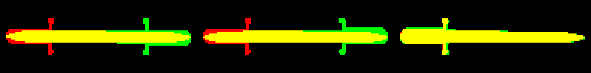
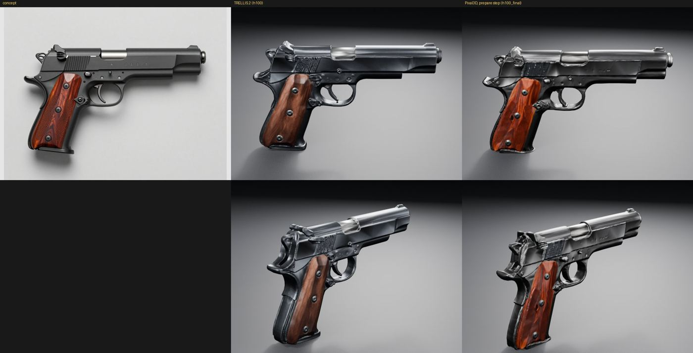
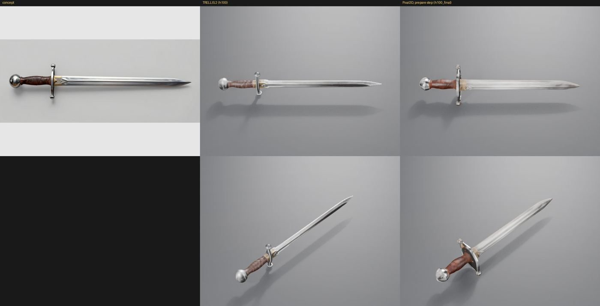
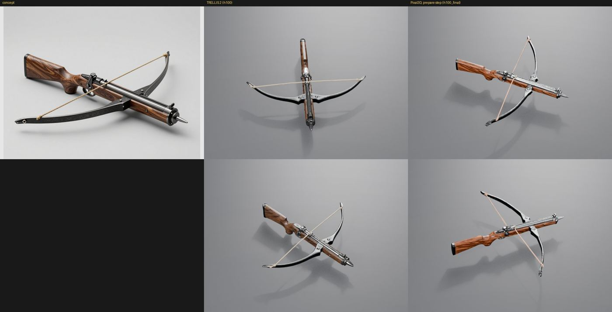
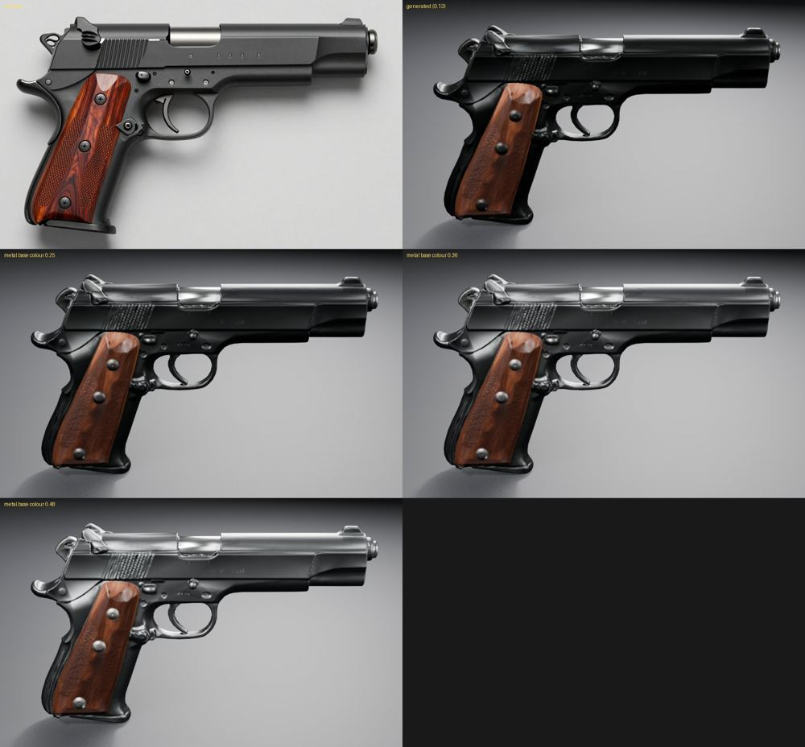
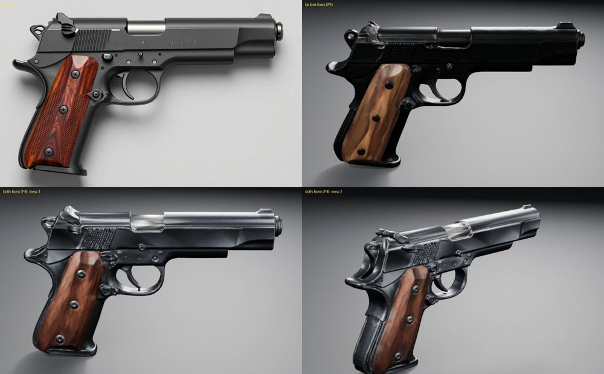
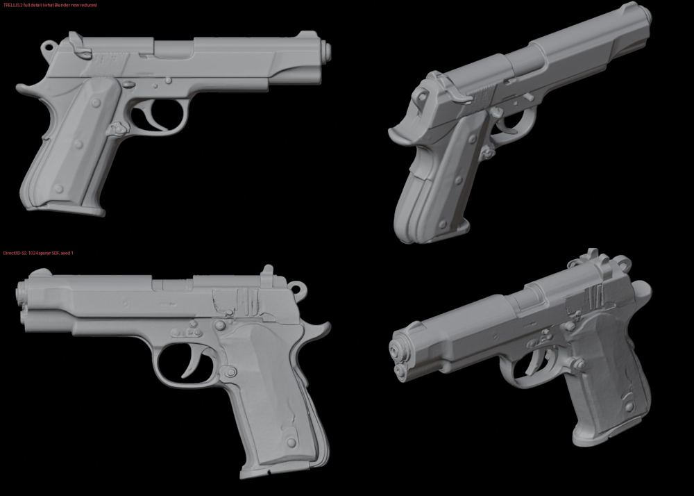

# Weapons through the whole pipeline (2026-10-24)

**Why this run:** the owner judged weapon quality far below props. This page records the full pipeline run on three
weapons, rendered and lit exactly as the props are:
- a pistol with walnut grips (landscape canvas);
- a longsword (wide canvas);
- a crossbow drawn from above at three-quarters (landscape).

**Method:**
- Each brief was generated in a fresh project from the props protocol's Unity shell, at the `final` tier.
- One concept was approved, with a grip box, on the `h100` profile (TRELLIS.2).
- The same concept was re-approved in a clone of the project on `h100_final`, overriding its model graph with a
  single-view Pixal3D graph that has Blender's prepare step.
- Each result was rendered with the props' lit turntable.

**Fixes found on the way:**
- [Mesh reduction](../mesh-reduction-2026-10/README.md): the flat steel was wavy because of the graph's decimation.
- **Metal lightness.** Generated blued steel was near-black (0.13 sRGB) where the concept shows dark grey. Every
  pistol seed failed the dark-texture check on it. The material stage now brightens metal that is darker than the
  concept shows it (see [Materials](../../MATERIALS.md)).
- **Orientation (weapon orientation, [Weapons](../../WEAPONS.md)):**
  - **The length is chosen by the grip.** A crossbow's bow spread almost as far as its stock was long.
  - **No 90° turn for weapons.** The target-size rule for kit walls turned an oriented crossbow 90°.
  - **An unreadable view is retried.** A reconstruction of two crossed swords stopped approval as a Blender crash.
    It is now the retryable `weapon_orientation`.
- **Full-turn view search.** TRELLIS.2 rebuilt three of four longsword seeds turned 180°. The concept's view then
  fits only from behind, which the front-half search could not find. Every seed failed concept fit at 0.66 to 0.71,
  against 0.94 to 0.95 once the full turn is searched. In the overlay below, red is the concept and green is a turned
  mesh; the third pair is fitted correctly.

## Results

| Weapon | Graph | Commit | Mesh attempts | Concept fit | Hue difference | Darkened share | Metal gain |
| --- | --- | --- | --- | --- | --- | --- | --- |
| Pistol | TRELLIS.2 | `70d82a4` | 1 | 0.968 | 2.79 | 0.013 | 3.76 |
| Pistol | Pixal3D, prepare step | `70d82a4` | 1 | 0.990 | 0.89 | 0.011 | 1.40 |
| Longsword | TRELLIS.2 | `58cb08d` | 1 after the fixes; 4 before | 0.945 | 0.31 | 0.034 | 1.05 |
| Longsword | Pixal3D, prepare step | `70d82a4` | 2 | 0.940 | 0.60 | 0.019 | 1.00 |
| Crossbow | TRELLIS.2 | `70d82a4` | 1 | 0.839 | 0.69 | 0.068 | 1.52 |
| Crossbow | Pixal3D, prepare step | `c57107c` | 1 after the fixes; 1 before | 0.901 | 3.12 | 0.075 | 1.00 |

Each sheet shows the concept, then TRELLIS.2 and the Pixal3D prepare-step graph from two turntable angles.

**What the renders show:**
- **Longsword:** TRELLIS.2 matches the concept closely: wheel pommel, wrapped leather grip, crossguard and fuller.
  Pixal3D added a dark plate behind the guard.
- **Crossbow:** both kept the stock, the bow and the string.
  - TRELLIS.2 has the concept's dark steel.
  - Pixal3D's bow came out silver, though its wood is nearer the concept's orange walnut.
- **Pistol:**
  - TRELLIS.2 has cleaner forms: flat slide planes and rear serrations.
  - Pixal3D's grips are nearer the concept's rosewood and keep some checkering, but its slide and rear are dented
    and lumpy.

**Decision:** weapons use the TRELLIS.2 graph with Blender's reduction on every H100 profile (`weapon_model`).
Pixal3D's prepare-step graph does not ship. This replaces the [earlier comparison](../weapon-graph-2026-10/README.md),
which judged raw renders before the mesh-reduction and metal fixes.

## Metal lightness

The pistol's metal brightened to several base-colour lightnesses, against the concept:

- **0.48:** reads as chrome.
- **Concept's lightness:** the step matches the concept's own lightness; it never brightens beyond that.
- **Dark iron:** iron drawn dark stays dark.

## Not adopted: Direct3D-S2

Direct3D-S2 (MIT code and weights, a 1024³ sparse SDF) ran on the H100 in its own environment:
- seed 1;
- 2.4 million faces;
- 92 seconds;
- 19.8 GiB.

Its pistol has a blocky slide but a blotchy, pitted grip and rear and a doubled muzzle bore. TRELLIS.2's full-detail
shape is cleaner. Using it would also need TRELLIS.2 to texture a foreign mesh.

## Limits

- **Seeds and commits:** one approved seed per weapon and graph. The runs span three commits, given per row.
- **Pistol:**
  - the grip checkering is lost on TRELLIS.2;
  - its wood drifts from rosewood towards brown, which the whole-object colour checks do not catch;
  - small mechanisms (hammer, safety, slide stop) stay soft;
  - the finish is glossy where the concept is satin.
- **Not checked:** Unity, which renders these through URP, and moving parts.
